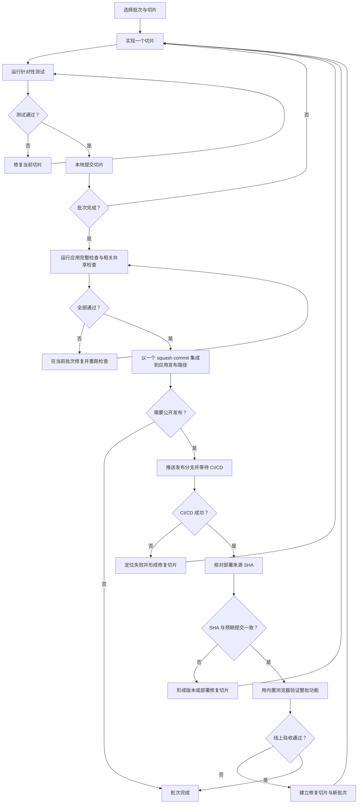

# 通用协作规则

## 1. 指令层级与子项目契约

- 本文件定义整个仓库通用的协作规则；各子项目在自己的 `AGENTS.md` 中补充本地架构、依赖、测试和部署约束。
- 根目录及每个子项目的 `CLAUDE.md` 只导入同目录的 `AGENTS.md`，不复制规则正文。
- 新应用放在 `apps/<slug>/`，目录名使用小写字母、数字和连字符；每个应用使用 pnpm 并独立维护依赖清单和 `pnpm-lock.yaml`，不加入跨应用的根 workspace。
- CI 的 pnpm 版本从仓库级 `package.json` 配置读取（可使用 `packageManager` 或支持版本范围的 `devEngines.packageManager`），workflow 不重复声明具体版本；子应用默认不重复声明工具版本，确需独立工具链时再单独配置并维护匹配的 lockfile。
- 可从导航站访问的前端应用必须登记在 `apps/catalog.json`。`slug` 同时决定 `/<slug>/` URL 和 `_site/<slug>/` 发布目录。
- 每个登记的前端应用提供自己的 `package.json`、`pnpm-lock.yaml`、`scripts/install.sh`、`build` 和 `test:ci` 入口；构建产物写入应用目录内的 `dist/`。
- 应用之间默认不直接导入代码。确需复用时，建立职责清晰的共享包并明确其版本和测试边界。
- Python 项目使用项目自己的 `.venv/` 和依赖清单；不要把项目依赖安装到全局解释器。

## 2. 共享站点与 Cloudflare 资源

- 导航页与已登记的静态前端应用由同一个共享站点构建和发布；根 README 是完整公开域名的唯一文档维护位置。
- `apps/catalog.json` 是导航卡片和静态应用发布路径的单一数据源；不要在导航 HTML 或构建脚本中重复维护应用列表。
- 所有公开页面共用 `@wishflow/site-shell` 提供的页眉、项目侧栏、页脚和语言切换；应用专属页面导航通过 `data-local-nav` 接入公共侧栏，功能控件仍放在各自页面内容区。
- 所有公开页面的语言状态、持久化和切换逻辑必须使用 `@wishflow/site-shell`；页面只维护自己的中英文文案，通过 `registerMessages` 或 `data-locale` 接入，不另建语言存储键或切换按钮。
- 新增 Worker、容器、数据库或其他 Cloudflare 资源前，先评估免费额度、成本、密钥边界和维护责任；复用现有 Worker 也必须符合安全边界。
- Worker 只在对应源码或部署配置变化时发布。静态站点变更不应触发 Worker 发布。
- 正常发布使用裸 `git push origin master` 触发 `.github/workflows/pages.yml`；工作流会按变更范围和测试结果决定是否部署静态站或 Worker。纯 Git 版本控制操作（如 `status`、`diff`、`add`、`commit`、`pull`、`push`）必须使用 `git` 命令，不通过 GitHub/Cloudflare CLI 或网页操作。
- GitHub 资源与状态的读写（如仓库、PR、Issue、Actions 和发布管理）原则上使用 GitHub CLI（`gh`）；Cloudflare 资源、配置与部署状态的读写原则上使用 Cloudflare CLI（`wrangler`）或官方命令行 API，不使用 GitHub 网站或 Cloudflare Dashboard 代替 CLI。公开网站本身的功能预览不属于平台管理操作，可按网页预览规则使用 Codex 内置浏览器。
- `gh` 未安装或未登录不得阻塞已有 Git 凭证可完成的纯 Git 操作。若 GitHub/Cloudflare 管理操作无法通过可用 CLI 完成，先说明具体限制；未经用户明确要求，不切换到网页界面操作。

## 3. Roadmap 演进规则

- 通用规则只写演进原则，不写具体路线、阶段清单或功能排期。
- Roadmap 应描述目标、边界、拆分方式、依赖、风险、验收标准和取舍依据。
- 每个 roadmap 步骤必须能独立实现、独立测试、独立部署或回滚。
- 不把多类重构、新能力、新依赖和架构迁移混在一次变更里。
- 新增大改动前，必须先确认目标、范围、兼容性、风险和验证方式。
- 当前阶段优先保证已有公网编辑器稳定可用。

## 4. 文档撰写规则

- 如无特殊要求，文档默认使用中文。
- 文档应内容具体、结构清晰、逻辑准确，避免空泛描述。
- 复杂逻辑、流程、结构或取舍，应优先使用表格、列表、mermaid 图或 ASCII 图辅助说明。
- 文档只记录对后续执行有用的背景、约束、决策和操作步骤。
- 不在通用规则文档里复制具体 roadmap 路线；具体路线保留在专门文档中。
- 更新文档时，应尽量保持原有语气、层级和术语一致。

## 5. 代码实现规则

- 具体实现前，先对齐现有代码风格、架构边界和用户约束。
- 默认采用最小改动、最简单方案、最贴近现有架构的实现。
- 优先复用已有组件、脚本、测试、工具函数和项目内已验证模式。
- 复杂查询、接口重构、新实现范式或新增依赖，必须先确认后再实施。
- 不主动引入与当前目标无关的重构、格式化或目录调整。
- 不主动启用额外工作流或外部工具；只有用户明确要求时才使用。
- 在 macOS 的 Codex 桌面应用中预览或检查网页时，使用 Codex 内置浏览器；不要打开系统外部浏览器，也不要改用外部 Chrome DevTools。CI 所需的无头浏览器自动化检查可以继续运行。
- 修改已有文件时，应避免覆盖或回退他人未要求处理的改动。

## 6. 验证与交付规则

- 默认从 `master` 创建独立功能分支，不直接在 `master` 上开发；子项目 `AGENTS.md` 若指定长期集成分支或不同发布路径，只在该子项目范围内覆盖此分支约定，其他仓库规则继续生效。
- 改动后运行与范围匹配的验证；文档变更至少运行 `git diff --check`，未运行其他适用检查时说明原因。
- 实现按批次交付：每个切片运行针对性测试并本地提交；整个批次完成后再运行应用完整本地检查和相关共享检查。失败在当前批次内修复，并重新运行失败项及最终完整检查。不得在每个切片提交后重复运行整套检查或单独发布。
- 批次检查全部通过后，按应用规定将该批次以一个 squash commit 集成到发布路径。批次是集成和发布单位，单个切片提交不是发布单位。
- 提交前检查 `git status` 和 `git diff`，确保只包含本次相关文件。验证通过后先提交，commit 信息应简洁明确。
- 将已验证的功能分支合并到 `master` 后，再执行 `git push origin master`；纯 Git 操作使用 `git` 命令。
- 涉及公开应用或部署产物的改动，push 后等待现有 CI/CD workflow 成功；核对部署产物暴露的来源 SHA 与本次预期发布提交一致，再用 Codex 内置浏览器验证整批功能，并在交付说明中记录结果。SHA 不一致或无法核实、工作流未完成、线上检查失败时，发布都保持未完成状态。

## Agent skills

### Issue tracker

本仓库使用 GitHub Issues 跟踪任务，见 `docs/agents/issue-tracker.md`。

### Triage labels

Triage 使用标准标签 `needs-triage`、`needs-info`、`ready-for-agent`、`ready-for-human` 和 `wontfix`，见 `docs/agents/triage-labels.md`。

### Domain docs

本仓库采用多上下文领域文档布局，见 `docs/agents/domain.md`。
