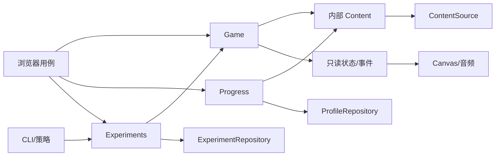

# 架构

本文定义目标能力的边界与所有权；实现进度和任务顺序只见[实施计划](implementation-plan.md)。玩法规则见[产品规格](spec.md)，存储和模拟细节分别见对应契约。

## 公共 Module

| Module | 对调用者的能力 | Module 内部负责 |
| --- | --- | --- |
| `Game` | 准备/开启战局、提交意图、步进、观察、暂停、关闭、重放 | 内容校验、规则状态、命令顺序、时间/随机消费、终局 |
| `Progress` | 读取档案投影、查询可用内容、应用正式结算、保存设置和状态 | 解锁、高分、迁移、并发修订、结算去重与恢复 |
| `Experiments` | 保存方案版本、冻结实验、运行/比较场景及批次、读取结果 | 策略、runner、预算、指标、任务状态和产物提交 |

三者是公共能力边界，不要求独立进程或包。行为测试与玩家、学习面板、CLI 等消费者共享公共 Interface；Repository、ContentSource、runner 和执行器均为所属 Module 的内部 Seam。删去某 Module 会把多处初始化、排序、保存或运行协调复制到调用者。

依赖单向：Game 不读 Progress 或 Experiments；实验不读玩家档案；规则内核不访问 DOM、存储、网络或全局时钟。Progress 通过进度投影为 Game 提供合法开局条件；Render 只消费 Game 的只读视图，不决定命中、死亡或生成。

## Interface 与运行

- `Game.prepare` 校验完整内容与数值方案，返回不可变、可序列化的 `PreparedSetup`；不建会话、不取随机样本或时钟。`Game.open` 可用准备结果或普通玩家选项开局，成功即返回会话与不可变 `StartRecord`，不启动循环或推进首帧。
- 普通消费者提交业务意图；Game 内 `SessionController` 产生顺序与目标帧。只读观察带帧标识。重放数据只能走受控导入路径并核验格式、版本、顺序与完整性。
- `step` 同步推进一帧，接收明确的时间、命令与环境输入，返回事件、状态和结果。一个会话只有一个驱动所有者；暂停不推进，重开生成新身份并作废旧命令。
- 正式终局由 Progress 应用且去重；实验、调试和 replay 模式不能写正式档案。开局、持久化和导出可异步，但规则步进不等待 I/O。
- `Progress` 对调用者隐藏 revision、事务与重试；返回已保存、待保存、冲突或失败及恢复操作。只接受正式 Game 终局。
- `Experiments` 冻结场景、规则/内容版本、数值、策略、seed、时间、预算和样本输入，再通过 Game 公共 Interface 运行。调用者不直接使用私有 `ScenarioRunner`。

外部 Interface 只暴露必要知识：输入、结果、不变量、时序、错误和性能边界。公共 DTO 可序列化；活动会话句柄仅进程内使用，远程适配传逻辑 ID，不序列化函数或活实例。

## 内部所有权

| 数据/责任 | 所有者 |
| --- | --- |
| 地图、单位、敌人、波次、素材清单、版本解析与校验 | 内部 Content |
| 实体、规则、命令、帧事件、`PreparedSetup`、`StartRecord`、replay | Game |
| 正式进度、难度解锁、高分、设置和保存状态 | Progress |
| 数值方案、场景、策略、运行/比较报告、预算和产物 | Experiments |
| 相机、指针、图片解码、Canvas 与音频节点 | 浏览器 Adapter / Render |
| 时钟、随机种子和影响规则的环境输入 | Game 会话；由装配/受控驱动显式提供 |

建议按能力归属组织：`src/game`、`progress`、`experiments`、`content`、`ui`、`render`、`adapters`、`bootstrap`。仅随真实切片建文件，不预建空框架。UI 与脚本不导入私有规则、仓库或 runner；bootstrap 只装配，不编排业务。内部 Seam 只供所属 Module 测试及装配使用，不为测试而公开私有类型。

## 内容与表现

游戏自有内容包括 campaign、共享定义、关卡数据和表现元数据；静态发布资产由 `public/assets` 管理。引用使用稳定逻辑 ID；文件名、density、平台变体和 URL 由 Content/Render Adapter 解析。一次战局固定不可变内容版本；缺少地图、波次、必需图像或数值时拒绝创建可操作的半成品战局。音频可按产品规则静音降级。

Game 每步维护规则和绘制所需只读状态；Renderer 依据对象状态、动画元数据与图层绘制。动画描述绑定素材、裁切、方向/镜像、帧驱动、阈值、锚点和结束条件。渲染省略不能跳过会改变共享随机状态的表现事件。图片/音频句柄由表现侧按资源生命周期创建与释放，不能写入游戏定义。

菜单、区域/关卡选择、说明、难度、设置和帮助用 DOM/CSS；战场、动画和 HUD 用 Canvas 2D。逻辑画布为 1024×576，世界单位、逻辑格、素材像素、CSS 像素和设备像素分开；输入逆变换与投影由同一视口实现。Pointer Events 统一鼠标与触屏，并处理捕获、取消和多指手势。

主菜单、区域/关卡导航、关卡说明/难度选择、选项/帮助、波次对白、招募/升级确认、结算及主要游戏操作栏作为 DOM/CSS 叠层，受16:9 `.game-frame` 裁切并与 Canvas 共用游戏窗口；档案恢复、实验、回放和只读调试仍属于页面级工具区。正式战斗只能由明确的关卡选择动作开启。窄屏操作栏须给画布手势保留可用触点区域。

正式开局顺序：Progress 读取可用进度 → Game 准备新会话 → Render 准备必需资源 → 资源就绪后替换旧画面并连接唯一驱动。资源加载迟到时不能覆盖较新的玩家选择；切关先停输入和推进，释放旧表现资源并关闭会话。实验结果不经过 Progress。

## 后端与变更边界

首版浏览器实时游戏在本地运行；IndexedDB 用于档案和所需实验记录，内容随静态应用发布。Node 本地批次可用内存或文件产物。远程档案、内容分发、批量任务分别演进，不是前端战役的前置条件。仅在有真实消费者时增加 Adapter、worker、网络端或依赖；不预建通用 ECS、插件总线、全局 RunExecutor 或后台服务。

行为测试通过 Game/Progress/Experiments 公共 Interface；存储替换测试所属内部契约；真实浏览器检查输入与表现。修改一个职责时保持其他 Module 的可观察行为不变；接口新增前先核实真实消费者、失败语义和时序。
