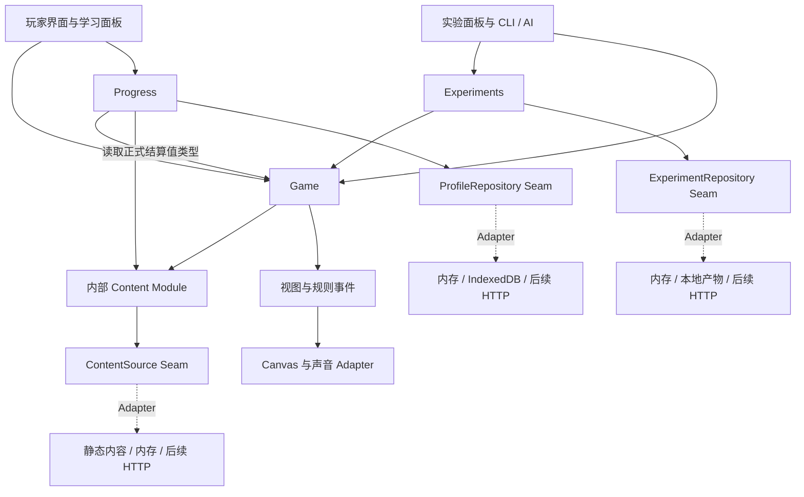
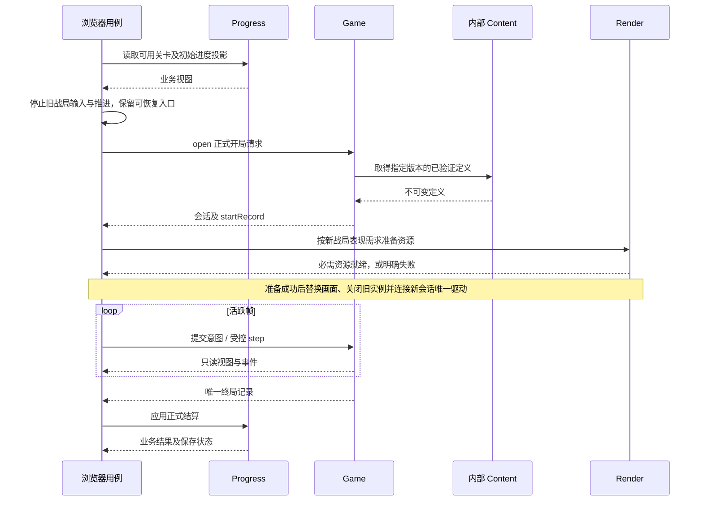

# 游戏架构设计

## 1. 决策与阅读范围

用户已确认采用 **Game、Progress、Experiments 三个公共深 Module**，以它们的 Interface 作为主要行为测试 Seam。本文是该决策的统一架构定义，取代按全局 `core / application / ports / simulation` 划分公共能力的方案。架构定义目标能力与维护归属，不以此宣称全部能力已经实现；当前进度、内容缺口和实施顺序统一见[实施计划](implementation-plan.md)。

产品目标与范围见[产品规格](spec.md)，领域用语见[领域词汇](GLOSSARY.md)。本文负责能力封装、依赖和状态归属；时间与回放细节见[模拟契约](simulation-and-automation.md)，持久化细节见[存储契约](storage-contracts.md)。

采用 Matt 的设计用语：**Module** 是 Interface 与 Implementation 的组合；**Interface** 包括调用者必须理解的输入、结果、不变量、顺序、错误和性能；**Seam** 是替换行为的位置；**Adapter** 是满足该 Interface 的具体实现。Depth 体现在小 Interface 能完成多少行为，Leverage 体现为调用者少做多少协调，Locality 体现为修改集中在何处。

## 2. 三个公共 Module

| Module | 对调用者提供的能力 | 隐藏的 Implementation | 主要消费者与行为测试 |
| --- | --- | --- | --- |
| `Game` | 开局、提交游戏意图、受控推进、观察、暂停与重开、回放 | 内容准备、规则状态、命令排序、数值与随机语义、战局生命周期 | 玩家输入、学习面板、脚本、Experiments；给定输入验证可观察战局结果 |
| `Progress` | 读取正式档案、查询可用关卡与单位、接受正式结算、更新设置、呈现保存状态与恢复操作 | 默认档案、进度规则、格式迁移、并发修订、结算去重、冲突合并与重试 | 战役菜单、设置、结算界面；给定用户操作验证持久化后的业务结果 |
| `Experiments` | 保存数值方案版本、冻结实验、运行场景或批次、查询报告、比较与导出 | 策略驱动、场景循环、指标、运行预算、任务尝试、产物提交与执行方式 | 实验面板、CLI、未来 MCP/后端入口；给定实验输入验证结果及分类 |

三个 Module 表达能力，不要求三个进程、三个包或三个框架实例。调用者只学习本次用例需要的 Interface；各 Module 按切片增加有真实消费者的操作，不一次实现整张能力表。

### 2.1 删除测试

| 删除对象 | 复杂性会去哪里 | 设计判断 |
| --- | --- | --- |
| Game | UI、脚本和场景执行各自处理初始化、输入排序、规则推进和生命周期 | 这些责任集中到 Game，避免重复战局控制 |
| Progress | 菜单、设置和结算各自迁移、合并、重试及去重 | 业务保存流程集中到 Progress，调用者只处理用户反馈 |
| Experiments | 面板、CLI 和后端各自冻结输入、分类结果、统计与比较 | 实验生命周期集中到 Experiments |
| 只转发调用的层 | 删除后调用者没有增加知识或协调逻辑 | 合并该层；HTTP、CLI 等薄 Adapter 则保留必要的接入职责 |

### 2.2 运行关系



图中依赖为单向；Game 不读取正式档案，也不调用 Experiments。正式开局先由 Progress 给出合法的进度投影，浏览器用例将该值交给 Game。Experiments 使用自己冻结的初始条件，运行时不依赖 Progress 或机器上的个人档案。

## 3. Interface 的完整约定

下列名称用于说明语义，具体签名由相应切片落地；它们不是已经存在的 SDK。公共值可以序列化，活动会话句柄只在进程内使用，远程 Adapter 用逻辑 ID 映射，不能序列化函数或运行中的实例。

### 3.1 Game：准备一次，同步推进

- **开局：** 异步 `open` 接收关卡、难度、运行模式及初始条件。正常玩家只给业务选择；受控运行还可给固定版本、数值方案、随机样本和时间环境方案。Game 通过内部 Content 读取并校验定义，生成默认值、随机初始状态与时间基准，返回会话及不可变 `startRecord`。初始化所需时钟与随机材料由装配时注入的环境能力提供，规则计算不访问全局时钟或随机数。
- **完成点：** open 成功表示玩法数据准备完毕，未启动驱动循环、未推进首帧。记录包含实际规则/内容版本、完整数值配置及摘要、初始随机与时间环境输入；给 Game 原样重放即可，调用者无需重建内核。指定版本不存在、摘要不符或初始关系不合法时返回明确失败，不产生可操作的半初始化会话。
- **独立准备：** 数值方案编辑与保存通过 `prepare` 在不开局时解析完整基线。它与 open 复用同一准备实现，返回不可变、可序列化的 `PreparedSetup`，包含精确版本、完整参数、摘要与已校验的初始化约束；不创建会话、不取随机样本或时间读数。受控 open 接受该准备结果及每次运行的样本输入，重新核验版本和摘要后初始化；正常玩家仍只需一次 open。
- **操作与观察：** 普通调用者提交选择、移动、招募、升级、开波等游戏意图；Game 内部的 `SessionController` 分配序号和目标帧。观察带帧标识并返回隔离值。回放导入的精确帧记录通过专用校验路径进入同一控制实现。
- **推进：** 受控驱动同步提供一帧时间与环境输入，Game 完成一次逻辑步进后返回事件与结果，不向消费者暴露半帧状态。每个会话只有一个推进所有者；普通输入可以提交意图，但不能并行启动第二个推进循环。暂停、单步、重开与关闭的精确行为由模拟契约定义。
- **性能：** 步进不等待 I/O。普通观察可按范围读取，避免每帧为全部消费者深拷贝全部状态。同步渲染借用视图若有实际性能需要，应有明确的有效期和只读约束；该受限能力不暴露为可修改实体引用。
- **模式：** 模式区分正式、调试、实验和回放。正式战局使用正式规则与允许的内容；自定义数值、特殊初始化和调试修改进入相应非正式模式。模式在开局时固定，终局记录携带模式、战局标识与版本。回放保留原始启动记录作为来源，但创建新会话身份并标为回放模式；原始正式记录不能赋予本次执行正式结算资格。
- **回放：** 导出和导入由 Game 拥有，检查格式、规则、内容版本、输入、完整性摘要和状态检查点，建立独立的 `replay` 会话。载荷、导出条件与兼容失败语义以[模拟与自动化接口](simulation-and-automation.md#53-game-拥有的回放最小载荷)为准；表现层不能靠播放动画重建战斗结果。

无画面运行不等待图片或音频解码。浏览器在 Game 准备完毕且必需表现资源可用后连接输入与绘制；音频不可用的降级按产品行为处理，不能改变已固定的规则随机消耗。

### 3.2 Progress：一次业务操作包含完整保存流程

调用者读取档案视图、选择设置或提交 Game 的正式终局结果。Progress 拥有战役解锁、高分与设置规则，并在内部协调读取、合并、条件写入和必要重试；调用者不传 `expectedRevision`、事务、数据库路径或存储类型。

返回结果区分业务结果与保存状态：已保存、待保存、冲突待处理或失败，并提供可用的业务恢复操作。保存失败保留可诊断的待保存状态，不把内存结果显示成已持久化。重复终局处理不重复应用进度；只接受本次执行模式为正式的终局，实验、调试和回放终局均被拒绝。

档案操作异步且在单个 Progress 实例内串行协调，多标签页竞争由内部存储契约解决。UI 负责呈现状态和收集用户选择，不自行实现“重读—合并—保存”。正式战局的实时计算不等待档案写入，未完成关卡也不写成续玩档案。

战役查询按关卡定义、已完成 ID 和前置关系投影可进入、锁定、已完成及最高分。浏览器每次开关卡前重新读取投影，再把已允许关卡的精确内容版本交给 Game；Game 不读取档案。难度选择属于 Progress 设置，解锁与拒绝条件按[产品规格](spec.md)执行；切换难度不隐式撤销既有进度。验收样本与真实战役使用独立身份，迁移时明确保留、隔离或转换，样本胜利不能自动算成真实关卡完成。

### 3.3 Experiments：冻结、运行、比较由一处协调

单场景运行可以接收显式版本、初始条件与样本请求，调用 `Game.open` 并在首帧前固定实际 StartRecord，不要求调用者先保存数值方案。需要编辑、比较方案时使用 `Game.prepare` 返回的完整准备结果；正式模式只接受原始数值基线，实验模式使用已冻结的 PreparedSetup。

调用者编辑草稿、保存不可变数值方案版本，再提交场景集、策略、样本和预算。Experiments 通过 Game.prepare 解析基线与参数差异，取得完整数值及精确版本后保存方案；开始实验时准备各场景并冻结场景集、策略、样本、预算和各 PreparedSetup。之后按冻结的准备结果及每次样本调用 Game.open，收集实际启动记录，在首帧之前核验它与冻结条件一致。实际输入可以内存收集或按本次产物策略先持久化，不得让后续运行跟随“最新版本”。

场景运行通过 Game 的同一 Interface 推进、观察和提交意图。`ScenarioRunner`、指标收集和比较算法是 Experiments 的内部实现，不另外暴露 runner 作为供 CLI 绕过生命周期的入口。结果区分胜负、取消、预算耗尽、无效输入和执行错误，报告显示分母与缺失样本。

每次战局步进同步；启动、保存、导出和后台任务提交异步。浏览器及 Node 本地 runner 都在有界帧批之间让出执行权，使取消请求和真实耗时预算检查可以被处理；让出频率不改变输入帧序列。worker 同样支持协作取消，外部执行 Adapter 对不响应的 worker 提供终止兜底。

首个串行实现直接组合内部 runner。只有接入 Node worker 或远端执行的真实需求出现时，才建立 Experiments 内部的粗粒度执行 Seam；它传递冻结的运行请求和结果，封装串行、worker 或 HTTP Adapter，不引入全局 `RunExecutor` 层。

## 4. 内部组织、依赖与类型归属

建议按能力归属目录，内部用普通函数和小 Module 组织；仅随实际切片创建文件。目录名表达维护归属，不要求每个目录再包一层类。

```text
apps/gunsnglory/
  AGENTS.md / CLAUDE.md / README.md
  docs/
  src/
    game/          # 公共 Interface；内部 SessionController、规则、回放
    progress/      # 公共 Interface；内部进度规则、存储 Seam 与 Adapter
    experiments/   # 公共 Interface；内部场景、策略、统计、存储与执行 Adapter
    content/       # 内部共享定义、版本解析、校验、ContentSource 与 Adapter
    ui/            # 菜单、学习与实验面板；只使用公共业务能力
    render/        # Canvas、声音与表现资源生命周期
    adapters/      # 鼠标/触屏、时钟、CLI、HTTP 等宿主接入
    bootstrap/     # browser / node / 后续 server 的集中装配
  public/assets/   # 游戏拥有的图片、声音等分发内容
  scripts/         # 已实现的安装、校验、批量运行入口
  tests/           # 公共行为、Adapter 契约、真实环境与浏览器流程
```

| 使用者 | 允许依赖 | 必须隐藏的知识 |
| --- | --- | --- |
| Game | 内部 Content 的定义与加载能力、注入的环境输入 | Progress、Experiments、DOM、数据库、网络协议不进入规则实现 |
| Progress | 内部 Content 的战役定义、Game 的正式终局值类型 | 不读取或修改活动战局，不控制游戏时钟 |
| Experiments | Game 的公共 Interface 和自己拥有的内部能力 | 不导入 Game 私有规则、Progress、表现实现 |
| 内部 Content | 自有定义类型、纯解析校验及 ContentSource | 不反向依赖 Game、Progress 或 Experiments |
| UI、脚本接入 | 所需的三个公共 Interface | 不导入仓库、runner、规则实体或内容解析器 |
| render | Game 的只读表现值，以及经装配获得的内部 Content 资源访问能力 | 不写规则状态，不承担内容玩法校验 |
| bootstrap | 各 Module 的装配工厂、内部 Seam 的 Adapter 构造入口 | 只选择与连接实例，不编排游戏业务或计算实验结果 |

类型导入遵循相同约束。内部 Seam 允许 Module 自己的契约测试及 bootstrap 装配使用，但不能为了测试便利重导出到玩家/脚本 Interface。依赖检查允许这些明确用途，禁止跨 Module 导入私有实现。

| 数据 | 唯一所有者 |
| --- | --- |
| 地图、单位、波次与战役的静态定义；资源清单 | 内部 Content |
| 命令、观察、帧事件、PreparedSetup、StartRecord、终局记录、回放 | Game |
| 正式档案视图、可用内容投影、保存状态 | Progress |
| 数值方案草稿及版本、Scenario、RunRequest、RunResult、实验和比较报告 | Experiments |

Experiments 将数值方案草稿中的参数差异交给 Game.prepare；Game 使用 Content 定义解析、校验并返回完整值，Experiments 保存该值及版本。Game 不导入实验编辑器的数据模型。Progress 的进度投影同样转换成 Game 所需的初始条件，Game 不引用档案内部格式。无需建立全局 DTO 仓库或重复两套相同结构。

内部 Content 有实际复用价值：它为 Game 与 Progress 隐藏字节来源、版本解析、格式、跨文件引用及缓存。静态/文件读取与内存测试 Adapter 构成真实的内容 Seam。纯计算的伤害、路线与指标算法直接组合，无需各建一个可替换端口。

### 4.1 具体对象行为的维护归属

Game 内按实际行为组织普通函数和私有 Module，使增加一种原版对象主要修改该对象的定义、规则和对应表现绑定。完整行为规格、参数与来源归[产品规格](spec.md)维护，架构不再复制数值表。

| 行为 | Game 内封装的内容 | 对外可观察结果 |
| --- | --- | --- |
| 雇用、升级与武器 | 对象资格、经济、活动状态、等级限制、普通与特殊装填、目标及伤害消费 | 合法命令的业务结果、可控制对象、现金、等级、状态与战斗事件 |
| 路线与障碍 | 地图道路 action、格心转向、静态地形、对象碰撞、组关系、占格与失败重试；步行、列车和 Steamer 各遵循自己的规则 | 实际位置、方向、阻挡、进入与离场；表现层不反推碰撞 |
| 车辆死亡与乘员 | 组死亡、奖励、死亡计时、残片及派生敌人的一次性生成、占格释放 | 完整生命周期及派生对象；动画结束回调不生成规则实体 |
| 波次与结算 | 池请求、间隔、生成重试、波间状态、动态修正、未处理派生与全关结束条件 | 本波结束、下一波可用、整关胜败各自明确的观察与事件 |

这些规则共享同一会话的时间、随机与推进次序；具体对象不能另起时钟或随机流。地图像素只用于绘制，道路、碰撞和原始异常字段按内容定义解释。沿用原版 PriorityMap 与移动规则，不在无规格依据时替换为 A* 或物理引擎。只有真实变化需求才增加内部 Seam，不为每种武器、伤害或路径函数建立公共插件 Interface。

## 5. 状态与生命周期

| 状态 | 所有者 | 生命周期与释放 |
| --- | --- | --- |
| 正式档案及待保存修改 | Progress | 跨会话；以存储提交结果判断已保存 |
| 已校验定义和资源字节缓存 | 内部 Content | 按不可变版本共享；缓存失效不改正在运行的定义 |
| 战局实体、计时器、随机源、命令队列与推进权 | Game 的单个会话 | 开局至关闭；重开创建新身份并作废旧队列 |
| 实验、策略状态、指标、任务尝试 | Experiments | 每个运行独立可变状态；共享内容只读 |
| 相机、可见区域和输入 | 输入/表现 Adapter 与 Game 各自拥有相应部分 | 能影响规则的部分显式进入帧输入，纯布局留在表现侧 |
| 解码图片、音频节点与绘制缓存 | render 及其 Adapter | 页面或资源包生命周期，离开后释放 |



浏览器用例只连接这些能力，不计算结算或重试存储。实验用例由 Experiments 直接使用 Game，并将结果保存为实验产物，不进入上述 Progress 结算路径。

真实关卡切换必须同时满足玩法定义校验和必需表现资源就绪。Game.open 内部完成内容读取与玩法校验；浏览器无需分拆或重做这一过程。Render 通过装配取得资源访问能力，根据新战局的只读表现需求准备对应资产。必需资源失败时关闭候选会话并显示可重试的入口，旧画面不能混入新对象；音频未获手势许可与资源损坏按产品规格分别处理。连续切关时，迟到的准备结果不得替换更新的选择。

离开战局先停止输入与推进，再释放表现资源并关闭会话；旧实体、弹丸、计时器、选中和输入捕获不得泄漏到新局。未完成的持久化由其所属 Module 管理，不能以销毁 Canvas 推断保存完成。共享只读资源按引用生命周期释放，任何实例关闭或重开都不影响其他独立运行。切换验证使用不同真实地图及资源组合；加载同地图的两个样本不能证明这些条件。

## 6. 内容与浏览器表现

### 6.1 游戏自有内容与稳定身份

游戏拥有关卡清单、数值、地图、图像、声音和文案；研究报告与中间文件不进入运行时或构建依赖。迁入资源后，研究侧可保留指向游戏文件的引用。研发文档记录来源定位与确认状态，运行时只携带游戏所需的 ID、版本与数据；正常 build 不调用 REA 或扫描研究树。

以下为逻辑组织，按真实内容逐步落实，不要求先重排现有文件或创建空目录：

```text
游戏自有 content
├── campaign        区域、关卡身份、顺序、解锁、标题与预览
├── definitions     共享单位、敌人、升级、武器与特殊对象定义
├── levels          原始地图、初始对象、完整波次、生成动作与关卡限制
└── presentation    稳定资源 ID、图集、帧序、方向、锚点、音效事件

游戏自有 public/assets
├── terrain         通用与区域地形
├── units / enemies 角色、车辆及其状态图集
├── objects / fx    建筑、装饰、残片、弹丸、爆炸等
└── ui / audio      界面、提示、音乐与音效
```

| 标识与数据 | 约定 |
| --- | --- |
| 关卡身份 | 关卡 ID、区域内序号、全局顺序与地图编号分别存储；实际战役映射由内容定义，详见产品规格 |
| 对象定义与实例 | 类型定义跨关卡复用；地图实例携带位置、组、初始状态等差异，关卡仅覆盖原版确有的限制 |
| 稳定资产 ID | 定义引用语义 ID；PNG 文件名、区域别名、density、平台文件和下载 URL 由 Content 资源装配解析，规则不根据路径判断玩法 |
| 版本与摘要 | 内容清单绑定不可变版本和摘要；同一战局固定整套引用，后续资源替换不能悄悄改变运行中的定义 |

初期保留原始图集便于核对，只有加载或内存测量需要时再合图压缩。原始资源库存中的平台文件与未确定用途文件留在研发材料中，按真实消费者决定是否迁入。资源清单应包含本关后续波次、雇用、死亡派生和效果可能需要的资产，不能仅从开局可见对象收集图片，再在 UI 硬编码补齐。

原始异常字段保留在内容中，改变其解释属于规则或实验版本变更。先按关卡加载必需内容，再依据测量决定缓存与预加载；缺地图、波次或必需资源时返回明确失败。完整目录及覆盖状态由[实施计划](implementation-plan.md)管理，文件复制成功仅证明迁入，不能代表行为或表现验收完成。

### 6.2 表现描述与动画驱动

| 表现对象 | 必需描述 |
| --- | --- |
| 玩家单位 | 原版存在的可雇用/睡眠、唤醒、待机、移动、攻击、装填、选中与升级反馈 |
| 敌人与运输车辆 | 方向与转向、受击、状态效果、死亡，车组部件、残车及乘员出现的表现 |
| 投射物与效果 | 枪口、弹道、命中、爆炸、毒/火/烟、寿命与绘制顺序 |
| 地形与建筑 | 区域别名、裁切、锚点、地面/道路/阴影/对象层及遮挡 |
| UI 与音频 | 语义事件与文字键、提示冷却、循环/暂停/静音及设置恢复 |

动画元数据包括素材 ID、裁切矩形、方向映射及镜像、帧序、驱动方式与阈值、循环/结束条件、锚点和必要层次。驱动按原版区分模拟时间与实际移动距离，不能统一成浏览器定时换帧。具体对象的素材绑定、帧阈值和状态切换以[产品规格](spec.md)为准；验收固定朝向、距离或攻击进度下的预期帧，并检查状态衔接。

规则结果由 Game 同步推进产生，Render 只根据只读状态、模拟进度和表现描述绘制；命中、死亡与派生实体不依赖渲染回调。涉及共享随机源的表现消费仍按[模拟契约](simulation-and-automation.md)由同一模拟过程执行。无画面运行只省略解码、绘制和播放，不能跳过改变后续结果的随机调用，也不等待图片或音频资源就绪。

### 6.3 浏览器接入

菜单、设置与长文本使用 DOM/CSS，战场、动画与战斗 HUD 使用 Canvas 2D。中文使用可覆盖中文字形的字体。世界坐标、逻辑格、素材像素、CSS 像素和设备像素明确分开；一个投影 Module 统一输入逆变换与渲染投影，保留每格 7680 世界单位及既定取整点。

Pointer Events 统一鼠标与触屏，处理捕获、取消、丢失捕获和多指手势优先级；只在游戏区域限制必要的浏览器手势。音频经用户交互启用，OGG 在目标浏览器逐项验证，必要备用编码在构建前离线生成。实际绘制和播放只消费 Game 的表现事件。

确定性定义为相同版本及完整输入可重放；具体可变时间、更新次序、整数截断和随机源共享关系以[模拟契约](simulation-and-automation.md)为单一真源。页面隐藏、音频设置或镜头若影响规则，必须成为该契约里的可记录输入。

## 7. 存储与后端演进

| 内部 Seam | 拥有者 | 首次真实用途 | 后续替换 |
| --- | --- | --- | --- |
| ProfileRepository | Progress | 内存契约验证与浏览器 IndexedDB | 合格的 localStorage 或 HTTP 后端 |
| ContentSource | 内部 Content | 内存夹具、静态内容及 Node 文件读取 | HTTP 内容分发或后端对象存储 |
| ExperimentRepository | Experiments | 内存实验；需要保存时接浏览器或 Node 介质 | HTTP 后端与 DB/对象存储组合 |
| 粗粒度执行 Seam | Experiments，批量需求出现后 | 串行与 Node worker 的可替换运行 | 远端任务 Adapter |

更换存储时只替换所属 Adapter 和装配，公共 Module 的业务行为及其测试保持不变。条件写入、未知提交状态、容量与兼容失败必须满足同一[存储契约](storage-contracts.md)；能力不足的实现明确报错，不静默降级为覆盖数据。

浏览器、Node 和后端是装配目标：浏览器实时游戏留在本地，Node/后端通过相同 Game 与 Experiments 实现批量运行。浏览器可使用 IndexedDB，Node 可使用内存并通过文件产物 Adapter 导出；Node 不被迫模拟 IndexedDB。后端档案、资源和批量执行分别接入，远端批量可使用随执行器分发的固定内容包，不强依赖先建设远端内容服务。

认证、租户映射、DB/S3 凭据和部署成本由后端接入负责；业务 Interface 使用逻辑标识。纯前端与前后端方式复用相同规则和用例。存储替换不等于自动迁移或多设备同步，登录界面、迁移与数据来源选择仍需相应用户流程。

## 8. 测试 Seam 与变更成本

**主要行为测试与真实消费者跨同一 Interface。** 以 Game 驱动战斗、Progress 执行结算和恢复、Experiments 执行比较；不分别给控制器、规则函数、runner 和转发层重复建立行为测试套件。内部重构应保留这些测试；只有预期行为改变才调整断言。

| 层面 | 测试内容 | 为什么保留 |
| --- | --- | --- |
| 公共行为 | 固定输入与独立预期、业务错误、状态隔离、版本与重放 | 覆盖真实用例，允许内部重构 |
| 内部 Adapter 契约 | 相同读写、冲突、失败、提交语义 | 证明存储和执行可替换 |
| 真实介质 | IndexedDB 事务与多实例、Node 文件、后续 HTTP 条件写入 | 内存替身不能证明宿主能力 |
| 浏览器流程 | 输入坐标、取消、声音、语言、保存反馈及完整可玩路径 | 公共逻辑测试不能证明真实呈现和输入 |

纯算法只有在通过公共场景无法清晰隔离其数学性质时才补充集中测试，保留理由应明确。删除被公共行为测试覆盖的内部调用次数、转发与私有结构断言；不靠额外导出私有实现使测试通过。

| 变更 | 主要修改归属 | 应保持不变 |
| --- | --- | --- |
| 数值或配置型内容 | Content 数据；Game 的数值解析校验；Experiments 的版本管理 | Progress 与存储 Adapter |
| 伤害、路径、特殊对象 | Game 的相应规则及必要内容 | CLI、存储与实验调度 |
| 正式进度或高分 | Progress 规则 | 战斗规则、Experiments |
| 存储引擎 | 所属 Adapter 与 bootstrap | 三个公共 Interface 及业务测试 |
| 策略、指标或比较 | Experiments | Game 内核、正式档案 |
| 渲染或输入优化 | render、宿主 Adapter | 固定输入下的 Game 结果 |
| 执行位置或并行方式 | Experiments 的执行 Adapter | 单个运行的语义结果与游戏规则 |

新增 Interface 前盘点真实消费者、错误和时序要求，执行删除测试并说明 Locality 是否改善。只有一个具体实现且没有合理替身的纯转发 Seam 应合并；不以“未来可能”支撑抽象。

## 9. 依赖、版本与实施尺度

| 类别 | 已选择或保留的方向 | 引入时点 |
| --- | --- | --- |
| 构建与类型 | Vite、TypeScript，独立 pnpm 应用 | 首个可演示切片 |
| 站点外壳与语言 | `@wishflow/site-shell` | 首个页面，语言状态由公共外壳维护 |
| 测试 | Node 测试能力、tsx、Playwright，沿用仓库模式 | 实际行为与环境测试出现时 |
| 渲染、输入、存储与音频 | 浏览器原生能力 | 对应纵向切片 |
| 批量并行 | Node worker | 串行可重现且有真实批次后 |
| 后端框架、DB 与云 SDK | 尚未选型 | 后端接入前单独评估 |

先在一个应用、一份依赖清单内实现。只有真实消费者需要独立分发或部署才提取共享包；不预建通用 ECS、插件平台、消息中间件或 ORM。现有 `@wishflow/simulation-testkit` 的模式可参考，但其球群领域类型不能伪造适配，也不能直接带入浏览器；共享包调整另行确认。

分别测量规则步进、绘制、内容加载、内存和输入延迟，预算绑定设备、视口与实体场景。缓存、索引、新渲染引擎或浏览器 worker 只在测得瓶颈后考虑，并保持行为回归。

| 版本 | 拥有者 | 兼容责任 |
| --- | --- | --- |
| 规则与回放 | Game | 明确时间、随机、算法及记录解释；不能用新规则冒充旧回放 |
| 内容 | Content | 不可变清单与摘要，缺失版本明确拒绝 |
| 档案格式 | Progress | 显式迁移及失败恢复，保留可回退或导出路径 |
| 数值方案、实验与报告格式 | Experiments | 旧版本不可覆盖，固定全部比较输入 |
| 公共 Interface | 对应公共 Module | 协调浏览器、脚本和其他消费者，语义变化显式标识 |

至少记录精确构建标识；这不要求建设版本服务器或长期托管所有历史内核。目录、依赖和命令随实施计划落地，不建立空脚本假装已实现。公开发布遵循仓库现有工作流，后续待定的设备、视觉容差与成本事项以产品规格为准。
