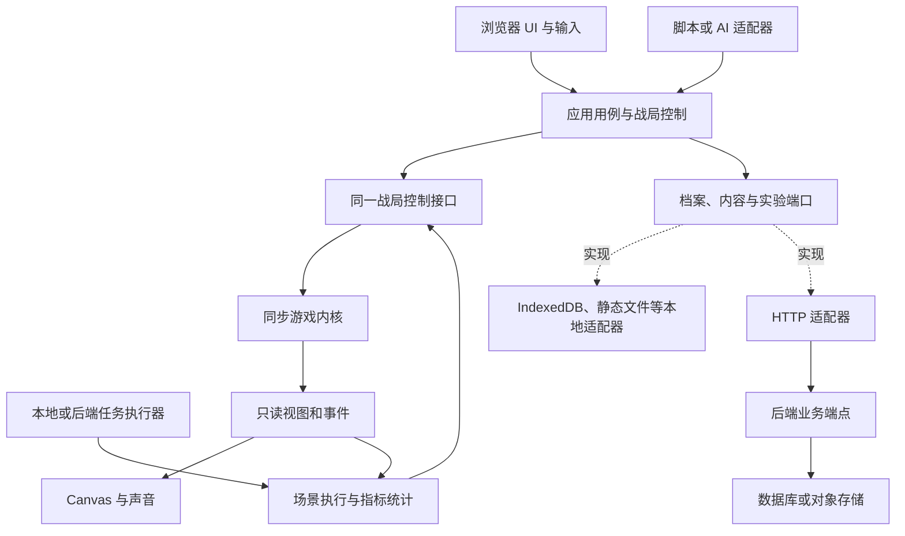

# 游戏架构设计

## 1. 目标、范围与状态

本文定义 Guns’n’Glory 的目标架构。当前只有设计文档；目录、接口名称和依赖均为实施契约，阶段状态见[实施计划](implementation-plan.md)。协作入口见[AGENTS.md](../AGENTS.md)。

优先目标是高内聚、低耦合和降低改动验证成本。每个模块围绕一种变化原因组织：规则变化留在内核，存储变化留在适配器，界面变化留在表现层，并行运行变化留在执行器。

| 已确定的目标 | 架构响应 |
| --- | --- |
| 完整离线玩法及学习测试 | 同一个内核支持实时游戏、交互调试和无画面运行 |
| 更换存储不修改上层业务 | 业务端口、统一语义、适配器契约测试、集中装配 |
| 支持纯前端及前后端部署 | 浏览器保留实时战斗；后端补充档案、内容和批量模拟 |
| 多套平衡参数比较 | 原版基线不可变；实验冻结配置、策略与运行样本 |
| 易扩展、可局部测试 | 普通 TypeScript 模块、明确状态所有权、少量公共接口 |

当前不包含多人同步、服务端权威战斗、预测回滚、支付广告、云端排行榜、任意代码插件平台或必须安装的离线 PWA。新增这些能力需要独立确认目标和成本。

研究过程不构成游戏架构。素材迁入后由游戏内容目录拥有，研究侧可以保留引用；应用构建和运行不读取研究工具、证据清单或本机工作目录。

## 2. 总体结构



图表示运行关系；代码依赖由下表约束。接口由使用能力的一侧定义，外部实现依赖接口，上层不导入具体实现。

| 模块 | 拥有的职责 | 允许依赖 |
| --- | --- | --- |
| `core` | 状态、定义类型、规则计算、进度规则、数值与随机语义 | 本模块及无环境依赖的标准语言能力 |
| `content` | 内容数据、清单、纯解析与校验、语言词条 | `core` 的公开定义类型 |
| `ports` | 档案、内容、实验存储、粗粒度运行执行契约及传输无关 DTO | `core` / `content` 的公开值类型 |
| `application` | 战役流程、战局控制、结果落档、实验用例、公开 API | `core`、`content`、`ports` |
| `simulation` | 场景、策略驱动、指标采集、运行比较 | `application` 的战局 API、`ports` 的运行 DTO |
| `ui` / `render` | DOM、Canvas、交互反馈、学习面板 | `application` 的公开 API、内容与只读视图类型 |
| `adapters` | 存储、HTTP、浏览器时间输入、音频、Node 执行器 | 端口、公开应用 API 及自身环境 API；运行执行适配器可调用 `simulation` 的公开 runner |
| `bootstrap` | 创建实例、选择适配器、连接消费者、释放资源 | 上述模块的公开入口 |

`application` 不反向依赖 `simulation`；实验用例准备运行定义，经注入的 `RunExecutor` 发起执行并保存结果。该执行契约只接收冻结的运行定义、返回运行报告，取消使用调用级控制信号；它不是逐帧接口或第四种存储仓库。首次需要场景运行时再落地，不提前建设分布式执行框架。

`Scenario`、`RunRequest`、`RunResult` 等跨模块值类型由 `ports` 的运行契约拥有，应用公共 API 可重导出。`simulation` 实现这些契约，不成为 DTO 的唯一来源；`application` 和 `ports` 不导入其实现。Node 或浏览器运行适配器调用 `ScenarioRunner`，仓库写入由外层实验用例或后端任务执行器负责。

表现层只通过 `application/api` 等窄入口访问游戏能力，不导入内核私有实体和容器。类型导入也遵守模块边界，避免用 `import type` 绕过分层。

## 3. 目录与实现尺度

以下是职责布局，按阶段创建实际文件；不在文档阶段生成空目录或空抽象。

```text
apps/gunsnglory/
  AGENTS.md / CLAUDE.md / README.md
  docs/
  src/
    core/          # 战局、战役规则、移动、战斗、波次、特殊对象
    content/       # 清单、定义解析、数值、关卡配置和文案
    ports/         # 三类存储端口；场景阶段增加 RunExecutor 与运行 DTO
    application/   # 公开 API、SessionController、战役和实验用例
    simulation/    # 场景、策略、指标、比较；不负责线程或网络
    ui/            # DOM 页面、学习面板、菜单
    render/        # Canvas 地图、精灵、HUD 与覆盖层
    adapters/      # 浏览器、持久化、HTTP、Node 等实际接入
    bootstrap/     # browser / node / 后续 server 装配入口
  public/assets/   # 随应用分发的图片、音频等游戏资产
  scripts/         # 安装、内容检查、批量运行等已实现入口
  tests/           # 规则、契约、场景、浏览器验证
```

先使用一个应用、一份依赖清单。只有多个真实消费者已经需要独立分发、版本或部署时，再讨论提取共享包；不能为了预期后端先拆成多个仓库或服务。

内核按规则职责划分，例如战斗模块拥有目标选择、伤害和状态效果；波次模块拥有生成计划与波间推进。单位和地图以定义数据表达差异，行为扩展留在所属模块。避免一个覆盖所有领域的 `utils`、所有状态混合的巨型类型文件，以及每个实体一套 Repository。

## 4. 状态所有权与生命周期

| 状态 | 所有者 | 生命周期与持久化 |
| --- | --- | --- |
| 正式档案 | 应用层使用档案仓库 | 跨会话保存进度、设置、高分；带格式版本与并发修订 |
| 内容包与参数方案 | 内容用例 | 按不可变版本读取；战局创建后冻结其实际配置 |
| 战局状态 | 单个内核实例 | 创建至结束或销毁；正式游戏不保存续玩状态 |
| 命令队列、暂停状态与推进权 | `SessionController` | 每个战局只有一个执行者；禁止重复驱动循环 |
| 相机与输入状态 | 战局控制及浏览器输入适配 | 可影响规则的部分进入显式帧上下文；纯布局状态留在 UI |
| 解码图片、音频节点、绘制缓存 | 表现层适配器 | 页面或资源包生命周期；释放不改变玩法 |
| 实验定义和运行结果 | 实验用例与仓库 | 与正式档案分区；可导出、比较、追溯 |
| 批量任务状态 | 本地或后端执行器 | 可取消、超时、重试；区别于战局胜负 |

内核可在实例内部修改状态，以避免逐帧深拷贝。渲染可在同步绘制期间借用受约束的只读视图；对脚本、策略、异步消费者及导出必须提供隔离值，防止持有引用修改战局。

开局流程为：读取档案与内容 → 校验并冻结运行定义 → 创建战局 → 连接输入和表现 → 取得唯一推进权。资源缺失时返回可诊断的加载失败，不创建半初始化战局。

结束流程为：内核产生唯一结算结果 → 应用判断正式/实验运行 → 正式运行请求保存进度，实验运行保存实验产物 → 显示保存状态。重复处理同一结算不得重复奖励或覆盖较新的进度，具体写入契约见[存储文档](storage-contracts.md)。

离开战局时按顺序停止输入与推进、取消待处理 UI 请求、释放表现资源、释放实例。待完成的持久化由应用用例管理，不能把销毁 Canvas 当作保存完成。

## 5. 战局接口和时间模型

公开能力分为两类：

- **同步战局接口**：提交命令、读取视图、按显式帧输入推进、取得事件。用于浏览器交互和高速无画面运行。
- **异步应用用例**：加载内容、读写档案、保存实验、提交后端任务。负责 I/O 和生命周期，不进入逐帧计算。

不把所有操作包装为异步 RPC。命令、状态和事件使用可序列化值，未来 CLI/MCP 只做薄转换；批量执行器在进程内循环调用同步接口。

### 5.1 兼容基线

基线保留已确认的可变毫秒步长，活跃更新将 `dt` 限制在 0–100 ms。一次逻辑更新的固定顺序为：对象 → 敌人 → 单位生成 → 单位移动 → 投射物 → 波次 → 生成池 → 音效状态；输入、控制状态及胜负检查的位置必须由明确规则固定。

Java 整数除法向零截断、特定 float 运算和逐帧截断点分别建模。等待开波、暂停和结束使用不同状态；不可用统一的 `stopped` 标志替代。逻辑集合保持稳定次序，绘制排序使用独立索引。

敌人路线、玩家方向输入、地形可走性、占格和实体碰撞保持独立规则；不以通用寻路或物理引擎替换既有语义。具体玩法分支在对应实现阶段形成规则测试，不把整套游戏规则复制到架构文档。

### 5.2 时间与随机依赖

浏览器适配器生成时间输入，内核不调用 `Date.now()` 或 `performance.now()`。测试和回放提供相同格式的显式时间序列；涉及绝对时间动画时额外传入可重放的时间基准。

保留原版随机源之间的共享关系和调用顺序；地图变体、气泡、音效请求和部分死亡生成可能共享随机消耗，不能仅按“视觉/战斗”分类重新拆流。需要的相机、可见区域、声音设置或焦点状态纳入可记录的输入，实际解码与扬声器播放不反馈给规则。

页面隐藏时采用明确暂停策略，恢复时重置浏览器计时基线；这是浏览器适配行为，应独立测试并记录，不伪称原设备所有生命周期行为都相同。

确定性意味着同一版本和完整输入可以重放，不意味着 60 Hz、120 Hz 或不同 `dt` 序列天然得到相同结果。学习倍速加快同一帧序列的执行；修改时间方案属于新实验。

命令阶段、拒绝规则、帧编号、策略和回放格式由[模拟与自动化接口](simulation-and-automation.md)统一定义。

## 6. 内容、画面与浏览器接入

游戏拥有关卡清单、数值、波次、地图网格、图像、音频及文案。内容包使用版本与摘要绑定实际数据，运行时校验引用、范围和资源完整性。

- 战役清单明确映射 60 个关卡；63 个地图文件与战役入口分开计数。
- 图像描述包含密度、图集裁切、帧、锚点和所需变体；资源文件名不承担玩法判断。
- 原始异常字段作为内容保存，改变其行为要进入显式规则或实验版本。
- 公共资源与地区资源分组加载；首阶段先保证正确性，再依据实际内存和加载数据决定缓存策略。
- 内容解析与校验是纯逻辑，具体字节读取由 `ContentSource` 完成。静态文件、HTTP 或对象存储来源不会改变内核定义。

菜单、设置和长文本采用 DOM/CSS；战场、动画和战斗 HUD 采用 Canvas 2D。中文文本使用可覆盖中文的字体渲染，不能假设原版数字图集提供 Unicode 字形。

世界坐标、逻辑格、素材像素、CSS 像素和设备像素分别建模。坐标转换由一个模块拥有，输入逆变换和渲染投影共享规则；保留每格 7680 世界单位及原版取整点。画面比例、留白和 DPR 不得改变玩法坐标。

Pointer Events 统一鼠标和触屏，处理捕获、取消及丢失捕获；只限制游戏区域必要的浏览器手势。菜单、暂停、单指移动与多指缩放的优先级必须写成可测试行为。

音频在用户交互后启用。OGG 素材逐项验证目标浏览器解码；需要备用编码时在构建前离线生成。声音不可用允许静音运行，但必须保持规则要求的随机消耗和计时。

## 7. 存储替换和后端路径

应用使用 `ProfileRepository`、`ContentSource`、`ExperimentRepository`。接口拥有语义而非驱动细节，选择适配器只发生在 `bootstrap`。详细失败、冲突、提交和迁移约束以[存储契约](storage-contracts.md)为准。

| 运行方式 | 实时战斗 | 档案与内容 | 批量模拟 |
| --- | --- | --- | --- |
| 首版纯前端 | 浏览器内核 | IndexedDB + 静态资源 | 本地 Node 入口，按阶段提供 |
| 可选本地介质 | 同上 | 满足契约的 localStorage 等适配器 | 同上 |
| 接入后端 | 同上 | HTTP 端点背后的 DB / 对象存储 | 后端进程加载同版本内核 |

后端接入不要求将实时战局搬出浏览器。用户身份、认证、配额及数据库选型在后端阶段确定；传给应用的是逻辑档案或实验范围，云端凭证不进入浏览器。

“上层不改”指在契约语义一致时只更换实现及装配。数据迁移、网络错误呈现、登录入口和介质容量仍需要相应适配工作；不得用接口统一掩盖实际不支持的能力。

纯前端不等于断网后可以首次打开或完整重开。离线安装、Service Worker 和整站预缓存属于后续独立需求，不混入初版存储抽象。

## 8. 学习、自动化与实验

学习面板通过同一命令与查询接口提供暂停、单步、实体检查、路线和射程覆盖层。覆盖层只读，记录指标不额外改变游戏状态。

批量模拟使用同一个 `SessionController` 和内核；场景执行与线程池解耦。控制策略通过有限观察和合法命令操作，调试的全量状态查询不能自动变成评测机器人可见信息。

实验冻结基线、修改后的完整配置、场景、策略、时间方案和随机初始状态。每次运行独立实例；并行只改变任务完成顺序，不能改变单个运行结果。

AI 接入优先调用结构化接口。CLI 先服务本地真实运行；MCP、远程任务 API 在有实际消费者时增加薄适配。接口版本、幂等、取消和重放规则见[模拟文档](simulation-and-automation.md)。

## 9. 依赖与性能策略

| 依赖类别 | 初始选择 | 引入时点 |
| --- | --- | --- |
| 构建与类型 | Vite、TypeScript | 第一个可构建切片 |
| 公共外壳 | `@wishflow/site-shell` | 页面切片，遵守仓库语言约束 |
| 测试 | Node 测试工具、`tsx`、Playwright | 对应测试消费者出现时，沿用仓库模式 |
| 渲染、输入、存储、音频 | 浏览器原生 API | 各功能阶段 |
| 批量并行 | Node worker 及小型执行适配器 | 单运行已经可复现后 |
| 数据库、HTTP 服务框架、云 SDK | 尚未选型 | 后端阶段另行确认 |

首版不添加 UI 框架、全局状态库、完整游戏引擎、物理引擎、通用寻路、存储 ORM 或消息中间件。新增依赖应说明哪个已测问题需要它、替代方案和验证成本。

现有 `@wishflow/simulation-testkit` 可评估复用其 Node 任务池模式，但其类型和导出仍包含球群领域字段。不得把它导入浏览器，也不伪造字段适配；真正复用前先确认最小接口调整，避免本项目先触发共享包重构。

先单线程实现实时游戏。分别测量逻辑步进、渲染、加载、内存和输入响应；预算应绑定测试设备、视口、实体数量和场景。只有确认瓶颈后才讨论缓存、空间索引、PixiJS 或 Web Worker，且保留规则回归。

## 10. 变更影响与验证范围

| 典型变更 | 主要修改位置 | 必须验证 |
| --- | --- | --- |
| 调整数值、增加配置型单位 | `content`，必要时定义校验 | 内容引用、场景回归、实验版本比较 |
| 新增伤害或特殊对象行为 | 对应 `core` 模块及定义 | 规则边界、随机和更新顺序、代表场景 |
| 新关卡 | 地图、波次、战役清单 | 可加载、可开局、终止条件、资源和路线检查 |
| 新存储引擎 | `adapters` + `bootstrap` | 相同契约测试、真实介质、迁移与失败 |
| 新策略或统计指标 | `simulation` | 合法操作、观察边界、无副作用、串并行一致 |
| 新 UI 或渲染优化 | `ui` / `render` | 输入坐标、状态只读、视觉与性能回归 |
| 新后端批量执行方式 | 执行适配器与任务用例 | 相同运行结果、取消、重试、版本与产物提交 |

接口变更先盘点浏览器、策略、脚本、回放和测试消费者。修改某一规则不应要求重写存储测试；修改驱动不应要求调整伤害公式。这是模块边界是否有效的验收信号。

### 10.1 版本责任

| 版本 | 变化来源 | 处理原则 |
| --- | --- | --- |
| 规则版本 | 算法、时序、随机或数值语义变化 | 保存旧实验引用；不可重现时明确拒绝 |
| 内容版本 | 地图、资源、数值方案变化 | 清单及摘要固定实际输入 |
| 公共接口版本 | 命令、查询、事件语义变化 | 协调消费者；不静默改变字段含义 |
| 档案格式版本 | 持久化结构变化 | 显式迁移，保留失败恢复与备份路径 |
| 回放、实验格式版本 | 记录结构变化 | 校验、兼容读取或明确不支持 |

版本职责分开，不代表首阶段要建立版本服务器或长期托管全部旧内核。至少记录精确构建标识，防止用新规则冒充重放成功。

## 11. 接入与尚待阶段内确定的事项

应用遵循独立 pnpm 清单、锁文件、安装脚本、`build`、`test:ci` 和应用内 `dist/` 的仓库契约。完整域名只由根 README 维护；导航登记、公共 shell 和部署按实施计划接入。

当前文档不登记未实现应用，不创建后端资源，不修改现有公开应用。后续公开部署按仓库工作流等待成功并实测；浏览器预览使用 Codex 内置浏览器。

以下事项不阻塞当前模块边界，但必须在相应阶段形成具体记录：目标浏览器最低版本与触屏设备样本、参考视口与视觉容差、性能和批量任务预算、中文翻译校验、资源分发范围，以及后端供应商、身份与成本。

它们应作为阶段验收输入确定，不以本机偶然表现或未经确认的新依赖替代决策。
