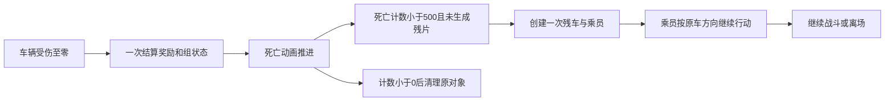
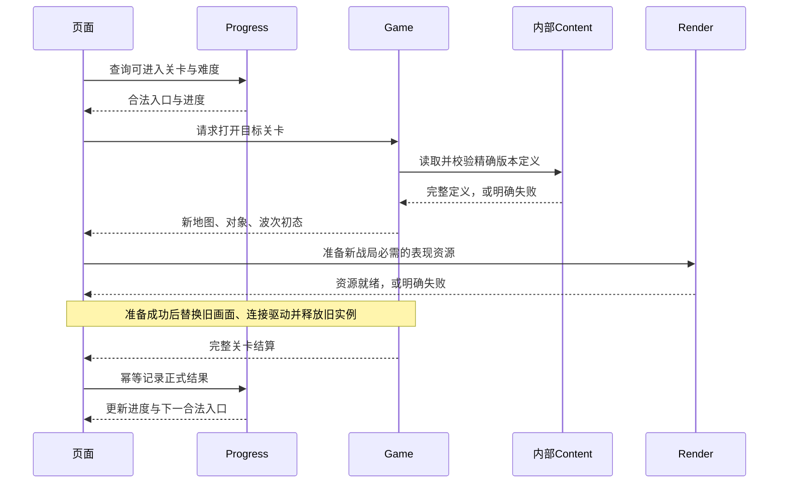

# 完整游戏交付路线审计与修订建议

## 1. 结论与适用范围

**原实施计划排序有误，且完成标准过于局部。二十轮左右的任务完成，不代表完整游戏已接近完成。** 当前产物是单关地图上的受控战斗样本，以及围绕样本建立的存储、回放和实验工具；完整原版首关尚未交付。这是规划责任，不能归因为实现任务没有遵守计划。

本次审计日期为 2026-10-28，代码基准为 `gunsnglory` 的 `03821da`，另检查了当时尚未提交的 T20 关卡进度样本。并发任务仍在更新实现和现行计划，本文作为**本次讨论的路线修订稿**，未覆盖其未提交改动，未修改游戏代码，也不冒充已经生效的新排期。达成路线决定后，应以本文第 6–8 节替换现行计划的后续任务与完成门槛，而不是长期并行维护两份路线图。

已确认的 Game / Progress / Experiments 三个深 Module、存储可替换、浏览器实时战斗、不可变原版基线与独立实验方案继续成立。需要修正的是内容覆盖、优先级、任务完成标准，以及研究结论进入实现的过程。

**本轮工作的目标是把项目规划可靠，而不是立即实现本文提到的全部机制。** 参数、动画、障碍和马车只是检查规划是否具体的案例；不能将用户列举的问题直接当成本轮功能清单。以下里程碑是后续成果目标，进入实现之前仍须通过规格与任务验收门槛。

### 1.1 目标、范围与规格深度

| 层次 | 必须明确到什么程度 | 何时完成 |
| --- | --- | --- |
| 最终产品 | 以指定原版为基线的完整六区60关；浏览器游玩、学习、脚本与平衡实验；存储可替换；后端职责和范围外事项明确 | 规划阶段，沿用并核对现有产品规格 |
| 全局内容与风险 | 所有对象/参数组/关卡/表现都有清单与阶段归属；数值单位、时间随机、状态所有权、关卡身份、存档兼容等跨阶段决定明确 | 规划阶段，不能等最后验收才补名单 |
| 当前里程碑 | 每个任务的具体输入、行为、结果、依赖、失败处理、验收样本和独立预期全部明确 | 该里程碑开始实现前 |
| 后续里程碑 | 内容范围、关键差异、依赖、完成门槛明确；具体帧裁切等局部细节可以按阶段展开 | 排期时定范围，实施前补齐局部规格 |
| 实现与验证 | 代码消费规格；行为测试、资源检查、真实操作证明对应结果 | 对应任务内完成，不把“计划要做”记成已验证 |

这避免两个极端：一边实现一边临时猜参数，或先无限期整理所有底层细节却不交付。规格的作用是让错误在明确、有限的范围内暴露，并限制返工影响。

### 1.2 为什么按旧计划执行也会停在 demo

| 规划缺陷 | 产生的结果 | 修正原则 |
| --- | --- | --- |
| 首五片之后没有“完整首关”门槛 | 单单位、单敌人、单波样本一直充当产品主体 | 下一主里程碑明确为原版 Cow Gulch 全部 8 波 |
| T11–T19 的工具和容错任务有编号，核心内容只有 E/U/D/W/G/S/L/R/V 模板 | 已编号任务持续推进，真正玩法没有具体责任和顺序 | 将具体单位、敌人、效果、关卡填入交付任务，不再以任务族代替排期 |
| 招募验收停在扣钱与池计数 | 没有新增可操作战斗单位也能标完成 | 玩家操作必须产生完整结果，并在真实关卡中可达 |
| 回放和批次只依赖最小战斗样本 | 模拟平台比被模拟的游戏成熟 | 既有工具保留供回归；新增工具能力排在真实内容之后 |
| 表现独立放在末尾 | 数据字段有了，动作和反馈仍是占位图形 | 每种玩法连同对应素材、动画、音效、交互一起交付 |
| 总验收依赖“全部已实例化的内容成员” | 未实例化内容没有实际阻塞责任 | 用固定的完整内容清单作为分母，缺项必须显式显示 |

“纵向切片”仍适用。一个切片可以很小，但应完成真实内容的一段玩家行为；任务粒度不是产品路线，也不等于每个字段、按钮都单独占一轮。

## 2. 当前实现覆盖审计

下表是本次读取快照，不作为未来状态的第二维护位置。

| 范围 | 实际实现 | 对完整游戏的缺口 |
| --- | --- | --- |
| 内容与素材 | 1 张 TDM；17 张 PNG，包括地形、枪手、男性拓荒者 | 其他单位、车辆、建筑、效果、音频和区域资源未接入 |
| 波次 | `PreviewWaveDefinition` 中单一敌人定义，开波直接创建样本 | 完整池、出怪间隔、失败重试、多波、波间倍率未接入 |
| 敌人 | Interface 与内部状态固定 `type: 1`、`pioneer_male` | 不支持完整敌人目录、运输组、死亡派生和状态差异 |
| 招募 | 扣钱后增加 `recruitPool` 数量 | 没有消费该池生成单位，也没有地图待雇用单位的完整激活路径 |
| 升级 | 枪手 0→1 在调试样本中可测 | 其余等级、单位、关卡上限与真实战斗效果未覆盖 |
| 装填 | 普通冷却已消费；特殊装填数值已暴露 | 未按六发周期消费特殊装填；一枪即死的敌人掩盖问题 |
| 移动 | 静态地形四角检查、逐轴移动及滑动子集 | 缺少建筑、多单位、车辆组件、占格和生成碰撞组合 |
| 表现 | 枪手固定帧；拓荒者基础行走；简单 Canvas 弹点、描边与淡出 | 完整方向、攻击、睡眠、受击、死亡、残片、爆炸等未接入 |
| 结算 | 样本中的敌人与投射物清空即整局结束 | 未区分本波结束、后续波次、死亡待生成乘员与整关结束 |
| T20 切关 | 两个复制 Cow Gulch 地图的验收样本 | 没有证明真实地图、初始对象、资源包和规则组合的切换 |
| 实验 | 固定样本的重放、方案、串行及 worker 批次 | 仅能评价这个样本模型，不能据此判断原版游戏平衡 |

代码定位：

- [场景与枪手配置](../src/content/cow-gulch.ts)、[单波样本](../src/content/cow-gulch-preview-wave.ts)。正式样本初始现金 65、招募价 75、唯一敌人奖励 1，这条游玩路径无法成功购买单位。
- [Game 实现](../src/game/index.ts)：搜索 `PreviewWaveDefinition`、`recruitPool`、`weaponCooldownMs = weapon.reloadTimeMs`、`waveCleared`。
- [Canvas 表现](../src/render/canvas-renderer.ts)与[浏览器入口](../src/main.ts)：图片列表由初始 view 收集，并硬编码补入男性拓荒者；同地图样本切换未暴露真实跨关资源加载问题。

这些工作并非全部无效。保存、暂停、观察、公共命令和回放等可以保留，但它们的通过记录不得换算成完整玩法覆盖率。

## 3. 已有资料与数据落地方式

### 3.1 研究已经提供什么

本次使用已有本地研究树：`/Users/shiwei/.codex/worktrees/f862/wishflow-tools/apps/gunsnglory/docs/research/`，以下以 `R/` 表示该路径。它是研发参考，游戏运行与构建不依赖此路径。

| 输入 | 已有范围 | 游戏内需要落地的内容 |
| --- | --- | --- |
| `R/data/level-config.json` | 60 行关卡、9 行敌人、14 组升级数据/44 行、21 个类型映射及解锁表 | 具名的关卡、单位、敌人、升级与难度定义 |
| `R/data/waves.json` 及符号解析表 | 60 关、527 条 `newWaves` 定义、1377 条 `addToWave` 配置、86 条生成池动作 | 按调用语义解释的关卡波次、时间、池类别和生成动作；配置条数不是敌人数 |
| `R/data/map-inventory.json` | 63 个地图文件；战役实际使用 60 个 | 原始地图、派生地形/道路、生成点、转向点、出口、对象实例 |
| `R/data/resource-inventory.json`、地形绘制索引 | 943 条 PNG 路径、423 个 basename；包含不同 density 和平台资源 | 按实际游戏用途选择的资产及裁切、区域别名；不是把 943 个文件全部列为待开发功能 |
| `R/assets/audio/` 及音频索引 | 67 个 OGG 已导出并校验，其中 64 个有直接 DEX/XML 引用 | 游戏事件、音乐循环、冷却、播放器生命周期与真实播放 |
| `R/recovered-source/` 与专题文档 | 规则、对象构造、碰撞、渲染与更新逻辑 | 行为实现、独立测试预期及需要对照的表现 |

现有静态资料足以支持大部分实现。未完成的主要是内容迁入、行为组合和运行表现交叉验证，不应再以“需要先研究完整游戏”为由无限延后开发。

### 3.2 每个参数如何确定

每个原版字段都应经历下面的闭环，实验改动使用独立配置版本：


需要记录的是值、单位、公式、整数截断位置、难度/波次/状态修正、适用对象和测试场景。来源定位放研发文档；运行时定义只携带游戏所需 ID、版本和数据。迁入时进行一次校验，正常 build 不调用 REA，不扫描研究树。

例如，`waves.json` 中的 `newWaves`、`addToWave`、`rawCalls` 按类别整理，不能简单将前两个数组按下标配对；同一波可能有多个 spawn 调用。须核对归档 `GameDesignWaves` 的调用顺序及按波次展开的索引，再形成带明确所属波次的游戏配置。

**以枪手为例，原版表已给出四档，不能凭感觉补值：**

| 升级索引 | 本次购买/升级价 | 基础伤害 | 射程 | 移动速度原始值 | 普通装填 | 特殊装填 | 周期 |
| ---: | ---: | ---: | --- | ---: | ---: | ---: | ---: |
| 0 | 75 | 140 | 38400，即 5 格 | 1500 | 500 ms | 1500 ms | 6 发 |
| 1 | 25 | 140 | 5 格 | 1750 | 400 ms | 1250 ms | 6 发 |
| 2 | 25 | 180 | 5 格 | 1750 | 400 ms | 1250 ms | 6 发 |
| 3 | 25 | 180 | 5 格 | 1750 | 300 ms | 1000 ms | 6 发 |

来源为 `level-config.json → tables.unitsByField.unitDataDesperado`。每格 7680 fine units；移动速度按每 100 ms 的 fine units 使用，还须保留方向处理、逐帧截断和碰撞。140 是基础伤害，不等于对所有敌人的实际扣血；命中还要走伤害类型与穿透等消费规则。射程边界、目标排序、普通与特殊装填的切换必须测行为，而不是只测表值。

Cow Gulch 的原始 `maxUpgrades=0`。因此首关不能为了展示升级而篡改原版上限；升级在允许升级的真实后续关卡验收，边界测试可以另外使用 fixture。实验配置可以改变限制，但必须明确属于实验。

同样处理所有敌人的生命、速度、抗性、奖励和扣命，所有单位等级、范围伤害、持续伤害、减速、毒、治疗、特殊武器和效果持续时间。当前没有依据的字段保留“待确认”，禁止填写貌似合理的数值并标为原版基线。

### 3.3 摘要并非无误的实现规格

本次已发现并回查归档 Smali 的两类冲突：

| 研究摘要说法 | 归档代码显示的语义 | 实现风险与处理 |
| --- | --- | --- |
| `content-inventory.md` 将 tile 96–101、130–131 写为“仅从存档还原时创建” | `GameObjectManager.smali` 中 `if-nez fromLoadGame` 跳过该创建分支；正常新局创建 activity 4 的待雇用对象，仍受解锁判断约束 | 若只抄摘要，首关会丢失地图上可雇用的单位；导入测试必须验证完整对象实例集合 |
| 摘要将 tile 102/110 对应为箱/触发器 | packed-switch 与构造分支显示 102→type 7 `DynamiteTrigger`，110→type 8 `DynamiteBox` | 配对与点击行为会相反；按 switch 目标与类型构造核对，不按表头猜 |

定位：`R/recovered-source/smali/smali_classes2/com/hg/gunsandglory/gamelogic/GameObjectManager.smali` 的 `pswitch_4/5/6`、`pswitch_data_2/3`。本轮未改写另一 worktree 的研究文件，修订正式计划时应同步记录这些勘误。

不要求重新逆向所有已确认内容。只有资料冲突、语义缺失或实现差异时回查对应消费者；数组、图片清单、静态规则和实际画面分别验证。

## 4. 素材、对象与场景如何组织

### 4.1 内容所有权

以下是建议的逻辑组织，不要求先重排所有现有文件，也不新增公共 Module：

```text
游戏自有 content
├── campaign        区域、关卡 ID、解锁、标题、预览
├── definitions     单位/敌人/升级/武器/特殊对象数据
├── levels          地图、初始对象、波次、生成动作、关卡限制
└── presentation    资源 ID、图集、帧序、方向、锚点、音效事件

游戏自有 public/assets
├── terrain         通用与地区地形
├── units / enemies 角色、车辆及其状态图集
├── objects / fx    建筑、装饰、残片、弹丸、爆炸等
└── ui / audio      界面、提示、音乐和音效
```

稳定资产 ID 连接定义和素材；文件名、PNG 路径、区域别名和 density 由内容装配处理。下载 URL 不进入 Game 规则。所有关卡共享同一单位定义；升级不复制整套规则，关卡只覆盖原版确有的限制。需要独立处理的武器/特殊对象使用具体实现函数，先避免通用插件框架或 ECS。

初期保留原始图集便于核对；只有加载或内存测量需要时再做合图压缩。原始资源库存中的平台文件与不明用途文件继续保留在研究材料中，是否进入游戏由真实消费者决定。

### 4.2 素材验收不是“文件复制成功”

| 对象 | 必须绑定的表现元数据与行为 |
| --- | --- |
| 玩家单位 | 可雇用/睡眠、唤醒、待机、方向、移动、攻击、装填、选中、升级；原版不存在的状态不另造 |
| 敌人 | 行走、转向、受击、状态效果、死亡；类型差异与车组部件 |
| 运输车辆 | 牵引/车体、方向、死亡过程、残车、乘员出现的时机和位置 |
| 投射物与效果 | 枪口、弹道、方向/帧、命中、爆炸/毒/火/烟、寿命与绘制顺序 |
| 地形/建筑 | 地区别名、source rectangle、锚点、地面/道路/阴影/对象层、遮挡与对象占地 |
| UI/音频 | 语义事件、文字键、冷却/提示、手势解锁音频、循环/暂停/静音与设置恢复 |

动画元数据至少包含素材 ID、裁切矩形、方向映射、帧序及驱动阈值、循环/结束条件、锚点和必要的层次信息。驱动方式按原版区分时间与实际移动距离；渲染负责绘制，不能让浏览器帧率决定命中或乘员生成。

枪手已有具体依据（`GameDesignOptics.java`、`GameObjectUnit.java`）：

- 使用 `player_gunslinger`、`player_gunslinger_sleep`、`player_gunslinger_shot` 分别表现移动、睡眠和攻击相关状态。
- 步行动画按实际移动距离累计，默认 `(帧, 距离阈值)` 为 `(0,1536)、(1,3072)、(0,4608)、(2,6144)`；不是统一每100ms换帧。
- 攻击动画的时间记录为 `(0,100)、(1,200)、(0,1000)`，八方向映射为五行与水平镜像；具体重置与状态切换按消费者核对。
- 固定距离、朝向和攻击进度分别截取预期帧，另检查连续移动/停下/开火时的衔接。素材文件存在不等于这些映射已经实现。

原版部分表现也消费共享随机数。为保证已约定的原版语义，相关消费顺序仍由同一模拟过程维护；无画面运行省去绘制，不能顺便跳过会改变结果的随机调用。已有[模拟契约](simulation-and-automation.md)继续适用。

### 4.3 路线和障碍不能合并成一个开关

| 对象/检查 | 来源与实现方式 | 关键测试 |
| --- | --- | --- |
| 普通敌人路线 | 地图 action 1 生成点、action 2 转向点、action 3 出口；格心触发，按原方向表与随机规则处理 | 转向前后、分叉、地图外生成、离场延迟 |
| 敌人组与占格 | 牵引与车厢组关系、当前格/下一格占用、异组碰撞、生成失败重试 | 同组跟随、异组堵塞、释放、重试不丢池请求 |
| 玩家步行 | 原版地形可行走规则、碰撞框、装饰/建筑、逐轴运动 | 水域/峡谷、建筑边缘、转角、移动取消 |
| 横纵列车 | 分组、轴向输入、各部件形状与处理顺序 | 两个方向、阻挡中途出现、组选中与解除 |
| Steamer | 原版水域/部件运动规则 | Cold Lake 的左右输入分别核对，不能假设整组原子移动 |

PriorityMap 是静态优先数据，不是每帧寻路器；地图像素也不是碰撞真源。没有依据时不引入 A* 或物理引擎“改善”原版路径。异常原图字段保留并单独回归，不凭推测改正。

### 4.4 马车死亡是一条完整行为链



`R/game-loop-and-enemy-update.md` 已说明：仅 type 4/5/6 走该残片分支；`n = trunc(random(trunc(difficulty / 50) + average × 10) / 10)`，average 分别为 2/4/0，最多四个槽。每个乘员随机选择 type 1 或 2，使用规定的四个相对位置，方向取原车向量符号，采用当前波次 HP 倍率及 `90 + random(20)` 速度比例，并获得独立组号。

这不是“死亡时固定刷两个人”，也不是动画结束后由 Renderer 加敌人。测试应覆盖 0–4 个槽、阈值两侧、恰好只生成一次、方向/组号/倍率、车组清理和待生成期间不能提前宣告整关胜利。图像、残片、声音和时间都随这条行为链交付。

### 4.5 真实关卡切换



关卡 ID、区域内序号、地图编号分开处理：1–10 使用地图 01–10，11–60 使用地图 14–63。切换测试必须用不同真实地图及资源组合，检查旧对象/弹丸/计时器/选中状态被清理、目标初态正确、缺资源不留下半个战局。样本胜利记录不自动转换成真实战役完成。

## 5. 全量内容覆盖责任

完整清单来源已经存在，不再以“以后增加各种对象”作为计划。实施时从来源形成一份**内容覆盖表**，每项至少具备：语义 ID、所属关卡、参数/规则入口、资产与动画、具体任务、资料确认/数据迁入/规则通过/表现检查四种状态。来源和状态是研发文档；无需为此建设运行时证据系统。

| 内容集合 | 明确责任 |
| --- | --- |
| 8 类普通可雇用角色的数据组 | Desperado、Mexican、Cannon、Indian、Grandpa、Sniper、Pyromaniac、Salesman；每组四档，按实际解锁与地图使用落地 |
| 车辆和武器组件 | Train、Gatling、Steamer、DoubleCannon；21 个类型映射不是 21 种独立兵种，组件应按实际共享定义处理 |
| 特殊对象 | DynamiteTrigger/Box、Gambler/Casino；配对、输入、经济、冷却、生成与表现全部覆盖 |
| 敌人 | 源表全部 9 行及其实际构造分支，包括男女乘员、骑乘、车组、特殊敌人；表行和工厂请求类型须分开映射 |
| 战斗规则 | 目标选择、普通/特殊装填、轻/火/重/毒穿透、AOE、持续伤害、减速、治疗、奖励、动态难度和离场扣命 |
| 地图对象 | 装饰、可雇用槽、活动单位、生成建筑、铁路、Steamer、道路字段与背景碰撞 |
| 战役 | 六区各十关，逐关绑定原始地图、现金/生命、波次、生成池、升级上限、难度、可用单位、文案和资源包 |
| 表现 | 各行为的状态图、方向与帧、特效、绘制顺序、声音及中英文界面；随内容验收 |

四种状态不能相互替代。例如，枪手特殊装填属于“参数已迁入、行为未完成”；首关地形已显示，不表示首关对象和波次已完整。

## 6. 建议替换的整体交付顺序

以下是产品里程碑；内部仍可拆成小的可独立验证提交，但不以提交数量报告整体进度。既有工具直接用于开发回归，真实内容成熟后再扩大实验规模。暂不新增依赖或后端。**当前先完成 P0 的规划工作；P1 是下一实现目标，而不是本轮开始编码的指令。**

| 里程碑 | 玩家得到的成果 | 内容与验收门槛 |
| --- | --- | --- |
| P0 规格与任务基线 | 可审阅、可据此实施的整体计划 | 全量覆盖表、阶段归属、P1任务规格与验收样例、研究勘误、关键设计风险及兼容决定；完成定义见第8节 |
| P1 完整原版 Cow Gulch | 原始首关从开局到全部 8 波结束，可多人雇用、移动、战斗，包含马车与乘员 | 本文第 7 节；首关所有必要素材、动画、声音随玩法交付；完成后计 1/60 |
| P2 完整 New Mexico | 原版前十关连续游玩；真实关卡切换、经济和进度形成闭环 | Death Valley 等多入口/多波、首次出现的单位和敌人、生成建筑、Railroad Ranch 等列车场景；按原解锁判断是否可用，不能因地图有标记便提前开放 |
| P3 其余区域逐区完成 | Mississippi→Oregon→Dakota→Nevada→Alaska，每完成一批便增加真实可玩内容 | 每区十关绑定完整清单；先实现本区新增机制的具名代表关，再完成其余数据差异关卡；每区独立验证与回滚 |
| P4 真实游戏平衡性验证 | 在完整规则上比较原版与实验方案，定位失败样本 | 把当前固定 Cow Gulch 样本 CLI 扩展为真实场景选择；固定版本/策略/seed/时间及环境输入；胜败、超时、异常分开；已有串并行能力复用 |
| P5 完整前端验收与发布 | 全战役、学习控制、实验、存档及桌面/触屏稳定可用 | 全量内容检查、代表表现/设备实测、回放兼容与预算、共享站点发布及线上验收 |
| B 后端按需 | 远程档案、资源管理、远程批次 | 延续既有存储和执行 Seam；具体服务选型另行确认，浏览器仍负责实时战斗 |

P2/P3 的数据迁入工作可以并行；共享 Game 行为的修改按真实依赖串联。不得为等候后续全部素材而阻塞已经能交付的真实关卡，也不得用未实现机制的静默降级把整区标为完成。

### 6.1 后续区域的具名验收入口

| 区域/关卡 | 重点覆盖 | 边界 |
| --- | --- | --- |
| New Mexico：Cow Gulch 1/map01 | 枪手、炸弹手、拓荒者组、covered-wagon、8 波与完整经济 | 第一主里程碑，不再只取一个男性拓荒者 |
| New Mexico：Death Valley 2/map02 | 骑手、弓箭手、火焰持续伤害、多生成点 | 与完整首关共用规则，新增真实行为与状态表现 |
| New Mexico：Fort Kaboom 3/map03、Tech Town 4/map04 | 驿站马车、运金车、炮手、建筑生成池、横向列车与 Gatling | 以地图/波次/解锁联合判断，不能从关卡名称猜能力 |
| New Mexico：Railroad Ranch 9/map09 | 横纵列车组件、Gatling、组选中、轴向移动与阻挡 | 不是静态摆一张火车图片 |
| Mississippi：Traveller's Town 11/map14、Railroad Canyon 15/map18 | 跨区域资源别名、Steamer 首次地图配置、不同路线与列车组合 | Steamer 不能等到 Cold Lake 才实现；所有十关仍须逐项验收 |
| Oregon：Eastwood Forest 21/map24、Cashcow Canyon 22/map25、Dynamite Plains 25/map28 | Grandpa、boss 敌人、炸药解锁、配对触发与范围判定 | 炸药用精确坐标与自身半径边界，不套普通 AOE |
| Dakota：Loot Lakes 31/map34 起 | Sniper、雪地资源与该区敌人/波次组合 | 首次开放由实际解锁公式决定，不仅看名称 |
| Nevada：Labyrinth Gulch 41/map44、Reno 43/map46、Las Vegas 46/map49 | Pyromaniac 的火箭、沿途伤害、爆炸及持续火伤；赌徒/赌场、开奖、延后生成；多赌场配对 | Reno 等满足关卡门槛；早期地图中的赌场标记不等于初始可用 |
| Nevada：Boomtown City 49/map52 | 路线分叉、组跟随与异常原图字段回归 | 不要求穷举随机轨迹，不擅改孤立字段 |
| Alaska：Windham Bay Mine 51/map54、Cold Lake 52/map55 | Salesman/毒伤、doctor 敌人治疗、Steamer 部件、水域阻挡与动态组合 | 左右输入分别对照，保留有限原版运行证据的边界 |
| Alaska：Glacier Bay 60/map63 | 最终关完整波次、战役结束与结算 | 不是只测试能加载最后一张地图 |

这些入口由已有地图和配置选出。P0 必须逐项列出全部60关及全部行为的阶段归属、所需机制类别；不得把未归属项留到以后。区域开始前展开的是更细的任务依赖、具体状态/时间/随机验收样例和表现预期，而不是重新决定是否实现这些内容。不能再把未列出的关卡留给最终验收任务临时实现。

## 7. 下一主里程碑 P1 的可执行任务

一次工作可以完成多个紧密相关的小提交；下列六项是验收责任，不是“至少再跑六轮”的规定。P1 每项都推进同一个真实首关，不创建新的产品演示场景。

| 任务 | 具体交付 | 主要前置 | 验收与回滚 |
| --- | --- | --- | --- |
| P1-A 首关原始开局 | 迁入首关对象/资源；8 个 tile96 枪手槽、7 个 tile97 炸弹手槽、1 个 tile104 活动枪手；101/130 按原解锁判定；呈现可雇用/锁定/活动状态和对应选择反馈 | 原地图和构造分支核对 | 对象集合与独立原始预期匹配；现金65、生命50、升级上限0正确；只能报告“原始开局”，不能报告完整雇用；可回退旧样本入口 |
| P1-B 前两波与完整雇用战斗 | 原始请求池、间隔、拓荒者小组、路线占格、碰撞、重试；枪手特殊装填；从击杀所得中雇用、唤醒并移动新增单位；炸弹手及重型 AOE、弹道/爆炸、相关动画声音 | A 的内容；波次消费规则 | 通过真实前两波获得现金后成功雇用并控制；至少跨越一次六发装填周期；群体命中与未命中边界、奖励一次性；固定输入回归与浏览器操作；fixture只补边界测试 |
| P1-C 第三波运输队 | type8 牵引+type4 车厢同组运动；受击、组死亡、残车与0–4乘员；对应动画/特效/声音 | B 的多人战斗与路线 | 真实第三波3个配对请求；验证生成失败重试、车毁后乘员继续走/战斗、一次奖励与派生；未生成乘员前不提前结算 |
| P1-D 第四至八波与正式结算 | 混合池、波间提示与加速、倍率/动态难度、剩余敌人、正确整关胜败；首关提示、声音和 HUD | B、C | 原始现金65/生命50开局，完整玩到第8波后真正结束；清一波不等于胜利；失败/重开清理；记录完整输入、终态与浏览器过程 |
| P1-E 正式入口和存档接通 | 产品默认打开真实首关；Progress 写真实关卡结果；旧样本记录明确隔离；资源预加载失败保留可恢复入口 | D | 刷新恢复真实进度但不续玩半局；失败保存可重试；不把旧样本胜利当首关通关；下一真实关未完成时明确不可进入 |
| P1-F 首关对照验收 | 原地图、对象、三类战斗链、动画与声音、完整八波和鼠标/触屏一起核对 | A–E | 独立数据预期 + Game 公共行为 + 真实浏览器；修复差异回对应任务，验收任务不吞并新的玩法实现；合格后才将覆盖计为1关 |

雇用语义需准确区分：`GameObjectUnit.hire()` 将已有 activity 4 对象激活为 activity 5 并扣款；生成建筑/生成池是另外的后续路径。首关没有 tile112–114 的生成建筑，也没有 spawn-pool actions。因此不能用“购买后等待建筑出兵”替代首关待雇用单位。

P1-A 清单基于首关原图实际出现的 tile；98–100、131 不在这张地图中，不是遗漏这些位置的实例。全局类型定义仍由全量内容清单覆盖。A、B 分别验证原始开局和完整雇用战斗，避免用 B 的结果作为 A 的前置，形成验收循环。

首关炸弹手的基础表是 `unitDataMexican`：购买价100、基础重型伤害500、AOE7680（一格）。这些是初始配置值，实际范围、穿透和伤害仍走消费公式。它直接说明首关需要的并非只有枪手单目标射击。

P1 前不继续扩建实验保存、worker、后端或新增合成关卡。现有能力若因真实规则扩展需要修复兼容性，应随对应玩法处理。原 T21–T24 中真正服务当前关卡的难度、帮助、语言、声音穿入对应任务；原 T25/T26 只做最终集成与发布。

## 8. 如何确保之后不再回到 demo 路线

### 8.1 每项任务的规格与启动门槛

执行前填写下表。局部研究缺口只阻塞依赖它的任务；所有未知都不能隐式填成“合理默认值”。

| 项目 | 必填内容 | 拒绝进入实现的情况 |
| --- | --- | --- |
| 目标与范围 | 所属用户故事/里程碑、真实对象或关卡、本次结果与明确留后项 | 只有“完善系统”“接入更多内容”等模糊目标 |
| 输入与初态 | 原版版本、关卡/难度、参数表、对象状态、时间和随机条件 | 参数未定或数据属于其他版本 |
| 行为规格 | 触发条件、状态迁移、计算/舍入/次序、输出与错误行为 | 只有字段说明，没有规则消费或状态迁移 |
| 表现规格 | 绑定素材、动画驱动/方向/锚点、交互反馈；本任务不涉及则说明 | 用临时图代替正式表现却准备报告完整交付 |
| 依赖与影响 | 真正前置任务、修改的 Module、版本/存档/回放影响、回滚方法 | 依赖环或隐含修改不相关 Module |
| 验收样例 | 初态、操作/事件、明确预期、预期的独立来源、检查方法 | 只写“测试通过”或只由实现生成预期 |
| 异常与边界 | 该行为的阈值、重复输入、无效状态、缺资源、生命周期 | 关键边界未定，靠编码时临时决定 |
| 完成证据 | 对应规则测试、真实关卡过程、必要表现检查、仍未验证项 | 以测试数量代替任务的实际通过条件 |

以“雇用睡眠枪手”为例，规格应在实现前明确：合法可雇用对象、75现金、当前单位数量与身份；确认后只扣一次75、**同一对象**由activity4变5、可以选择移动开火、图像和声音切换；74现金时拒绝且状态不变；重复确认不能重复扣款。独立预期来自原单位表与 `hire` 消费分支。正式首关的可达性由 P1-B 的真实赚钱—雇用路径证明，而不是给 fixture 无限现金。

以“特殊装填”为例，需要明确射击计数初值、哪次射击切换特殊冷却、普通/特殊冷却的替换或叠加、无目标及移动时如何更新、升级是否重置；四档参数表本身不能回答所有问题。先核对原消费分支，再为跨越周期的固定输入写独立预期。

P0 的完成条件是：全量目录无未归属内容；各阶段范围和退出标准齐全；当前阶段所有任务满足以上字段、依赖无环；已知勘误完成处理；跨阶段设计风险有决定或明确验证任务。**本审计稿给出了结构、实例和已发现问题，尚未声称这些全量工作已经完成。**

规格发现错误时，先修改其唯一真源，列出受影响的规则、内容、存档/回放与已通过样本，再修实现并重跑这些范围的验收。原版行为纠错与主动调整平衡分别记录；不能为让现有测试通过而静默修改原版数值，也不能用代码当前行为反向定义规格。

### 8.2 调整任务模板与 AGENTS 约束

AGENTS 仅需要少量稳定要求；具体里程碑和状态继续只放实施计划：

1. 任务必须声明所属产品里程碑、真实关卡/对象、玩家可见结果及来源入口。
2. 一种玩法的完成包括参数、实际规则消费、素材表现、交互、公共行为验收；仅有字段、计数器或静态图片记为部分实现。
3. fixture 用于边界测试；真实内容覆盖只能由正式内容路径和对应验收增加。
4. 当前产品里程碑的内容缺口优先于新的辅助平台能力；例外需说明它如何直接解除当前交付阻塞。
5. 测试预期来自独立源数据/公式与行为案例，避免由同一错误导入器同时生成实现和“正确答案”。

文档职责不增加新的架构层：规格管目标，架构管深 Module，内容覆盖表管具体对象/素材/关卡，实施计划管排期和状态，验证记录管实际证据。本文在决定落地后归档为审计背景，避免成为第二份活动计划。

### 8.3 进度按产品覆盖报告

| 指标 | 分母及通过定义 |
| --- | --- |
| 完整可玩关卡 | 固定60关；包含完整波次、所需对象、正式结算、一次有效完整通关记录。能加载或运行到预算终止不算通过 |
| 规则/对象覆盖 | 完整源目录中实际使用的行为集合；数据表值存在与行为完成分别计数 |
| 表现覆盖 | 当前已交付内容所需的动画、效果、音频；按固定状态与实际交互核对 |
| 资料缺口 | 逐项描述已确认/冲突/未确认及其阻塞的关卡，不能只报“还有研究工作” |
| 实验可信范围 | 只包含已实现规则与内容；工具测试通过不扩展这个范围 |

每次交付回答：新增了什么可玩内容、哪个真实场景能看到、哪些机制仍缺、如何验证。提交数、测试数和任务编号作为工程信息保留，不作为完整度百分比。

### 8.4 测试与发布的节奏

- 内容导入：检查 ID/映射/引用/尺寸/参数单位、60关完整目录；为关键构造保留独立预期。
- Game：通过公共命令与观察验证真实规则，包括招募后可操作、六发装填、运输组、死亡派生、AOE、波间与整关结算。
- 浏览器：每种新增交互和表现做代表性检查；真实不同地图切换与资源释放必须覆盖。
- 全战役：每关完整运行；三档难度的配置逐项检查，倍率与解锁边界使用代表性运行；单次胜利不声称穷举所有策略或随机轨迹。
- 性能：等真实多人、多弹丸与效果存在后测峰值，不用单敌人场景确定全游戏预算。
- 日常提交：运行受影响的检查；里程碑合并时跑完整相关检查；公开发布仍完成现有 CI/CD 与线上实测，不强制把每个小内部改动单独发布。

## 9. 本轮验证与未执行项

本轮执行了现有代码、研究 JSON、归档 Java/Smali 与实施计划的只读交叉检查。未重新运行 Android，未修改研究 worktree，未实现上述任务，也未把静态规则宣称为完整原版运行验证。

已运行 `git diff --check`，并单独检查本新增文件的尾部空白、本地 Markdown 链接与代码围栏闭合。三处 Mermaid 的文本结构已检查，未进行图形渲染验收；本轮没有运行游戏测试，因为未修改游戏代码。

按仓库要求，实际在 `apps/gunsnglory/` 运行：

```bash
pi --no-extensions --no-skills --no-prompt-templates --no-themes --no-session --no-approve --offline --tools read --mode json -p '只读验证最新规划稿，不修改文件，不实现功能。先报告启动时自动加载的 AGENTS.md 路径，不通过read它们替代。实际调用read读取 docs/delivery-plan-review.md 全文。请简要回答：本轮是在要求立即实现全部机制吗；P0完成条件是什么；P1-A和P1-B是否有验收依赖环；UI是否需要协调Game内部内容；数值表存在能否代表规则完成；这份文档是否已经替换正式执行计划。若文档仍有关键矛盾请指出。' > /tmp/gunsnglory-plan-review-final-pi.jsonl 2> /tmp/gunsnglory-plan-review-final-pi.stderr
```

关键返回：自动加载根与应用两份 AGENTS；实际 `read` 本文，`isError=false`；进程退出0，stderr为空。正确区分本轮规划与后续实现、P0门槛、A→B依赖、Game内部内容职责，以及“参数存在不等于规则完成”。实读提出的 P0 全量归属与区域详细规格区别已在第6.1节明确。该验证证明文档可加载及关键要求可读取，不代表计划中的游戏功能通过验证。

本文件通过 `cp` 按相对路径复制至 `/tmp/var/wishflow-tools/apps/gunsnglory/docs/delivery-plan-review.md`。本轮不提交并发实现文件，不推送当前分支已有的其他提交，不向其他用户任务发送指令；修订稿仍待与正式计划整合。
