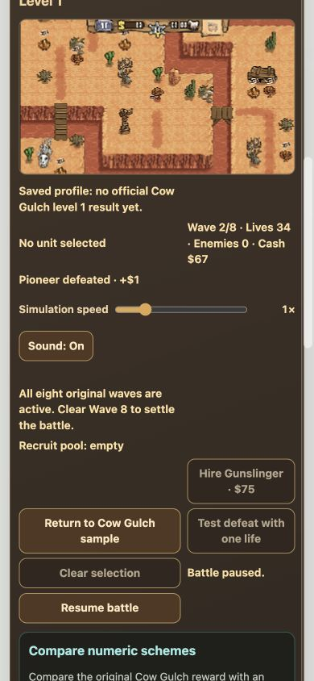
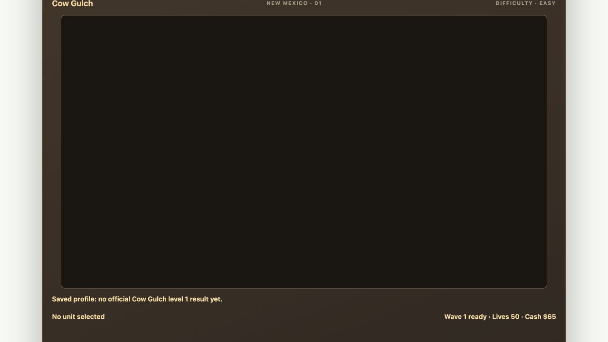
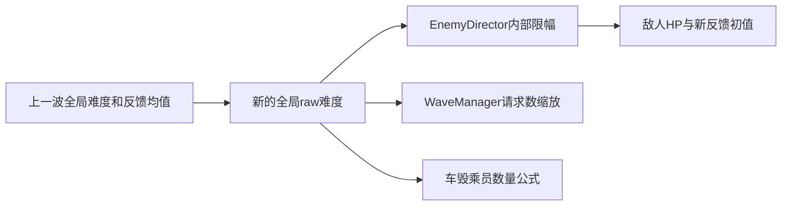
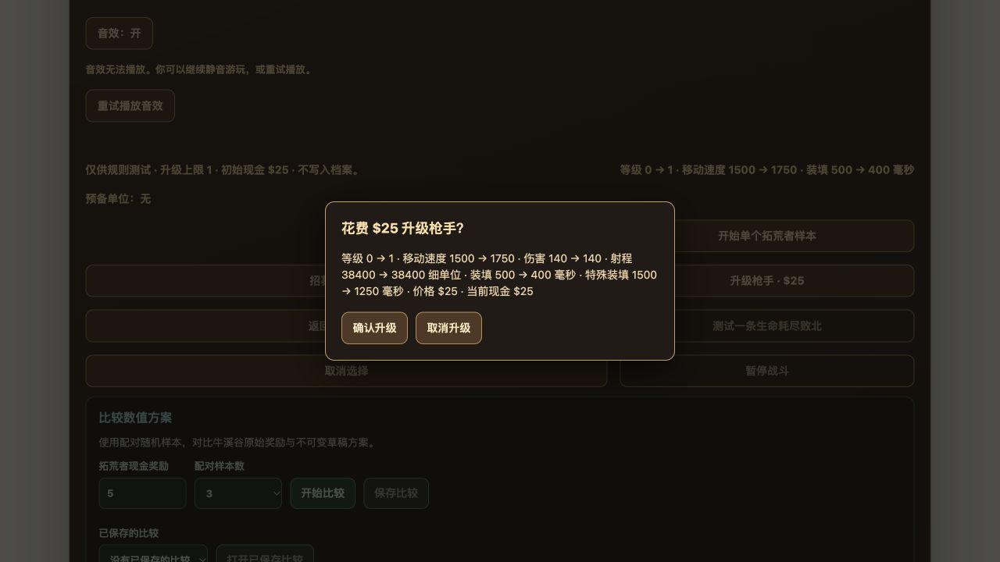

# Guns’n’Glory 当前实现审核报告

## 1. 结论

**当前实现尚不能作为“完整复现的游戏”交付，也不能作为真实战役的平衡性计算依据。问题同时包括已实现规则错误、产品范围缺口和实验能力缺口。**

首轮确认了六项具体玩法错误；2026-11-01扩审又确认了单位速度、移动中开火、射程、弹道和动态难度等差异，以及UI、操作、音画和文案问题。敌人生成点被永久向地图外移动，来自对原版 Smali 公共收尾分支的误读；Mexican速度为0、准星只有两段等错误也已经进入规格或测试。另一方面，即使把同一正式关卡交给实验模块，实验模式也会切换成单波预览规则；因此目前“使用同一个 Game”没有保证“模拟同一场游戏”。

已有成果应保留：正式首关的八波数据、地图对象、运输队、地图雇用、部分动画音频、进度保存、回放、方案仓储和小批次运行已经存在。不能继续概括为最早的一人一敌 demo；但这些局部能力也不能折算为完整原版已经交付。

| 用户目标 | 当前可核实状态 | 主要阻断 |
| --- | --- | --- |
| 完整复现、选关、难度、正常游玩 | 正式目录只有 Cow Gulch L01；八波与部分常规操作已接入；浏览器成功将下一场设为 Medium 并重新打开 L01 | 已实现规则和数值存在错误；桌面无法到达整张地图；手机战斗画面与控件过小；资源失败可导致黑屏；其余59关及其他对象/机制未接入；首关完整对照未通过 |
| 大规模模拟、数值计算、调平衡和扩展 | 固定单波样本可运行、比较、保存；有串行/最多4个 worker，最多25场的批次入口 | 正式/实验玩法不等价；难度、环境、雇用意图和关键参数不完整；真实场景批次入口缺失；保存/版本/预算存在错误；无大规模容量与恢复证据 |
| 后续开发成本 | Game / Progress / Experiments 已有实际职责，存档与实验仓储有内存/IndexedDB 实现 | 内容与资源装配仍散落在首关 UI/静态配置；内容有效性、驱动所有权和 worker 失控终止契约未落实；部分测试预期反而固化了错误 |

本报告累计列 **46项独立问题：需求符合性（Spec）40项，工程规范与验收可靠性（Standards）6项**。本次扩审新增22项，并为原A03补充实际消费者证据。同一问题涉及多个目标时交叉引用，不重复计数；纯视觉细节与规则错误分开定级。这是已核实的问题集合，**不是已穷尽全部原版内容错误的声明**。

| 阅读入口 | 问题数 | 内容 |
| --- | --- | --- |
| [§3 完整游戏](#3-需求符合性spec完整游戏复现) | 8 | 生成、运输、弹丸、群伤、雇用、关卡和内容范围 |
| [§4 模拟与平衡](#4-需求符合性spec模拟与平衡分析) | 11 | 游戏等价性、输入、方案、保存、批次、指标与规模 |
| [§5 工程与验收](#5-工程规范standards与验收可靠性) | 6 | 内容边界、执行控制、校验、错误规格和测试预期 |
| [§9 UI与交互](#9-扩审需求符合性specui与交互) | 6 | 镜头、手机布局、资源失败、单步、保存恢复、帮助 |
| [§10 数值与消费公式](#10-扩审需求符合性spec数值与消费公式) | 5 | 速度、开火条件、射程、弹道、动态难度；附参数核对表 |
| [§11 渲染与音频](#11-扩审需求符合性spec渲染与音频) | 5 | 音效调度、共享随机、准星、播放生命周期、弹丸外观 |
| [§12 文案与反馈](#12-扩审需求符合性spec文案与反馈) | 5 | 操作提示、场景说明、单位、击杀反馈、本地化 |

处理顺序见§6，实际执行及限制见§7、§13。缺失内容须继续拆解交付，不能用这46项的关闭率替代完整游戏完成度。

## 2. 审核基准、方法与证据边界

| 项目 | 本轮范围 |
| --- | --- |
| 日期 | 2026-10-31至2026-11-01，Asia/Shanghai |
| 代码快照 | gunsnglory；335ec8dd5d266ec15ebe7dab6c624b30db37a8c3 |
| 扩审快照 | 2026-11-01，5a20d54275785714a9a601b7ec39b19f0096e9e7；相对335ec8d只增加双桥路线测试断言、审核及发布记录，运行时代码相同 |
| 审核方式 | 审核上述快照的完整应用，不仅审核最近一次提交；分别检查用户目标、工程契约，并做独立行为探针 |
| 产品要求 | 用户本轮的两个目标，以及现有[产品规格](spec.md)、[架构](architecture.md)、[模拟契约](simulation-and-automation.md)、[存储契约](storage-contracts.md) |
| 原版静态依据 | 研究分支 codex/gunsnglory-spec，固定提交8ad364e509a1784f3ee7c2770a7fc0f6294f10b5；使用归档 Smali、DEX dump、JADX 恢复代码与地图/数值资料 |
| 实际执行 | 首轮完整应用CI、公共接口探针、12个seed串并行对照；扩审增加数值/消费者探针、相关表现测试、Codex内置浏览器桌面与390×844视口、资源故障注入、文案检查 |
| 未执行 | 本轮没有启动原版 APK 做全程动态对照，没有运行全部60关，没有千场/万场压力测试，没有进行真实手机性能测试 |
| 修改边界 | 只生成审核报告和入口；游戏代码、配置、资源未修复。生成点对照只修改 /tmp 中的临时源码副本 |
| 行号 | 运行时代码行号在335ec8d与扩审5a20d54相同；测试/文档以各项注明的位置为准；研究文件区分物理行号与原始调试行号 |

优先级：**P1** 表示已影响核心玩法、实验可信性或明确阻断目标；**P2** 表示扩展或正式交付前必须解决的局部错误、可用性、可靠性/容量问题；**P3** 表示不直接改变战斗结果的局部表现或文案偏差。分类分别为“已确认错误”“功能缺口”“证据缺口”“设计风险”。未实现功能不伪装成隐藏bug，静态风险不描述成已发生事故。UI尺寸评价是本轮可用性判断，不冒充原版像素规范或已做用户研究。

原版代码引用的统一路径前缀：

- Smali公共根：研究提交中的 apps/gunsnglory/docs/research/recovered-source/smali/smali_classes2/com/hg/gunsandglory/。
- Java公共根：同目录树下 recovered-source/java/com/hg/gunsandglory/。这些是恢复代码，不是开发者原始Java源码；复杂控制流优先回查Smali/DEX。
- EnemyDirector、UnitDirector、GameObjectShot、GameObjectEnemy、WaveManager、PriorityMap在gamelogic/；GameObjectUnit在units/；GameDesignData在datastorage/；GunsAndGloryThread、SfxManager、Sound在game/；LevelPack在levelpacks/。下文省略目录时按此表定位，不把不同包拼到gamelogic/之下。
- 运行时仍应只依赖游戏自己的内容。本报告引用研究材料用于核对，不提出运行时证据系统。

## 3. 需求符合性（Spec）：完整游戏复现

### G01 · P1 · 敌人生成点永久漂移，改变首关胜败

**分类：已确认错误；影响两个目标。**

位置：[Game 生成逻辑](../src/game/index.ts)，2598–2638行，核心为2638行将 candidatePosition 写回 spawnField.positionFine。

正常生成使用沿出生方向反向偏移两格的临时位置；网页每次成功生成都永久保存这个偏移，下一次又继续偏移。正式首关只有一个共享生成字段，因而敌人出生位置不断向西移动。越界移除发生在后续射击前，大量敌人直接扣命，玩家没有正常拦截、赚钱和雇用的机会。

原版 EnemyDirector.addEnemyAtSpawnPoint 的恢复不是“仅失败时执行”：

| 原版 Smali 分支 | 固定研究提交中的物理行与路径 |
| --- | --- |
| 预检失败 | 421行：if-eqz v16, :cond_19 |
| type4运输请求成功 | 执行 addEnemy 后，经 :goto_5、:cond_a、:cond_11 到 :goto_b；987–999行在 p2 不为9时跳入 :cond_19 |
| type1步兵请求成功 | 循环结束进入 :cond_10；980–999行经 :goto_b 跳入 :cond_19 |
| type9成功 | 1029–1030行循环结束也进入 :cond_19 |
| 公共恢复与返回 | 1247–1274行，即调试 .line909–910：fineX/Y 加回 direction × 2 × 7680；随后返回生成结果 |

DEX dump 中的跳转028f→0366及0366–0379加回坐标再次印证共同收尾。不能只看到失败分支跳到该标签，就推断成功路径不经过它。

本轮固定正式内容、seed42、每步100ms、无玩家命令，最多12000步：

| 检查项 | 当前代码 | 临时副本只去掉永久写回 |
| --- | --- | --- |
| 前四批出生x坐标 | -11520、-26880、-42240、-57600 | 均为-11520 |
| 终局 | 第4波败北 | 第8波胜利 |
| 现金 / 生命 / 击杀 | 66 / 0 / 1 | 270 / 30 / 196 |
| 显示分数 | 50 | 356 |

临时对照证明该差异会决定性影响当前模型，**不证明其余规则已经与 APK 全量等价**，也不声称任意玩家操作都必败。

**建议与验收：** 恢复临时偏移语义；同时纠正规格、验证记录第69节及引用该结论的测试。分别验证成功、碰撞失败、连续请求、跨波次后生成字段保持原值；在未删减正式内容下重新验收完整首关、自然收入和雇用。

### G02 · P1 · 马车逃逸处罚错误，并影响动态难度

**分类：已确认错误。**

位置：[Game](../src/game/index.ts)2433–2437行，统一使用 previewWave.escapePenalty；[预览配置](../src/content/cow-gulch-preview-wave.ts)24行的值为1。

原版 GameObjectEnemy.getPenaltyForSurviving，恢复代码调试行506–510，规定 type4扣2、type5扣3、type6扣4、type7扣10；type8由 EnemyDirector 另行豁免。当前 type4车厢也只扣1，并把相同错误值交给动态难度更新。

实测一个运输组被移除：type8+type4共移除两对象，生命50→49；按已实现的 type4/type8语义应为50→48。[运输测试](../tests/p1c-campaign.test.ts)194、200行还把扣1命写成预期。

**建议与验收：** 将生存处罚绑定敌人定义/类型，统一供生命与难度计算消费；验证牵引对象0、车厢2且只计一次，并独立复算难度权重。后续敌人类型不能继承首关单兵处罚。

### G03 · P1 · 原目标死亡后，在途炸药被直接删除

**分类：已确认错误。**

位置：[Game](../src/game/index.ts)2513–2516行；只要目标死亡或已从敌人数组移除，就删除所有种类的在途投射物。

原版 GameObjectShot.move 的调试行384–398保留目标引用/最终落点并继续飞行；UnitDirector.moveShots 的151–191行在抵达时对周边活敌计算 AOE 和爆炸，不因主目标已经死亡而直接删除炸药。

本轮两单位集火边界 fixture：第10帧 Mexican 已投出炸药，剩余飞行1260ms；第13帧枪手击杀主目标，炸药立即消失，另外3名敌人仍存活，未产生爆炸。fixture 增大枪手伤害以稳定触发顺序，不作为真实关卡通关证据。

**影响：** 集火时群伤、音效和表现凭空消失，平衡计算低估炸弹手及单位组合。

**建议与验收：** 投射物拥有独立生命周期与最后有效终点；分别覆盖主目标被击杀、被清理、离场后继续抵达，以及其他活敌按范围受伤。普通单体弹与范围弹按各自原版语义处理。

### G04 · P1 · AOE 使用了错误的候选敌人坐标

**分类：已确认错误。**

位置：[Game](../src/game/index.ts)1405–1410、2527–2532行。当前距离将主目标和每个候选敌人的绘制偏移都叠加到物理坐标。

原版 UnitDirector.moveShots 调试行164使用投射物的 fineX/Y 对候选敌人的物理 fineX/Y 计算距离，并保留主目标保底命中的分支。绘制偏移不是候选敌人的物理位置。

本轮使用实际 Mexican 武器、4人请求、seed2的隔离场景：第25帧实际命中 enemy1/3/4；按原公式独立计算应命中 enemy1/2/3/4。四人的物理位置相同，不同绘制偏移导致网页漏伤一人。

**建议与验收：** 区分物理坐标、绘制锚点和投射物终点，按原版取整位置计算。保留上述4人独立预期，再验证半径内、等于半径、半径外，以及主目标保底命中；不能只用渲染截图验收群伤。

### G05 · P2 · 马车乘员错误复用普通步兵阵型偏移

**分类：已确认错误。**

位置：[Game](../src/game/index.ts)2408行复用 SETTLER_SPAWN_OFFSETS；[规格§4.6](spec.md#46-运输组与马车死亡派生)已有正确乘员值。

| 槽位 | 当前使用 | 原版乘员值 |
| --- | --- | --- |
| 1 | (-2560,-2080) | (-1280,-1760) |
| 2 | (2560,-2080) | (1280,-1760) |
| 3 | (-2560,4000) | (-1280,800) |
| 4 | (2560,4000) | (1280,800) |

依据为 EnemyDirector 恢复代码调试行664–667；本轮 seed2车毁探针观察到前两个错误值。[现有测试](../tests/p1c-campaign.test.ts)138–139行只验证偏移“不为零”，不能发现这类错误。

**影响：** 乘员出现位置、选择/瞄准距离和弹道终点偏离；与 G04组合时还改变范围伤害。

**建议与验收：** 独立定义乘员偏移，逐槽核对值与方向；物理坐标仍从车体继承，不通过修改物理坐标补偿显示。

### G06 · P1 · 正式首关提供了只扣钱、不产生战斗单位的招募入口

**分类：已确认错误。**

位置：[首关内容](../src/content/cow-gulch.ts)131–136行的 recruitableUnits 被正式内容继承；[页面](../src/main.ts)1498–1540、1655行显示独立 Hire Gunslinger 按钮；[Game](../src/game/index.ts)2224–2243行只扣钱并增加 recruitPool。

首关没有生成建筑，正确行为是激活地图上的已有待雇用对象。当前已有 hire-map-unit 路径，但旧预备池入口仍暴露，且整个 src 没有消费该池并出兵的实现。本轮正式页面确实显示 Recruit pool 与独立购买按钮。

独立动作 fixture：现金75→0，单位数量16→16，预备池数量0→1；未生成或唤醒任何战斗单位。G01导致自然收入异常，暂时掩盖了该入口在恢复正常收入后的危害。

**建议与验收：** 正式首关只提供地图雇用；预备池仅在支持生成建筑且完整出兵流程已实现的场景开放。玩家每次合法购买均须获得规格规定的可操作结果；重复确认、钱不足、生成延迟/失败分别明确处理。

### G07 · P1 · 关卡选择和难度只有首关入口，未形成完整战役

**分类：功能缺口，不是把已声明限制重新包装为 bug。**

位置：[正式目录](../src/content/official-campaign.ts)13–19行只有一个关卡；[Progress](../src/progress/index.ts)140–143行要求完成全局编号10的倍数才能解锁 Hard。

当前可以选择下一场的 Easy/Medium、重新打开 L01；本轮浏览器实际验证 Medium 生效。第二关仅为禁用占位，没有其余59关、六区域入口和不同真实地图切换。由于没有任何第10/20/…60关，空档用户无法通过现有正式玩法自然解锁 Hard。

**建议与验收：** 按真实首次机制消费者逐区域迁入。验收包括六区首关按原条件开放、本区进度、不同地图/资源切换、难度对应的真实参数、10倍数关完成后的 Hard 解锁、刷新恢复与末关战役结束。目录中出现60行不等于60关可玩，每关须有完整波次和有效终局证据。

### G08 · P1 · 对象、规则和表现仍限首关子集

**分类：功能缺口。**

位置：[Game 敌人类型](../src/game/index.ts)148行仅1/2/4/8；[首关内容](../src/content/cow-gulch.ts)是当前单位与武器主要定义；[实现覆盖表](implementation-plan.md)列出的后续内容大多未开始。

| 范围 | 当前确有实现 | 完整目标仍缺 |
| --- | --- | --- |
| 玩家单位 | 枪手、Mexican；部分升级 fixture 与武器规则 | 其余普通单位、车辆/武器组件、各单位全部真实等级和开放条件 |
| 敌人 | 男女步兵、covered wagon与牵引对象 | 骑兵、其他运输车、boss、doctor等 |
| 规则/地图对象 | 首关雇用、射击/AOE、静态碰撞、部分车组生命周期 | 生成建筑、列车/Steamer、炸药配对、赌场、火/毒/减速/治疗等 |
| 表现 | 首关部分方向/状态、装饰/HUD、对白、枪声/爆炸与配乐 | 全部对象状态、地区资源、特殊效果、完整声音及原版动态对照 |

当前 assets 有56个PNG、12个OGG；这些是库存数字，不能以其占原版资源总数的比例推算完成度。正常首关禁止升级本身是正确限制，应在允许升级的真实后续关卡验收升级。

**建议与验收：** 维持固定内容分母，按每种机制的真实首次关卡交付数据、规则、交互和表现。未支持内容在装配时拒绝（A04），不静默退化；每个状态和规则都指向真实消费者与独立预期。

## 4. 需求符合性（Spec）：模拟与平衡分析

### M01 · P1 · 同一正式内容在实验模式下运行另一套场景

**分类：已确认错误；第二目标的首要阻断。**

位置：[Game](../src/game/index.ts)1836–1839行只在 formal 或正式来源 replay 启用 campaignWaves；[Experiments](../src/experiments/index.ts)738–745行固定使用 experiment。

同一正式 L01、同一内容版本、seed1：

| 模式 | 第0帧波次状态 |
| --- | --- |
| formal | totalWaves=8、phase=active、pendingSpawnRequests=10 |
| experiment | phase=not-started，没有总波次和请求池；进入 preview 路径 |

这不是简单的 CLI 场景尚未开放：即使通过公共接口注册正式内容，核心模式判断仍切换玩法。Experiment 不写正式档案是正确约束，但不应因此改成单敌样本。

**建议与验收：** 内容身份决定完整战役或独立样本，mode 只决定控制/观察权限和结算资格。相同关卡、难度、seed、逐帧时间/环境和动作，在 formal/experiment 下应产生相同规则事件与终局；仅会话身份、mode和保存资格不同。Progress 继续拒绝实验结算。

### M02 · P1 · 难度及影响规则的环境尚未进入实验输入

**分类：功能缺口，并有静默忽略输入的可诊断性问题。**

位置：[Experiments](../src/experiments/index.ts)34–48、454–500、740–745、827行；[Game 默认难度](../src/game/index.ts)1813行，移动边界环境消费958–995行。

ExperimentScenario没有难度，Game.open未接收 difficulty，因此默认 easy。JavaScript调用额外添加 difficulty=hard，会被快照丢弃；本轮实际 StartRecord仍为easy。准确说法是“接口尚不支持选择难度”，不是已经支持Hard却偶发失效。

运行只传 deltaMs，未提供 tileSizePixels等实际影响规则的环境方案；当前网页移动边界却会消费相机缩放后的图块像素宽。因此也不能声称与指定视口的真人操作等价。

**建议与验收：** 将难度和影响规则的环境作为显式、可冻结、可版本化输入；未知字段明确拒绝。三档难度的实际 StartRecord与请求一致；同环境可以逐帧对照，不同环境明确作为实验维度，不能混入同一个比较分母。

### M03 · P1 · 策略不能执行现有地图雇用，观察也缺少决策信息

**分类：已确认接口错位。**

位置：[Game 意图](../src/game/index.ts)241行支持 hire-map-unit；[Experiments](../src/experiments/index.ts)550–575行的 copyIntent不接受它；579–597行的单位观察缺少activity、hirePrice和雇用状态。

策略返回合法的地图雇用命令后，本轮结果为 invalid-input / invalid-policy-output，尚未交给 Game。即使扩展白名单，策略仍缺少判断“是否待雇用、价格多少”的公开信息。

**影响：** 无法比较购买时机、兵种组合和真实经济；脚本不能复用玩家已有的核心行为。

**建议与验收：** 对齐 Game 公共意图及玩家可见观察，不绕过 Interface读取私有状态。相同雇用动作由玩家/策略入口产生相同扣款和激活结果；钱不足、重复命令、非法对象分别有可解释结果，并保持观察可见性约束。

### M04 · P1 · 数值方案与摘要未覆盖完整战役输入

**分类：功能缺口及内容身份完整性风险（契约偏离）。**

位置：[参数绑定](../src/game/index.ts)654–708行。已覆盖伤害、射程、移动、装填、部分升级及preview参数，不能笼统说底层只能改现金奖励；但正式战役的关键变量没有进入方案。

本轮正式首关 Game.prepare返回142个参数，未包含地图hirePrice、campaignEnemy/byType、campaignWaves或难度HP倍率。保持内容版本字符串不变，将基础campaign HP从18改成180、第一池首项请求从6改成9，两个PreparedSetup摘要仍完全相同。

该探针对比的是两份注册内容，模拟内容变更却未升级版本的发布错误。createGame已经复制并冻结各自的内容；结果不表示同一战局运行中内容会被改写，而是说明摘要尚未覆盖全部玩法输入。

**影响：** 无法通过方案调整真实雇用成本、车HP或波次配置；摘要仅证明部分参数一致，不能证明完整玩法输入一致。版本字符串能帮助拒绝已知旧版，但不能替代完整内容摘要。

**建议与验收：** 分清“允许编辑的参数”与“必须冻结的全部玩法输入”。不可编辑项也要绑定不可变内容摘要。逐类改变雇用价、HP、抗性、间隔、倍率及请求数量，必须形成不同冻结身份，或以明确的不可编辑字段拒绝；旧方案可准确复现或明确报版本不可用。

### M05 · P1 · 固定基线ID/版本阻断老用户升级后的比较

**分类：已复现错误。**

位置：[UI创建基线](../src/main.ts)1195–1199行固定 cow-gulch-original@1；[Experiments](../src/experiments/index.ts)980–992行和仓储坚持不可变版本。

用旧内容版本保存该基线后，保留同一仓储并切到新内容，再按 UI相同参数创建基线，会抛出“A numeric scheme version is immutable and already exists”。重试仍使用相同身份，不能恢复。

本轮在共享内存仓储中复现；IndexedDB采用同一不可变身份语义，但没有额外执行浏览器旧库升级路径，不能把该路径写成已实测。

**建议与验收：** 基线身份绑定内容/规则版本或完整准备摘要，保留旧方案。预置历史方案和报告后升级，应能创建当前基线并比较；旧记录可打开且不被改写。不得要求清空实验库解决版本冲突。

### M06 · P2 · 公共报告保存接口不能幂等重试

**分类：已复现错误。**

位置：[saveComparison](../src/experiments/index.ts)1091–1108行每次生成savedAt；[报告摘要](../src/experiments/experiment-repository.ts)164–170行将该字段计入；[仓储](../src/experiments/memory-experiment-repository.ts)89–98行拒绝同ID不同摘要。

同一报告连续保存两次，注入时间戳1000、1001，第二次返回conflict。若第一次已提交但响应丢失，公共接口重试也会产生新的摘要，不能复用底层幂等能力。

**建议与验收：** 首次提交冻结元数据，或对同ID已有记录比较业务内容并返回原记录。重复保存和“已提交后丢响应再重试”返回同一savedAt/摘要；真正不同报告仍拒绝覆盖。内存和IndexedDB都从公共Interface验收。

### M07 · P2 · 终局帧超过墙钟预算仍报告正常完成

**分类：已复现错误。**

位置：[运行循环](../src/experiments/index.ts)783–800行在策略调用前检查预算；827–841行推进后发现终局便直接completed。

固定样本正常运行101帧。探针将前100帧单调时钟保持为0，最后一次策略执行后设为100，预算为50ms，实际返回：

~~~text
status=completed
stopReason=victory
wallClockMs=100
budget=50
~~~

**影响：** 终局获得隐式预算豁免，完成率与资源预算口径不一致；不是游戏规则上的败北。

**建议与验收：** 明确同帧“预算耗尽”和“自然终局”的优先级，在策略及advance返回后按统一口径判断。覆盖终局帧、普通帧越界和恰好边界；结果分类与实际耗时一致。无法返回的执行另需A02的宿主终止能力。

### M08 · P1 · CLI及批次无法组合真实场景、策略、难度和方案

**分类：显式功能缺口。**

位置：[CLI输入](../src/cli/batch-input.ts)9–14、96–111行；[固定样本装配](../src/experiments/cow-gulch-experiment.ts)15–32行；[runBatch请求](../src/experiments/index.ts)220–224行。

CLI只有batchId、seed列表及预算；固定单波Cow Gulch和start-wave@1策略。批次请求本身也没有数值方案引用。浏览器比较面板仅开放preview敌人现金奖励和1/3/5个固定seed。

这与README所声明的样本范围一致，但不足以回答“不同关卡/难度/兵种配置下哪个方案更平衡”。重复更多seed不能补上缺失的实验维度。

**建议与验收：** 在M01–M04成立后，提供经过验证的内容/方案/策略目录及冻结请求，CLI继续只调用Experiments。用同一入口运行已交付真实关卡、至少两难度、两方案和两种策略；所有维度写入报告。未知内容和未实现机制必须显式拒绝。

### M09 · P2 · 执行结构和容量仍针对小批次

**分类：规模能力缺口和待测风险，不是已观察到OOM。**

位置：[批次上限与汇总](../src/experiments/index.ts)255–256、313、375–379、873行起；[比较循环](../src/experiments/index.ts)1024–1044行；[worker](../src/experiments/node-batch-executor.ts)24行；[CLI写出](../src/cli/run-batch.ts)84行附近。

- 每批最多25场、4并发；比较两侧仍逐项串行。
- 每场创建并销毁worker，尚未复用执行进程。
- 结果在内存完整保留，批次结束后整体序列化写出。
- Game在所有模式中积累每帧记录和检查点，而普通Experiments结果并不导出整份回放，诊断成本不能按用途选择。

本轮12个seed：串行3.453秒、4worker 2.827秒，报告约278KB，两者语义一致。这仅为当前宿主的单次小样本smoke，包含进程启动成本，不能线性外推真实战役吞吐。

**建议与验收：** 先定义场景、规模、耗时/RSS/产物/取消延迟预算，再建立有界队列、worker复用、分块产物和诊断保留策略。建议第一档用1,000场已验收真实场景进行容量测试；最终规模按用途确定。并发1/2/4应语义一致，不能只调大25这个常量。

### M10 · P2 · 长批任务缺少持久化进度和恢复

**分类：功能缺口。**

位置：[Experiments接口](../src/experiments/index.ts)263–270行只持久化comparison；run/runBatch在内存返回，CLI完成后输出。

已有正确行为是SIGINT/SIGTERM协作取消可以导出部分结果；尚无逐场提交、checkpoint、attempt/retry状态、resume接口或失败运行的直接回放产物。进程崩溃或机器重启前已算完的场次仍可能全部丢失。

**建议与验收：** 稳定runId、逐条提交、批次索引和完成状态分离，保留失败输入及足够诊断产物。强制中止后恢复时跳过已经有效提交的run、继续剩余任务；重试不重复计入结果，部分产物不冒充完整报告。无需为此立即引入后端平台。

### M11 · P2 · 当前指标不足以解释平衡变化

**分类：分析能力缺口。**

位置：[指标](../src/experiments/index.ts)114–125、711–723行；[汇总](../src/experiments/index.ts)423–450行；[面板样本](../src/main.ts)1228–1230行。

已有帧数/时长、峰值实体、初始/最终现金、生命、击杀、逃脱、均值及胜率；未完成比例和分母没有简单伪装成0，这是正确基础。

缺少逐波压力、单位有效伤害/成本收益、杀敌与购买/升级等经济分项、效应分布及统计不确定性说明。即使总胜率变了，也难区分是特定武器、某波强度、购买时机还是未完成样本造成。

**建议与验收：** 依据规则事件记账，建立人工可算的小场景，核对收支、伤害与过量伤害归属、逐波归属；对相同有效样本计算配对差异，报告分布、样本量和缺失原因。置信区间若提供，需说明方法；不要求每个实验机械给出同一统计格式。

## 5. 工程规范（Standards）与验收可靠性

本轴独立列出6项问题。M01的模式分歧、M04的冻结不完整也违反既有契约，但已在需求轴列出，不再重复计数。以下设计判断不以“大文件”为唯一理由，也不建议预建ECS或插件平台。

### A01 · P2 · 内容/资源尚未形成约定的内部Seam

**分类：明确契约偏离及扩展风险；可能的Shotgun Surgery。**

位置：[内容](../src/content/cow-gulch.ts)4行反向导入Game类型；[正式目录](../src/content/official-campaign.ts)1行导入Progress类型；[页面](../src/main.ts)9–18、1727–1800行持有首关内容、音乐、固定资源列表与URL拼装；[Game装配](../src/game/index.ts)1712–1720行只接受整份同步scenarios。

[架构](architecture.md)§4要求Content自有类型、不反向依赖Game/Progress，类型导入同样遵守；§6及[存储契约](storage-contracts.md)§5要求隐藏字节来源、资源定位、解析校验和版本处理。档案仓储有可替换实现，并不能证明内容读取也已存储无关。

**影响：** 新增地区或替换远程资源可能同时改内容注册、页面资源加载、音乐分支和装配。当前本地可运行，不等于存储切换上层无需变动。

**建议与验收：** 随第二张真实地图建立最小Content Interface：自有定义、校验后的场景、逻辑资源清单和读取Seam；装配选择静态/内存源。新增不同地图与音画资源不再添加首关ID分支；替换内容源不改变Game/Progress/UI业务流程，固定版本资源不会混用。

### A02 · P2 · 不响应worker没有外部终止兜底

**分类：源码确认的可靠性缺口；未故意运行无限循环。**

位置：[Node执行器](../src/experiments/node-batch-executor.ts)28–58行，取消只发送abort消息；仅收到消息、error或exit后调用terminate，没有父线程watchdog及取消宽限期。

[模拟契约](simulation-and-automation.md)要求真实超时与不响应worker的外部强制终止。策略或规则若同步卡住，worker既无法处理abort，也无法检查自己的预算，整批可能永久等待。

**建议与验收：** 父线程根据预算监控并提供有限宽限期后的terminate，明确区分cancelled/timeout/执行错误。专用失去响应fixture必须在限定时间内退出，其他场次可继续；不把强制终止记为游戏败北。M07解决正常返回但越预算的情况，不能替代此项。

### A03 · P2 · 公共会话的推进所有权和输入队列预算未落实

**分类：契约缺口；扩审确认现有浏览器输入路径已经改变推进序列。**

位置：[GameSession](../src/game/index.ts)396–408行向消费者直接提供advance；2171–2186行未验证驱动所有者；2078–2168行多分支直接pending.push，无容量约束。

[架构](architecture.md)§3.1规定每会话唯一推进所有者；[模拟契约](simulation-and-automation.md)§3要求队列预算和拒绝/背压。

扩审定位到[页面](../src/main.ts)2515–2523行：dispatch在submitIntent之后立即调用advance(currentGameStepEnvironment())；RAF又独立推进。该输入消费没有传deltaMs，默认是**0ms，不是额外16ms**，但0ms推进仍增加frame并执行出兵等普通更新分支。

使用正式首关、seed42、正常步长100ms、总模拟时长20,000ms，在每个正常步前增加不改变战术的clear-selection输入及0ms消费，结果如下：

| 驱动方式 | 当前frame | 前四次出兵时刻/ms | 当前波次 / 生命 |
| --- | --- | --- | --- |
| 仅正常步进 | 200 | 100 / 1700 / 3300 / 4900 | Wave2 / 26 |
| 每步前额外清除选择及0ms推进 | 400 | 0 / 1500 / 3000 / 4500 | Wave3 / 21 |

在无RAF的消费者探针中，第一次清除选择后的0ms更新就使frame从0变1、待生成请求10→9，同时elapsedMs仍为0。因此问题不是“点击自动快进若干毫秒”，而是输入消费额外执行调度，使相同模拟时间下的规则事件依赖无关UI操作次数。后续双调用方推进和无界队列仍是另两项未被约束的风险。

**建议与验收：** 明确输入消费与规则步进边界，保证同一受控驱动消费队列；相同时间/seed下，重复选择或清除选择不能改变出兵时刻与终局时长。在Game内部落实最小驱动所有权和队列容量；第二驱动被拒绝，释放后允许明确接管；超限动作有可诊断拒绝。无需增加远程逐帧控制平台。

### A04 · P1 · 内容校验接受未实现请求，运行时无限重试

**分类：已复现错误；与G08的缺失机制分别处理。**

位置：[开局校验](../src/game/index.ts)1840–1852行只检查请求向量长度/非负整数；2622–2635行仅实现pool2–5及7，其余被当作暂时生成失败。

探针构造合法十槽向量，仅pool6为1。Game.open成功；推进200×100ms后出兵事件0、pendingSpawnRequests=1、终局null。当前内容没有该消费者，并不意味着迁入下一关时可以让错误无限等待。

这违反[架构](architecture.md)开局前完整玩法校验，以及[存储契约](storage-contracts.md)完整引用后才创建战局的要求。

**建议与验收：** 区分可重试的本帧碰撞与永久不支持的类型/缺失引用。后者在open前明确失败，错误包含关卡、波次、池和对象；不能让模拟最终把内容错误归为普通预算耗尽。每个声明支持的类型都有实际处理器和测试。

### A05 · P1 · 错误来源解释进入测试与完成状态，现有“全绿”不能证明复现正确

**分类：已确认的验收失真及证据缺口。**

证据：

1. [验证记录第69节](validation.md#69-p1-f-cow-gulch-生成点漂移与越界清理)把公共恢复分支解释为仅失败恢复，并据此撤销原自然收入路径；G01已证明该解释错误。
2. [运输测试](../tests/p1c-campaign.test.ts)190–200行把出生漂移、车厢只扣1命写成预期；乘员测试只检查偏移不为零。
3. [八波胜利测试](../tests/p1d-campaign.test.ts)40–73行清空全部敌人请求和单位，只能证明切波/终局框架。
4. [Mexican正式触屏测试](../tests/e2e/t26-official-mexican.spec.ts)现在验证65现金时不可购买，不能证明“赚钱→雇用→群体战斗”。
5. [现行计划](implementation-plan.md)仍总体声明P1-A–E实现/验收/发布，又保留已自然雇用Mexican的能力描述，同时另段承认该历史证据失效。行为状态没有随规则回归统一重核。

本轮完整CI仍为186单测、67E2E全通过。通过表明代码符合现有断言，不证明断言来自正确的原版语义。空请求fixture和不可购买边界测试本身有价值，问题是用它们替代完整玩法验收。

**建议与验收：** 纠正G01/G02等独立规则预期；给受影响历史结论加明确失效与替代记录，重新核定具体行为完成状态。至少保留真实原始开局、完整请求池的可复现通关、自然雇用两类单位、运输派生、终局保存及浏览器操作链。复杂控制流须覆盖进入和退出路径，不凭一处跳转写规则。原版动态对照仍缺时单独标明，不用网页快照自证。

### A06 · P2 · 普通步兵速度规格错误，与当前正确实现冲突

**分类：已确认文档错误；当前这条实现不应按错误规格回退。**

位置：[规格§4.4](spec.md#44-地图构造首关初态与雇用)写“普通敌人保持100%波次速度；只有车毁派生乘员另用……速度随机”；[Game](../src/game/index.ts)1266行则给普通拓荒者组采用90+nextInt(20)。

原版EnemyDirector.smali物理711–718行（原始调试行837）在普通步兵请求分支执行random(20)+90；运输组不额外随机、采用100%组倍率，但仍乘当波速度倍率，车毁乘员另外随机。当前seed42首个普通敌人速度490，即基础500的98%，与该来源一致。不能因“规格优先”把它改回固定500。

**建议与验收：** 规格区分普通步兵组、运输组、派生乘员的随机消费次数和适用倍率；保留独立固定seed预期。与N01、V02一起纠正来源解释，再核对引用这些结论的验证记录。报告只指出冲突，本轮未修改产品规格或玩法。

## 6. 修复与推进建议

本节是基于发现提出的处理顺序，**不替换现行实施计划，也不表示已实施这些修复**。

### 6.1 游戏交付线

| 顺序 | 目标 | 涉及问题 | 可审阅交付与退出条件 |
| --- | --- | --- | --- |
| 1 | 恢复首关规则可信性 | G01–G06、N01–N05、V01、A03、A05、A06 | 分别纠正来源解释、规格、实现和独立预期；物理坐标、时间/随机消费、动态难度各有边界案例，不能只改数据常量；保留原始初态 |
| 2 | 完成可正常操作的首关 | U01–U06、C01–C05、V02–V05 | 鼠标可达整图；手机HUD可读可操作；资源失败可恢复；保存重试跨重开有效；文案准确；单步、动画和声音有一致的事件消费 |
| 3 | 重新完成首关验收 | A05及G07/G08的首关部分 | 完整八波、自然赚钱与雇用、胜败/重开/保存、鼠标/触屏、音画对照；规则修正引起的版本兼容有明确处理 |
| 4 | 用真实第二关验证扩展结构 | A01、A04、G08 | 不同地图/资源与新增敌人真实运行；不支持内容在开局时失败；不扩建与此无关的通用框架 |
| 5 | 逐区交付完整战役 | G07、G08 | 六区60关逐项验收、三档难度、解锁、完整对象和表现；不按任务轮数计进度 |

生成点或处罚变更会影响随机轨迹、回放与历史报告。修复时需要同步规则/内容版本，明确旧运行不可直接用新规则验证；是否保留旧版本按既有兼容契约决定，不能覆盖旧实验基线。

### 6.2 模拟交付线

| 顺序 | 目标 | 涉及问题 | 退出条件 |
| --- | --- | --- | --- |
| 1 | 保证模拟的就是实际游戏 | M01–M04、N01–N05、V01、A03 | 至少一张已验收真实关卡，正式/实验同输入逐帧语义一致；难度、环境、操作、参数、随机消费和摘要完整；有画面/无画面均有独立预期 |
| 2 | 修复持久化和结果分类 | M05–M07 | 老用户升级可比较；保存可重试；预算与终局分类一致 |
| 3 | 形成可配置实验入口 | M08、M11 | 场景×难度×方案×策略×seed可定义，指标能解释主要经济和战斗差异，失败样本可复核 |
| 4 | 验收受控规模和恢复 | M09、M10、A02、A03 | 明确规模及资源预算，有界执行、worker兜底、持久化进度与恢复；实测吞吐、内存和取消延迟 |

M01–M04的等价性与冻结契约不应等到全部60关完成才发现问题；可以先用已交付真实关卡建立它们。更大的调度平台和更多样本量，仍须建立在正确规则和有效场景之上。

### 6.3 应保留的基础

- 三个公共Module的职责方向正确，无需推倒重建。
- Game同步规则、显式时间/随机、只读观察；Progress统一保存与正式结算隔离。
- 档案和实验仓储已有内存/IndexedDB实现、冲突与恢复行为。
- 数值方案版本不可变、已绑定部分参数摘要、版本缺失明确报错。
- 实验策略每次独立，结果区分胜败、非法输入、取消、预算和执行错误。
- 小批次按输入顺序汇总；本轮串并行语义一致。
- 现有文档坦诚限定CLI为单波样本，完整关卡仍按0/60记录；应继续保留这种范围表达，同时修正已失效的具体行为结论。

## 7. 本轮实际验证

### 7.1 首轮应用CI（扩审未重新执行全套）

工作目录：apps/gunsnglory。

~~~bash
source /Users/shiwei/.nvm/nvm.sh
CI=1 PLAYWRIGHT_PORT=4281 nvm exec 22.23.3 pnpm run test:ci
~~~

| 检查 | 结果 |
| --- | --- |
| TypeScript | 通过 |
| 单元测试 | 186通过，0失败 |
| Vite生产构建 | 通过 |
| Playwright | 67通过，单worker，约2.5分钟 |
| 日志 | /tmp/gunsnglory-audit-ci-node22.log |

首次使用默认Node25运行已执行部分检查，随后主动中止并切换为近期项目使用的Node22及单worker配置；首次运行不计完整通过，也不记录为产品测试失败。未修改依赖或锁文件。

同期新增提交521839f的[验证记录第79节](validation.md#79-p1-f-cow-gulch-原版路线穿越双桥回归)另记载两次全套E2E出现手机暂停及IndexedDB用例不稳定失败，隔离重跑通过。本轮单worker的67项通过只证明这次运行成功，不能覆盖或撤销该稳定性问题；其根因未在本轮定位。

### 7.2 独立行为探针

探针位于本机/tmp，仅用于本轮审查；核心输入、结果和源定位已写入本报告，后续修复应把需要的案例转成正式行为测试。

~~~bash
node --import tsx /tmp/gng-fidelity-audit.ts
node --import tsx /tmp/gng-fidelity-restored-spawn-audit.ts
node --import tsx /tmp/gng-combat-audit.ts
node --import tsx /tmp/gng-aoe-audit.ts
node --import tsx /tmp/gng-standards-audit-probe.ts
node --import tsx /tmp/gng-simulation-audit-probe.ts
node --import tsx /tmp/gng-simulation-audit-probe2.ts
python3 /tmp/gng-audit-cli-benchmark.py
~~~

| 探针 | 核心结果 |
| --- | --- |
| 正式seed42 vs临时生成点恢复 | Wave04 defeat/$66/0命 vs Wave08 victory/$270/30命 |
| 运输处罚 | 50→49，独立源预期50→48 |
| 在途炸药 | 主目标被杀后删除，周围3活敌无爆炸 |
| 群伤坐标 | 实际命中3人，源公式应4人 |
| 预备池招募 | $75→$0，16单位仍16，池计数1 |
| 正式/实验同内容 | 八波自动进行 vs未开始的单波预览 |
| 完整数值摘要 | campaign HP×10、请求+3，摘要仍相同 |
| 未支持pool6 | open成功，200帧后0出兵、1请求、无终局 |
| 难度/地图雇用策略 | hard输入实际easy；hire-map-unit在实验侧被拒绝 |
| 方案升级/重复报告保存 | 基线immutable冲突；相同报告第二次保存conflict |
| 终帧墙钟预算 | 预算50ms，耗时100ms仍completed/victory |
| 12场串并行 | 均12 completed；忽略耗时和执行实例ID后语义相同 |

临时恢复对照的唯一玩法改动为移除spawnField永久写回；它使用/tmp源码副本，未替换工作树或部署。其他隔离fixture有意控制输入以暴露边界，不能作为原版通关记录。额外定向测试分别为玩法9项、模拟26项、仓储/装配18项通过，属于与完整CI部分重叠的集合，不相加冒充覆盖量。

### 7.3 浏览器与容量检查边界

- Codex内置浏览器使用本轮独立本地origin http://127.0.0.1:5281/，未操作公开站点档案。
- 观察到正式L01、0/1进度、第二关未实现占位、Hard锁定、8波HUD及首波对白；关闭对白后可见战斗，暂停有效。
- 将下一场难度设为Medium并重新打开L01，界面显示MEDIUM、Wave1/8、50命、$65，证明现有选择确会应用于新战局。
- 正式页面同时暴露预备池招募入口，为G06提供UI证据；没有把本次浏览器短时检查描述为完整通关。
- 没有千场测试、内存峰值/长跑、真实手机或完整APK动态对照；M09/A02相关容量与失控风险仍须专门验收。

## 8. 可直接复核的关键输入

以下最小脚本可从应用目录使用Node和已有tsx运行，不依赖临时副本：

~~~bash
node --import tsx --input-type=module <<'JS'
import { createGame } from './src/game/index.ts';
import { cowGulchLevelOneContent as content } from './src/content/official-campaign.ts';

const game = createGame({ scenarios: { [content.id]: content } });
for (const mode of ['formal', 'experiment']) {
  const session = await game.open({ scenarioId: content.id, mode, randomSeed: 1 });
  console.log(mode, session.observe().wave);
  session.close();
}

const session = await game.open({
  scenarioId: content.id, mode: 'formal', randomSeed: 42,
});
for (let frame = 0; frame < 12000 && !session.terminalRecord(); frame++) {
  session.advance({ deltaMs: 100 });
}
console.log(session.terminalRecord(), session.observe().wave);
session.close();
JS
~~~

在审核快照上，它应分别显示M01的模式差异和G01的第4波败北。修复后输出应变化，不能继续把旧快照结果当作新的正确答案。

复核生成点原版控制流：

~~~bash
git show 8ad364e509a1784f3ee7c2770a7fc0f6294f10b5:apps/gunsnglory/docs/research/recovered-source/smali/smali_classes2/com/hg/gunsandglory/gamelogic/EnemyDirector.smali
~~~

在addEnemyAtSpawnPoint方法内逐条追踪成功/失败路径至共同cond_19；不同方法中可以重复出现相同标签，不能跨方法拼接控制流。

本报告的结论以固定代码和上述证据为准。后续版本处理问题时更新其所属规格、实现、计划状态和验证记录，不持续改写本快照为另一份活动路线。

## 9. 扩审：需求符合性（Spec）——UI与交互

本节核对“能否作为正常游戏使用”，包括操作可达性、移动视口、异常恢复和已有学习控件。页面美观偏好不作为缺陷；明确尺寸、操作后果和缺失行为分别记录。

### U01 · P1 · 桌面没有可用的镜头控制，部分地图与单位不可达

**分类：已确认交互缺口；阻断完整游玩。**

位置：[页面](../src/main.ts)507、2031、2771、2800–2924行；[视口计算](../src/render/canvas-renderer.ts)29–52行；[相机约束](../src/render/map-viewport.ts)。mapCamera除初始化/重开外，只在双触点手势中更新；没有桌面平移、滚轮缩放或键盘镜头入口。拖动鼠标作用于单位，小地图区域只拦截点击，不移动镜头。

正式开局调用真实Game和getMapViewport得到：1024×576逻辑画布，17×17地图以60像素格绘制为1020×1020，origin=(2,-222)，只覆盖世界Y约3.7–13.3格。以下六个待雇用对象的精灵完全处于画布外：

| 对象ID | 地图格 | 默认画面位置 |
| --- | --- | --- |
| gunslinger-hire-01 | (6,1) | 上方 |
| gunslinger-hire-06 | (2,14) | 下方 |
| gunslinger-hire-07 | (14,14) | 下方 |
| mexican-hire-06 | (4,15) | 下方 |
| gunslinger-hire-08 | (6,16) | 下方 |
| mexican-hire-07 | (13,16) | 下方 |

**复现：** 桌面打开正式L01，尝试用鼠标查看地图顶端/底端并选择上述单位。滚动网页只能移动整个Canvas，不能揭示被Canvas裁切的地图；顶端路段的敌人也无法直接点选。现有双指手势不能作为桌面功能已完成的证据。

**验收：** 桌面具有明确的整图查看和镜头操作入口；16个初始单位及完整路线均可达；移动镜头后选择、优先标记和单位移动坐标仍准确；镜头/HUD操作不误发单位命令。具体选用拖拽、滚轮或适配全图属于实现选择，无需先设计复杂相机系统。

### U02 · P2 · 手机竖屏的战场、HUD和操作区不适合持续游玩

**分类：浏览器视口实测的可用性问题；不是已做真实手机用户测试。**

位置：[样式](../src/styles.css)中的game-frame固定16:9布局及页面控制面板；[HUD](../src/render/canvas-renderer.ts)固定逻辑尺寸，经整个Canvas缩放。

Codex内置浏览器设置390×844视口，在检查面板展开的页面状态下测得：

| 项目 | 实际尺寸/位置 | 影响 |
| --- | --- | --- |
| Canvas | 约341×191 CSS像素 | 17格地图、精灵和点击目标集中在很小区域 |
| HUD暂停命中区 | 74×49逻辑像素，折算约24.7×16.3 CSS像素 | 触摸定位困难 |
| HUD数字 | 24逻辑像素高度，折算约8 CSS像素 | 生命、现金和波次读数过小 |
| Canvas顶端 | 初始文档Y约700 | 首屏主要是说明和工具区，战斗画面位于页面下方 |
| 页面总高 | 约2956 CSS像素 | 战斗、声音、暂停及实验控件分散，需要频繁滚动 |

没有观察到横向溢出；问题不是页面超宽，而是“桌面工具页面整体缩小”后仍被当作手机战斗界面。下图已滚动到Canvas附近，显示实际尺寸与控件排列：

**验收：** 明确桌面/手机战斗布局及可读、可点的HUD标准；主要操作无需反复滚离战场；学习/实验工具可以按需展开。以至少一个手机竖屏和横屏尺寸检查选中、雇用、拖动、暂停、对白与结算，随后做真实触屏实测。不能仅以“无横向滚动”验收移动端。

### U03 · P1 · 首屏必需图片加载失败会中断初始化，重试入口不可用

**分类：已确认故障恢复错误。**

位置：[页面](../src/main.ts)1803–1806行取得loadGameAssets返回的失败列表后，仍先无条件redraw；[Renderer](../src/render/canvas-renderer.ts)287–288行遇缺图抛错；重试监听器要到main.ts 2668行才注册。[规格§4.7](spec.md#47-动画与声音必须对应真实行为)要求必需图像失败时保留恢复入口。

**复现：** 本地故障服务器仅令/assets/tiles_water.png返回503，其余使用同一构建。内置浏览器显示黑色空画布，控制台为`Missing game image: tiles_water`；资源失败提示和重试按钮不可见；点击打开关卡也没有进入可恢复流程。真实drawGame的缺图探针再次复现抛错。

现有[t20资源失败E2E](../tests/e2e/t20-campaign-progress.spec.ts)110–134行只拒绝初始画面未使用的pioneer_male.png，不能覆盖初始必绘资源。因而“资源重试测试通过”与本错误并不矛盾。

**验收：** 地形、初始单位、HUD等各类必需图像失败均能进入可见错误状态；资源就绪前不连接绘制和游戏输入；恢复资源后通过页面重试重新进入关卡，且不重复注册输入/驱动。网络重试不能依赖已经因缺图抛错而中止的初始化流程。

### U04 · P2 · 单步跨波会永久跳过该波对白

**分类：已确认消费者分支遗漏。**

位置：[页面](../src/main.ts)2495行附近的RAF分支检查波次变化并展示对白；2547–2557行的singleStep只推进、消费声音和重绘，没有相同检查。

**复现：** 正式L01、seed42、16ms步进，在Wave1末暂停；真实Game状态frame856经真实singleStep回调进入frame857、Wave2，仍paused，但对白入口调用次数为0。随后恢复RAF时，前后状态已同为Wave2，也不会补出这一波对白。探针通过AST提取现有消费者回调，未改写其逻辑；这不是完整浏览器点击录像。

**验收：** 正常播放和单步都经统一的步后事件处理；每波对白恰好出现一次；关闭对白只恢复规定状态，不额外开波/推进；暂停中跨波、关闭后再单步以及重开分别覆盖。

### U05 · P2 · 正式结算保存失败后重开，会丢失页面重试所需的记录

**分类：已确认恢复流程错误；Progress模块内存仍保留待重试结算。**

位置：[页面](../src/main.ts)2037–2046行activateSession清空activeSettlementRecord、settlementSaveState并隐藏结算面板；1338行附近的retryFormalSettlement依赖当前记录ID。[存储契约](storage-contracts.md)要求失败后可重试并允许继续操作。

**复现顺序：** 完成正式会话→注入一次档案写失败→重开/切换战局→恢复存储→调用页面重试。消费者探针观察到第一次写入失败后writes=1，重开后记录与保存状态为null，页面重试不会再次写入。直接调用Progress.retrySettlement(旧settlementId)则成功，writes=2。首轮探针使用正式L01失败结算；复核探针使用formal单波样本胜利结算，均验证相同UI生命周期问题。

**影响：** 玩家继续游戏后失去旧结算恢复入口；如果刷新，尚在内存中的待重试记录也无法依靠该UI找回。不能笼统归为“IndexedDB不可用”，因为存储恢复后模块接口可以成功重试。

**验收：** 待保存结算不依附当前战局面板生命周期；重开或选关后仍可识别并重试旧记录，成功只应用一次。异步返回按settlementId归属，不能覆盖新战局状态；页面刷新后的策略按既有持久化契约明确实现并验证。

### U06 · P2 · 缺少可再次打开的操作帮助

**分类：产品功能缺口。**

[规格US11](spec.md)要求操作帮助；当前页面只有场景说明、一次性波前对白和零散工具提示，没有可以随时重新打开的帮助入口。用户无法集中查到鼠标/触屏选择、拖动释放、取消、优先目标、双指镜头、暂停及检查面板的用法。C01进一步说明现有对白还可能提示不存在的按键。

**验收：** 在关卡外和暂停期间可再次打开中英文帮助；内容与实际输入映射一致，区分游戏操作与学习/实验工具。打开/关闭帮助不偷跑战斗、不丢失选择，也不改变随机状态。帮助文案按已支持行为描述，不承诺缺失操作。

## 10. 扩审：需求符合性（Spec）——数值与消费公式

常量相同不代表行为正确。以下将数据值、单位换算、应用时机、坐标系、随机和截断顺序分开核对；已有G02/G04的处罚与AOE不重复计数。

### N01 · P1 · Mexican初始移动速度错误设为0

**分类：已确认基线数据错误，同时固化在规格和测试中。**

位置：[首关单位数据](../src/content/cow-gulch.ts)40行speed=0；[规格§4.4](spec.md#44-地图构造首关初态与雇用)144行明确声称初始档不能移动；[Game测试](../tests/game.test.ts)437、441、465、467行依赖该结论。

原版datastorage/GameDesignData.smali物理793–816行把array_49赋给unitDataMexican的第0档，2627–2645行该数组首值为`0x5dc`，即1500。GameObjectUnit构造消费该值为speed。恢复Java把这个整数显示为某个同值的外部常量名，不能因常量名不直观就解释为0；hire不改速度也不能证明初始速度为0。

**复现：** 使用原Mexican定义、隔离fixture把现金置100完成合法地图雇用；返回activity=5、speed=0，move-unit被拒绝。该现金仅用于边界复现，不修改正式首关65的初态。

**验收：** 初始速度1500 fine units/100ms；雇用后对象身份不变，可沿无障碍路径移动，睡眠状态仍不可移动；方向、碰撞、停止和动画随真实位移生效。同步纠正错误规格和测试，不能只把数值改为1500而保留“不可移动”验收。

### N02 · P1 · 玩家单位移动中仍能开火

**分类：已确认规则条件遗漏。**

位置：[Game射击循环](../src/game/index.ts)2443行起没有原版xDirection/yDirection门槛。原版UnitDirector恢复代码调试296行、Smali物理789–807行要求两个移动方向均为0，并满足冷却和canShoot后才寻找射击目标。

**复现：** 隔离平地、静止高血敌人，选中枪手后下达移动命令；seed42、100ms步进，在第4帧/300ms返回moving=true，同时出现unit-fired。枪手已发生位移，并非只保留一个旧移动目标。

**影响：** 移动射击提高单位有效输出并改变调位成本；玩家策略、自动化策略的收益一起失真。攻击动画被移动清除并不能补上规则层禁射。

**验收：** 按原版方向状态判断是否允许开火；移动时仍正确消费冷却，停止后按剩余冷却恢复攻击。区分“有移动方向但受阻”和“实际位移为0”，不要用Renderer的动画状态替代规则条件。

### N03 · P1 · 射程判定混入显示与投射物起点偏移

**分类：已确认距离公式错误；与G04的爆炸候选距离不同。**

位置：[Game](../src/game/index.ts)1396–1402、1413–1417、1479、2452行。unitEnemyDistanceSquare把敌人drawingOffset叠加到坐标，且通过unitAttackCenterTenthTiles把我方Y减3840；随后该距离参与目标资格和弹道时长。此减值是当前实现的起点处理，不能把它称作已经核对正确的原版枪口偏移。

原版UnitDirector调试309–316行、Smali物理858–892行计算双方物理fineX/Y距离，908–912行判断边界：各坐标分别转换为十分之一格后计算平方距离，要求`50 < d² < maxSquareRange`。绘制锚点和弹丸终点可以不同，但不能因此改写目标物理距离。

| 独立边界案例 | 原物理公式 | 当前结果 |
| --- | --- | --- |
| 我方(65280,67200)，敌方(65280,69120) | d²=9，低于最小有效距离 | 仍开火 |
| 我方(49920,67200)，敌方(49920,26880) | d²=2704，大于枪手上限2500 | 偏移后d²=2209，仍开火 |

前一例由本次公共接口探针再次复现；后一例为扩审隔离坐标案例。均不代表敌人自然路线恰好经过该点。

**验收：** 采用正确的物理坐标及整数转换次序；覆盖平方距离阈值50、2500/1600的内侧、恰等于和外侧；只改变绘制偏移不得改变攻击资格。枪口、精灵脚底和弹丸终点分别保留自己的表现语义，不用统一减偏移粗暴修复。

### N04 · P1 · Mexican炸药误用普通子弹的10%基础飞行时间

**分类：已确认武器消费公式错误。**

位置：[Game.projectileTravelTime](../src/game/index.ts)1429–1438行把baseTimePercent固定为10。原版GameObjectShot调试152–162行及Smali497–504、592–598、896–905行的style映射为：style0→10，style1/2→50，style3/4/5→75；当前Mexican使用style3，应取75。

**复现：** 保留Mexican实际武器参数、静止高血敌人的隔离场景，unit=(65280,67200)，enemy=(80640,65280)。第14帧生成炸药后同帧推进100ms，剩余390ms，即总飞行490ms。以当前错误坐标所得d²=409，只纠正75%基础值即应为1220ms；同时按N03纠正物理距离d²=404后为1210ms。不能把remainingMs当成初始总时长。

**影响：** 炸药提前落地、群伤时机与动画速度不正确；与移动目标、死亡清理和G03组合后，实际伤害也发生变化。projectileSpeed虽命名为速度，在该公式中实际是时间计算参数，不能按米/秒解释或直接线性插值。

**验收：** 按弹种选择基础比例，分别独立计算近/中/远距离及取整边界；style0与style3都保留案例；验证新弹同帧更新、到达、AOE与动画结束时机。修复N03后重新计算预期，不能把两项错误互相补偿后的画面作为正确结果。

### N05 · P1 · 全局动态难度与敌人HP用的限幅难度被合并

**分类：已确认状态与公式消费错误。**

位置：[Game](../src/game/index.ts)2678–2688行算出rawNextDifficulty后先限幅，再把同一个nextDifficulty用于全局状态、反馈初值和下一波请求；2391行派生乘员也消费这个值。

原版流程由GunsAndGloryThread.smali物理10223–10248行、EnemyDirector.smali 3791–3838行与2936–2953行确认：

限幅仅属于EnemyDirector的内部消费：下限500，Easy上限1250，其他难度上限1500；它不把全局raw值改写回限幅结果。**敌人和乘员HP仍使用限幅后的值，下一波请求数和乘员数量使用raw**。当前仅维护一个值，导致其他消费者拿错输入。

**复现：** 保留正式L01波次/路线，移除我方单位以隔离射击，seed42、100ms步进。Wave2开始的动态值507、请求4、生命34；该波13人逃逸后生命21，反馈均值为trunc(507/(1+13×4))=9，全局下一值应为trunc((507+9)/2)=258。第3波原始3次请求按258缩放应为1次；当前将全局钳为500，实际得到2次。另一个强火力隔离案例中raw达到1377，Easy HP限幅1250应保持独立，100次基础请求应缩放138次，当前为125次。

上述为固定输入和原公式复算，**不是原版APK的实际通关输出**；正式模型仍受G01等其他错误影响。隔离案例用于证明消费者必须区分两种值，不用它们推断原版关卡难度。

**验收：** 分别表达全局raw与EnemyDirector内部难度，明确各消费者；覆盖低于500、Easy超过1250、其他难度超过1500，核对下一波请求、HP、反馈初值和乘员数量。字段名称应体现角色，避免再次用一个“difficulty”替代不同状态。

### 10.1 已核对的单位参数：哪些值正确，哪些行为仍不可信

换算基准：1地图格=7680 fine units；speed字段单位为fine units/100ms。下表只覆盖当前首关两种单位及已有一级升级fixture，不代表所有单位/等级已验证。原始数据见GameDesignData.smali数组与GameObjectUnit的构造/升级/射击消费者。

| 对象/参数 | 原版基线 | 当前值或行为 | 判断 |
| --- | --- | --- | --- |
| 枪手初始速度 | 1500，约1.953125格/秒 | 1500 | 值一致；所有角度/碰撞组合未穷尽 |
| 枪手基础伤害/类型 | 140 / light(0) | 相同 | 值一致；移动射击条件错误N02 |
| 枪手最大射程 | 38400=5格，十分之一格平方上限2500 | 值相同 | 实际资格错误N03 |
| 两类武器最小距离 | d²严格大于50 | 门槛相同 | 输入坐标错误N03；不是“50格” |
| 枪手装填/初始冷却 | 500ms / 250ms | 相同 | 隔离静止目标时序一致 |
| 枪手特殊装填 | 每6发额外1500ms | 相同 | 第6发后总间隔2000ms |
| 枪手弹道参数 | projectileSpeed600，style0基础10% | 数据相同 | 距离输入仍受N03影响 |
| 枪手地图雇用 | $75 | $75 | 值正确；另有无产出的预备池入口G06 |
| 枪手一级升级价格 | $25 | $25 | 仅在允许升级的fixture可用 |
| 枪手一级速度 | 1750，约2.278646格/秒 | 1750 | 数据一致；UI单位说明C03 |
| 枪手一级伤害/射程 | 140 / 38400 | 相同 | 本级未提升伤害和射程本身不是bug |
| 枪手一级装填/特殊装填 | 400ms / 每6发额外1250ms；新档初始冷却200ms | 相同 | 已有档位数据一致；真实后续关卡尚缺 |
| Mexican初始速度 | 1500 | 0 | 错误N01 |
| Mexican基础伤害/类型 | 500 / heavy(2) | 相同 | 对heavy抗性系数25%的拓荒者实际基础命中125；500不是所有敌人的扣血量 |
| Mexican最大射程 | 30720=4格，平方上限1600 | 值相同 | 距离消费错误N03 |
| Mexican爆炸半径 | 7680=1格，平方上限100 | 值相同 | AOE候选坐标错误G04 |
| Mexican装填/初始冷却 | 2500ms / 1250ms | 相同 | 隔离静止目标时序一致 |
| Mexican特殊装填 | 每1次标记，额外0ms | 相同 | special事件为true不代表有额外延迟 |
| Mexican弹道参数 | projectileSpeed1500，style3基础75% | 1500但基础10% | 错误N04 |
| Mexican地图雇用 | $100 | $100 | 价格正确，不应为适应错误收入而调低 |
| Mexican一级升级 | 价格$75、速度1750等原版后续档 | 当前未接入完整档位 | G08内容缺口；不是要求首关开放升级 |
| 正式L01升级上限 | 0 | 0 | 正确；C02样本文案与之不符 |

隔离静止高血目标的开火时间核对：枪手250/750/1250/1750/2250/2750/4750ms，第6发为特殊装填；Mexican1250/3750/6250/8750/11250/13750/16250ms。时序吻合不抵消目标资格、移动开火、弹道和随机消费差异。

### 10.2 敌人、波次、经济及难度核对

| 范围 | 原版/当前已核对值 | 结论或限制 |
| --- | --- | --- |
| L01开局 | 三难度现金65、生命50 | 一致；不能为通过雇用验收直接增加正式初始现金 |
| 普通拓荒者type1/2 | 基础HP18、奖励1；light/fire/heavy/poison系数100/50/25/75 | 数据一致；最终HP还消费难度、波次和动态系数 |
| 车厢type4 | 基础HP200、奖励10；系数50/100/66/100 | 数据一致；逃逸处罚2被错误用成1，见G02 |
| 牵引type8 | 基础HP200、奖励0；不可作为普通攻击目标 | 当前子集数据一致；整组生命周期仍须结合G03/G05验收 |
| 敌人基础速度 | 500；普通步兵组90–109%随机，运输组不额外随机、采用100%组倍率，乘员另取随机；仍分别乘当波速度倍率 | 当前普通组算法正确；规格错误A06 |
| 难度HP系数 | Easy100%、Medium125%、Hard155% | 数据一致；Game可直接开Hard，产品自然解锁仍被G07阻断 |
| Wave1首敌HP/速度 | seed42：Easy126、Medium156、Hard194；speed490 | 当前结果与该组合公式一致，不能据此推断后续难度消费正确 |
| 八波HP系数 | 70/75/60/70/100/110/125/130 | 原版数组与当前数据一致 |
| 八波速度系数 | 100/100/100/105/105/120/105/110 | 原版数组与当前数据一致 |
| 请求池/基础间隔 | 首关八波数据与原始调用对应 | 执行仍有G01生成点与N05缩放输入错误；配置正确不等于波次正确 |
| 请求数舍入 | 正数按原公式舍入且至少1 | 算术路径一致，输入难度错误N05 |
| 基础伤害结算 | floor(基础伤害×对应penetration/100) | 已实现两类武器数据路径一致；G04决定哪些敌人收到伤害 |
| 击杀现金 | 对应敌人奖励同时进入现金与cashMade | 基础奖励正确；C04漏显示事件不等于现金漏结算 |
| 难度高分系数 | 75%/100%/150%；(cashMade+cash)×系数按Java整数截断 | 已核对高分公式；本轮未独立穷尽displayScore的浮点取整分支 |

未覆盖的参数必须保持“待核对”：其余单位等级、59关完整数据、状态效果叠加、全部移动角度的Java浮点差异、所有碰撞组合及同帧死亡/切波顺序。不得从本表“多数常量相同”推出整体数值基线已正确。

## 11. 扩审：需求符合性（Spec）——渲染与音频

### V01 · P1 · 音效请求缺少原版筛选与共享随机消费

**分类：已确认调度差异，同时影响原版规则轨迹；不只是听感问题。**

位置：[Game](../src/game/index.ts)2498–2499、2555、2559–2560行，每次事件直接请求固定soundrevolver或爆炸音；[页面](../src/main.ts)1945–1947行直接播放。

原版game/SfxManager.java物理24–25行定义冷却数值，29–47行（调试49–67）、116–122行（调试123–130）及对应Smali表明：

1. 先检查声音发生点是否在画面内。
2. 检查冷却；枪声至少200ms，爆炸/车辆爆炸各300ms。变体使用相邻ID对的冷却检查，枪声与炮声存在共享阻塞组，不能简单实现成“每个文件独立冷却”。
3. 接受枪声请求时调用共享Util.random(2)，选择revolver或revolver2。

当前两枪手同帧开火的公共Game探针产生两条相同枪声请求；按原条件，第一条被接受后第二条应因冷却被拒绝。原Util使用与玩法共享的Random，省略随机调用会使后续随机序列偏离；本轮没有量化这项差异单独造成的通关胜率变化。

**影响：** 枪声密度、变体和画外声不一致；未来无画面模拟若只照当前事件播放路径实现，也无法复现原版随机轨迹。当前模拟输入缺少相关环境描述，需与M02共同处理。

**验收：** 将影响随机的请求接受/选型决定与实际音频播放分开；视口、冷却、共享随机调用有确定输入和顺序；相同冻结环境下静音、有声、无画面运行的规则与随机状态一致。覆盖200/300ms边界、同帧多请求、画外事件及变体选择，不能简单把随机放进HTMLAudio回调。

### V02 · P2 · 优先目标准星少左右两段，上下还用了同一帧

**分类：已确认表现错误，规格与测试也错误。**

位置：[Renderer](../src/render/canvas-renderer.ts)835–861行，859–860只调用两次frame0。[规格§4.9](spec.md#49-敌人优先标记与攻击选择)230行和[渲染测试](../tests/canvas-renderer.test.ts)338–342行把“两段”作为正确答案。

原版game/GunsAndGloryThread.drawCrossHair，恢复Java物理2224–2284行（调试1728–1831），明确上、下、左、右四次绘制，分别取hud_crosshair的frame0/1/2/3；对应Smali也有四次drawBitmap。当前真实drawGame探针只记录两次绘制，裁切均为(0,0,16,16)。

**验收：** 四方向分别使用正确图集帧及锚点；随目标绘制偏移、镜头移动、裁切及暂停保持正确；目标死亡取消。同步纠正规格与断言，不以现有截图或错误测试为视觉真源。

### V03 · P2 · 相同音效复用单个播放器，后一次播放截断前一次

**分类：已确认音频生命周期差异；与V01的请求冷却是两个问题。**

位置：[页面](../src/main.ts)1844、1862、1881–1891行：每个sound只缓存一个HTMLAudioElement；每次play前将currentTime置0。

原版Sound.java物理92–98行（调试102–110）每次接受播放都创建独立MediaPlayer，105–109行在播放完成后释放。资源时长实测：revolver为506.757ms，dynamite为745.850ms，均长于对应200/300ms冷却。因此即使修复V01，合法重叠仍然存在，不能靠冷却掩盖此问题。

消费者函数配合FakeAudio探针：相隔200ms的两次请求只创建一个实例，play调用2次、currentTime重新归零；此证据验证播放控制，没有声称用真实扬声器试听。

**验收：** 接受的重叠请求可以各自播放完成，第二次请求不重置第一段播放进度。浏览器工程上另需有界的实例管理及错误时的资源释放；后台/关卡切换应分别遵循已确认契约。原版pauseAllSounds只暂停音乐，不能将“停止全部音效”冒充原版等价要求。

### V04 · P2 · 从档案重新加载静音设置，只更新按钮，不停止已播音乐

**分类：已确认设置消费缺口；多标签完整链未做浏览器端到端复现。**

位置：[页面](../src/main.ts)830–838行applyProfileSettings只赋soundEnabled；2307行重载档案时调用它。暂停声音的副作用只写在2235–2246行手动开关事件中。

**可达流程：** A页已经播放音乐→B页保存关闭声音→A页保存设置时产生版本冲突并重新载入档案。A页的状态与按钮显示已关闭，原播放器却继续播放。反方向重载为开启也不会恢复应有音乐。

实际消费者函数配合FakeAudio验证：applyProfileSettings(false)后soundEnabled=false，但音乐和既有音效的paused仍false，pause调用0次。问题在设置应用入口不统一，不是浏览器拒绝自动播放。

**验收：** 手动开关、初始读取、冲突恢复和其他档案重载都通过相同的音频状态应用逻辑；断言实际播放器状态，而非仅按钮文案。恢复播放仍遵守浏览器手势许可；许可失败要有真实可用提示。

### V05 · P3 · 普通子弹形状、颜色与描边不符合原版

**分类：已确认局部视觉偏差，不声称影响命中或伤害。**

位置：[Renderer](../src/render/canvas-renderer.ts)499–505行，无图片的普通弹画成#8f2118圆形，并加#f5cf79金色描边。

原版GameObjectShot.java物理95行（调试94）设ARGB(255,127,0,0)，即#7f0000；物理491行（调试529）调用drawRect绘制小矩形，没有描边，对应Smali已复核。

**验收：** 按原版尺寸、缩放、锚点与颜色绘制矩形；在固定视口和弹丸位置下对照，不额外加入美化描边。若未来提供增强视觉，应作为独立可选风格，不能混入原版基线验收。

## 12. 扩审：需求符合性（Spec）——文案与反馈

### C01 · P2 · 英语教学要求使用不存在的Action键

**分类：已确认操作文案错误。**

位置：[第5波对白](../src/content/cow-gulch-wave-intros.ts)60行，英语为“Just use the Action key to highlight one of them!”；实际页面只通过pointer输入选择优先目标，没有该Action键映射。中文已改为点选说明，中英文不一致。

**复现：** 阅读Wave5英语对白并按其说明寻找或使用Action键，无法完成指定操作。并非要求为保留一句原版台词而临时加入整个键盘操作系统。

**验收：** 教学按浏览器真实鼠标/触屏动作给出指引，两个语言版本都能直接执行；旧平台按键名逐条核对；出现新输入方式时同步帮助与对白。结合U06验证帮助可再次查看。

### C02 · P2 · 单波样本串用了升级调试说明，开局条件与保存承诺均不准确

**分类：已确认场景文案绑定错误；不是正式战役档案污染。**

位置：[页面](../src/main.ts)1564–1567行对普通cow-gulch样本使用originalUpgradeLimit，中文定义742行；八波说明207行也是固定文案。

**复现：** 从正式L01点击返回Cow Gulch样本，状态显示单波、50生命、$65，但说明仍称“此独立调试样本”的升级上限1、初始现金$25、不会写入存档，页面其他位置仍描述八波正式战役。

| 页面说明 | 当前实际 |
| --- | --- |
| 升级上限1 | cow-gulch的maxUpgrades=0 |
| 初始现金$25 | 实际$65 |
| 不写入存档 | mode=formal，样本胜利可写completedScenarios与highScores |
| 八波 | 样本没有totalWaves，走单波preview |

公共Game/Progress复核：seed42样本胜利后写入completedScenarios=[cow-gulch]、highScores.cow-gulch=50；**不会据此标记正式campaign-new-mexico-01完成**。该隔离是已有正确行为；本问题是页面向用户作出了错误说明。

**验收：** 正式关卡、普通学习样本、升级调试样本分别从当前场景身份生成标题、初始条件、波次、限制与保存资格说明；切换后所有区域同步更新。不能只修一个数字而保留错误的“独立调试/不存档”描述。

### C03 · P2 · 升级数值缺少一致的单位和解释

**分类：信息表达缺口；不把正确数值误报为数据错误。**

位置：[升级文案](../src/main.ts)592–597、745–750行；1688行附近的确认对话框；1450–1457行检查面板。

当前确认框显示速度1500→1750而不说明单位；射程38400→38400虽标为“细单位”，但检查面板又显示5.0格，未说明两者换算关系。伤害140→140是基础值，也没有与抗性处理后的实际扣血区分。对于学习与数值调整用途，这会妨碍正确解释升级收益。

**验收：** 同一参数跨面板使用一致的主单位并可查看原始值；例如速度1.953125→约2.278646格/秒，原值1500→1750 fine/100ms，射程5格=38400 fine。明确基础伤害、目标抗性与实际伤害的关系；不暗示每级必定提升全部属性。最终显示精度按可读性确定，底层计算不因格式化而改变。

### C04 · P2 · 击杀反馈把车辆也叫拓荒者，并只呈现同帧首个击败事件

**分类：已确认对象文案错误与反馈不完整；现金计算本身未因此少算。**

位置：[页面](../src/main.ts)1403–1404行用events.find取得第一条enemy-defeated，578/731行统一称Pioneer/拓荒者。

| 输入/行为 | 当前输出 | 问题边界 |
| --- | --- | --- |
| 击毁奖励$10的type4车厢 | Pioneer defeated · +$10 | 对象类型明确错误 |
| 同帧击杀两名各奖励$1的敌人 | Pioneer defeated · +$1 | 仅展示首个事件，第二个击败反馈缺失 |

实际群伤探针中现金65→67，说明奖励已正确累加；界面也没有明确声称+$1是“本帧总收入”，因此不将它写成少算奖励或错误总额。问题是反馈与发生的事件集合不匹配，尤其不利于核对AOE和经济来源。

**验收：** 至少正确区分敌人类型；多事件采用明确的逐条记录或数量/奖励汇总，不能无说明地丢弃其余事件。反馈与规则事件核对，而非从现金差额猜击杀数；同时覆盖车毁及乘员的后续奖励，不重复计账。

### C05 · P3 · 本地化残留与动态错误消息不同步

**分类：已确认文案本地化不完整。**

位置：[页面](../src/main.ts)1424行把英文Cell直接拼入中文选中反馈，1562–1563行硬编码NEW MEXICO · 01；1180、1185、1238行把实验错误写成最终字符串，2927–2932行语言订阅不重建该状态。

**观察与复核：** 中文浏览器可见“已选择枪手 · Cell (9, 9)”及英文地区名；消费者探针先以英语触发空奖励错误，再切中文，错误仍是英语。后者采用真实UI代码和DOM替身验证，未把它描述为本轮浏览器端到端语言切换结果。

**验收：** 坐标标签、地区名和动态错误进入统一语言资源；错误保存语义状态而非仅保留已翻译字符串；切换语言后标题、选择、对话框、错误、结果同时更新。内容ID、seed等技术标识可以保持原值，但应与面向玩家的说明文字区分。

## 13. 扩审验证记录与剩余覆盖

### 13.1 本次实际执行及证据性质

扩审使用5a20d54工作树；运行时与首轮335ec8d相同。仅更新本报告、README入口及三张原始截图，未修复游戏、规格或测试，也未改动原版研究文件。

| 验证 | 实际执行/结果 | 能证明什么、不能证明什么 |
| --- | --- | --- |
| 数值与原版静态交叉复核 | GameDesignData、UnitDirector、GameObjectShot、EnemyDirector、WaveManager、GunsAndGloryThread的Smali与恢复Java | 数据/分支/公式来源；不能代替APK完整动态对照 |
| 公共Game数值探针 | N01–N05再次复现；关键输入和输出已写入§10 | 现有规则可观察错误；隔离fixture不计正式关卡通关 |
| Game/Progress/Renderer与消费者探针 | 六不可见单位、缺地形图抛错、0ms出兵、跨波漏对白、保存失败后UI失联、单波样本档案 | 真实模块行为和现有回调分支；AST提取配合DOM替身不等于浏览器端到端 |
| 文案消费者探针 | 车厢误称、仅首个击败反馈、语言切换旧错误保留 | 文案绑定和状态消费；不据此推断现金少算 |
| 音频函数与资源 | Audio替身验证重置与静音设置；ffprobe核实507/746ms附近时长 | 播放控制及文件时长；未进行真实扬声器听感对照 |
| 相关表现测试复核 | canvas-renderer、cow-gulch-music、enemy-animation、draw-order四文件，17/17通过 | 当前断言通过；其中准星预期本身错误，不能视为原版等价 |
| 内置浏览器 | 1280×720桌面、390×844竖屏；本地5282正常资源、5283单资源503；保存三张截图 | 实际页面可见状态、尺寸和初始缺图失败；未做真实手机或全关通关 |
| 完整CI | 本次文档扩审未重复全套；首轮186单测、67E2E的执行记录见§7 | 不将旧CI表述为本次新执行，也不累加重叠测试数量 |

可复核命令（应用目录；临时脚本为本机审核产物，可能被清理；关键用例已保留在正文）：

~~~bash
node --import ./node_modules/tsx/dist/loader.mjs /tmp/gng-numeric-audit/probe.mts
node --import ./node_modules/tsx/dist/loader.mjs /tmp/gng-ui-readonly-probe.ts
node --import ./node_modules/tsx/dist/loader.mjs /tmp/gng-ui-copy-readonly-probe.mts
pnpm exec node --import tsx --test tests/canvas-renderer.test.ts tests/cow-gulch-music.test.ts tests/enemy-animation.test.ts tests/draw-order.test.ts
~~~

A03的配对复核使用正式L01、seed42、100ms正常步长和相同20,000ms总时长，只增加冗余清除选择及缺省delta消费。报告正文保存了两侧帧数、生成时刻、波次和生命，便于在修复后对照。缺省delta为0ms，错误来自额外规则调度，不是输入直接增加模拟时长。

### 13.2 按用户目标检查的覆盖矩阵

| 类别 | 本轮已逐项核对 | 仍不能宣称完成的范围 |
| --- | --- | --- |
| 游戏入口与关卡 | 正式/样本切换、Easy/Medium应用、Hard开放条件、首关目录 | 六区60关、真实跨地图生命周期、末关战役结束 |
| UI与交互 | 桌面镜头入口、默认裁切、390竖屏尺寸、选择反馈、单步、帮助、异常恢复 | 真实触屏设备、横屏长时间游玩、全部键鼠/触屏取消边界及无障碍完整验收 |
| 数值 | 两类单位、枪手一级、首关敌人/八波数据、伤害/距离/弹道/难度/经济消费 | 全兵种全等级、59关、状态叠加、所有浮点与同帧顺序 |
| 路线与障碍 | 已有G01生成、运输碰撞/派生、A03时序；阅读现有双桥回归 | 全图全对象的障碍组合、其他地图/分叉、列车及船只；现有双桥测试不代表全部寻路正确 |
| 动画与特效 | 原有车辆转向/死亡边界资料、准星、弹丸样式、弹道时间、AOE生命周期 | 全状态全方向的APK逐帧动态对照；图片存在不等于动画正确 |
| 音频 | 选曲资料、请求筛选/冷却/随机、播放器重叠、静音重载 | 完整听感、所有事件映射、全部平台手势许可/后台恢复组合 |
| 文案 | 场景身份、初始条件、输入说明、单位、击杀类型/多事件、动态本地化 | 所有语言资源逐句校对、全部未来关卡对白及版权外观差异 |
| 存储 | 结算幂等/失败恢复、实验保存问题、UI跨重开恢复 | 新存储Adapter端到端替换、跨设备/后端、多标签全链压力 |
| 模拟 | 同内容模式差异、参数/策略/难度、报告和预算、12场串并行 | 真实战役等价、大规模吞吐/内存/取消、崩溃恢复、完整统计指标 |

本轮未发现新增差异的抽查包括首关背景/战斗/胜利音乐选曲、已有车辆转向帧与镜像、生命星填充方向；这仅表明对应已读分支未再发现差异。返回页面时的BFCache恢复没有成功触发缓存恢复路径，故未将pagehide/pageshow疑点列为已确认缺陷。

### 13.3 后续每项修复的最小关闭证据

每项问题应在其所属规格、实现、计划和验证记录中闭环，不新建平行的“正确规则”来源。复现报告保留为快照，并链接后续处理结果。

| 必需证据 | 具体要求 |
| --- | --- |
| 正确预期 | 明确固定原版资料、实际消费点和独立公式；若为浏览器适配，写清用户行为和可用性目标 |
| 受影响消费者 | 游戏界面、单步、回放、实验、无画面执行、保存等按实际影响列出；不能只改一条调用路径 |
| 最小回归 | 覆盖已报告反例与必要边界，通过真实公共Interface或浏览器；不用实现自身生成预期 |
| 正式内容验证 | 相关机制在真实首次关卡中可用；fixture只证明边界，不代替完整波次和自然资源获取 |
| 版本与历史 | 数值、随机或时序变更明确影响哪些回放、方案与报告；不能用新规则悄悄覆盖原版基线 |
| 交付判断 | 区分规则修正、产品可用、浏览器验证、部署和原版动态对照，各自记录事实；单测全绿不能合并为“完整复现已完成” |

两个目标共享可信的规则和内容基线：UI错误会限制玩家可执行策略，规则/随机错误会污染批量结果，文案错误会让学习和调参建立在错误理解上。因此后续应以可完整游玩的真实关卡和可重复的同规则模拟作为阶段退出条件，而非只按新增按钮、字段、截图或测试数量推进。
