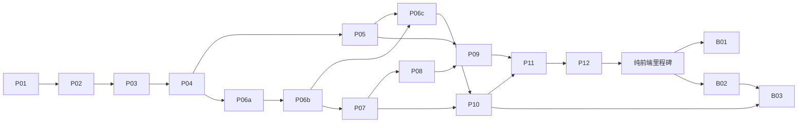

# Guns’n’Glory 分阶段实施计划

## 1. 目标、状态与授权

本计划将完整离线游戏拆成可独立验证、集成和回滚的增量。当前只有设计文档，所有实现阶段均未开始；本轮交付范围是文档及其分支提交，不包含执行本计划、登记导航、合并 master 或发布游戏。后续实现统一在用户指定的 `gunsnglory` 集成分支推进。

执行阶段前，先阅读 [AGENTS.md](../AGENTS.md) 和 [架构设计](architecture.md)，确认目标阶段的前置验收已经满足。实施中发现接口语义、新依赖或架构边界需要调整时，先更新设计并确认，不借实现阶段扩大范围。

两个里程碑分别验收：

| 里程碑 | 完成定义 | 不依赖 |
| --- | --- | --- |
| M1：纯前端正式版 | 离线可达玩法与完整战役实现，正式档案可用，学习调试与本地批量模拟可用，完成静态发布和线上实测 | 后端服务、账号、远程任务平台 |
| M2：后端能力接入 | 在 M1 契约上分别提供远程档案、内容资源和批量任务，浏览器实时战斗保持本地执行 | 服务端权威战斗、多人同步 |

“完整”由内容与行为覆盖表、固定场景和浏览器验收共同证明，不要求穷举所有随机战局。已实现模块的测试从首个阶段开始维护，不把正确性检查推迟到上线前。

## 2. 阶段总览与依赖

### 2.1 本轮候选：首批纵向切片

上一版 P01–P04 按骨架、内容、内核、界面推进，不能作为 Matt tracer-bullet ticket 的直接拆分。建议用以下可演示切片替换；每片同时完成必要内容、规则、Interface、界面与行为测试。当前等待用户确认粒度和阻塞关系，尚未发布 tracker 任务。

| 候选 | 交付行为 | Blocked by | 独立验收 |
| --- | --- | --- | --- |
| T01 | 打开首关地图并选中一个合法单位 | 无；本片包含必要的最小构建接入 | 页面可开、选择反馈可见，同一操作可从公共 Interface 验证 |
| T02 | 手动开一波敌人，观察其移动、离场与扣命 | T01 | 固定输入得到预期路线与生命变化，浏览器看到相同结果 |
| T03 | 单位攻击、击杀并获得现金 | T02 | 固定场景验证攻击与收益，画面和状态查询可见 |
| T04 | 单波胜败结算并重新开始 | T02、T03 | 胜败各有完整流程，重开不保留上一局的队列或状态 |
| T05 | 保存首次正式结算并刷新恢复 | T04 | 正常恢复、保存失败反馈、重复结算不重复生效 |

T01 的单位和 T02–T04 的单波是首关的受限开发场景，不声称已完成原版首关。正式版本只开放已实现的完整玩法。后续任务围绕学习观察、回放、方案比较和逐项玩法扩展继续纵向拆分，而不是先完成整层再接入消费者。

各候选需映射[产品规格](spec.md)中的相关用户故事。确认后用任务图替换旧的横向阶段，区分可在一次独立上下文完成的 ticket 与需要进一步拆分的里程碑；真正前置之外的工作可并行。

### 2.2 上一版里程碑草案（待重新拆分执行任务）

| 阶段 | 独立交付物 | 前置 | 当前状态 |
| --- | --- | --- | --- |
| P01 | 可构建应用与模块边界 | 文档设计 | 未开始 |
| P02 | 游戏内容清单与首关地图预览 | P01 | 未开始 |
| P03 | 无画面首关规则内核 | P02 | 未开始 |
| P04 | 首关可玩闭环 | P03 | 未开始 |
| P05 | 战役档案与 IndexedDB 实现 | P04 | 未开始 |
| P06a | 学习控制与只读检查 | P04 | 未开始 |
| P06b | 回放与最小串行场景运行 | P06a | 未开始 |
| P06c | 参数方案比较与实验持久化 | P06b、P05 | 未开始 |
| P07 | 常规单位、敌人及战斗规则扩展 | P04、P06b | 未开始 |
| P08 | 特殊对象逐项交付 | P07 | 未开始 |
| P09 | 完整战役、界面、语言和声音 | P05、P07、P08 | 未开始 |
| P10 | 本地并行模拟与脚本入口 | P06c、P07 | 未开始 |
| P11 | 完整版本集成验收 | P09、P10 | 未开始 |
| P12 | 静态站点登记、发布和线上验证 | P11 | 未开始 |
| B01 | 远程档案适配器 | M1；后端方案确认 | 未开始 |
| B02 | 远程内容资源适配器 | M1；后端方案确认 | 未开始 |
| B03 | 远程批量模拟任务 | P10、B02；任务平台方案确认 | 未开始 |

P05 与 P06a/P06b 可并行；P06c 在两条前置链完成后集成。P09 的普通界面、翻译可在对应规则稳定后提前进行。每条并行任务只修改自己的模块，通过已约定接口集成，不直接读取另一个模块的内部状态。

## 3. 各阶段共同执行规则

每阶段按以下顺序执行：

1. 明确本次功能清单、受影响版本及必要输入，列出不处理的内容。
2. 基于 `gunsnglory` 的最新已验证提交开展工作；并行任务从该集成分支建立独立 worktree 和任务分支。保护工作区已有改动，不混入其他应用或研究目录的修改。
3. 选择一个可观察的验收场景，先确定输入、操作和结果，再完成对应功能及必要测试。
4. 检查模块依赖、公共接口、数据格式和错误路径；确认正式档案与实验数据隔离。
5. 运行范围匹配的测试、构建和人工检查，记录实际命令、结果与未验证项。
6. 检查 diff 后提交；任务分支先同步 `gunsnglory`，通过受影响检查后集成回 `gunsnglory`，使下一任务获得前置成果。只从前置任务已验收的可执行任务集合中领取工作；不逐阶段合入 master。

代码集成与游戏公开发布是两个节点。阶段成果提交并推送到 `gunsnglory`；公开发布阶段通过整体审查并取得发布授权后，再按根规则合入 master、推送并检查工作流及公网结果。本项目的集成分支约定来自用户的明确指定，优先于通用的逐任务从 master 建分支规则。本轮只修订设计，不执行游戏实现或发布。

P01–P11 默认交付可构建的应用目录和阶段测试，进行本地或独立预览验收，不提前登记不完整的公网游戏入口。没有登记应用时，现有发布工作流不一定执行本应用测试；交付不能将其他应用 CI 的成功当成本应用验证。

回滚按变更类型处理：

| 变更类型 | 回滚要求 |
| --- | --- |
| 无持久化的代码或资源 | 回退对应代码与内容版本，并运行阶段基线 |
| 档案格式 | 证明旧代码可读新数据，或提供经验证的降级/导出恢复路径；仅回退 Git 不足以回滚数据 |
| 实验与回放格式 | 保留已提交版本，不用新格式覆盖历史运行；旧运行不可重放时返回明确原因 |
| 后端适配器 | 保留原适配器与数据迁移边界，验证切换后的档案来源，不能静默产生两份进度 |

以下命令名称均为拟定入口，尚不存在。实现相应能力时写入应用 `package.json`，以后以该文件为准：`build`、`test:ci`、`test:unit`、`test:contracts`、`test:e2e`、`simulate`。不提前创建空脚本充当完成证明。

## 4. 纯前端实施阶段

以下 P 阶段保留上一版范围、风险及验收素材，当前不是可直接领取的执行任务。应在第 2.1 节的粒度与阻塞关系确认后重组为纵向任务；不能绕过该确认直接执行“骨架 → 整个内核 → 界面”的旧顺序。

### P01：应用骨架与依赖边界

- **范围：** 建立独立 pnpm 应用、TypeScript、Vite、Canvas 容器及 site-shell 接入；只创建本阶段确实使用的模块和装配入口。
- **产出：** `package.json`、锁文件、安装脚本、类型检查、基础测试与构建入口；首页标明当前开发状态。
- **边界：** `core` 不导入浏览器或 Node 环境模块；`application` 通过 `ports` 使用外部能力；适配器只在 `bootstrap` 装配。
- **验收：** 全新安装后可构建 `dist/`；基础页面可加载；语言状态由共享 shell 提供；依赖边界检查能够拒绝一条刻意构造的非法导入。
- **验收：** 应用构建不需要研究目录、本机路径、后端密钥或原始 APK；已有应用构建入口保持可用。
- **部署/回滚：** 仅本地预览，尚不修改 catalog；可独立回退应用骨架。
- **暂不做：** 游戏规则、框架迁移、通用插件系统、后端或共享包拆分。

### P02：游戏内容与首关地图预览

- **前置：** P01 可构建且模块边界检查通过。
- **范围：** 从既有研究输入中迁入游戏需要的素材和机器可读配置，形成游戏自有内容清单；研究原位置保留引用，不复制证据管理结构。
- **产出：** 首关可加载内容包、关卡到地图映射、图集裁切和资源引用；建立 `ContentSource` 的最小静态实现。
- **验收：** 清单引用全部可解析，地图尺寸、坐标、图集裁切和关键数值合法；缺文件或未知内容版本时明确失败。
- **验收：** 首关地图在约定视口下正确展示；世界坐标到屏幕与反向输入换算通过边界测试；资源由部署子路径正确加载。
- **验收：** 完整战役映射规则区分 60 个战役关卡与 63 个地图文件，不能把文件枚举当成开放关卡列表。
- **部署/回滚：** 发布物仍为内部地图预览；代码与内容包版本一起回退。
- **暂不做：** 全部资源一次性预加载、通用内容编辑器、玩法状态及存档。

### P03：无画面首关规则内核

- **前置：** P02 的首关内容与坐标约定稳定。
- **范围：** 实现首关所需的状态初始化、路线、波次、基本单位、敌人、命中、奖励和胜负；同步步进接收显式时间、命令及随机状态。
- **产出：** 可在 Node 中运行的生产内核、首关固定场景，以及最小 `SessionController` 命令/查询/步进入口；无画面测试从本阶段就通过公共入口运行，不要求已有玩家界面。
- **验收：** 固定配置、全部相关随机初始状态、时间序列和操作序列可复现；独立运行实例之间无共享可变状态。
- **验收：** 更新次序、整数截断、等待开波与暂停含义、生命耗尽和波次清空的判定顺序有针对性测试。
- **验收：** 原版可变时间语义得到保留；不同分帧产生的结果差异有明确用例，不能改成固定 60 Hz 后宣称等价。
- **部署/回滚：** 通过无画面场景独立交付；回退内核版本不会修改任何正式用户数据。
- **暂不做：** 尚未在首关出现的特殊对象、批量任务平台、正式存储和额外渲染引擎。

### P04：首关可玩闭环

- **前置：** P03 固定场景通过，P02 地图预览可用。
- **范围：** 应用流程连接内核、输入、Canvas 与基础声音；完成开始、招募或操作、战斗、暂停、胜负、重开的一条完整路径。
- **产出：** 浏览器对既有 `SessionController` 公共接口的接入；鼠标与触屏适配；首关交互回归，不另造一套浏览器战局模型。
- **验收：** 人工完成一场胜利和一场失败；重开重置战局；切出页面与恢复行为明确，不补算无限后台时间。
- **验收：** 拖动取消、指针捕获丢失、缩放和留白区域命中正确；渲染排序不改变逻辑遍历次序。
- **验收：** Playwright 覆盖开局至结算；通过 Codex 内置浏览器检查鼠标与触屏模拟、窗口变化、基本声音启动。
- **部署/回滚：** 可独立展示首关原型，明确内容范围；尚无正式档案迁移问题。
- **暂不做：** 全战役、高级学习面板、账户和远程控制协议。

### P05：战役档案与 IndexedDB

- **前置：** P04 结算和重开行为稳定；读取 [存储契约](storage-contracts.md)。
- **范围：** 实现 `ProfileRepository`、内存适配器与原生 IndexedDB 适配器；持久化进度、设置和本地高分。
- **产出：** 档案格式与迁移入口、结算落档用例、缺失/损坏/冲突/容量错误处理、共享契约测试。
- **验收：** 两种适配器使用同一应用用例和同一契约测试；从内存切换至 IndexedDB 只改装配，不改上层业务。
- **验收：** 刷新恢复进度和设置；未完成关卡从头开始；重复结算或写入重试不重复发放解锁和奖励。
- **验收：** 在真实浏览器验证事务提交、写入失败和多个实例冲突；写入失败不能显示“已保存”。
- **部署/回滚：** 首次建立用户数据边界；为格式变更准备导出和恢复方案，明确旧程序读取能力。
- **暂不做：** 原生 Android 二进制存档兼容、战局续玩、localStorage 实现及远程同步。其他介质按需实现，但不能改变本阶段契约。

### P06a：学习控制与只读检查

- **前置：** P04 的浏览器战局可用。
- **范围：** 暂停、单步、状态检查、范围与路线覆盖层，通过已有公共接口实现。
- **产出：** 学习面板、只读查询 DTO、单步控制与调试模式边界。
- **验收：** 一次单步只推进一帧；查询返回的数据不能修改战局；调试覆盖层不影响随机调用和战斗；界面与脚本命令得到相同规则结果。
- **部署/回滚：** 学习入口可独立启停或回退，不涉及持久化迁移。
- **暂不做：** 回放格式、参数编辑、大规模并行或远程控制。

### P06b：回放与串行场景运行

- **前置：** P06a 控制和查询稳定。
- **范围：** 冻结场景输入、记录并重放操作、从初始状态执行到终止；引入必要的运行 DTO 与窄 `RunExecutor` 契约。
- **产出：** 回放格式、最小 `ScenarioRunner`、本地串行执行适配器、固定场景与摘要核验。
- **验收：** 记录相关时间序列、全部随机源及必要环境状态；从头重放关键帧和终局摘要一致；倍速消费相同步骤，不放大 `dt`；未知版本明确拒绝。
- **部署/回滚：** 回放可独立导出和验证；回退执行器不覆盖旧记录，明确支持的回放版本。
- **暂不做：** 检查点加速续算、实验仓库、并行任务平台或参数编辑器。

### P06c：参数比较与实验持久化

- **前置：** P06b 可串行执行；P05 的存储契约与介质测试基础可用。
- **范围：** 冻结原版基线，建立独立参数方案、同场景对比及实验保存。先实现内存仓库和契约测试，再接入 IndexedDB，分别提交和验收。
- **产出：** 实验配置格式、最小指标报告、`ExperimentRepository` 的所需操作及两种实现。
- **验收：** 两套完整参数配置运行同一组场景、策略和样本，输出可解释的差异；修改编辑态配置不改变已提交实验；实验从不写正式档案。
- **验收：** 切换内存/IndexedDB 不改实验用例；验证配置冻结、产物提交与失败恢复；历史基线和实验保持只读版本。
- **部署/回滚：** 内存比较和持久化可分开交付；回退界面或仓库不重写历史结果。
- **暂不做：** 自动平衡优化、大规模并行、公共远程 API、MCP 或通用编辑器。

### P07：常规玩法扩展

- **前置：** P06b 可运行固定回放；读取 [模拟与自动化接口](simulation-and-automation.md)。参数比较在 P06c 完成后复用，不阻塞局部规则测试。
- **范围：** 按依赖拆为多次交付：敌人及组队行为、单位与升级、投射物与状态效果、生成池与经济规则。每次只扩展一个有明确验收场景的规则集合。
- **产出：** 对应规则模块、内容条目和局部场景；更新功能覆盖表，注明已实现、部分实现与未实现。
- **验收：** 每类单位和敌人的关键分支可触发；毒伤阈值、持续伤害截断、目标排序、死亡分解等边界有独立预期。
- **验收：** 增加数据型单位不修改应用流程或存储适配器；新增行为只修改所属规则及其必要公共类型。
- **验收：** 首关回归持续通过；任何有意改变原版行为的方案只进入实验版本，不直接更新原版基线。
- **部署/回滚：** 每批规则与对应内容一起交付或回退；涉及回放版本时保留兼容说明。
- **暂不做：** 用通用 A*、刚体引擎或新 ECS 替换既有规则；一次加入全部特殊玩法。

### P08：特殊对象逐项实现

- **前置：** P07 所需的碰撞、投射物、生成与交互规则已可复用。
- **拆分：** 炸药箱/触发器、赌徒/赌场、列车、蒸汽机车各为独立实现与提交单元；先列明对应地图和场景，不合成一个不可回滚的大改动。
- **产出：** 对象配对、控制状态、动画与事件映射；每类至少一个成功场景和一个边界/拒绝场景。
- **验收：** 炸药与普通范围伤害的边界分别验证；赌徒的随机消耗、结果和延后生成语义固定；列车组件更新与阻挡次序有场景覆盖。
- **验收：** 对象状态可以通过公共查询解释，脚本能用正式命令操作；不需要脚本直接修改内部字段。
- **验收：** 规则、画面、交互和声音分别记录验证范围；仅规则测试通过不能标记视觉对照完成。
- **部署/回滚：** 按对象及依赖内容独立交付；回退时移除其可进入关卡或返回明确的不支持状态。
- **暂不做：** 独立通用载具框架、未被当前玩法使用的插件能力。

### P09：完整战役与表现内容

- **前置：** P05、P07、P08；分区接入，不一次导入全部内容后再统一排错。
- **范围：** 六区域与 60 关、难度和单位解锁、完整菜单/帮助/结算、英文与中文、图像动画及音频映射。
- **产出：** 内容覆盖表、逐区固定场景、字符串检查、资源清单检查和页面状态转移表。
- **验收：** 60 关均可初始化，内容引用完整；每区选择代表关卡完成交互与结算检查，特殊组合进入对应回归集合。
- **验收：** 解锁与高分依据游戏规则；显示分数和保存高分的舍入差异有测试；中文换行及原画面比例在目标视口可用。
- **验收：** 音频在目标浏览器实际解码和启动，错误时可静音继续；图像密度、裁切与遮挡完成固定状态对照。
- **部署/回滚：** 每区内容包可分别回退；正式档案保留已获得进度，内容暂不可用时不删除进度。
- **暂不做：** 广告、支付、统计 SDK、外部排行榜及新玩法扩展。

### P10：本地批量模拟与脚本入口

- **前置：** P06c 场景/实验格式和 P07 稳定规则；后续特殊内容通过相同入口逐步加入。
- **范围：** 规则机器人与操作回放策略、批次清单、Node worker 并行、取消/预算/错误归集、结果导出；CLI 是这些能力的薄包装。
- **产出：** 小规模验证批次、可复现失败样本、串并行对照、运行指标与资源测量；记录场景集、策略、配置及内核版本。
- **验收：** 串行与并行对同一运行给出一致结果；并发顺序不影响随机源；超时、取消、异常不计入正常败北。
- **验收：** 同一批场景比较多套参数，保留样本量和停止原因；先测单次资源开销并建立预算，再扩展批量规模。
- **验收：** 用 `pi` 实际加载或发现 CLI 并完成一次真实小批次调用，记录命令、返回结果和产物；直接手工运行 CLI 不替代该验证。
- **部署/回滚：** 本地执行器独立于网页产物发布，回退执行器不改已提交实验结果。
- **暂不做：** 分布式调度、无限运行、自动提交参数优化结果；MCP 仅在确有客户端需求时另开阶段。

### P11：完整版本集成验收

- **前置：** P09 与 P10，所有已承诺功能均在覆盖表中有实现和验证记录。
- **范围：** 汇总跨模块回归、目标浏览器与视口对照、资源加载、存储失败、输入取消、页面隐藏恢复及长时间运行检查。
- **产出：** 发布候选版本、内容与规则版本清单、验收记录、剩余限制和可重放失败清单。
- **验收：** 完整应用测试与构建通过；Codex 内置浏览器完成代表性正常与错误流程；模拟输出和浏览器结果的可比部分一致。
- **验收：** 分别测量内核步进、绘制、资源加载和内存；以目标设备测量制定预算。仅在具体瓶颈被定位后提出优化，不能提前换引擎。
- **验收：** 原版基线、实验版本与正式档案隔离；所有已发现阻断问题闭合；不能以静态规则覆盖替代最终画面和交互检查。
- **部署/回滚：** 冻结可重建的发布候选，变更后只重跑受影响检查及必要集成检查；保留上一候选版本。
- **暂不做：** 用“优化”夹带架构迁移、新依赖或超出基线的新能力。

### P12：共享站点发布

- **前置：** P11 通过，用户授权当前阶段发布；已确认应用路径和公开资源范围。
- **范围：** 登记 `apps/catalog.json`，验证 shell、语言和子路径资源；接入已有测试矩阵与静态构建，不新增云资源。
- **产出：** 可由现有工作流构建发布的应用；必要的根 README 导航说明与发布记录。
- **验收：** 应用安装、构建、`test:ci` 及站点集成检查通过；页面公共外壳完整，移动端游戏控件不被浮动挂件遮挡。
- **发布：** 验证后的功能分支按仓库规则合入 master，再执行裸 `git push origin master`；用 CLI 跟踪 workflow 直至成功。
- **线上验收：** Codex 内置浏览器访问公开路径，检查开局、操作、声音、结算、刷新档案、语言和资源加载；记录实际版本与结果。
- **回滚：** 回退发布提交并重新走现有流程；同时验证档案格式兼容。CI 未成功或线上检查失败时，M1 不算完成。
- **暂不做：** 后端部署、云数据库、实时多人或离线安装 PWA。

## 5. 后端能力独立演进

以下阶段不阻塞 M1。开始前分别确认服务归属、认证方式、运行环境、成本额度、数据保留、秘密管理与运维责任；使用现有资源也要验证边界。接口已有约定不等于已授权采购、创建或部署服务。

### B01：远程档案

- **前置：** M1；档案接口及并发契约稳定；具体后端方案获得确认。
- **范围：** 后端档案 API、HTTP 适配器及身份映射；数据库由服务内部选择，不泄漏到应用用例。
- **产出：** 远程实现、共享契约测试、认证/权限测试、本地档案迁移与切换流程。
- **验收：** 更换装配配置即可复用上层用例；断网、超时、重复请求、并发写入和失效身份语义明确；迁移前后进度可核对。
- **验收：** 真实远程介质通过集成测试；浏览器代码不包含数据库或对象存储长期凭据。
- **部署/回滚：** 服务与客户端分开发布；回退前明确权威档案位置，已同步进度不被旧本地副本覆盖。
- **暂不做：** 实时战斗迁移、无约束双向合并及跨设备自动解决所有冲突。

### B02：远程内容与资源

- **前置：** M1；内容版本和资源清单稳定；对象存储或分发方案获得确认。
- **范围：** `ContentSource` 远程适配器、版本发布和可用性检查；保留静态源作为独立实现。
- **产出：** 不可变内容版本、清单与资源完整性校验、发布提交点、保留和回滚策略。
- **验收：** 同一版本从静态或远程源加载后产生相同游戏定义；部分上传失败的版本不对外宣布可用。
- **验收：** 资源路径、鉴权与缓存由适配器处理；旧回放所需版本缺失时明确报错，不替换为最新内容。
- **部署/回滚：** 先上传并校验完整版本，再切换清单入口；回退入口时保留仍被档案、实验或客户端引用的旧版本。
- **暂不做：** 通用资源编辑平台、第三方插件市场及在线任意代码执行。

### B03：远程批量模拟

- **前置：** P10；B02 或等价的已验证版本化内容交付；后端任务运行及存储方案获得确认。
- **范围：** 提交批次、查询状态、取消、读取结果；服务端直接运行同一内核和场景执行器，任务按运行粒度调度。
- **产出：** 任务 API、运行资源限制、幂等提交、失败重试和结果索引；保留本地执行方式。
- **验收：** 本地与服务端对同一冻结场景结果一致；任务重复投递不产生重复有效结果；部分失败可定位到具体运行并复现。
- **验收：** 取消、超时、额度耗尽及执行器崩溃有明确最终状态；结果持久化完成前不报告任务成功。
- **验收：** 若增加 CLI/MCP/skill 客户端，逐入口用 `pi` 完成真实调用；环境不能验证时列为未完成验收。
- **部署/回滚：** 新旧执行器绑定各自规则版本；回滚服务不改变已完成结果，运行中的旧版本任务按既定策略完成或取消。
- **暂不做：** 逐帧 HTTP 控制、服务端权威实时战斗、自动无限扩容和不受限用户代码执行。

## 6. 阶段交付记录

每个阶段完成后，在对应任务或交付记录中至少保留：范围与版本、实际改动、执行命令及结果、人工检查、已知限制、持久化兼容、回滚方式、后续阶段前置条件。此表是填写要求，不是已经完成的证据。

| 字段 | 必需内容 |
| --- | --- |
| 范围 | 阶段编号、实际功能、未实现部分 |
| 版本 | 提交、内容/规则/格式版本，适用运行环境 |
| 验证 | 自动检查与真实操作的命令、关键输出、失败及处理 |
| agent 入口 | `pi` 实际加载及调用证据；未验证时写明原因 |
| 数据 | 档案迁移、实验隔离、历史内容保留与回滚限制 |
| 发布 | 是否发布；发布时记录 workflow 和线上检查结果 |

当前设计文档只需完成文档差异检查、链接和契约一致性检查、AGENTS.md 的实际加载验证及 Markdown 成品复制。游戏运行、存储介质、模拟器和公开站点尚未实现，不在本轮报告中记为通过。
