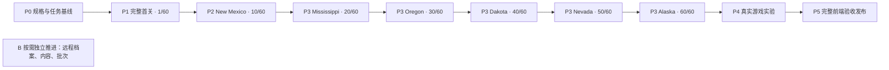

# Guns’n’Glory 实施计划

## 1. 执行目标与当前状态

**P0 规格与任务基线已关闭；下一实现里程碑为 P1：完整原版 Cow Gulch。** 本计划已替换原来的 T22–T26 后续流水线与 E/U/D/W/G/S/L/R/V 任务族；T01–T21 保留为历史交付记录，不能继续按旧编号推进。P0 关闭只表示路线、内容分母、责任和验收契约可执行，不表示完整游戏已完成。

最终目标以[产品规格](spec.md)为准：在浏览器实现指定原版的六区域、60 关完整玩法及表现，支持学习、脚本调试和可复现的平衡实验。纯前端正式版不依赖后端；后端以后只承担档案、资源管理和批量模拟，实时战斗继续在浏览器运行。

已确认的 `Game`、`Progress`、`Experiments` 三个深 Module 和首五个纵向切片的粒度继续成立。需要修正的是完整内容的覆盖责任、工作顺序和验收深度。原计划让工具、容错任务持续推进，却没有把完整首关、所有对象和全部关卡落实为明确交付门槛；这是规划缺陷，不能归因为实现任务没有遵守计划。

### 1.1 当前实现与发布状态

历史能力基准：代码提交 `558176c`。T01–T21 均已合入 `gunsnglory` 和 `master` 并完成公开发布。T21 包含难度选择、对应样本的难度效果、困难模式解锁与旧档默认简单模式，不应从后续规划中丢失。逐项证据见第 8 节及[验证记录](validation.md)。

**完整原版关卡仍为 0/60（按 P1-F 对照验收门槛计数）。** Cow Gulch L01 已接入独立的正式战役身份，包含原版八波、整关胜败与正式档案；现有样本入口仍与正式进度隔离。P1-F 首关对照验收尚未完成，因此 L01 暂不计入已验收关卡。T10 的真实 Android AVD 触控仍未验证。

P1-A 原始开局、P1-B 前两波与雇用、P1-C 运输队、P1-D 原版八波和终局、P1-E 正式入口与档案接通均已实现并发布；P1-E 证据见[验证记录第 39 节](validation.md#39-p1-e-正式战役入口与档案)。P1-F 首关对照验收仍待完成。

P1-F 已按 APK 屏宽目标和缩放上下限实现视口、统一地图绘制与点选变换，并接入 Cow Gulch 静态装饰及碰撞、原版战斗 HUD/小地图、可保存的音效开关，以及 Wave01–08 的 Pedro 叙事对白。对白使用 APK 肖像和语音资源，暂停正式战役直到玩家继续；具体内容与证据见[验证记录第61节](validation.md#61-p1-f-cow-gulch-逐波叙事对白)。原版 `GameObjectManager` 使用 `fineY + drawingOffsetY + fineZ × 100` 排序单一对象队列，再以 `768000` 为界分道路前后两次绘制；网页以单一跨类型队列统一排序静态装饰、玩家单位、敌人、投射物和车厢残骸，并沿用该道路分界。队列现由 `GameSession` 在每个模拟步维护，作为只读 `GameView.drawOrder` 交给 Canvas 消费，因此跳过绘制或中途首次绘制也不会丢失顺序历史（见[验证记录第57节](validation.md#57-p1-f-cow-gulch-模拟步绘制顺序)）。此前的目标投射物局部修正见[验证记录第55节](validation.md#55-p1-f-cow-gulch-同深度目标投射物遮挡)。原版伤害类型 3/4/5/6 的未命中投射物现保留 Java float32 弹道高度及 `fineZ`，按 `f < 0.5`、垂直偏移 `< 7680` 且 `fullZ == 1` 判定切层，并在越过当前帧绘制后于下一游戏帧应用；峡谷且非道路只控制拖尾显示。算法依据见[产品规格 §4.7](spec.md#47-动画与声音必须对应真实行为)，代码和测试增量见[验证记录第 46 节](validation.md#46-p1-f-cow-gulch-特殊投射物弹道与道路图层)。此前的缺口及其边界保留在[验证记录第 45 节](validation.md#45-p1-f-cow-gulch-投射物与残骸深度排序)。受损敌人的生命条现按原版类型和95% HP 门槛绘制，保留半高填充、小倍率底条修正、float32整数宽度及颜色，证据见[验证记录第47节](validation.md#47-p1-f-cow-gulch-受损敌方生命条)。静态装饰在同深度时按原版地图扫描插入次序倒序绘制，证据见[验证记录第48节](validation.md#48-p1-f-cow-gulch-静态装饰同深度插入顺序)。敌人行走帧现按 APK 阈值表对 type1/2/4 和 type8 分别推进，见[验证记录第49节](validation.md#49-p1-f-cow-gulch-敌人行走动画帧推进)；type1/2 步兵死亡图集及 type4/8 车辆烟雾末帧现按 APK 计时保留，见[验证记录第50节](validation.md#50-p1-f-cow-gulch-普通步兵死亡动画)和[第51节](validation.md#51-p1-f-cow-gulch-死亡动画计时零边界)。通用受击金色光圈已确认不是 APK 行为并移除，见[验证记录第53节](validation.md#53-p1-f-cow-gulch-移除通用受击光圈)。转向之外的其他敌人动画状态仍待对照。这些都是 P1-F 的局部增量，不代表全量首关对照通过，也不改变0/60的关卡验收计数。

玩家 Gunslinger/Mexican 的移动距离帧阈值、方向行与镜像现按 APK 默认行走表实现；详细证据、帧边界测试和兼容性见[验证记录第58节](validation.md#58-p1-f-cow-gulch-玩家行走动画)。这一局部差异关闭不代表 P1-F 完成，首关验收仍为0/60。

Cow Gulch 的环境曲、每波首枪战斗曲、败北/波间恢复与胜利曲已接入浏览器播放，并复用声音设置、后台暂停/恢复和播放失败重试；验证与边界见[验证记录第62节](validation.md#62-p1-f-cow-gulch-背景音乐)。其余区域的音乐和单位音画覆盖仍未开始，P1-F 及首关验收保持未完成、0/60。

本轮把正式战役的波次请求池更新移到当前模拟步的敌人、单位和投射物更新及射击处理之后。新生成敌人从下一模拟步才开始移动并进入射击目标集合；固定 Cow Gulch 正式关卡行为测试和发布验证见[验证记录第65节](validation.md#65-p1-f-cow-gulch-波次敌人生成时序)。该局部修正不改变首关验收状态，完整关卡计数仍为0/60。

P1-F 静态核对还发现 Wave01/02 步兵组漏掉了 APK 的生成随机过程：网页此前固定使用速度基准和按序偏移。本轮改为每次请求抽取一个供全组共用的速度比例、为每名成员无放回随机选出生偏移，并为成员分配独立组号；规则版本升至 `gng-rules-4`，旧回放不会错误套用新随机序列。精确依据和行为测试见[验证记录第66节](validation.md#66-p1-f-cow-gulch-步兵速度与阵型随机)。这一项仍不代表 P1-F 完成，首关验收与60关计数保持0/60。

网页敌人移动此前漏掉了 APK 的异组碰撞阻挡：type4/type8 只在生成时互相检查。现已按 APK 的 `7678×7678` 碰撞框、过滤同组对象的规则、方向预测、碰撞回退及同组下一成员单步阻挡，加入 Cow Gulch 两组迎面运输队的行为覆盖；type1/2 不进入该碰撞管理器。规则版本升至 `gng-rules-5`，旧规则回放不会静默使用新移动规则。验证见[验证记录第68节](validation.md#68-p1-f-cow-gulch-异组敌人碰撞)。这项不启用背景地形碰撞，不修正原版桥面路线，也不代表 P1-F 完成；首关与完整关卡验收仍为0/60。

随后按 Smali 修正越界清理时机，并保留 type8 移除时不扣命/难度的例外；规则版本升至 `gng-rules-6`，使旧回放不会静默套用新的移动/结算规则。Cow Gulch 唯一 action1 字段的成功生成会持续后移，因此固定种子、无玩家输入的当前模型会以失败结算；这是源码模型结果，不能替代 APK 运行对照。前两波自然收入、真实战斗是否达到雇用价仍需按该源行为重新验收，详见[验证记录第69节](validation.md#69-p1-f-cow-gulch生成点漂移与越界清理)。P1-F 和关卡计数仍为0/60。

| 已有能力 | 可保留的价值 | 不能据此宣称的能力 |
| --- | --- | --- |
| Cow Gulch 原始对象、静态装饰及碰撞、P1-C 运输链、正式 Wave01–08 | 正式 L01 从原始初态自动推进八波，完成/败北后结算；运输 type4/type8、死亡派生、奖励与清理已按 P1-C/D 的固定场景覆盖；正式关卡 ID 与旧样本身份隔离 | P1-F 对地图、对象、规则和表现的完整首关对照；type5/type6 及其余关卡内容 |
| 地图枪手按原价雇用、同一对象唤醒与再选择；正式关卡 tile97 Mexican 雇用；既有招募池机制 | 固定开局可回归；正式 L01 从原始 `$65` 自然推进到 `$100` 后雇用 Mexican 的 Game 与触屏流程已覆盖 | 生成建筑出兵、全部单位等级与真实战役进度 |
| 枪手真实第六发特殊装填、正式 L01 Wave02 Mexican 重型 AOE | 首关两类武器的部分攻击和碰撞规则已接入；真实战役 Mexican 投射物命中敌群的 Game 行为已有覆盖 | 其他武器与状态、建筑/列车对象组合、非首关战斗规则及全部关卡的整体平衡验证 |
| 原版枪手/Mexican 射击帧、炸药与爆炸特效、枪声、炸药音效及 Cow Gulch 配乐 | Canvas 帧绘制、已实现音效请求和 Cow Gulch 背景音乐切换接通 | 全方向状态图、全部攻击/睡眠/死亡动画、其他单位音效及其余区域音乐 |
| T20/T21 样本关卡、难度及档案恢复 | 样本行为可回归；P1-E 已接入独立的 L01 正式入口和正式进度 | 60 关序列、不同真实地图及资源包切换、其余关卡的战役难度与进度覆盖 |
| 重放、方案比较、CLI 和 worker 批次 | 固定样本可复现，既有工具可用于后续回归 | 原版完整游戏的平衡性结论、真实多人场景性能预算 |

该表描述上述代码基准，不作为持续维护源码细节的第二份清单。具体规则、参数、勘误及内容集合定义由[产品规格](spec.md)维护；素材组织、关卡装配和 Module 分工由[架构设计](architecture.md)维护；实际执行结果由[验证记录](validation.md)维护。本文维护阶段、依赖、范围及逐项交付覆盖状态；第 10 节是内容覆盖与实现状态表。

### 1.2 规格展开的深度

| 层次 | 必须明确的内容 | 完成时点 |
| --- | --- | --- |
| 最终产品 | 原版基线、全部产品能力、网页适配、实验范围、后端范围外事项 | P0 核对，沿用产品规格 |
| 全局内容与风险 | 全部对象/参数组/关卡/表现的清单及阶段归属；时间、随机、单位、身份、存档兼容等跨阶段决定 | P0 完成前 |
| 当前里程碑 | 每个任务的输入、状态变化、输出、依赖、失败处理、独立预期和验收场景 | 该里程碑进入实现前 |
| 后续里程碑 | 明确内容范围、主要新机制、依赖及退出标准 | P0 排定；该阶段开始前展开局部规格 |
| 实现与验证 | 内容被实际规则消费，交互与表现对应，验收记录可复查 | 每个任务内 |

后续局部帧裁切等细节可以按阶段展开；全部内容是否属于目标、由哪个阶段承担，必须在 P0 明确。未确认规则只阻塞依赖它的任务，不能以合理默认值填入原版基线，也不能无限期重新研究已确认内容。

## 2. 任务契约与启动门槛

### 2.1 每项任务必须具备的规格

下表是任务进入实现的检查表。里程碑名称和任务表只是范围约束，不能替代具体规格；P1-A–F 的输入、独立预期、边界和证据已列在第 4.1 节。每项开工前冻结其 StartRecord、随机状态、逐帧时间、输入序列与 oracle；规格变更时同步更新受影响的回放和验收。

| 字段 | 必填内容 | 未满足时的处理 |
| --- | --- | --- |
| 目标与范围 | 用户故事、所属里程碑、真实关卡/对象、玩家可见结果、明确留后项 | 拆清目标，不能以“完善系统”“更多内容”进入实现 |
| 输入与初态 | 原版版本、场景/难度、参数引用、对象状态、时间和随机条件 | 核对版本及单位；缺参数保持阻塞 |
| 行为规格 | 触发、状态迁移、计算/截断/顺序、输出与错误行为 | 回查消费分支；字段表存在不代表规格完整 |
| 表现规格 | 素材 ID、动画驱动/方向/锚点、反馈与音频；不涉及时说明原因 | 占位表现只能计为部分实现 |
| 依赖与影响 | 真正前置、修改的 Module、内容/规则/存档/回放版本影响、回滚办法 | 消除依赖环及隐含跨模块改动 |
| 验收样例 | 初态、操作或事件、明确预期、独立来源及检查方法 | 预期不能仅由被测实现或同一个导入器生成 |
| 异常与边界 | 阈值、重复输入、非法状态、缺资源、生命周期及恢复 | 先确定关键边界，不在编码时临时猜测 |
| 完成证据 | 公共行为测试、真实关卡过程、必要表现检查、未验证项 | 测试数量和字段存在均不能替代通过条件 |

例如，“雇用”需要验证合法对象从待雇用变成可选择、移动、开火的同一对象，现金只扣一次；不足现金和重复确认不能改变状态。合法价格、状态编号及来源在产品规格中维护。正式首关的可达性由实际击杀赚钱后的雇用路径证明，额外 fixture 只用于不足现金、重复操作等边界测试。

枪手特殊装填的计数、叠加方式、无目标/移动处理与升级重置已经在[产品规格 §4.3](spec.md#43-参数确定单位与规则消费)依据消费者分支确定；对应验收必须跨过第6次实际射击并核对冷却边界，不能只断言四档参数表。

### 2.2 P0 的完成条件

P0 交付规格和可执行计划，不交付本次列举的全部游戏机制。完成时同时满足：

- 本文第 10 节的完整内容覆盖表逐项列出全部 60 关，以及源目录实际使用的单位、敌人、组件、特殊对象、规则、动画/音效集合；每项都有阶段归属和来源入口，没有未归属项。
- 每项分别记录“资料确认、数据迁入、规则通过、表现检查”，并关联具名任务与验收场景；四种状态不互相代替。原版数据、实验参数和 fixture 身份明确。
- P1-A–F 全部满足第 2.1 节，具有独立预期；依赖无环，原始开局不依赖完整雇用成功才可验收。
- 其他阶段有明确范围、代表关卡、主要机制差异和退出标准；逐区详细任务在该区实现前展开，不能把未归属内容拖到最终验收。
- 已知研究勘误纳入规格；单位、时间/随机、对象身份、关卡映射、资源装配及样本档案兼容等关键风险已有决定，或有明确阻塞范围和验证责任。

**当前状态：P0 规格与任务基线已闭合；P1-A–E 已实现、通过本地验证并发布。** P1-E 发布状态见[验证记录第39节](validation.md#39-p1-e-正式战役入口与档案)；P1-F 首关对照验收尚未完成，因此完整原版关卡仍为0/60。第10节覆盖60关、对象/规则/表现首次消费者与任务责任；第4.1节为P1-A–F固定了输入、状态预期、独立来源、边界和证据。

规格纠错先修改唯一真源，列出受影响的规则、数据、存档/回放和已通过样本，再修实现并重跑这些范围的验收。原版行为纠错与实验平衡调整分别记录；不能用当前代码行为反向定义原版规格。

## 3. 整体交付顺序与覆盖责任

### 3.1 产品里程碑

| 阶段 | 用户得到的成果 | 前置与退出标准 |
| --- | --- | --- |
| P0 规格与任务基线 | 可审阅、可据此实施的完整计划 | 第 2.2 节全部满足；不是游戏完成声明 |
| P1 完整 Cow Gulch | 真实首关的雇用、多人战斗、运输队和全部 8 波 | P0；第 4 节 A–F 通过，首关必要表现随玩法交付，覆盖计为 1/60 |
| P2 完整 New Mexico | 原版前十关连续可玩，经济、切关、进度形成闭环 | P1；本区 10 关完整运行，新增敌人/单位、生成建筑与列车行为及资源切换通过，累计 10/60 |
| P3 其余五区逐区交付 | Mississippi → Oregon → Dakota → Nevada → Alaska | 每区依赖已验收的共享行为；区域完成须覆盖本区 10 关全部内容，累计依次 20/30/40/50/60 关 |
| P4 真实游戏平衡性验证 | 在完整规则上比较原版与独立实验方案，定位失败样本 | P3；真实场景选择、输入冻结、指标分母、失败分类及本地串并行一致性通过 |
| P5 完整纯前端验收与发布 | 全战役、学习、实验、档案及桌面/触屏使用稳定 | P4；固定完整清单全部闭合，目标设备/表现/兼容/预算检查及 CI/CD、线上实测完成 |
| B 后端按需演进 | 远程档案、资源管理、远程批次 | 不作为 P1–P5 前置；按第 7 节分别确认服务环境并验收，浏览器继续运行实时战斗 |

P3 的先后顺序是开发交付顺序，不能转成产品的区域解锁顺序。实际入口、难度与关卡开放条件遵循产品规格；尚未实现的内容标明开发状态，不伪装成原版锁定。

数据迁入和独立资源核对可以并行；修改共享 Game 行为按真实依赖串联。各区按下表先实现新增机制的具名代表关，再完成其余仅有数据差异的关卡。不会因等待后续全部素材而阻塞已可交付关卡，也不能以静默跳过不支持机制的方式将区域标为完成。

### 3.2 区域及具名验收入口

| 阶段 / 全量责任 | 具名代表关卡 | 重点覆盖与退出要求 |
| --- | --- | --- |
| P1：第 1 关 / map01 | Cow Gulch | 枪手、炸弹手、拓荒者组、covered-wagon、原版生成/越界行为、8波；全部必要动画、声音及正式结算；不得把历史网页模型的自然雇用结果当作 APK 基线 |
| P2：第 2–10 关 / map02–10，复验第 1 关 | Death Valley 2/map02 | 骑手、弓箭手、火焰持续伤害、多生成点；复用首关规则并验证新增状态表现 |
| P2 同上 | Fort Kaboom 3/map03、Tech Town 4/map04、Railroad Ranch 9/map09 | 驿站马车、运金车、炮手、生成建筑、横纵列车、Gatling、组选中与轴向阻挡；以地图/波次/解锁联合确定使用时机 |
| P3 Mississippi：第 11–20 关 / map14–23 | Traveller’s Town 11/map14、Railroad Canyon 15/map18 | 跨区域素材别名、Steamer 的首次地图配置、不同路线和列车组合；Steamer 不延后至 Cold Lake；本区十关全部验收 |
| P3 Oregon：第 21–30 关 / map24–33 | Eastwood Forest 21/map24、Cashcow Canyon 22/map25、Dynamite Plains 25/map28 | Grandpa、boss 敌人、炸药解锁、配对与专属范围判定；本区十关全部验收 |
| P3 Dakota：第 31–40 关 / map34–43 | Loot Lakes 31/map34 起 | Sniper、雪地资源及该区敌人/波次组合；首次开放按实际解锁公式；本区十关全部验收 |
| P3 Nevada：第 41–50 关 / map44–53 | Labyrinth Gulch 41/map44、Reno 43/map46、Las Vegas 46/map49、Boomtown City 49/map52 | Pyromaniac 火箭、沿途/爆炸/持续火伤；赌徒/赌场开奖、延后生成及多赌场配对；路线分叉、组跟随和异常原图字段；本区十关全部验收 |
| P3 Alaska：第 51–60 关 / map54–63 | Windham Bay Mine 51/map54、Cold Lake 52/map55、Glacier Bay 60/map63 | Salesman/毒伤、doctor 治疗、Steamer 部件与水域阻挡、左右输入差异、最终关全部波次和战役结束；本区十关全部验收 |

上表明确所有关卡的阶段责任；P0 将每个关卡的名称、语义 ID、阶段、任务、规格入口和完成状态在本文第 10 节逐项展开。波次、对象、限制及资源的具体定义只引用产品规格和游戏自有内容。代表关卡不取代其余关卡。地图含某个标记不等于该对象已解锁，静态载入最后一张地图也不等于战役结束已经正确实现。

### 3.3 全部内容的阶段归属

| 内容集合 | 排期责任 | 完成标准 |
| --- | --- | --- |
| 普通可雇用角色 | P1：Desperado、Mexican；P2：Cannon、Indian；P3 按实际开放依次覆盖 Grandpa、Sniper、Pyromaniac、Salesman | 全部定义与等级、雇用、移动、武器、状态、限制和表现；允许升级的真实关卡验证升级，不篡改首关限制 |
| 车辆和武器组件 | P2：Train、Gatling；P3 从首次实际需要的区域接入 Steamer 及其共享武器/DoubleCannon 定义 | 组件身份、组移动、碰撞、攻击及状态完整；类型映射不误算为独立兵种数 |
| 特殊对象 | P3 Oregon 的 DynamiteTrigger/Box；P3 Nevada 的 Gambler/Casino，较早标记按原解锁显示 | 配对、输入、经济、冷却、随机/延后生成及对应表现 |
| 敌人目录 | P1 的拓荒者与 covered-wagon 运输链；P2 的骑乘、驿站马车和运金车；P3 的 boss、doctor 等实际构造差异 | 源表全部行与工厂请求类型逐项映射，移动、受击、状态、死亡派生、奖励、离场完整 |
| 战斗与生成规则 | P1：单体/重型 AOE、普通/特殊装填、组占格/重试、运输死亡派生和波间/整关结算；后续新规则随首次实际关卡交付 | 轻/火/重/毒穿透、持续伤害、减速、治疗、动态难度等所有已用规则在 P3 结束前闭合 |
| 地图对象与碰撞 | P1：Cow Gulch 背景、道路、静态装饰及其碰撞、待雇用/活动对象；P2：生成建筑与列车；P3：各区装饰/铁路/水域/对象组合 | 原图实例集合与层次、可行走/占格/阻挡和对象生命周期一致 |
| 表现与 UI | 随对应 P1–P3 行为；帮助、双语、声音与设置穿入当前场景；P5 集成检查 | 每项绑定素材、状态、方向、帧/锚点/绘制顺序与事件音效；不把全部动画留到末尾 |
| 学习、实验、存储 | 已有能力持续回归；真实内容驱动的兼容修复随玩法；P4 扩展真实场景与完整实验验收 | Game/Progress/Experiments 公共 Interface 一致，实验隔离，失败分类清晰 |

此表分派集合责任；第 10 节逐条列出成员的首次使用区域、共享定义、等级及状态差异。未知的首次消费者须明确标为阻塞项，不能从名称猜测，也不能当作未来任选内容；“资料确认”也不表示数据已迁入或玩法已验收。

## 4. P1：完整原版 Cow Gulch

P1-A–F 是验收责任，不是至少执行六轮的要求。一次工作可包含多个紧密相关、各自可验证的小提交。每项推进同一个真实首关；受控 fixture 只补边界测试，不成为新的产品演示场景。

| 任务 | 交付与范围 | 真正前置 | 验收与回滚 |
| --- | --- | --- | --- |
| P1-A 原始开局 | 迁入首关地图、完整对象实例及必需资源；按原始解锁呈现待雇用、锁定、活动对象；选择反馈可用 | P0 中对象构造、原图、资源及首关限制规格通过 | 对象集合与独立原始预期匹配；初始现金、生命、升级上限正确。只验收原始开局，不要求 B 的完整雇用成功。可回退受控样本入口 |
| P1-B 前两波、枪手雇用与 Mexican 战斗 | 原始请求池、间隔、拓荒者小组、占格/重试；核对真实开局的生成与越界结果；枪手特殊装填；Mexican 雇用、重型 AOE、弹道/爆炸、动画和声音 | A；波次消费、雇用和两类武器规格通过 | 固定输入从正式 L01 `$65` 开始，按 APK 逐帧边界规则核对现金、生命、波次和实际敌人，不预设能够自然赚到 `$75/$100`。通过独立、明确标识的行为 fixture 验证枪手/Mexican 招募边界和作战链；Mexican 初始速度为0，只验收可选中并原地攻击，不要求移动。禁止给正式场景注资、重置生成点或删减敌人来满足旧的网页测试预期。已记录的固定种子结果与源运行差异按[验证记录第69节](validation.md#69-p1-f-cow-gulch生成点漂移与越界清理)继续调查。回退对应规则与版本 |
| P1-C 第三波运输队 | 配对请求的牵引与车厢、同组移动、受击/死亡、残车与乘员；动画、效果及声音一起交付 | B 的多人战斗与路线；运输及死亡派生规格通过 | 覆盖源配置的全部请求与六秒成功间隔；同时按共享生成点位移、地图边界清理与 type8 免扣命规则核对实际存活数和生命变化。生成失败重试、车毁后乘员继续走/战斗；阈值、方向、组号、倍率、一次生成/奖励与清理通过；待派生期间不提前结算。回退同一行为链，不只关闭动画 |
| P1-D 第四至八波与正式结算 | 按原版自动推进的混合池、动态难度、存活敌人、HUD 与整关胜败；仅正 `waveDelay` 显示倒数/加速，Cow Gulch L01 的八波均无延迟 | B、C；完整波次和结算规格通过 | 从原版初态连续运行至第 8 波后结束；不为波次插入人工开波确认；清一波不等于整关胜利；失败/重开清理。保存完整输入、终态与浏览器过程；回退成对的规则与内容版本 |
| P1-E 正式入口与存档接通 | 默认进入真实首关；Progress 写真实结果；旧样本记录隔离；必需资源加载失败保留恢复入口 | D；样本/正式关卡身份和兼容方案通过 | 刷新恢复真实进度，未完成战局从初态重开；保存失败可重试；旧样本胜利不变成首关通关；下一真实关未完成时明确不可进入。回滚保留原档与修订，不删用户数据 |
| P1-F 首关对照验收 | 地图/对象、地形与静态装饰碰撞、两类武器、运输链、动画/音频、全部波次、鼠标/触屏和正式结算一起核对 | A–E | 独立数据预期、Game 公共行为、真实浏览器三类证据齐全；真实设备未验证单列。差异退回对应任务，不在验收任务中吞并新玩法；通过后才计为 1/60 |

### 4.1 P1-A–F 独立验收契约

下表补齐第2.1节的具体输入、初态、行为、表现、边界、独立预期与证据。参数和规则只在[产品规格](spec.md)维护；详细来源在 `R/`。实现前先冻结每个场景的 `StartRecord`、完整随机状态、逐帧 `dtMs`、带帧号的命令及独立预期；原始地图/波次由人工复核的 APK 字节、DEX/Smali 和 `R/data/*.json` 交叉生成，不得由同一生产导入器生成测试答案。

| 任务 | 固定输入与步骤 | 独立通过预期 | 边界、失败和证据 |
| --- | --- | --- | --- |
| P1-A 原始开局 | 新正式档案、无已完成关卡、无全单位解锁；`levelId=1`、`difficulty=easy`，只准备战局并在帧0查看/选择/取消选择对象。 | [产品规格 §4.4](spec.md#44-地图构造首关初态与雇用)：Cow Gulch/map01，现金65、生命50、升级上限0、8波；原始对象为 tile96 枪手槽8个和 tile97 Mexican（重型爆炸攻击单位）待雇用槽7个（activity4），tile104 活动枪手1个（activity5）；fresh profile 下 tile101/130 的锁定对象不实例化，tile98–100/131 不在该图。坐标/朝向逐项等于 `td_map_01.tdm` 原始格；地图没有 spawn location 或 spawn-pool action。 | 原始 TDM 独立解码，与 GameObjectManager 构造分支逐对象对照；点击只改变选择，不激活或扣款。必需地图/图像缺失时拒绝进入半初始化战局并保留恢复入口。证据：`R/data/map-inventory.json`、`R/data/level-config.json`、GameObjectManager 源与固定开局浏览器截图。 |
| P1-B 前两波、枪手雇用与 Mexican 战斗 | 真实路线从 A 的原始 `StartRecord` 开始，以固定随机/时间输入推进 Wave01–02；现金和生命按 APK 生成点漂移及逐帧边界清理核对，不预设必能攒到雇用价。枪手和 Mexican 的完整招募/战斗行为另用明确标识的 Game 行为 fixture，不写入正式档案。 | L01 Wave01/02 的 `newWave` 参数和**原始**请求向量分别为 `HP70/speed100: [6,2,2,0,0,0,0,0,0,0]`、`HP75/speed100: [0,2,2,3,0,0,0,0,0,0]`，顺序为 `Wave` pool type 2–11。后续波前先应用动态难度缩放；按剩余请求数加权选择，只有 `addEnemy` 成功才扣请求。枪手基础档初始冷却250ms；每6次实际射击后冷却加到2000ms；同一 Desperado 由 activity4 转 activity5，扣75且仍可选择/移动/射击。Mexican 初始档速度为0，activity4→5 仅唤醒，不产生移动能力。 | 真实回放记录实际请求、边界移除、生命/现金与射击数；不得把旧网页模型中的 Wave02 `$100` 结果当 APK oracle。枪手74/75与重复雇用、Mexican activity4/现金99拒绝及现金100成功、AOE 边界、奖励、弹道/爆炸和音效使用隔离 fixture。未经 APK 运行对照或新源证据闭合，不得注资正式局、重置 action1 字段或删减请求来实现旧断言。证据：`R/recovered-source/java/.../GameDesignWaves.java`、Wave/WaveManager、UnitDirector、GameObjectUnit（hire 与速度消费）、`R/data/waves.json`、`EnemyDirector.smali` 及独立复算。 |
| P1-C 第三波运输队 | 从固定的 A 开始记录前两波输入，到达 Wave03；按固定随机状态推进 Wave03 全部实际 covered-wagon 请求与运输死亡链；源配置为3个，运行数按上一波动态难度缩放。 | L01 Wave03 原始配置为 HP60/speed100、spawn0、base delay3000ms、covered-wagon请求3；实际请求数为 `max(1, round-half-up(3 × difficulty / 1000))`。每次成功构造 type8牵引+type4车厢，同组行动，成功后基础间隔乘2为6000ms；生成碰撞失败保留池请求，首轮重试间隔为3000ms。type4死亡奖励一次；计数降到500以下时只派生一次残车与0–4乘员，乘员使用原方向、四个原始偏移、当前波次 HP 倍率和独立组号。 | 随机完整状态与调用顺序固定；独立复算乘员0–4槽、type1/2、速度 `90+random(20)`、坐标及组号。死亡计数500不生成、499触发；重复更新不重复派生或奖励；牵引type8不套用车厢派生；待派生对象清理前不得结算。证据：WaveManager、EnemyDirector、Util、`R/route-and-wave-model.md`、`R/game-loop-and-enemy-update.md` 与运输波固定状态记录。 |
| P1-D 第四至八波与结算 | 从 A 的固定 `StartRecord` 开始运行；首波及后续波按 Game 规则自动推进 Wave01–08，只记录真实战斗 GameIntent，不提交逐波 `start-wave`；另以终局边界 fixture 检查败北与重开。 | 每波 metadata、原始 `newWave/addToWave/rawCalls` 顺序与 `R/data/waves.json` 和 GameDesignWaves 逐项一致；实际池数量按前波动态难度逐项独立复算。L01 八次 `newWave` 的 `waveDelay` 均为0，`WaveManager.updateWave()` 随游戏循环运行；`waveEmpty && enemyList.length===0` 后自动 `nextWave()`，不等待玩家确认。正 `waveDelay` 才有倒数/加速，Cow Gulch 不触发该界面。清空单波不能终局；第8波后没有请求、敌人及待清理对象才产生胜利。 | 覆盖活动池、自动波次推进、生成重试、死亡清理、离场扣命和重开；重开恢复同一初态且不先行写进度。回放保存规则/内容版本、随机完整状态、逐帧时间、命令与终态摘要。证据：GunsAndGloryThread、WaveManager、Wave、EnemyDirector、`R/data/waves.json`、`R/progress-and-save-data.md`。 |
| P1-E 正式入口与档案 | 用 schemaVersion 2 的现有档案，包含 `cow-gulch`、`campaign-cow-gulch-sample-1/2` 中任意样本完成记录、设置和高分；从正式 L01 入口开局、胜利、刷新并尝试进入 L02。 | 正式关卡使用独立稳定的 scenarioId，不与 `cow-gulch` 或两个 T20 样本 ID 相同；历史样本记录和高分原样保留且不解锁正式 L01/L02。复用 `completedScenarios`、`highScores` 和 settlement receipt 时保持 schemaVersion 2/数据库版本1；L01 胜利后幂等完成并开放 L02，刷新保留进度/设置但不续玩未完成局。 | 验证正式/样本/replay/experiment 结算权限、重复 settlement、保存失败重试、冲突及已有档案完整保留。若实现确需新增持久字段，则先补版本化迁移和旧档往返测试再开工；禁止删除、重命名或静默提升样本数据。证据：Progress 公共 Interface、`storage-contracts.md` §4、`R/progress-and-save-data.md`、profile fixture 与真实 IndexedDB 浏览器记录。 |
| P1-F 首关对照验收 | 对同一 L01 内容运行完整正式战局；使用相同规则/内容版本、完整随机状态、逐帧时间和玩家命令重放，并在内置浏览器检查桌面鼠标与触屏视口。 | A–E 的独立输入/状态结果全部一致；8波及胜败/重开/正式结算闭环通过。以固定1024×576逻辑画布检查地图贴图、路线、地形和静态对象碰撞框、对象锚点、遮挡、方向帧、爆炸、音频事件和HUD；HUD 对照覆盖原版顶栏、数字图集、星章、暂停命中、小地图地形/道路/单位/敌人/视口框；原版随机地图变体按合法候选集合比较，其余差异按[产品规格 §8 的视觉对照基准](spec.md#8-待定事项与完成标准further-notes)处理，并逐项归属到 A–E。 | 英文与中文走 site-shell 语言状态；音频由用户手势启用并覆盖静音/恢复。浏览器检查及CI/公开发布证据记入 `validation.md`；未实测的真机触控单列，不能由桌面模拟代替。差异退回 A–E 的责任任务修正，不在F中增加新规则；完成前不能把 L01 计为1/60。 |

P1-F 运行截图参照位于本地研究分支 `codex/gunsnglory-spec` 的 `apps/gunsnglory/docs/research/runtime/screens/`，不进入游戏包。各图用途按画面内容判定：`clean-level-one-live.png` 是 Wave 01/08 开局；`level-one-hire-action.png` 实为 Wave 06 的 settlers 逃脱教程，不作雇用验收依据；`level-one-hire-dialog.png` 是 Wave 02 时现金 `$99`、Bandito 报价 `$100` 的拒绝对话，只验证该资金不足分支；`level-one-after-wave-eight.png` 是 Wave 08/08 的结语对话；`level-one-success-scroll.png` 才是胜利结算卷轴。现有归档没有成功雇用的单独截图，因此成功雇用按 Game 公共行为和完整战局验证，不伪造画面 oracle。原截图里的广告区域属于已移除的平台 SDK 范围，视觉比较时排除。

P1 依赖图的 A→B→C/D→E→F 无环；B 与 C/D 的边界夹具不取代真实连续战局。正式场景与 fixture 的 ID、初态和用途必须分开保存。`Content` 负责原图/波次/资源版本，`Game` 负责规则、随机/时间和 replay 版本，`Progress` 负责正式完成与档案格式；A 不写档案，B–D 的规则或波次改动需同步更新受影响的内容/规则版本和回放预期，E 复用 schemaVersion 2 除非先通过迁移审查，F 不新增领域版本。回滚沿用任务表规定的成对规则/内容版本，旧档案与样本 ID 必须保留。上述记录明确输入与 oracle，但只有实现完成后可把状态改为“通过”。

P1 的原始对象数量、状态、基础值、波次明细和来源由[产品规格](spec.md)维护，此处不再复制数值。需要特别落实两种不同路径：首关雇用激活地图上已有的待雇用对象；生成建筑/生成池属于其他关卡的后续机制。首关没有的生成建筑不能被用来替代雇用行为，首关禁止的升级也不能为了演示而放开。

当前里程碑的内容缺口优先。P1 前不扩建实验保存、worker、后端或新增合成关卡；现有工具因真实规则扩展产生的兼容问题随对应玩法修复。既有难度、帮助、语言、声音与设置能力按该关所需接入，不另走一串与真实内容脱节的按钮任务。

## 5. 验收、进度与发布节奏

### 5.1 按产品覆盖报告进度

| 指标 | 分母与通过定义 |
| --- | --- |
| 完整可玩关卡 | 固定 60 关；完整波次、所需对象和正式结算，且有一次有效完整通关记录。加载成功或预算终止不算通过 |
| 规则/对象覆盖 | 原始完整目录实际使用的行为集合；表值迁入、规则消费、边界通过分别呈现 |
| 表现覆盖 | 已交付内容所需的状态图、动画、效果和音频；以固定状态和真实交互验证 |
| 资料缺口 | 每项已确认/冲突/未确认及被阻塞的任务和关卡，不笼统写“还有研究工作” |
| 实验可信范围 | 只包括已实现和验收的规则/内容；批次工具通过不会自动扩大范围 |
| 发布状态 | 本地通过、已集成、CI 通过、已部署、线上实测分别记录 |

每次交付说明新增的真实可玩内容、可观察场景、仍缺机制和验证依据。提交数、测试数、任务编号只作为工程记录，不折算为产品完成百分比。

### 5.2 验证入口与范围

| 范围 | 默认最高测试 Seam / 检查方式 | 必须证明的结果 |
| --- | --- | --- |
| 规则、控制、回放 | Game 公共 Interface | 从初态提交意图、推进与观察；原版时间/随机/次序、关键阈值和状态迁移有独立预期 |
| 进度、设置、保存 | Progress 公共 Interface | 真实可进入内容、难度、幂等结算、保存状态及刷新恢复；样本和实验隔离 |
| 方案、运行、批次 | Experiments 公共 Interface | 冻结真实输入、原版/实验配对、分母、失败分类、串并行一致性与取消预算 |
| 存储替换 | 所属 Module 的内部存储 Seam | 各 Adapter 同一契约；内存通过不能替代真实介质 |
| 内容导入 | 独立源预期与引用检查 | ID/映射/尺寸/单位、完整 60 关目录和关键对象构造；不让同一错误导入器同时生成实现与预期 |
| 浏览器输入与表现 | 自动化及 Codex 内置浏览器 | 每种新增交互/表现的代表场景；不同真实地图资源切换、生命周期、音频及真实存储 |
| 全战役 | 每关完整运行及覆盖表核对 | 三档难度的配置逐项检查，倍率/解锁边界代表运行；一次胜利不宣称穷举策略或随机轨迹 |
| 性能与设备 | 绑定版本、设备、场景、实体数及配置测量 | 真实多人、多投射物和效果的峰值；不用单敌人或桌面速度推断手机预算 |

测试断言外部行为。只有公共 Interface 难以准确定位且算法边界确有必要时，才补内部测试；内部重构不应迫使重写所有同一行为测试。时间、共享随机和可复现输入继续遵守[模拟契约](simulation-and-automation.md)，渲染省略不代表可以跳过会影响战斗的随机消费。

### 5.3 每轮交付、集成与线上验收

1. 使用 `gunsnglory` 集成分支，从最新已验收提交开始。串行任务直接提交可验证增量；确需并行则从同一基点使用独立 worktree/分支，验收后汇回，避免覆盖彼此工作。
2. 每个切片一并交付必要数据、Module 内部逻辑、公共 Interface、交互、表现和测试。共享接口随第一个实际消费者引入，复用既有运行器与存储能力，不先建通用插件平台。
3. 每轮完成实现、范围匹配的完整验证和差异审查后，先提交到 `gunsnglory`，再将已验证提交合并到 `master`，执行裸 `git push origin master`，等待现有 CI/CD 成功。
4. 部署完成后，用 Codex 内置浏览器打开公开入口，实测本轮涉及的操作、结算、存储、语言和资源；记录结果、环境及未覆盖项。未完成推送、CI/CD 或线上实测，该轮不得标记完成。
5. 线上实测结果和用户反馈记录为下一轮输入；反馈修复并入下一轮，不临时扩展已发布提交。下一轮先处理影响上一轮核心验收的反馈与回归，再做其余计划项；只有修复并完成本轮验证、合并、推送与线上复测后，才推进后续功能。一般体验建议可排序，但不能丢失。
6. CLI/MCP/skill 等 agent 可加载产物按仓库要求经 pi 实际加载及调用，记录命令、关键返回与产物；手工执行不替代真实加载验证。

每次记录规则、内容、数值和格式版本及兼容影响。计划中的命令、尚未执行的 CI/设备/线上检查不计为证据。完整域名仍只在根 README 维护；其他应用 CI 成功不代表本应用验收通过。任务跟踪使用仓库规定的 GitHub Issues，本文不冒充已创建的 Issue；创建任务记录时采用上述具体范围与真实阻断关系。

### 5.4 P4 与 P5 的退出标准

| 阶段 | 必须满足的条件 | 失败处理 |
| --- | --- | --- |
| P4 | 既有固定样本 CLI 能选择验收过的真实场景；同一生产 Game 支持无画面运行；规则/内容/方案/策略/seed/时间及影响随机的环境冻结；报告区分胜败、超时、取消、非法输入和异常，给出样本量及未完成比例；串并行结果一致，失败输入可重放；正式档案不被实验修改 | 规则不完整退回对应内容任务；实验能力差异在 Experiments 内修复；不以异常当败北形成错误平衡结论 |
| P5 | 规格范围与本文逐项覆盖表无遗漏；60 关完整路径、全部故事、表现、双语、帮助/设置、学习控制、回放和实验通过；真实桌面/触屏设备、版本兼容和峰值预算检查；共享站点集成与发布、CI/CD、线上实测通过 | 缺口退回明确所属任务；验收阶段不临时吞并遗漏的新规则、迁移或关卡；未完成发布不报完整前端已完成 |

## 6. 主要风险、兼容与回滚

| 风险 | 控制与验收责任 | 回滚要求 |
| --- | --- | --- |
| 研究摘要与代码消费者冲突 | 规格记录已知勘误；受影响对象构造、类型映射和配对使用独立源预期 | 修正一个真源后成组回退/更新关联数据和规则，保留差异记录 |
| 参数存在但未消费、单位或舍入错误 | P0 任务契约 + P1–P3 公共行为测试；价格/射程/速度/伤害等均检查实际结果 | 规则和内容版本成对回滚；历史运行不静默换新数值 |
| 对象组、死亡派生和波次结算交叉影响 | P1-C/D 验证阈值、一次性与待派生；后续新组合在代表关复验 | 整条生命周期行为回滚，避免仅禁用显示留下隐藏状态 |
| 同地图样本掩盖切关和资源问题 | P2 必须使用不同真实地图及资源；加载成功后再替换旧实例 | 缺资源保留可恢复入口；清理新实例，不留下半个战局 |
| 样本档案误记为正式通关 | P1-E 明确样本/正式身份及兼容；Progress 公共行为验收 | 保留原备份和修订；不得删数据或静默提升进度 |
| 原版纠错使旧回放/实验不兼容 | 版本绑定和失败分类遵循模拟/存储契约；旧版本不可用明确拒绝 | 保留可用版本或明确不可重放，不静默切换最新内容 |
| 内容扩展后性能或资源内存超标 | 真实群体和效果场景测量后才调整预算、缓存或并发 | 缩小交付范围至已验收关卡或回退整套版本，不改原版规则掩盖问题 |
| 计划再次以工具或模糊任务族替代玩法 | 固定完整分母、逐区退出门槛、真实内容优先；例外说明如何解除当前交付阻塞 | 中止不服务当前里程碑的扩建，保留已有效验证的能力 |

每区和每个行为都应能独立验收并回退代码及匹配内容。持久化改动额外证明旧代码可读或提供明确恢复路径；历史实验所引用的版本不可用时显式失败。P5 只负责集成和发布，不作为此前遗漏内容的收容任务。

## 7. 后端独立演进

服务商、身份、成本/配额、数据保留和维护责任在具体后端工作开始前确认；这些环境选择不重开已确认的三个 Module。B 不是完整纯前端交付的前置，也不扩大为服务端权威战斗或多人同步。

| ID / 行为 | 故事 | 真正前置 | 验收与回滚 |
| --- | --- | --- | --- |
| B01 远程保存并读取档案 | US27、US13、US14 | 已有 Progress 保存/冲突能力；真实正式档案契约；可用环境和身份边界 | 调用者不改，远程 Adapter 通过缺失/冲突/重试契约，浏览器无长期数据库凭据；回退明确权威档案，旧副本不覆盖新进度 |
| B02 本地档案迁到远程 | US27、US13、US14 | B01 | 迁移前后可核对、取消或重试，不产生不可见双份进度；保留原备份与修订 |
| B03 读取固定远程内容版本 | US27、US14、US18 | 真实内容装配与版本错误恢复；可用交付环境 | 静态/远程源得到相同定义；部分上传不可见、缺版本明确失败；回退时保留被引用内容 |
| B04 提交并读取远程批次 | US27、US24、US26 | P4 的真实场景批次契约；可用任务环境和冻结内容包 | Experiments 粗粒度提交，服务端使用同一 Game，本地/远程结果一致，产物提交后才成功；内容可固定部署，不强制依赖 B03；可回退本地执行 |
| B05 取消与重试远程任务 | US27、US25、US26 | B04 | 取消/预算耗尽/重复提交/崩溃重试不产生重复有效结果，真实失败样本验证；回退先处理在途任务，保留已完成产物 |

每项按具体服务环境继续拆为可观察行为，避免一次混入存储迁移、调度平台和新业务规则。存储和执行 Seam 保持在所属 Module 内部。

## 8. 历史任务与新路线的对应关系

### 8.1 T01–T21 历史交付

以下保留历史事实和证据入口，不再充当当前可执行流水线。T01–T05 是用户认可并已完成的受控纵向切片；完整内容的验收要求由新路线承担。

| 任务 | 已交付范围 | 状态 / 验证记录 | 新路线中的责任 |
| --- | --- | --- | --- |
| T01 | 地图、单单位选择、独立构建、shell 接入 | 已发布；[T01](validation.md#6-t01-可玩切片验收) | P1-A 扩展真实对象集合，P5 验证入口 |
| T02 | 单名拓荒者路线、离场扣命、时间随机与倍速子集 | 已发布；[T02](validation.md#7-t02-单个拓荒者离场扣命验收) | P1-B/D 扩展真实波次和群体 |
| T03 | 单单位攻击、击杀与现金奖励 | 已发布；[T03](validation.md#8-t03-单单位击杀与现金奖励验收) | P1-B/C 扩展完整武器、群体和派生 |
| T04 | 样本胜败、显示分数与干净重开 | 已发布；[T04](validation.md#9-t04-胜败结算与干净重开验收) | P1-D 改为完整关卡结算 |
| T05 | 样本结果保存、IndexedDB/内存契约与刷新恢复 | 已发布；[T05](validation.md#10-t05-样本结算档案验收) | P1-E 正式进度与样本隔离 |
| T06 | 拖动单位及静态地形碰撞子集 | 已发布；[T06](validation.md#11-t06-拖动单位与地形碰撞验收) | P1–P3 随真实对象补组合碰撞 |
| T07 | 枪手招募扣款与池计数 | 已发布；[T07](validation.md#12-t07-招募-gunslinger-验收) | P1-B 完成真实雇用；P2 生成建筑另验收 |
| T08 | 枪手局部升级及上限测试 | 已发布；[T08](validation.md#13-t08-升级-cow-gulch-gunslinger) | P2–P3 在允许升级的真实关卡覆盖全部档位 |
| T09 | 暂停及后台恢复 | 已发布；[T09](validation.md#14-t09-暂停恢复及后台返回验收) | P1–P3 持续回归，P5 整体验收 |
| T10 | 触屏缩放与坐标命中 | 已发布；真实 AVD 触控未验证；[T10](validation.md#15-t10-触屏缩放与命中验收) | P1-F/P5 补目标设备与新对象交互 |
| T11 | 暂停单步与只读检查 | 已发布；[T11](validation.md#16-t11-单步与只读检查验收) | 随真实规则回归，P5 学习控制验收 |
| T12 | 样本记录与确定性重放 | 已发布；[T12](validation.md#17-t12-记录与重放战局) | 规则变化随任务处理版本，P4/P5 真实内容重放 |
| T13 | 单场景无画面运行 | 已发布；[T13](validation.md#18-t13-无画面运行单个场景) | P4 真实场景选择与生产规则覆盖 |
| T14 | 不可变数值方案与样本配对比较 | 已发布；[T14](validation.md#20-t14-比较两套数值方案) | P4 保留基线并比较真实玩法 |
| T15 | 实验方案/报告保存、分页及重开 | 已发布；[T15](validation.md#21-t15-保存并重新打开实验) | P4/P5 验证真实实验与版本兼容 |
| T16 | 受限 Cow Gulch 串行批次 API 与 Node CLI | 已发布；[T16](validation.md#22-t16-cli-串行批次) | P4 扩展真实场景，pi 真调用 |
| T17 | 可选 Node worker 批次，串行默认 | 已发布；[T17](validation.md#23-t17-worker-并行批次) | P4 真实负载串并行一致性及预算 |
| T18 | 档案冲突、设置重试、损坏备份与条件重置 | 已发布；[T18](validation.md#24-t18-档案冲突与恢复) | P1-E/P5 验证正式档案，B01 复用契约 |
| T19 | 内容/规则版本错误及保留原战局的恢复 | 已发布；[T19](validation.md#25-t19-内容缺失与版本错误恢复) | P1-E/P2 真实资源包与不同地图恢复 |
| T20 | 两个进度样本入口与刷新恢复 | 已发布；[T20](validation.md#26-t20-选择开放关卡与查看进度) | P1-E 已接入 L01 正式入口和档案；P2/P3 扩展真实战役，样本完成不转换成正式通关 |
| T21 | 难度选择、样本难度效果、困难解锁及旧档默认值 | 已发布；[T21](validation.md#27-t21-难度选择与困难模式解锁) | P1–P3 真实关卡/单位开放，P5 三档配置检查 |

### 8.2 未执行旧任务的归属

| 旧任务 | 生效归属 |
| --- | --- |
| T22 帮助与离开战局 | 随 P1 的真实开波、暂停、离开场景接入；其余关卡内容随 P2/P3；P5 汇总检查 |
| T23 双语与文本布局 | P1–P3 每次交付同时补真实内容文案和布局；P5 检查完整范围 |
| T24 声音与设置 | P1-B/C/D 随对应战斗链交付，Progress 接设置；后续新增行为随 P2/P3；P5 检查完整声音和生命周期 |
| T25 完整纯前端验收 | P5，分母改为固定完整源目录与 60 关，不再依赖“全部已实例化任务” |
| T26 静态发布 | P5 发布责任；已公开的预览只代表其已发布能力 |
| E/U/D/W/G/S/L/R/V 泛化任务族 | 由 P1-A–F、P2、各 P3 区域及规格逐项覆盖替代，不再保留为无限期后续工作 |

## 9. 用户故事的验收责任

故事定义以[产品规格](spec.md)为准。以下只指定完整交付的责任阶段，不将历史样本通过等同于故事全部完成。

| 故事 | 责任阶段 | 必须保留的验收信号 |
| --- | --- | --- |
| US01 浏览器启动 | P1-E、P5 | 无原生安装可进、内容错误可恢复、线上入口有效 |
| US02 完整战役 | P2、P3、P5 | 六区 60 关与真实解锁关系 |
| US03 难度与单位 | P1–P3、P5 | 原始开放条件、升级上限、锁定不可绕过 |
| US04 玩家操作 | P1–P3 | 选择、移动、完整雇用、升级、开波及实际结果 |
| US05 特殊对象 | P2/P3 | 车组、炸药、赌场等真实交互、结果与边界 |
| US06 局势与结算 | P1–P3、P5 | 完整波次、伤害/派生、生命/现金、胜败与分数 |
| US07 图像动画音效 | P1–P3、P5 | 固定状态对照、状态转换、真实声音播放 |
| US08 鼠标与窗口 | P1-F、P2/P3、P5 | 比例变化后真实对象操作准确 |
| US09 触屏与取消 | P1-F、P2/P3、P5 | 目标设备、不同对象、取消无残留 |
| US10 比例与双语 | P1–P3、P5 | 共享语言、中文布局、画面比例 |
| US11 帮助设置暂停 | P1、P2/P3、P5 | 帮助对应真实机制，声音/暂停可控、设置可存 |
| US12 后台恢复 | P1–P3、P5 | 不补算不可控后台战斗，新对象生命周期一致 |
| US13 进度与高分 | P1-E、P2/P3、P5；B01/B02 | 正式保存、刷新、解锁、高分一致 |
| US14 错误恢复 | P1-E、P2、P5；B01/B03 | 不假报成功，原数据与可恢复入口保留 |
| US15 单步检查 | P1–P3、P5 | 真实规则一步一帧，关键状态可解释 |
| US16 观察无副作用 | P1–P4 | 观察、覆盖层和无画面运行保持规则语义 |
| US17 记录重放 | P4、P5，规则变更随任务回归 | 完整输入重现关键帧和终局 |
| US18 重放失败 | P4/P5；B03 | 缺版本、损坏、结果不符分别报告 |
| US19 数值方案 | P4 | 基线只读，保存版本不可变 |
| US20 同输入比较 | P4 | 场景、策略、样本及全部复现条件冻结 |
| US21 指标范围 | P4 | 明确指标、分母、样本量和未完成比例 |
| US22 实验隔离 | P1-E、P4/P5 | 实验和历史样本不更新正式战役档案 |
| US23 AI/脚本 | P4 | 受限观察、合法意图、pi 加载与真实调用 |
| US24 无画面批次 | P4；B04 | 同一生产规则、无浏览器依赖、失败输入可导出 |
| US25 并行与预算 | P4；B05 | 串并行一致，取消和预算有效 |
| US26 失败分类 | P4；B04/B05 | 取消/超时/非法输入/错误不算败北 |
| US27 远程服务 | B01–B05 | 档案、内容、任务分项接入，实时战斗留在浏览器 |

## 10. 内容覆盖与实现状态

**战役静态资料已逐项列出 60/60 关；下方列出对象、敌人、共享规则和表现资源的首次消费者与实现状态。** 表中的资料确认、数据迁入、规则通过和表现检查分别表示不同状态；内容清单完整不代表内容已迁入或真实战局已通过。P1-A–F 的实施契约见第 4.1 节。第 10 节维护内容与交付状态，产品规格第 4 节维护行为定义，本节引用而不复制规则公式。

| 待展开集合 | 本节应形成的逐项行 | 当前状态 / 闭合条件 |
| --- | --- | --- |
| 战役 | 全部 60 个真实关卡，逐行列出地图、基础参数、波次条目、静态地图标记、阶段与逐关任务 ID | 下方 60 行静态编目已完成；首次机制、完整任务契约、实现状态和完整关卡验收仍未闭合 |
| 对象及规则 | 所有实际使用的单位等级组、敌人构造差异、车辆/武器组件、特殊对象、生成与战斗行为 | 下方逐项表已列出 21 个对象类型、9 类敌人、首次消费者和共享规则责任；真实数据迁入与规则验收未完成 |
| 表现 | 各已确定行为需要的素材组、状态/方向/动画、效果、音频和交互反馈 | 下方已按地形、对象状态、UI 和音频列出资源族与首用场景；各内容的最终帧、锚点和像素对照仍待实现后验收 |
| P1 任务契约 | A–F 对应的全部范围项和第 2.1 节所需字段 | 第 4 节给出范围、依赖与退出条件；完整输入/状态/独立预期需在 P0 逐项核对 |

### 战役关卡逐项清单

**资料入口：**[产品规格 §4.1](spec.md#41-研发资料与验证边界)定义 `R/` 研究根别名；逐关静态源为 `R/content-inventory.md`、`R/data/level-config.json`、`R/data/waves.json` 和 `R/data/map-inventory.json`。关卡号/地图编号换算由 REA-102、REA-103、REA-108、REA-393 支持；对应实现行为和验收范围见[产品规格 §4](spec.md#4-原版内容与行为规格)及[区域计划](implementation-plan.md#32-区域及具名验收入口)。

关卡号使用 1-based `levelId`；地图文件编号为关卡 1–10 对应 01–10、关卡 11–60 对应 14–63。APK 有 63 个地图文件，`td_map_11`–`td_map_13` 不在该战役映射公式中；其在其他流程中的用途仍未知。表中参数顺序为初始现金 / 初始生命 / 升级上限 / 简单-中等-困难敌人 HP 百分比；波次列顺序为 `newWaves` 行数 / `addToWave` 行数 / 生成池动作数。这些是数据条目数，不是实际敌人数或波次数。

“地图标记”只统计指定 TDM tile 原始值的出现频数（列车组件 83–85/91–93、Steamer 120–123、炸药箱/触发器 102/110、赌徒/赌场 132/150、生成建筑 112–114、单位构造标记 96–101/104–109/130–131/138–139），不是实际对象数、解锁状态或运行时可达性。每项任务必须结合波次、关卡解锁和对象消费者确认实际行为；有标记不等于玩家当场可用。P2/P3 的任务 ID 先固定逐关内容装配责任，进入实现前仍须补齐第 2.1 节任务契约，并把首次出现的新规则归到共享行为任务，不以逐关表替代规则拆分。

状态顺序为“资料确认 / 数据迁入 / 规则通过 / 表现检查”；`✓*` 只表示本表中的静态身份、地图映射和列出的原始配置交叉核对通过，不代表完整原版行为已证实；“部分”只承认当前 Cow Gulch 样本的局部内容。T20/T21 两个进度样本均复用 Cow Gulch 地图，不计作第 2 关或其他真实关卡迁入。完整关卡验收列目前均为“—”；现有测试和公网样本不等于完整关卡通过。

#### New Mexico · 10 关

| 关卡 | 原版名称 | 地图文件 | 配置 C/L/U; HP E/M/H | 波次行 new/add/pool | 地图标记 tile 计数 | 计划任务 ID | 状态 资料/迁入/规则/表现 | 完整关卡验收记录 |
| ---: | --- | --- | --- | --- | --- | --- | --- | --- |
| 01 | Cow Gulch | `td_map_01.tdm` | C65/L50/U0;HP100/125/155% | 8/8/0 | 单位tile×18 | `P1-A–F` | ✓* / 部分 / 部分 / 部分 | — |
| 02 | Death Valley | `td_map_02.tdm` | C100/L50/U0;HP75/140/170% | 6/14/0 | 单位tile×33 | `P2-NM-L02` | ✓* / 未开始 / 未开始 / 未开始 | — |
| 03 | Fort Kaboom | `td_map_03.tdm` | C300/L50/U0;HP75/150/188% | 10/30/2 | 生成建筑tile×1、单位tile×33 | `P2-NM-L03` | ✓* / 未开始 / 未开始 / 未开始 | — |
| 04 | Tech Town | `td_map_04.tdm` | C300/L50/U0;HP75/150/188% | 8/21/2 | 列车组件tile×5、赌徒/赌场tile 1/1、生成建筑tile×3、单位tile×29 | `P2-NM-L04` | ✓* / 未开始 / 未开始 / 未开始 | — |
| 05 | Billy Hills | `td_map_05.tdm` | C250/L50/U1;HP75/150/200% | 8/13/2 | 列车组件tile×7、生成建筑tile×3、单位tile×35 | `P2-NM-L05` | ✓* / 未开始 / 未开始 / 未开始 | — |
| 06 | Murdock Mountains | `td_map_06.tdm` | C250/L50/U2;HP75/100/125% | 10/18/2 | 列车组件tile×5、生成建筑tile×3、单位tile×19 | `P2-NM-L06` | ✓* / 未开始 / 未开始 / 未开始 | — |
| 07 | Lucky Lake | `td_map_07.tdm` | C400/L50/U3;HP75/150/188% | 10/23/2 | 列车组件tile×7、生成建筑tile×3、单位tile×40 | `P2-NM-L07` | ✓* / 未开始 / 未开始 / 未开始 | — |
| 08 | Cactusville | `td_map_08.tdm` | C350/L10/U3;HP75/125/150% | 10/18/2 | 列车组件tile×5、炸药箱/触发器tile 1/1、生成建筑tile×3、单位tile×22 | `P2-NM-L08` | ✓* / 未开始 / 未开始 / 未开始 | — |
| 09 | Railroad Ranch | `td_map_09.tdm` | C600/L25/U3;HP75/100/125% | 7/11/0 | 列车组件tile×25、炸药箱/触发器tile 4/4 | `P2-NM-L09` | ✓* / 未开始 / 未开始 / 未开始 | — |
| 10 | Lost City | `td_map_10.tdm` | C350/L25/U3;HP75/150/188% | 10/29/2 | 列车组件tile×10、生成建筑tile×3、单位tile×23 | `P2-NM-L10` | ✓* / 未开始 / 未开始 / 未开始 | — |

#### Mississippi · 10 关

| 关卡 | 原版名称 | 地图文件 | 配置 C/L/U; HP E/M/H | 波次行 new/add/pool | 地图标记 tile 计数 | 计划任务 ID | 状态 资料/迁入/规则/表现 | 完整关卡验收记录 |
| ---: | --- | --- | --- | --- | --- | --- | --- | --- |
| 11 | Traveller's Town | `td_map_14.tdm` | C365/L25/U3;HP75/100/120% | 8/18/0 | 列车组件tile×7、Steamer组件tile×3、单位tile×20 | `P3-MS-L11` | ✓* / 未开始 / 未开始 / 未开始 | — |
| 12 | Steam Valley | `td_map_15.tdm` | C365/L25/U3;HP75/100/130% | 7/12/0 | Steamer组件tile×18、单位tile×14 | `P3-MS-L12` | ✓* / 未开始 / 未开始 / 未开始 | — |
| 13 | Golden River | `td_map_16.tdm` | C365/L25/U3;HP75/100/130% | 9/20/0 | Steamer组件tile×10、单位tile×24 | `P3-MS-L13` | ✓* / 未开始 / 未开始 / 未开始 | — |
| 14 | Riverside Mountains | `td_map_17.tdm` | C365/L25/U3;HP75/100/115% | 7/18/2 | Steamer组件tile×8、生成建筑tile×1、单位tile×22 | `P3-MS-L14` | ✓* / 未开始 / 未开始 / 未开始 | — |
| 15 | Railroad Canyon | `td_map_18.tdm` | C365/L20/U3;HP75/100/115% | 9/32/2 | 列车组件tile×15、Steamer组件tile×5、生成建筑tile×1、单位tile×18 | `P3-MS-L15` | ✓* / 未开始 / 未开始 / 未开始 | — |
| 16 | Highpoint Terrace | `td_map_19.tdm` | C365/L20/U3;HP75/100/110% | 8/30/2 | Steamer组件tile×6、炸药箱/触发器tile 1/1、生成建筑tile×4、单位tile×19 | `P3-MS-L16` | ✓* / 未开始 / 未开始 / 未开始 | — |
| 17 | Dead Rocks | `td_map_20.tdm` | C365/L20/U3;HP75/100/120% | 8/35/0 | 单位tile×36 | `P3-MS-L17` | ✓* / 未开始 / 未开始 / 未开始 | — |
| 18 | Shadow Town | `td_map_21.tdm` | C425/L20/U3;HP75/100/110% | 8/37/2 | 炸药箱/触发器tile 1/1、生成建筑tile×3、单位tile×17 | `P3-MS-L18` | ✓* / 未开始 / 未开始 / 未开始 | — |
| 19 | Dust Falls | `td_map_22.tdm` | C365/L15/U3;HP75/100/110% | 8/24/2 | Steamer组件tile×6、生成建筑tile×1、单位tile×26 | `P3-MS-L19` | ✓* / 未开始 / 未开始 / 未开始 | — |
| 20 | Horse Hills | `td_map_23.tdm` | C450/L1/U3;HP75/100/110% | 8/16/2 | Steamer组件tile×5、生成建筑tile×1、单位tile×26 | `P3-MS-L20` | ✓* / 未开始 / 未开始 / 未开始 | — |

#### Oregon · 10 关

| 关卡 | 原版名称 | 地图文件 | 配置 C/L/U; HP E/M/H | 波次行 new/add/pool | 地图标记 tile 计数 | 计划任务 ID | 状态 资料/迁入/规则/表现 | 完整关卡验收记录 |
| ---: | --- | --- | --- | --- | --- | --- | --- | --- |
| 21 | Eastwood Forest | `td_map_24.tdm` | C75/L25/U3;HP86/115/140% | 8/20/0 | 赌徒/赌场tile 1/1、单位tile×35 | `P3-OR-L21` | ✓* / 未开始 / 未开始 / 未开始 | — |
| 22 | Cashcow Canyon | `td_map_25.tdm` | C250/L25/U3;HP86/115/140% | 9/33/0 | 列车组件tile×3、单位tile×47 | `P3-OR-L22` | ✓* / 未开始 / 未开始 / 未开始 | — |
| 23 | Chinook Woods | `td_map_26.tdm` | C300/L25/U3;HP97/125/150% | 9/14/2 | 列车组件tile×5、生成建筑tile×1、单位tile×36 | `P3-OR-L23` | ✓* / 未开始 / 未开始 / 未开始 | — |
| 24 | Fort Echo | `td_map_27.tdm` | C250/L25/U3;HP86/115/140% | 10/22/2 | 生成建筑tile×1、单位tile×38 | `P3-OR-L24` | ✓* / 未开始 / 未开始 / 未开始 | — |
| 25 | Dynamite Plains | `td_map_28.tdm` | C65/L1/U3;HP86/115/140% | 9/23/2 | 炸药箱/触发器tile 3/3、生成建筑tile×2、单位tile×31 | `P3-OR-L25` | ✓* / 未开始 / 未开始 / 未开始 | — |
| 26 | Columbia River | `td_map_29.tdm` | C375/L25/U3;HP86/115/175% | 8/19/2 | Steamer组件tile×3、炸药箱/触发器tile 2/2、生成建筑tile×3、单位tile×43 | `P3-OR-L26` | ✓* / 未开始 / 未开始 / 未开始 | — |
| 27 | Mount Hood | `td_map_30.tdm` | C500/L25/U3;HP86/115/175% | 10/21/0 | 列车组件tile×10、炸药箱/触发器tile 2/2、单位tile×47 | `P3-OR-L27` | ✓* / 未开始 / 未开始 / 未开始 | — |
| 28 | Colt City | `td_map_31.tdm` | C600/L25/U3;HP86/115/175% | 9/19/2 | 列车组件tile×4、赌徒/赌场tile 1/1、生成建筑tile×4、单位tile×27 | `P3-OR-L28` | ✓* / 未开始 / 未开始 / 未开始 | — |
| 29 | Snake River | `td_map_32.tdm` | C50/L25/U3;HP82/110/150% | 6/11/0 | Steamer组件tile×3、炸药箱/触发器tile 11/11、单位tile×22 | `P3-OR-L29` | ✓* / 未开始 / 未开始 / 未开始 | — |
| 30 | Lumber Mill Hills | `td_map_33.tdm` | C400/L25/U3;HP86/115/175% | 10/20/2 | 列车组件tile×5、炸药箱/触发器tile 2/2、生成建筑tile×3、单位tile×9 | `P3-OR-L30` | ✓* / 未开始 / 未开始 / 未开始 | — |

#### Dakota · 10 关

| 关卡 | 原版名称 | 地图文件 | 配置 C/L/U; HP E/M/H | 波次行 new/add/pool | 地图标记 tile 计数 | 计划任务 ID | 状态 资料/迁入/规则/表现 | 完整关卡验收记录 |
| ---: | --- | --- | --- | --- | --- | --- | --- | --- |
| 31 | Loot Lakes | `td_map_34.tdm` | C250/L25/U3;HP56/75/100% | 9/16/2 | 炸药箱/触发器tile 2/2、赌徒/赌场tile 1/1、生成建筑tile×1、单位tile×36 | `P3-DK-L31` | ✓* / 未开始 / 未开始 / 未开始 | — |
| 32 | Six Grandfathers | `td_map_35.tdm` | C250/L25/U3;HP56/75/98% | 8/13/2 | 列车组件tile×6、生成建筑tile×2、单位tile×48 | `P3-DK-L32` | ✓* / 未开始 / 未开始 / 未开始 | — |
| 33 | Fort Knockout | `td_map_36.tdm` | C300/L25/U3;HP56/75/90% | 10/20/2 | 列车组件tile×4、炸药箱/触发器tile 1/1、生成建筑tile×2、单位tile×61 | `P3-DK-L33` | ✓* / 未开始 / 未开始 / 未开始 | — |
| 34 | Badlands | `td_map_37.tdm` | C300/L25/U3;HP56/75/110% | 9/13/0 | 列车组件tile×4、炸药箱/触发器tile 1/1、单位tile×62 | `P3-DK-L34` | ✓* / 未开始 / 未开始 / 未开始 | — |
| 35 | Ghost Town | `td_map_38.tdm` | C300/L25/U3;HP56/75/95% | 9/19/2 | 列车组件tile×5、Steamer组件tile×4、生成建筑tile×3、单位tile×23 | `P3-DK-L35` | ✓* / 未开始 / 未开始 / 未开始 | — |
| 36 | Ice Rocks | `td_map_39.tdm` | C200/L25/U3;HP56/75/125% | 9/16/2 | 炸药箱/触发器tile 1/1、生成建筑tile×3、单位tile×52 | `P3-DK-L36` | ✓* / 未开始 / 未开始 / 未开始 | — |
| 37 | Frost Station | `td_map_40.tdm` | C350/L25/U3;HP56/75/110% | 8/18/0 | 列车组件tile×20、单位tile×49 | `P3-DK-L37` | ✓* / 未开始 / 未开始 / 未开始 | — |
| 38 | Wayne Waters | `td_map_41.tdm` | C250/L25/U3;HP56/75/100% | 8/16/2 | Steamer组件tile×4、炸药箱/触发器tile 4/4、生成建筑tile×2、单位tile×47 | `P3-DK-L38` | ✓* / 未开始 / 未开始 / 未开始 | — |
| 39 | Snow Town | `td_map_42.tdm` | C250/L10/U3;HP56/75/100% | 8/17/2 | 列车组件tile×5、生成建筑tile×4、单位tile×40 | `P3-DK-L39` | ✓* / 未开始 / 未开始 / 未开始 | — |
| 40 | Sioux Falls | `td_map_43.tdm` | C250/L25/U3;HP56/75/110% | 10/28/2 | 列车组件tile×5、Steamer组件tile×4、炸药箱/触发器tile 1/1、生成建筑tile×3、单位tile×42 | `P3-DK-L40` | ✓* / 未开始 / 未开始 / 未开始 | — |

#### Nevada · 10 关

| 关卡 | 原版名称 | 地图文件 | 配置 C/L/U; HP E/M/H | 波次行 new/add/pool | 地图标记 tile 计数 | 计划任务 ID | 状态 资料/迁入/规则/表现 | 完整关卡验收记录 |
| ---: | --- | --- | --- | --- | --- | --- | --- | --- |
| 41 | Labyrinth Gulch | `td_map_44.tdm` | C150/L25/U3;HP75/100/140% | 11/37/2 | 炸药箱/触发器tile 1/1、生成建筑tile×3、单位tile×34 | `P3-NV-L41` | ✓* / 未开始 / 未开始 / 未开始 | — |
| 42 | Bombington | `td_map_45.tdm` | C300/L25/U3;HP75/110/155% | 10/39/2 | 列车组件tile×4、炸药箱/触发器tile 9/9、生成建筑tile×3、单位tile×24 | `P3-NV-L42` | ✓* / 未开始 / 未开始 / 未开始 | — |
| 43 | Reno | `td_map_46.tdm` | C50/L25/U3;HP65/85/105% | 6/16/2 | 炸药箱/触发器tile 3/3、赌徒/赌场tile 1/1、生成建筑tile×2、单位tile×27 | `P3-NV-L43` | ✓* / 未开始 / 未开始 / 未开始 | — |
| 44 | Hoover Valley | `td_map_47.tdm` | C130/L25/U3;HP75/100/150% | 9/30/2 | Steamer组件tile×3、炸药箱/触发器tile 1/1、生成建筑tile×2、单位tile×26 | `P3-NV-L44` | ✓* / 未开始 / 未开始 / 未开始 | — |
| 45 | Railroad Crossing | `td_map_48.tdm` | C350/L25/U3;HP75/100/115% | 8/24/2 | 列车组件tile×10、生成建筑tile×3、单位tile×29 | `P3-NV-L45` | ✓* / 未开始 / 未开始 / 未开始 | — |
| 46 | Las Vegas | `td_map_49.tdm` | C250/L25/U3;HP75/100/135% | 9/26/0 | 赌徒/赌场tile 9/9、生成建筑tile×6、单位tile×3 | `P3-NV-L46` | ✓* / 未开始 / 未开始 / 未开始 | — |
| 47 | Hills of the Burning Bandit | `td_map_50.tdm` | C250/L25/U3;HP75/100/135% | 10/35/2 | 生成建筑tile×3、单位tile×14 | `P3-NV-L47` | ✓* / 未开始 / 未开始 / 未开始 | — |
| 48 | Dead Desert | `td_map_51.tdm` | C250/L25/U3;HP75/100/135% | 10/41/0 | 炸药箱/触发器tile 1/1、单位tile×19 | `P3-NV-L48` | ✓* / 未开始 / 未开始 / 未开始 | — |
| 49 | Boomtown City | `td_map_52.tdm` | C250/L25/U3;HP75/100/135% | 10/38/2 | 赌徒/赌场tile 1/1、生成建筑tile×5、单位tile×10 | `P3-NV-L49` | ✓* / 未开始 / 未开始 / 未开始 | — |
| 50 | Area 52 | `td_map_53.tdm` | C250/L25/U3;HP75/100/135% | 9/33/2 | 列车组件tile×5、Steamer组件tile×5、炸药箱/触发器tile 8/8、生成建筑tile×7、单位tile×18 | `P3-NV-L50` | ✓* / 未开始 / 未开始 / 未开始 | — |

#### Alaska · 10 关

| 关卡 | 原版名称 | 地图文件 | 配置 C/L/U; HP E/M/H | 波次行 new/add/pool | 地图标记 tile 计数 | 计划任务 ID | 状态 资料/迁入/规则/表现 | 完整关卡验收记录 |
| ---: | --- | --- | --- | --- | --- | --- | --- | --- |
| 51 | Windham Bay Mine | `td_map_54.tdm` | C250/L25/U3;HP75/100/135% | 8/37/0 | 列车组件tile×9、炸药箱/触发器tile 3/3、单位tile×20 | `P3-AK-L51` | ✓* / 未开始 / 未开始 / 未开始 | — |
| 52 | Cold Lake | `td_map_55.tdm` | C250/L25/U3;HP75/100/135% | 10/31/2 | Steamer组件tile×4、生成建筑tile×2、单位tile×14 | `P3-AK-L52` | ✓* / 未开始 / 未开始 / 未开始 | — |
| 53 | Frozen Rivers | `td_map_56.tdm` | C250/L25/U3;HP75/100/135% | 9/36/2 | 生成建筑tile×1、单位tile×21 | `P3-AK-L53` | ✓* / 未开始 / 未开始 / 未开始 | — |
| 54 | Winter Valley | `td_map_57.tdm` | C0/L25/U3;HP75/100/135% | 10/23/0 | 列车组件tile×18、炸药箱/触发器tile 3/3、赌徒/赌场tile 1/1、单位tile×13 | `P3-AK-L54` | ✓* / 未开始 / 未开始 / 未开始 | — |
| 55 | Kenaj Fjorde | `td_map_58.tdm` | C250/L25/U3;HP85/115/150% | 8/22/0 | Steamer组件tile×8、炸药箱/触发器tile 2/2、单位tile×27 | `P3-AK-L55` | ✓* / 未开始 / 未开始 / 未开始 | — |
| 56 | Fairbanks | `td_map_59.tdm` | C250/L25/U3;HP100/140/160% | 9/18/4 | 列车组件tile×8、Steamer组件tile×4、炸药箱/触发器tile 2/2、赌徒/赌场tile 1/1、生成建筑tile×2、单位tile×15 | `P3-AK-L56` | ✓* / 未开始 / 未开始 / 未开始 | — |
| 57 | Trans-Alaska-Goldline | `td_map_60.tdm` | C250/L25/U3;HP85/115/150% | 8/16/2 | 列车组件tile×5、Steamer组件tile×3、炸药箱/触发器tile 3/3、生成建筑tile×1、单位tile×32 | `P3-AK-L57` | ✓* / 未开始 / 未开始 / 未开始 | — |
| 58 | Yukon River | `td_map_61.tdm` | C200/L25/U3;HP75/100/135% | 10/20/0 | Steamer组件tile×7、炸药箱/触发器tile 1/1、单位tile×33 | `P3-AK-L58` | ✓* / 未开始 / 未开始 / 未开始 | — |
| 59 | Chilkoot Pass | `td_map_62.tdm` | C250/L25/U3;HP100/135/160% | 8/20/4 | 列车组件tile×5、生成建筑tile×3、单位tile×26 | `P3-AK-L59` | ✓* / 未开始 / 未开始 / 未开始 | — |
| 60 | Glacier Bay | `td_map_63.tdm` | C200/L25/U3;HP90/135/160% | 12/30/2 | 列车组件tile×7、Steamer组件tile×10、炸药箱/触发器tile 2/2、赌徒/赌场tile 1/1、生成建筑tile×3、单位tile×16 | `P3-AK-L60` | ✓* / 未开始 / 未开始 / 未开始 | — |

### 对象、单位与敌人首次消费

“首次地图标记”表示 TDM 原始 tile 第一次出现；“解锁后首用”表示按 `GameObjectUnit.isUnlocked` 的关卡门槛筛选后，地图里第一次仍有对应标记的战役关；敌人列记录 `addToWave` 首次配置该池，不表示随机战局必然生成该敌人。Enemy ID 与玩家/地图对象的 unit type 是两套编号。单位门槛按“当前全局关卡达到门槛 **或** 对应 `isLevelFinished` 编码完成”解释。tile102/110 的对象语义以[产品规格 §4.4](spec.md#44-地图构造首关初态与雇用)勘误为准，研究摘要中的旧映射不作实现依据。

| 对象或类型 | 首次静态标记 / 配置 | 解锁后首用与责任 | 数据组 / 任务 | 状态 资料/迁入/规则/表现 |
| --- | --- | --- | --- | --- |
| 玩家 unit type 1 · Desperado | tile96/104；Cow Gulch / L01 | L01 原始开局 | `unitDataDesperado`；`P1-A/B` | ✓* / 部分 / 部分 / 部分 |
| 玩家 unit type 2 · Mexican | tile97/105；Cow Gulch / L01 | L01 原始开局 | `unitDataMexican`；`P1-A/B` | ✓* / 部分 / 部分 / 部分 |
| 玩家 unit type 3 · Cannon | tile98/106；Fort Kaboom / L03 | L03 | `unitDataCannon`；`P2-NM-L03` | ✓* / 未开始 / 未开始 / 未开始 |
| 玩家 unit type 4 · Indian | tile99/107；Death Valley / L02 | L02 | `unitDataIndian`；`P2-NM-L02` | ✓* / 未开始 / 未开始 / 未开始 |
| 玩家 unit type 6 · Grandpa | tile101/109；Cow Gulch / L01 | 当前关卡≥21 或 `isLevelFinished(30)`；首个符合地图为 L21 | `unitDataGrandpa`；`P3-OR-L21` | ✓* / 未开始 / 未开始 / 未开始 |
| 玩家 unit type 5 · Sniper | tile100/108；Death Valley / L02 | 当前关卡≥31 或 `isLevelFinished(40)`；首个符合地图为 L31 | `unitDataSniper`；`P3-DK-L31` | ✓* / 未开始 / 未开始 / 未开始 |
| 玩家 unit type 35 · Pyromaniac | tile130/138；Cow Gulch / L01 | 当前关卡≥41 或 `isLevelFinished(50)`；首个符合地图为 L41 | `unitDataPyromaniac`；`P3-NV-L41` | ✓* / 未开始 / 未开始 / 未开始 |
| 玩家 unit type 36 · Salesman | tile131/139；Death Valley / L02 | 当前关卡≥51 或 `isLevelFinished(60)`；首个符合地图为 L51 | `unitDataSalesman`；`P3-AK-L51` | ✓* / 未开始 / 未开始 / 未开始 |
| 列车 unit type 10/11/12、20/21/22 | tile83–85、91–93；Tech Town / L04 | L04；横、纵编组及 Gatling 各类型按地图 marker 展开 | `unitDataTrain`、`unitDataGatling`；`P2-NM-L04` | ✓* / 未开始 / 未开始 / 未开始 |
| Steamer unit type 30–33 | tile120–123；Traveller’s Town / L11 | L11；type32 消费 `unitDataDoubleCannon`，其余组件消费 `unitDataSteamer` | `unitDataSteamer`、`unitDataDoubleCannon`；`P3-MS-L11` | ✓* / 未开始 / 未开始 / 未开始 |
| 炸药 unit type 7/8 | tile102/110；Cactusville / L08 | type7 Trigger、type8 Box；当前关卡≥21 或 `isLevelFinished(30)`，首个解锁后含 marker 的地图为 Dynamite Plains / L25 | `unitDataDynamite`；`P3-OR-L25` | ✓* / 未开始 / 未开始 / 未开始 |
| Gambler unit type 9 / Casino spawn type 4 | tile132/150；Tech Town / L04 | 当前关卡≥41 或 `isLevelFinished(50)`；首个解锁后含配对 marker 的地图为 Reno / L43 | `unitDataGambler`；`P3-NV-L43` | ✓* / 未开始 / 未开始 / 未开始 |
| 地图 spawn location type 1–3 | tile112–114；Fort Kaboom / L03 | 由地图配置与对应 spawn-pool action 一起消费；不能只按静态数量断言实际出兵 | `P2-NM-L03`；后续首次消费者归对应 Lxx | ✓* / 未开始 / 未开始 / 未开始 |
| Enemy type 1/2 · Settler | `Settler ×1/×2/×3/×4` 请求池；Cow Gulch / L01 | 运行时男/女外观与敌人数值分别映射，按随机分支验收 | 9 行 `enemyDesignData`；`P1-B` | ✓* / 部分 / 部分 / 部分 |
| Enemy type 3 · Rider | Rider 请求池；Death Valley / L02 | L02 | `P2-NM-L02` | ✓* / 未开始 / 未开始 / 未开始 |
| Enemy type 4 · Covered Wagon；type 8 · Horse Neutral | Covered Wagon 请求池在 Cow Gulch / L01 首次配置；type8 与牵引车同组生成 | L01 第三波；Cow Gulch 的 type4/type8 生成、战斗与死亡派生由 P1-C 验收；type5/type6 仍待后续首用关卡 | `P1-C` | ✓* / 部分 / 部分 / 部分 |
| Enemy type 5 · Stage Coach | Stage Coach 请求池；Fort Kaboom / L03 | L03 | `P2-NM-L03` | ✓* / 未开始 / 未开始 / 未开始 |
| Enemy type 6 · Gold Transport | Gold Transport 请求池；Tech Town / L04 | L04 | `P2-NM-L04` | ✓* / 未开始 / 未开始 / 未开始 |
| Enemy type 7 · Boss | Boss 请求池；Cashcow Canyon / L22 首次配置 | L22 | `P3-OR-L22` | ✓* / 未开始 / 未开始 / 未开始 |
| Enemy type 9 · Doc | Doc 请求池；Cold Lake / L52 首次出现 | L52 | `P3-AK-L52` | ✓* / 未开始 / 未开始 / 未开始 |

上表覆盖 `unitTypeMap` 的 21 个 type、14 个单位数据组、6 组解锁门槛以及 9 行 enemy 数据；type8 Horse Neutral 是敌方运输组成员，不是 unit type 8 炸药箱。首次 wave 请求来自 `Wave` 的 pool 常量与 60 关 `waves.json`，首次地图 marker 来自逐图 `map-inventory.json`；导入前须与 `GameObjectManager` 和 `GameObjectUnit.isUnlocked` 消费分支核对。原始 tile 频数不表示当前关卡已解锁或实际创建对象。

### 共享规则覆盖

| 规则集合 | 静态分母与首个验收场景 | 实施责任 / 来源入口 | 状态 资料/迁入/规则/表现 |
| --- | --- | --- | --- |
| 地图层、道路、路线与 PriorityMap | 60 张 campaign map；原始 tile、background/street/variation 三层、action 1/2/3、分支方向和出口；Cow Gulch / L01 起 | `P1-A/F`，每张新图由对应 `P2/P3-Lxx` 验证；`R/content-inventory.md`、`R/route-and-wave-model.md`、`R/data/static-route-graph.json` | ✓* / 部分 / 部分 / 部分 |
| 波次、spawn slot 与生成池 | 60 关、527 条 `newWave`、1,377 个 `addToWave`、86 个 spawn-pool action；L01 的 8 波起 | `P1-B/D`，后续全关分别归 P2/P3；`R/data/waves.json`、`R/recovered-source/java/.../Wave.java`、`R/route-and-wave-model.md` | ✓* / 部分 / 部分 / 部分 |
| 敌人移动、组队、占格、阻挡与生成重试 | 9 类敌人、254 个 spawn、2,350 个 redirector、183 个出口；先验收 L01 直线/分支与第三波配对，再覆盖真实地图组合 | `P1-B/C`，地图组合随 P2/P3；`R/game-loop-and-enemy-update.md`、`R/route-and-wave-model.md`、`R/data/static-route-graph.json` | ✓* / 部分 / 部分 / 部分 |
| 雇用、升级、目标选择、武器与伤害状态 | 21 个 type 映射、14 组共44行升级数据、9 行敌人抗性/奖励；L01 的枪手/炸弹手，再按首用表扩展 | `P1-A/B`；后续对象归对应首用任务；[产品规格 §4.3–4.7](spec.md#43-参数确定单位与规则消费) | ✓* / 部分 / 部分 / 部分 |
| 运输组死亡、派生乘员、奖励与清理 | enemy type4–6 请求、type8 牵引、最多四个派生槽；L01 第三波 | P1-C 在 L01 完成 type4/type8 运输对；type5/type6 与跨关卡复用留待首用任务；R/game-loop-and-enemy-update.md、R/data/campaign-wave-paired-spawns.json | ✓* / 部分 / 部分 / 部分 |
| 特殊对象交互 | 炸药 102/110、赌场配对132/150、计时/下注/延迟生成；首个解锁后实图分别 L25/L43 | `P3-OR-L25`、`P3-NV-L43`；[产品规格 §4.4](spec.md#44-地图构造首关初态与雇用)、`R/special-map-interactions.md` | ✓* / 未开始 / 未开始 / 未开始 |
| 战役进度、难度、结算与正式档案 | 60 关/6 区、三档难度、开放门槛、波间和整关结算、正式进度/高分；Cow Gulch / L01 | `P1-D/E` 已实现 L01 结算与正式档案；`P1-F` 做首关对照；其余关卡归 P2/P3；[产品规格 §4.8](spec.md#48-关卡身份切换与结算)、`R/progress-and-save-data.md` | ✓* / 部分 / 部分 / 部分 |

### 表现资源与交互族

下表以静态消费者索引为素材清单入口；APK 943 个 PNG 路径不是实现分母，20 个 PNG 候选没有静态直接命中、3 个 OGG 没有直接游戏引用，均不能由文件存在或扫描未命中推断为可见/必需功能。原始素材仍保留在 `R/`，迁入后由游戏自身内容持有。

| 表现族 | 静态资源及消费者入口 | 首用场景 / 责任 | 状态 资料/迁入/规则/表现 |
| --- | --- | --- | --- |
| 地形、背景、道路、桥、铁路和水域 | `terrain-render-index.json` 按逐图 tile 映射到地区 atlas 和 density crop；`drawable-use-index.json` | map01 / `P1-A`；地区地图在对应 P2/P3 首关扩展 | ✓* / 部分 / 部分 / 部分 |
| 装饰与地图物件 | tile68–79、86–87、94–95、115–119、126 的 Decoration 映射；列车/Steamer组件、建筑、箱/触发器和赌场单独按对象表验收 | map01 / `P1-A`；特有对象按首次消费者任务 | ✓* / 部分 / 部分 / 部分 |
| 玩家单位与敌人 | 各 type 的图集、portrait、方向/镜像、待雇用/活动/移动/射击、受击后的生命条/状态效果、死亡状态；以 `GameDesignOptics`、drawable sink 和资源清单交叉核对 | L01 枪手/炸弹手/Settler；其它对象按首次消费表 | ✓* / 部分 / 部分 / 部分 |
| 投射物、状态特效与派生对象 | 普通弹、AOE、火/毒/减速/治疗、火箭沿途/爆炸、睡眠 Z、车辆残片/乘员、SteamCloud | L01 武器与第三波；后续首次状态随对应玩法任务 | ✓* / 部分 / 部分 / 部分 |
| HUD、菜单、帮助、对话和语言 | HUD/数字图集、方向与选择反馈、minimap、教程、关卡/难度/结果页面、1,208 个字符串；原版无中文 locale，中文为网页新增翻译 | L01 全流程；统一接入 site-shell 语言状态 | ✓* / 部分 / 部分 / 部分 |
| 音效、语音与音乐 | 67 个已导出 OGG，64 个有直接 DEX/XML 引用；`audio-use-index.json` 映射事件、变体、节流和循环 | L01 开波/枪手/爆炸、Cow Gulch 环境/战斗/胜利曲；其它单位语音与地区音乐随首次消费任务 | ✓* / 部分 / 部分 / 部分 |

动画帧、锚点、遮挡顺序和固定状态截图作为实现验收项，不用资源清单代替像素对照。原版研究中未由静态代码/资源关联解决的项目及其边界仍归研究问题清单；本表未命中的素材不阻塞首个真实关卡，但不得未经正向使用证据删除。

逐项表固定字段为：`语义 ID / 内容名称 / 真实消费者或关卡 / 规格及来源入口 / 所属阶段 / 具体任务 / 资料确认 / 数据迁入 / 规则通过 / 表现检查 / 验证记录 / 阻塞或未验证项`。四类状态使用“未开始、部分、通过、阻塞”并说明适用范围；不适用的列写明理由。只有对应内容实际完成后才更新状态，现有样本能力不批量转成真实内容通过。

对象/规则/表现静态分母与 P1-A–F 独立验收契约已纳入计划。当前所有 P0 退出条件均有覆盖表、唯一规格入口、独立来源和具体责任任务；P0 已关闭，P1-A–E 已完成实现、本地验收与发布，P1-F 尚未完成；首关另已按 APK 补入选中单位射程圈与四向光标，见[验证记录第59节](validation.md#59-p1-f-cow-gulch-单位选中反馈)。该进度不改变关卡计数：完整原版关卡仍为0/60。
