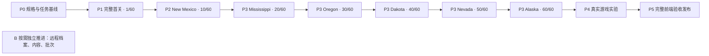

# Guns’n’Glory 实施计划

## 1. 执行目标与当前状态

**当前工作阶段为 P0：规格与任务基线。下一实现里程碑为 P1：完整原版 Cow Gulch。** 本计划已经替换原来的 T22–T26 后续流水线与 E/U/D/W/G/S/L/R/V 任务族；T01–T21 保留为历史交付记录，不能继续按旧编号推进，也不能把文档整合视为 P0 或完整游戏已经完成。

最终目标以[产品规格](spec.md)为准：在浏览器实现指定原版的六区域、60 关完整玩法及表现，支持学习、脚本调试和可复现的平衡实验。纯前端正式版不依赖后端；后端以后只承担档案、资源管理和批量模拟，实时战斗继续在浏览器运行。

已确认的 `Game`、`Progress`、`Experiments` 三个深 Module 和首五个纵向切片的粒度继续成立。需要修正的是完整内容的覆盖责任、工作顺序和验收深度。原计划让工具、容错任务持续推进，却没有把完整首关、所有对象和全部关卡落实为明确交付门槛；这是规划缺陷，不能归因为实现任务没有遵守计划。

### 1.1 当前实现与发布状态

状态基准：2026-10-29，`gunsnglory` 的 `d631ecb`。T01–T13 已合入 `gunsnglory` 和 `master` 并发布；T14–T21 已在集成分支本地实现与验证，尚未发布。T21 已包含难度选择、对应样本的难度效果、困难模式解锁与旧档默认简单模式，不应从后续规划中丢失。逐项证据见第 8 节及[验证记录](validation.md)。

**完整原版关卡当前为 0/60。** 当前有单地图受控战斗样本、两个进度样本入口，以及存储、暂停、回放、实验与批次工具；它们证明了各自的局部能力，没有证明完整 Cow Gulch 或完整战役。T10 的真实 Android AVD 触控仍未验证。

| 已有能力 | 可保留的价值 | 不能据此宣称的能力 |
| --- | --- | --- |
| Cow Gulch 地形、枪手与男性拓荒者、单波结算 | 内容加载、输入、观察和基础战斗测试入口 | 原始初始对象、真实全部波次、全部敌人、完整首关 |
| 招募扣款与池计数、枪手局部升级 | 经济接口与局部参数测试 | 待雇用对象被激活、生成建筑出兵、全部单位等级与真实战斗效果 |
| 普通射击、装填字段、静态地形运动 | 部分攻击和碰撞规则已接入 | 特殊装填周期、运输组、建筑/多对象碰撞、死亡派生 |
| 简化图形反馈与基础移动动画 | Canvas 绘制和公共观察已接通 | 全方向状态图、完整攻击/睡眠/死亡动画、特效和音频 |
| T20/T21 样本关卡、难度及档案恢复 | Progress 的入口、修订和解锁行为可回归 | 不同真实地图及资源包切换、真实战役难度与进度覆盖 |
| 重放、方案比较、CLI 和 worker 批次 | 固定样本可复现，既有工具可用于后续回归 | 原版完整游戏的平衡性结论、真实多人场景性能预算 |

该表描述上述代码基准，不作为持续维护源码细节的第二份清单。具体规则、参数、勘误及内容集合定义由[产品规格](spec.md)维护；素材组织、关卡装配和 Module 分工由[架构设计](architecture.md)维护；实际执行结果由[验证记录](validation.md)维护。本文维护阶段、依赖、范围及逐项交付覆盖状态，第 10 节明确 P0 尚未补齐的覆盖表。

### 1.2 规格展开的深度

| 层次 | 必须明确的内容 | 完成时点 |
| --- | --- | --- |
| 最终产品 | 原版基线、全部产品能力、网页适配、实验范围、后端范围外事项 | P0 核对，沿用产品规格 |
| 全局内容与风险 | 全部对象/参数组/关卡/表现的清单及阶段归属；时间、随机、单位、身份、存档兼容等跨阶段决定 | P0 完成前 |
| 当前里程碑 | 每个任务的输入、状态变化、输出、依赖、失败处理、独立预期和验收场景 | 该里程碑进入实现前 |
| 后续里程碑 | 明确内容范围、主要新机制、依赖及退出标准 | P0 排定；该阶段开始前展开局部规格 |
| 实现与验证 | 内容被实际规则消费，交互与表现对应，验收记录可复查 | 每个任务内 |

后续局部帧裁切等细节可以按阶段展开；全部内容是否属于目标、由哪个阶段承担，必须在 P0 明确。未确认规则只阻塞依赖它的任务，不能以合理默认值填入原版基线，也不能无限期重新研究已确认内容。

## 2. 任务契约与启动门槛

### 2.1 每项任务必须具备的规格

下表是任务进入实现的检查表。里程碑名称和任务表只是范围约束，不能替代具体规格；P1-A–F 同样必须补齐这些字段后才能开始对应实现。

| 字段 | 必填内容 | 未满足时的处理 |
| --- | --- | --- |
| 目标与范围 | 用户故事、所属里程碑、真实关卡/对象、玩家可见结果、明确留后项 | 拆清目标，不能以“完善系统”“更多内容”进入实现 |
| 输入与初态 | 原版版本、场景/难度、参数引用、对象状态、时间和随机条件 | 核对版本及单位；缺参数保持阻塞 |
| 行为规格 | 触发、状态迁移、计算/截断/顺序、输出与错误行为 | 回查消费分支；字段表存在不代表规格完整 |
| 表现规格 | 素材 ID、动画驱动/方向/锚点、反馈与音频；不涉及时说明原因 | 占位表现只能计为部分实现 |
| 依赖与影响 | 真正前置、修改的 Module、内容/规则/存档/回放版本影响、回滚办法 | 消除依赖环及隐含跨模块改动 |
| 验收样例 | 初态、操作或事件、明确预期、独立来源及检查方法 | 预期不能仅由被测实现或同一个导入器生成 |
| 异常与边界 | 阈值、重复输入、非法状态、缺资源、生命周期及恢复 | 先确定关键边界，不在编码时临时猜测 |
| 完成证据 | 公共行为测试、真实关卡过程、必要表现检查、未验证项 | 测试数量和字段存在均不能替代通过条件 |

例如，“雇用”需要验证合法对象从待雇用变成可选择、移动、开火的同一对象，现金只扣一次；不足现金和重复确认不能改变状态。合法价格、状态编号及来源在产品规格中维护。正式首关的可达性由实际击杀赚钱后的雇用路径证明，额外 fixture 只用于不足现金、重复操作等边界测试。

“特殊装填”则必须明确射击计数初值、在哪一次射击切换冷却、普通/特殊冷却替换还是叠加、无目标和移动时如何更新、升级是否重置。只有四档参数表仍不能进入实现；核对消费者后才能形成跨周期的独立预期。

### 2.2 P0 的完成条件

P0 交付规格和可执行计划，不交付本次列举的全部游戏机制。完成时同时满足：

- 本文第 10 节的完整内容覆盖表逐项列出全部 60 关，以及源目录实际使用的单位、敌人、组件、特殊对象、规则、动画/音效集合；每项都有阶段归属和来源入口，没有未归属项。
- 每项分别记录“资料确认、数据迁入、规则通过、表现检查”，并关联具名任务与验收场景；四种状态不互相代替。原版数据、实验参数和 fixture 身份明确。
- P1-A–F 全部满足第 2.1 节，具有独立预期；依赖无环，原始开局不依赖完整雇用成功才可验收。
- 其他阶段有明确范围、代表关卡、主要机制差异和退出标准；逐区详细任务在该区实现前展开，不能把未归属内容拖到最终验收。
- 已知研究勘误纳入规格；单位、时间/随机、对象身份、关卡映射、资源装配及样本档案兼容等关键风险已有决定，或有明确阻塞范围和验证责任。

**当前状态：P0 尚未完成。** 本次主文档整合建立了生效路线、责任和启动标准；全量规格闭合、P1 每项完整任务契约及其验收预期仍须逐条核对，不能因本文件已经存在便将 P0 打勾。

规格纠错先修改唯一真源，列出受影响的规则、数据、存档/回放和已通过样本，再修实现并重跑这些范围的验收。原版行为纠错与实验平衡调整分别记录；不能用当前代码行为反向定义原版规格。

## 3. 整体交付顺序与覆盖责任

### 3.1 产品里程碑

| 阶段 | 用户得到的成果 | 前置与退出标准 |
| --- | --- | --- |
| P0 规格与任务基线 | 可审阅、可据此实施的完整计划 | 第 2.2 节全部满足；不是游戏完成声明 |
| P1 完整 Cow Gulch | 真实首关的雇用、多人战斗、运输队和全部 8 波 | P0；第 4 节 A–F 通过，首关必要表现随玩法交付，覆盖计为 1/60 |
| P2 完整 New Mexico | 原版前十关连续可玩，经济、切关、进度形成闭环 | P1；本区 10 关完整运行，新增敌人/单位、生成建筑与列车行为及资源切换通过，累计 10/60 |
| P3 其余五区逐区交付 | Mississippi → Oregon → Dakota → Nevada → Alaska | 每区依赖已验收的共享行为；区域完成须覆盖本区 10 关全部内容，累计依次 20/30/40/50/60 关 |
| P4 真实游戏平衡性验证 | 在完整规则上比较原版与独立实验方案，定位失败样本 | P3；真实场景选择、输入冻结、指标分母、失败分类及本地串并行一致性通过 |
| P5 完整纯前端验收与发布 | 全战役、学习、实验、档案及桌面/触屏使用稳定 | P4；固定完整清单全部闭合，目标设备/表现/兼容/预算检查及 CI/CD、线上实测完成 |
| B 后端按需演进 | 远程档案、资源管理、远程批次 | 不作为 P1–P5 前置；按第 7 节分别确认服务环境并验收，浏览器继续运行实时战斗 |

P3 的先后顺序是开发交付顺序，不能转成产品的区域解锁顺序。实际入口、难度与关卡开放条件遵循产品规格；尚未实现的内容标明开发状态，不伪装成原版锁定。

数据迁入和独立资源核对可以并行；修改共享 Game 行为按真实依赖串联。各区按下表先实现新增机制的具名代表关，再完成其余仅有数据差异的关卡。不会因等待后续全部素材而阻塞已可交付关卡，也不能以静默跳过不支持机制的方式将区域标为完成。

### 3.2 区域及具名验收入口

| 阶段 / 全量责任 | 具名代表关卡 | 重点覆盖与退出要求 |
| --- | --- | --- |
| P1：第 1 关 / map01 | Cow Gulch | 枪手、炸弹手、拓荒者组、covered-wagon、完整雇用和 8 波；全部必要动画、声音及正式结算 |
| P2：第 2–10 关 / map02–10，复验第 1 关 | Death Valley 2/map02 | 骑手、弓箭手、火焰持续伤害、多生成点；复用首关规则并验证新增状态表现 |
| P2 同上 | Fort Kaboom 3/map03、Tech Town 4/map04、Railroad Ranch 9/map09 | 驿站马车、运金车、炮手、生成建筑、横纵列车、Gatling、组选中与轴向阻挡；以地图/波次/解锁联合确定使用时机 |
| P3 Mississippi：第 11–20 关 / map14–23 | Traveller’s Town 11/map14、Railroad Canyon 15/map18 | 跨区域素材别名、Steamer 的首次地图配置、不同路线和列车组合；Steamer 不延后至 Cold Lake；本区十关全部验收 |
| P3 Oregon：第 21–30 关 / map24–33 | Eastwood Forest 21/map24、Cashcow Canyon 22/map25、Dynamite Plains 25/map28 | Grandpa、boss 敌人、炸药解锁、配对与专属范围判定；本区十关全部验收 |
| P3 Dakota：第 31–40 关 / map34–43 | Loot Lakes 31/map34 起 | Sniper、雪地资源及该区敌人/波次组合；首次开放按实际解锁公式；本区十关全部验收 |
| P3 Nevada：第 41–50 关 / map44–53 | Labyrinth Gulch 41/map44、Reno 43/map46、Las Vegas 46/map49、Boomtown City 49/map52 | Pyromaniac 火箭、沿途/爆炸/持续火伤；赌徒/赌场开奖、延后生成及多赌场配对；路线分叉、组跟随和异常原图字段；本区十关全部验收 |
| P3 Alaska：第 51–60 关 / map54–63 | Windham Bay Mine 51/map54、Cold Lake 52/map55、Glacier Bay 60/map63 | Salesman/毒伤、doctor 治疗、Steamer 部件与水域阻挡、左右输入差异、最终关全部波次和战役结束；本区十关全部验收 |

上表明确所有关卡的阶段责任；P0 将每个关卡的名称、语义 ID、阶段、任务、规格入口和完成状态在本文第 10 节逐项展开。波次、对象、限制及资源的具体定义只引用产品规格和游戏自有内容。代表关卡不取代其余关卡。地图含某个标记不等于该对象已解锁，静态载入最后一张地图也不等于战役结束已经正确实现。

### 3.3 全部内容的阶段归属

| 内容集合 | 排期责任 | 完成标准 |
| --- | --- | --- |
| 普通可雇用角色 | P1：Desperado、Mexican；P2：Cannon、Indian；P3 按实际开放依次覆盖 Grandpa、Sniper、Pyromaniac、Salesman | 全部定义与等级、雇用、移动、武器、状态、限制和表现；允许升级的真实关卡验证升级，不篡改首关限制 |
| 车辆和武器组件 | P2：Train、Gatling；P3 从首次实际需要的区域接入 Steamer 及其共享武器/DoubleCannon 定义 | 组件身份、组移动、碰撞、攻击及状态完整；类型映射不误算为独立兵种数 |
| 特殊对象 | P3 Oregon 的 DynamiteTrigger/Box；P3 Nevada 的 Gambler/Casino，较早标记按原解锁显示 | 配对、输入、经济、冷却、随机/延后生成及对应表现 |
| 敌人目录 | P1 的拓荒者与 covered-wagon 运输链；P2 的骑乘、驿站马车和运金车；P3 的 boss、doctor 等实际构造差异 | 源表全部行与工厂请求类型逐项映射，移动、受击、状态、死亡派生、奖励、离场完整 |
| 战斗与生成规则 | P1：单体/重型 AOE、普通/特殊装填、组占格/重试、运输死亡派生和波间/整关结算；后续新规则随首次实际关卡交付 | 轻/火/重/毒穿透、持续伤害、减速、治疗、动态难度等所有已用规则在 P3 结束前闭合 |
| 地图对象与碰撞 | P1：首关静态背景、道路、待雇用/活动对象；P2：生成建筑与列车；P3：各区装饰/铁路/水域/对象组合 | 原图实例集合与层次、可行走/占格/阻挡和对象生命周期一致 |
| 表现与 UI | 随对应 P1–P3 行为；帮助、双语、声音与设置穿入当前场景；P5 集成检查 | 每项绑定素材、状态、方向、帧/锚点/绘制顺序与事件音效；不把全部动画留到末尾 |
| 学习、实验、存储 | 已有能力持续回归；真实内容驱动的兼容修复随玩法；P4 扩展真实场景与完整实验验收 | Game/Progress/Experiments 公共 Interface 一致，实验隔离，失败分类清晰 |

此表分派集合责任；P0 仍须在本文第 10 节逐条闭合所有成员，特别是首次使用区域、共享定义、等级及状态差异。未知的首次消费者须明确标为阻塞项，不能从名称猜测，也不能当作未来任选内容。

## 4. P1：完整原版 Cow Gulch

P1-A–F 是验收责任，不是至少执行六轮的要求。一次工作可包含多个紧密相关、各自可验证的小提交。每项推进同一个真实首关；受控 fixture 只补边界测试，不成为新的产品演示场景。

| 任务 | 交付与范围 | 真正前置 | 验收与回滚 |
| --- | --- | --- | --- |
| P1-A 原始开局 | 迁入首关地图、完整对象实例及必需资源；按原始解锁呈现待雇用、锁定、活动对象；选择反馈可用 | P0 中对象构造、原图、资源及首关限制规格通过 | 对象集合与独立原始预期匹配；初始现金、生命、升级上限正确。只验收原始开局，不要求 B 的完整雇用成功。可回退受控样本入口 |
| P1-B 前两波与完整雇用战斗 | 原始请求池、间隔、拓荒者小组、占格/重试；枪手特殊装填；赚取现金后激活、选择和移动新增单位；炸弹手及重型 AOE、弹道/爆炸、动画和声音 | A；波次消费、雇用和两类武器规格通过 | 在真实前两波赚钱后成功雇用并控制同一对象；跨越特殊装填周期；群体命中/未命中边界、一次奖励通过。固定输入与浏览器操作均验证；回退对应规则和版本，不改原版价格适配样本 |
| P1-C 第三波运输队 | 配对请求的牵引与车厢、同组移动、受击/死亡、残车与乘员；动画、效果及声音一起交付 | B 的多人战斗与路线；运输及死亡派生规格通过 | 真实第三波全部配对请求、生成失败重试、车毁后乘员继续走/战斗；阈值、方向、组号、倍率、一次生成/奖励与清理通过；待派生期间不提前结算。回退同一行为链，不只关闭动画 |
| P1-D 第四至八波与正式结算 | 混合池、波间提示/加速、倍率/动态难度、剩余敌人、HUD 与整关胜败 | B、C；完整波次和结算规格通过 | 原版初态完整运行至第 8 波后结束；清一波不等于整关胜利；失败/重开清理。保存完整输入、终态与浏览器过程；回退成对的规则与内容版本 |
| P1-E 正式入口与存档接通 | 默认进入真实首关；Progress 写真实结果；旧样本记录隔离；必需资源加载失败保留恢复入口 | D；样本/正式关卡身份和兼容方案通过 | 刷新恢复真实进度，未完成战局从初态重开；保存失败可重试；旧样本胜利不变成首关通关；下一真实关未完成时明确不可进入。回滚保留原档与修订，不删用户数据 |
| P1-F 首关对照验收 | 地图/对象、两类武器、运输链、动画/音频、全部波次、鼠标/触屏和正式结算一起核对 | A–E | 独立数据预期、Game 公共行为、真实浏览器三类证据齐全；真实设备未验证单列。差异退回对应任务，不在验收任务中吞并新玩法；通过后才计为 1/60 |

P1 的原始对象数量、状态、基础值、波次明细和来源由[产品规格](spec.md)维护，此处不再复制数值。需要特别落实两种不同路径：首关雇用激活地图上已有的待雇用对象；生成建筑/生成池属于其他关卡的后续机制。首关没有的生成建筑不能被用来替代雇用行为，首关禁止的升级也不能为了演示而放开。

当前里程碑的内容缺口优先。P1 前不扩建实验保存、worker、后端或新增合成关卡；现有工具因真实规则扩展产生的兼容问题随对应玩法修复。既有难度、帮助、语言、声音与设置能力按该关所需接入，不另走一串与真实内容脱节的按钮任务。

## 5. 验收、进度与发布节奏

### 5.1 按产品覆盖报告进度

| 指标 | 分母与通过定义 |
| --- | --- |
| 完整可玩关卡 | 固定 60 关；完整波次、所需对象和正式结算，且有一次有效完整通关记录。加载成功或预算终止不算通过 |
| 规则/对象覆盖 | 原始完整目录实际使用的行为集合；表值迁入、规则消费、边界通过分别呈现 |
| 表现覆盖 | 已交付内容所需的状态图、动画、效果和音频；以固定状态和真实交互验证 |
| 资料缺口 | 每项已确认/冲突/未确认及被阻塞的任务和关卡，不笼统写“还有研究工作” |
| 实验可信范围 | 只包括已实现和验收的规则/内容；批次工具通过不会自动扩大范围 |
| 发布状态 | 本地通过、已集成、CI 通过、已部署、线上实测分别记录 |

每次交付说明新增的真实可玩内容、可观察场景、仍缺机制和验证依据。提交数、测试数、任务编号只作为工程记录，不折算为产品完成百分比。

### 5.2 验证入口与范围

| 范围 | 默认最高测试 Seam / 检查方式 | 必须证明的结果 |
| --- | --- | --- |
| 规则、控制、回放 | Game 公共 Interface | 从初态提交意图、推进与观察；原版时间/随机/次序、关键阈值和状态迁移有独立预期 |
| 进度、设置、保存 | Progress 公共 Interface | 真实可进入内容、难度、幂等结算、保存状态及刷新恢复；样本和实验隔离 |
| 方案、运行、批次 | Experiments 公共 Interface | 冻结真实输入、原版/实验配对、分母、失败分类、串并行一致性与取消预算 |
| 存储替换 | 所属 Module 的内部存储 Seam | 各 Adapter 同一契约；内存通过不能替代真实介质 |
| 内容导入 | 独立源预期与引用检查 | ID/映射/尺寸/单位、完整 60 关目录和关键对象构造；不让同一错误导入器同时生成实现与预期 |
| 浏览器输入与表现 | 自动化及 Codex 内置浏览器 | 每种新增交互/表现的代表场景；不同真实地图资源切换、生命周期、音频及真实存储 |
| 全战役 | 每关完整运行及覆盖表核对 | 三档难度的配置逐项检查，倍率/解锁边界代表运行；一次胜利不宣称穷举策略或随机轨迹 |
| 性能与设备 | 绑定版本、设备、场景、实体数及配置测量 | 真实多人、多投射物和效果的峰值；不用单敌人或桌面速度推断手机预算 |

测试断言外部行为。只有公共 Interface 难以准确定位且算法边界确有必要时，才补内部测试；内部重构不应迫使重写所有同一行为测试。时间、共享随机和可复现输入继续遵守[模拟契约](simulation-and-automation.md)，渲染省略不代表可以跳过会影响战斗的随机消费。

### 5.3 日常提交、里程碑与发布

1. 使用 `gunsnglory` 集成分支，从最新已验收提交开始。串行任务直接提交可验证增量；确需并行则从同一基点使用独立 worktree/分支，验收后汇回，避免覆盖彼此工作。
2. 每个切片一并交付必要数据、Module 内部逻辑、公共 Interface、交互、表现和测试。共享接口随第一个实际消费者引入，复用既有运行器与存储能力，不先建通用插件平台。
3. 日常提交运行受影响检查；里程碑集成时完成完整相关检查、跨任务审查及覆盖核对。每个小内部变更不强制单独发布，保持可构建或有明确可运行验收入口。
4. 公开发布时按仓库规则将已验证内容合入 master，裸 `git push origin master`，等待 CI/CD 成功，再用 Codex 内置浏览器实测公开入口、操作、结算、存储、语言和资源。
5. CLI/MCP/skill 等 agent 可加载产物按仓库要求经 pi 实际加载及调用，记录命令、关键返回与产物；手工执行不替代真实加载验证。

每次记录规则、内容、数值和格式版本及兼容影响。计划中的命令、尚未执行的 CI/设备/线上检查不计为证据。完整域名仍只在根 README 维护；其他应用 CI 成功不代表本应用验收通过。任务跟踪使用仓库规定的 GitHub Issues，本文不冒充已创建的 Issue；创建任务记录时采用上述具体范围与真实阻断关系。

### 5.4 P4 与 P5 的退出标准

| 阶段 | 必须满足的条件 | 失败处理 |
| --- | --- | --- |
| P4 | 既有固定样本 CLI 能选择验收过的真实场景；同一生产 Game 支持无画面运行；规则/内容/方案/策略/seed/时间及影响随机的环境冻结；报告区分胜败、超时、取消、非法输入和异常，给出样本量及未完成比例；串并行结果一致，失败输入可重放；正式档案不被实验修改 | 规则不完整退回对应内容任务；实验能力差异在 Experiments 内修复；不以异常当败北形成错误平衡结论 |
| P5 | 规格范围与本文逐项覆盖表无遗漏；60 关完整路径、全部故事、表现、双语、帮助/设置、学习控制、回放和实验通过；真实桌面/触屏设备、版本兼容和峰值预算检查；共享站点集成与发布、CI/CD、线上实测通过 | 缺口退回明确所属任务；验收阶段不临时吞并遗漏的新规则、迁移或关卡；未完成发布不报完整前端已完成 |

## 6. 主要风险、兼容与回滚

| 风险 | 控制与验收责任 | 回滚要求 |
| --- | --- | --- |
| 研究摘要与代码消费者冲突 | 规格记录已知勘误；受影响对象构造、类型映射和配对使用独立源预期 | 修正一个真源后成组回退/更新关联数据和规则，保留差异记录 |
| 参数存在但未消费、单位或舍入错误 | P0 任务契约 + P1–P3 公共行为测试；价格/射程/速度/伤害等均检查实际结果 | 规则和内容版本成对回滚；历史运行不静默换新数值 |
| 对象组、死亡派生和波次结算交叉影响 | P1-C/D 验证阈值、一次性与待派生；后续新组合在代表关复验 | 整条生命周期行为回滚，避免仅禁用显示留下隐藏状态 |
| 同地图样本掩盖切关和资源问题 | P2 必须使用不同真实地图及资源；加载成功后再替换旧实例 | 缺资源保留可恢复入口；清理新实例，不留下半个战局 |
| 样本档案误记为正式通关 | P1-E 明确样本/正式身份及兼容；Progress 公共行为验收 | 保留原备份和修订；不得删数据或静默提升进度 |
| 原版纠错使旧回放/实验不兼容 | 版本绑定和失败分类遵循模拟/存储契约；旧版本不可用明确拒绝 | 保留可用版本或明确不可重放，不静默切换最新内容 |
| 内容扩展后性能或资源内存超标 | 真实群体和效果场景测量后才调整预算、缓存或并发 | 缩小交付范围至已验收关卡或回退整套版本，不改原版规则掩盖问题 |
| 计划再次以工具或模糊任务族替代玩法 | 固定完整分母、逐区退出门槛、真实内容优先；例外说明如何解除当前交付阻塞 | 中止不服务当前里程碑的扩建，保留已有效验证的能力 |

每区和每个行为都应能独立验收并回退代码及匹配内容。持久化改动额外证明旧代码可读或提供明确恢复路径；历史实验所引用的版本不可用时显式失败。P5 只负责集成和发布，不作为此前遗漏内容的收容任务。

## 7. 后端独立演进

服务商、身份、成本/配额、数据保留和维护责任在具体后端工作开始前确认；这些环境选择不重开已确认的三个 Module。B 不是完整纯前端交付的前置，也不扩大为服务端权威战斗或多人同步。

| ID / 行为 | 故事 | 真正前置 | 验收与回滚 |
| --- | --- | --- | --- |
| B01 远程保存并读取档案 | US27、US13、US14 | 已有 Progress 保存/冲突能力；真实正式档案契约；可用环境和身份边界 | 调用者不改，远程 Adapter 通过缺失/冲突/重试契约，浏览器无长期数据库凭据；回退明确权威档案，旧副本不覆盖新进度 |
| B02 本地档案迁到远程 | US27、US13、US14 | B01 | 迁移前后可核对、取消或重试，不产生不可见双份进度；保留原备份与修订 |
| B03 读取固定远程内容版本 | US27、US14、US18 | 真实内容装配与版本错误恢复；可用交付环境 | 静态/远程源得到相同定义；部分上传不可见、缺版本明确失败；回退时保留被引用内容 |
| B04 提交并读取远程批次 | US27、US24、US26 | P4 的真实场景批次契约；可用任务环境和冻结内容包 | Experiments 粗粒度提交，服务端使用同一 Game，本地/远程结果一致，产物提交后才成功；内容可固定部署，不强制依赖 B03；可回退本地执行 |
| B05 取消与重试远程任务 | US27、US25、US26 | B04 | 取消/预算耗尽/重复提交/崩溃重试不产生重复有效结果，真实失败样本验证；回退先处理在途任务，保留已完成产物 |

每项按具体服务环境继续拆为可观察行为，避免一次混入存储迁移、调度平台和新业务规则。存储和执行 Seam 保持在所属 Module 内部。

## 8. 历史任务与新路线的对应关系

### 8.1 T01–T21 历史交付

以下保留历史事实和证据入口，不再充当当前可执行流水线。T01–T05 是用户认可并已完成的受控纵向切片；完整内容的验收要求由新路线承担。

| 任务 | 已交付范围 | 状态 / 验证记录 | 新路线中的责任 |
| --- | --- | --- | --- |
| T01 | 地图、单单位选择、独立构建、shell 接入 | 已发布；[T01](validation.md#6-t01-可玩切片验收) | P1-A 扩展真实对象集合，P5 验证入口 |
| T02 | 单名拓荒者路线、离场扣命、时间随机与倍速子集 | 已发布；[T02](validation.md#7-t02-单个拓荒者离场扣命验收) | P1-B/D 扩展真实波次和群体 |
| T03 | 单单位攻击、击杀与现金奖励 | 已发布；[T03](validation.md#8-t03-单单位击杀与现金奖励验收) | P1-B/C 扩展完整武器、群体和派生 |
| T04 | 样本胜败、显示分数与干净重开 | 已发布；[T04](validation.md#9-t04-胜败结算与干净重开验收) | P1-D 改为完整关卡结算 |
| T05 | 样本结果保存、IndexedDB/内存契约与刷新恢复 | 已发布；[T05](validation.md#10-t05-样本结算档案验收) | P1-E 正式进度与样本隔离 |
| T06 | 拖动单位及静态地形碰撞子集 | 已发布；[T06](validation.md#11-t06-拖动单位与地形碰撞验收) | P1–P3 随真实对象补组合碰撞 |
| T07 | 枪手招募扣款与池计数 | 已发布；[T07](validation.md#12-t07-招募-gunslinger-验收) | P1-B 完成真实雇用；P2 生成建筑另验收 |
| T08 | 枪手局部升级及上限测试 | 已发布；[T08](validation.md#13-t08-升级-cow-gulch-gunslinger) | P2–P3 在允许升级的真实关卡覆盖全部档位 |
| T09 | 暂停及后台恢复 | 已发布；[T09](validation.md#14-t09-暂停恢复及后台返回验收) | P1–P3 持续回归，P5 整体验收 |
| T10 | 触屏缩放与坐标命中 | 已发布；真实 AVD 触控未验证；[T10](validation.md#15-t10-触屏缩放与命中验收) | P1-F/P5 补目标设备与新对象交互 |
| T11 | 暂停单步与只读检查 | 已发布；[T11](validation.md#16-t11-单步与只读检查验收) | 随真实规则回归，P5 学习控制验收 |
| T12 | 样本记录与确定性重放 | 已发布；[T12](validation.md#17-t12-记录与重放战局) | 规则变化随任务处理版本，P4/P5 真实内容重放 |
| T13 | 单场景无画面运行 | 已发布；[T13](validation.md#18-t13-无画面运行单个场景) | P4 真实场景选择与生产规则覆盖 |
| T14 | 不可变数值方案与样本配对比较 | 本地通过，未发布；[T14](validation.md#20-t14-比较两套数值方案) | P4 保留基线并比较真实玩法 |
| T15 | 实验方案/报告保存、分页及重开 | 本地通过，未发布；[T15](validation.md#21-t15-保存并重新打开实验) | P4/P5 验证真实实验与版本兼容 |
| T16 | 受限 Cow Gulch 串行批次 API 与 Node CLI | 本地通过，未发布；[T16](validation.md#22-t16-cli-串行批次) | P4 扩展真实场景，pi 真调用 |
| T17 | 可选 Node worker 批次，串行默认 | 本地通过，未发布；[T17](validation.md#23-t17-worker-并行批次) | P4 真实负载串并行一致性及预算 |
| T18 | 档案冲突、设置重试、损坏备份与条件重置 | 本地通过，未发布；[T18](validation.md#24-t18-档案冲突与恢复) | P1-E/P5 验证正式档案，B01 复用契约 |
| T19 | 内容/规则版本错误及保留原战局的恢复 | 本地通过，未发布；[T19](validation.md#25-t19-内容缺失与版本错误恢复) | P1-E/P2 真实资源包与不同地图恢复 |
| T20 | 两个进度样本入口与刷新恢复 | 本地通过，未发布；[T20](validation.md#26-t20-选择开放关卡与查看进度) | P2/P3 真实战役入口，样本完成不转换成正式通关 |
| T21 | 难度选择、样本难度效果、困难解锁及旧档默认值 | 本地通过，未发布；[T21](validation.md#27-t21-难度选择与困难模式解锁) | P1–P3 真实关卡/单位开放，P5 三档配置检查 |

### 8.2 未执行旧任务的归属

| 旧任务 | 生效归属 |
| --- | --- |
| T22 帮助与离开战局 | 随 P1 的真实开波、暂停、离开场景接入；其余关卡内容随 P2/P3；P5 汇总检查 |
| T23 双语与文本布局 | P1–P3 每次交付同时补真实内容文案和布局；P5 检查完整范围 |
| T24 声音与设置 | P1-B/C/D 随对应战斗链交付，Progress 接设置；后续新增行为随 P2/P3；P5 检查完整声音和生命周期 |
| T25 完整纯前端验收 | P5，分母改为固定完整源目录与 60 关，不再依赖“全部已实例化任务” |
| T26 静态发布 | P5 发布责任；已公开的预览只代表其已发布能力 |
| E/U/D/W/G/S/L/R/V 泛化任务族 | 由 P1-A–F、P2、各 P3 区域及规格逐项覆盖替代，不再保留为无限期后续工作 |

## 9. 用户故事的验收责任

故事定义以[产品规格](spec.md)为准。以下只指定完整交付的责任阶段，不将历史样本通过等同于故事全部完成。

| 故事 | 责任阶段 | 必须保留的验收信号 |
| --- | --- | --- |
| US01 浏览器启动 | P1-E、P5 | 无原生安装可进、内容错误可恢复、线上入口有效 |
| US02 完整战役 | P2、P3、P5 | 六区 60 关与真实解锁关系 |
| US03 难度与单位 | P1–P3、P5 | 原始开放条件、升级上限、锁定不可绕过 |
| US04 玩家操作 | P1–P3 | 选择、移动、完整雇用、升级、开波及实际结果 |
| US05 特殊对象 | P2/P3 | 车组、炸药、赌场等真实交互、结果与边界 |
| US06 局势与结算 | P1–P3、P5 | 完整波次、伤害/派生、生命/现金、胜败与分数 |
| US07 图像动画音效 | P1–P3、P5 | 固定状态对照、状态转换、真实声音播放 |
| US08 鼠标与窗口 | P1-F、P2/P3、P5 | 比例变化后真实对象操作准确 |
| US09 触屏与取消 | P1-F、P2/P3、P5 | 目标设备、不同对象、取消无残留 |
| US10 比例与双语 | P1–P3、P5 | 共享语言、中文布局、画面比例 |
| US11 帮助设置暂停 | P1、P2/P3、P5 | 帮助对应真实机制，声音/暂停可控、设置可存 |
| US12 后台恢复 | P1–P3、P5 | 不补算不可控后台战斗，新对象生命周期一致 |
| US13 进度与高分 | P1-E、P2/P3、P5；B01/B02 | 正式保存、刷新、解锁、高分一致 |
| US14 错误恢复 | P1-E、P2、P5；B01/B03 | 不假报成功，原数据与可恢复入口保留 |
| US15 单步检查 | P1–P3、P5 | 真实规则一步一帧，关键状态可解释 |
| US16 观察无副作用 | P1–P4 | 观察、覆盖层和无画面运行保持规则语义 |
| US17 记录重放 | P4、P5，规则变更随任务回归 | 完整输入重现关键帧和终局 |
| US18 重放失败 | P4/P5；B03 | 缺版本、损坏、结果不符分别报告 |
| US19 数值方案 | P4 | 基线只读，保存版本不可变 |
| US20 同输入比较 | P4 | 场景、策略、样本及全部复现条件冻结 |
| US21 指标范围 | P4 | 明确指标、分母、样本量和未完成比例 |
| US22 实验隔离 | P1-E、P4/P5 | 实验和历史样本不更新正式战役档案 |
| US23 AI/脚本 | P4 | 受限观察、合法意图、pi 加载与真实调用 |
| US24 无画面批次 | P4；B04 | 同一生产规则、无浏览器依赖、失败输入可导出 |
| US25 并行与预算 | P4；B05 | 串并行一致，取消和预算有效 |
| US26 失败分类 | P4；B04/B05 | 取消/超时/非法输入/错误不算败北 |
| US27 远程服务 | B01–B05 | 档案、内容、任务分项接入，实时战斗留在浏览器 |

## 10. P0 逐项覆盖表的待完成工作

**逐项表尚未补齐，当前不得据第 3 节的集合/区间表认定 P0 完成。** 第 3 节已经确定所有阶段与区域责任；P0 在本节展开具名成员、具体任务和状态，此处是交付覆盖的唯一维护位置，不新建另一份活动路线。产品规格第 4 节继续维护内容集合、规则、参数及来源，本节通过引用关联这些定义，不复制数值。

| 待展开集合 | 本节应形成的逐项行 | 当前状态 / 闭合条件 |
| --- | --- | --- |
| 战役 | 全部 60 个真实关卡，每行明确语义 ID、名称、区域/地图、阶段、所需机制和规格入口、具体交付任务 | 仅有第 3.2 节区间归属与代表入口；逐关行、任务与状态未闭合 |
| 对象及规则 | 所有实际使用的单位等级组、敌人构造差异、车辆/武器组件、特殊对象、生成与战斗行为 | 第 3.3 节只分派集合责任；逐项首次消费者、共享定义和任务未闭合 |
| 表现 | 各已确定行为需要的素材组、状态/方向/动画、效果、音频和交互反馈 | 素材/消费者对应及具体验收任务未全部闭合；不按平台资源文件数充当功能数量 |
| P1 任务契约 | A–F 对应的全部范围项和第 2.1 节所需字段 | 第 4 节给出范围、依赖与退出条件；完整输入/状态/独立预期需在 P0 逐项核对 |

逐项表固定字段为：`语义 ID / 内容名称 / 真实消费者或关卡 / 规格及来源入口 / 所属阶段 / 具体任务 / 资料确认 / 数据迁入 / 规则通过 / 表现检查 / 验证记录 / 阻塞或未验证项`。四类状态使用“未开始、部分、通过、阻塞”并说明适用范围；不适用的列写明理由。只有对应内容实际完成后才更新状态，现有样本能力不批量转成真实内容通过。

P0 审核需逐条将原始目录与本节对账：60 关无遗漏，全部实际构造和状态分支有任务，素材有真实消费者，未知项有明确阻塞范围。逐项行与 P1 契约补齐后，再按第 2.2 节决定 P0 是否完成；本次文档整合没有完成这项对账。
