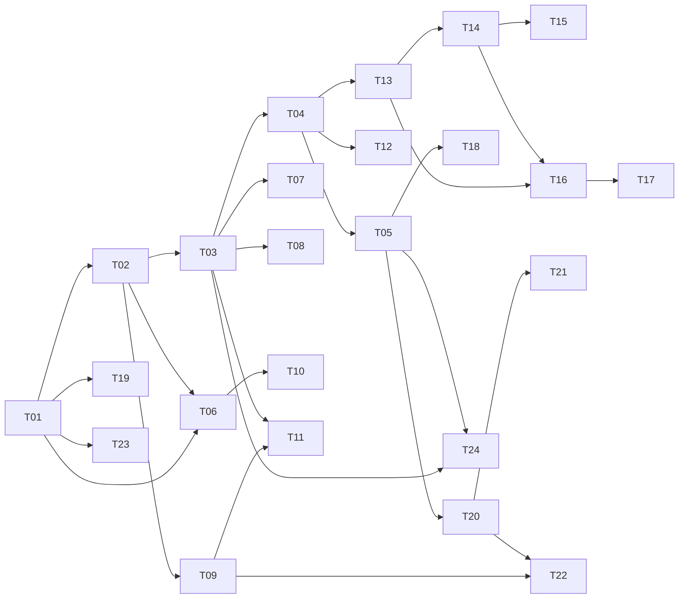

# Guns’n’Glory 实施任务图

## 1. 执行基线与当前状态

用户已确认 `Game`、`Progress`、`Experiments` 三个深 Module，以及首五个纵向小切片的粒度。本计划采用这些决定，不再将它们列为待确认候选。

**当前进度：T01–T10 已合入 `gunsnglory` 和 `master` 并发布；T11 已实现并通过本地验证，待合入和发布。** T10 最终提交 `faf018c` 通过本地应用 CI、共享站点构建、GitHub Actions 和公网内置浏览器检查；触屏自动化覆盖双指缩放、命中与多指取消。真实 Android AVD 窗口未能由内置控制接管，目标设备触控仍未验证，详见[验证记录](validation.md#15-t10-触屏缩放与命中验收)。前十一个切片不代表完整首关或 M1。T12–T26 与后续任务族尚未实现。

需求编号对应[产品规格](spec.md)的 27 条用户故事，本文以 `US01` 至 `US27` 引用。接口与依赖以[架构设计](architecture.md)为准，领域名称以[词汇表](GLOSSARY.md)为准；存储及模拟细节分别由[存储契约](storage-contracts.md)和[模拟契约](simulation-and-automation.md)维护。

| 里程碑 | 完成定义 | 不作为前置 |
| --- | --- | --- |
| M1：纯前端正式版 | 完整离线战役和表现内容、正式档案、学习回放、数值比较、本地批量模拟完成，并通过静态发布及线上实测 | 远程档案、内容服务、后端任务平台 |
| M2：后端扩展 | 按需完成远程档案、资源及批量任务的独立验收；浏览器继续执行实时战斗 | 服务端权威战斗、多人同步 |

任务是依赖图，不是必须逐行执行的流水线。只有 `Blocked by` 中的任务全部验收通过，任务才进入可执行前沿。除 T01–T10 外，所有任务、任务族成员及后端扩展当前均未实现。

## 2. 工作方式与测试入口

### 2.1 单集成分支

- 使用用户指定的 `gunsnglory` 集成分支；任务从其最新已验收提交开始，不逐任务从 master 分叉或合回 master。
- 串行任务在该分支提交可验证增量。并行时，从同一已验收提交创建独立 worktree 与任务分支，完成前同步集成分支，验收后汇回 `gunsnglory`。
- 共享接口由第一个实际消费者最小化引入；后续任务使用接口，不复制初始化、结算或运行逻辑。
- 整个里程碑集成后进行跨任务审查。公开发布时才按仓库规则将已验证结果合入 master，执行裸 `git push origin master`。
- GitHub 是仓库任务跟踪器；本文是本地执行计划，不冒充已经发布的 Issue。后续若要求发布，按每个具体任务建立记录及真实阻断关系。

### 2.2 每个切片贯穿完整行为

每个任务一并交付该行为需要的内容、Module 内部逻辑、公共 Interface 接入、用户反馈和行为测试。必要骨架、数据格式或 Adapter 随首个消费者引入，不单独先建完整引擎。

| 能力 | 默认最高测试 Seam | 验证结果 |
| --- | --- | --- |
| 游玩、控制、规则、回放 | `Game` 公共 Interface | 开局、提交意图、推进与观察的用户行为 |
| 进度、设置、结算保存 | `Progress` 公共 Interface | 可用内容、保存状态、重复结算与恢复 |
| 场景、方案、报告、批次 | `Experiments` 公共 Interface | 冻结输入、运行、比较和失败分类 |
| 存储可替换性 | 所属 Module 的内部存储 Seam | 同一契约对不同 Adapter 通过，真实介质满足语义 |
| 输入与表现 | 浏览器消费者 | 鼠标/触屏、Canvas、音频、布局与页面反馈 |

`core`、`SessionController` 和场景 runner 是所属 Module 的内部实现，不各建一套对外业务 API。不设置全局 `ports`/`application` 层，不预建 `RunExecutor`。普通 TypeScript Module 足以开始；真正引入 worker 或远端运行时，再在 `Experiments` 内部形成必要执行 Seam。

测试断言外部行为，固定输入须有独立可判断的预期。只有公共行为难以准确定位且算法边界确有必要时，才补内部测试；内部重构不能迫使完整重写同一行为的测试。

### 2.3 完成与回滚

1. 明确故事、验收场景、真实阻断任务及本次不处理内容。
2. 实现完整窄路径，运行实际存在的检查；计划中的命令不能记为执行证据。
3. 记录规则、内容及格式版本变化；核对正式档案与实验隔离，以及消费者是否依赖内部实现。
4. 完成范围匹配的自动化与真实操作验收，检查 diff 后提交并集成。阻断问题未闭合时保留未完成状态。

每个任务在 `gunsnglory` 上保持可构建或有明确可运行验收入口。代码和内容回滚到匹配版本；持久化回滚还需验证旧代码可读数据或提供恢复路径。历史实验依赖的版本不可用时明确拒绝，不静默改用最新版本。未登记应用时，其他应用 CI 成功不代表本应用已经验证。

## 3. 首五个纵向切片

首五切片使用最小受控开发场景，逐条验证原版规则，不宣称完整首关已复刻。可使用首关地图与已确认内容，未支持的波次和行为明确标记；验收档案与以后公开正式入口隔离。

### T01：打开游戏并选中一个单位

**故事：** US01、US08；US04 的选择操作、US10 的画面比例。 **Blocked by：** 无。

**完整行为：** 玩家在浏览器看到限定地图与一个单位，点击后得到选中反馈。此切片包含必要构建、内容读取、Game 创建与观察、输入转换和 Canvas 绘制。

**实现边界：** 建立独立 pnpm 清单、锁文件、安装/构建/测试入口及 site-shell；只迁入场景实际使用的游戏内容。Game 隐藏内容准备和初始状态，提供选择所需的最小命令消费与推进；不创建完整战斗系统、全部目录骨架或未来运行服务。

**验收：**

- [x] 全新安装后构建成功，仅依赖游戏自有内容，可从预期子路径加载。
- [x] 通过 Game 创建相同场景并观察单位；浏览器点击得到相同选择结果。
- [x] 空地、留白或无效位置不误选；改变窗口尺寸后命中仍正确。
- [x] 显示层不能修改内部状态；文案与语言状态接入共享 shell。
- [x] 自动测试及 Codex 内置浏览器完成“打开→选中→取消选择”。桌面鼠标、手机触屏和画面比例由 Playwright 场景覆盖。

**回滚：** 回退代码、内容及 catalog 登记即可；无正式档案。本次按用户明确要求登记并发布首个受控预览，不宣称完整首关；不引入 UI 框架或完整游戏引擎。

### T02：开始单波并观察敌人离场扣命

**故事：** US04 的开波、US06。 **Blocked by：** T01。

**完整行为：** 玩家确认开波后，看到一种敌人沿路线移动，离场时生命正确扣减；HUD 与 Game 观察一致。

**实现边界：** 仅实现首波的一名男性拓荒者受控样本，按该场景的原版路线、时间推进和离场规则运行；不实现完整波次调度。Game 统一管理时间和该战局随机源；受控驱动提供明确时间序列，普通 UI 不维护帧号或随机调用顺序。

**验收：**

- [x] 未确认时不生成敌人；确认后生成一个男性拓荒者样本，按 Cow Gulch 路线抵达出口。
- [x] 固定启动记录、Java 随机种子、时间序列和意图可复现位置及生命变化；不同战局互相隔离。
- [x] 保留原版 `0–100 ms` 可变步长、每步浮点计算后向零截断，以及 Java `Random` 语义；不使用固定 60 Hz 步进。
- [x] Game 观察证明离场只扣 1 点生命一次；Canvas 显示移动，HUD 从 50 命更新至 49 命。
- [x] 重复查询不推进时间或消耗随机数；动画根据 Game 时间派生，绘制不修改战局。
- [x] 地图按原版宽度缩放边界计算并裁切到 16:9 画布；地图、单位、敌人和点击输入使用同一格坐标变换，路线节点和敌人脚底对齐。
- [x] 提供 `0.25×–4×`、每 `0.25×` 一档的预览倍速；设置写入 IndexedDB，推进按不超过 100 ms 的小步执行，标签页隐藏时清空积压时间。

**回滚：** 恢复 T01 的选择预览，无档案迁移。不实现攻击、全部敌人或完整战役。

### T03：击杀一个敌人并获得金钱

**故事：** US06、US07 的基础战斗反馈。 **Blocked by：** T02。

**完整行为：** 既有单位按原版规则攻击范围内敌人，玩家看到命中与死亡反馈，并获得正确金钱。

**实现边界：** 仅一种单位、一种敌人及其必要投射物/命中方式。反馈来自 Game，绘制回调不计算伤害。

**验收：**

- [x] Game 公共观察验证射程内攻击、射程外不攻击、伤害、死亡和奖励。
- [x] 同分目标次序、攻击计时、截断边界有独立预期；同一死亡不重复奖励。
- [x] 画面与现金反馈对应公共观察，重复相同启动记录与步进输入得到相同结果。
- [x] T02 离场场景继续通过，不因新增攻击改变无关规则。

**回滚：** 回退攻击行为及内容，保留移动扣命。不同时加入全部武器、状态效果或经济系统。

### T04：看到胜败结算并重新开始

**故事：** US06；支撑 US11 的流程控制。 **Blocked by：** T02、T03。

**完整行为：** 单波开发场景通过清敌或生命耗尽结束，显示原因和数字；重新开始返回干净初态。

**验收：**

- [x] 生命耗尽与波次清空同时发生时按正确优先级结算，结果只产生一次。
- [x] 胜败均能进入结算；显示分数与尚未保存的高分文件候选值按原版舍入语义分别展示。
- [x] 重开重建状态、输入和随机源，无敌人、现金、选择或重复推进循环残留。
- [x] 重复重开或离开旧页面不驱动已销毁战局；公共行为及浏览器覆盖两种结果。

**回滚：** 回退结算/重开入口，保持 T03 可验证。不写正式档案，不把开发样本当完整战役。

### T05：保存结算并在刷新后恢复

**故事：** US13、US14 的基本保存反馈。 **Blocked by：** T04。

**完整行为：** 在支持正式结算的 Cow Gulch 样本中结束战斗，经 Progress 更新样本完成状态和高分；刷新后读取相同档案，未完成战局从初始状态重开。该样本存档不代表完整战役关卡或解锁。

**实现边界：** Progress 隐藏默认档案、结算应用、保存状态和存储 Seam。本切片提供内存与 IndexedDB Adapter；以后公开正式入口只接受完整支持的正式关卡结果。

**验收：**

- [x] 同一结算标识只应用一次并保留最高分；新档、读取、保存中/已保存/冲突/失败状态明确。
- [x] 内存和 IndexedDB Adapter 运行同一仓储契约，调用者只使用 Progress Interface。
- [x] 单档案条件替换在共享仓储上验证：两个客户端以同一修订写入仅一个成功，另一个获得冲突；UI 提供显式重试合并。
- [x] 实际刷新后样本完成状态和高分保留；未结束战局重开为初态；调试、实验、回放结算不能写正式档案。
- [x] 实际中止 IndexedDB 写事务后，页面显示未保存并提供重试；重试提交成功后只记录一次结算。

**回滚：** 保留已写档案或提供导出恢复，不靠删用户数据回滚；验证格式兼容。不加入远程同步或全部迁移机制。

## 4. 后续窄切片

T06–T10 已实现并发布，T11 已实现并通过本地验证、待合入发布；T10 的 Android AVD 触控仍待验证。实现依据和验证记录见[验证记录](validation.md#11-t06-拖动单位与地形碰撞验收)、[T07 招募验收](validation.md#12-t07-招募-gunslinger-验收)、[T08 升级验收](validation.md#13-t08-升级-cow-gulch-gunslinger)、[T09 暂停恢复验收](validation.md#14-t09-暂停恢复及后台返回验收)、[T10 触屏缩放与命中验收](validation.md#15-t10-触屏缩放与命中验收)及[T11 单步与只读检查验收](validation.md#16-t11-单步与只读检查验收)。下表仅保留未实现任务，通过公共 Module 和相应浏览器消费者验收。每次只引入当前行为需要的内部复杂性，不以另一模块的实现作为方便性前置。

| ID / 交付行为 | 故事 | Blocked by | 验收与回滚边界 |
| --- | --- | --- | --- |
| T12：记录并重放一次战局 | US17、US18 | T04 | 从初态重现关键帧与终局；缺版本、输入损坏、摘要不符分别提示。Game 拥有机制，界面仅导入导出。保留旧记录。 |
| T13：无画面运行单个场景 | US23、US24、US26 | T04 | Experiments 以显式请求调用 Game.open，在首帧前固定实际 StartRecord；策略只见允许观察并提交合法意图；结果与错误分类明确。不依赖学习/回放 UI 或 T14 的公开 prepare。回退单场景入口。 |
| T14：比较两套数值方案 | US19、US20、US21、US22 | T13 | 首次因方案编辑需要引入 Game.prepare，取得完整基线参数与精确版本；prepare 不创建战局，不读取时间或消耗随机。Experiments 据此冻结两套方案，同场景/策略/样本比较并显示样本量；草稿不影响已运行输入，不接触 Progress。回退比较入口。 |
| T15：保存并重新打开实验 | US19、US20、US22 | T14 | Experiments 内部存储的内存/IndexedDB 实现共用契约；冻结和产物提交可验证。无 Progress 前置；回退时保留不可变实验。 |
| T16：CLI 运行串行批次 | US23、US24、US25、US26 | T13、T14 | 小批次导出结果与失败输入；预算/取消/错误分别报告；pi 真实调用。无需实验仓库或浏览器。回退 CLI，保留结果。 |
| T17：并行执行同一批次 | US25、US26 | T16 | 依据预算引入 worker，与串行逐运行结果相同，取消/异常可定位；执行 Seam 只在 Experiments 内部。可回退串行。 |
| T18：档案冲突与恢复 | US13、US14 | T05 | 两标签页不静默覆盖；失败重试、损坏恢复可操作，迁移只针对实际格式变化。回退前验证格式兼容。 |
| T19：内容缺失与版本错误恢复 | US14、US18 | T01 | Game 返回明确错误，用户可重试/返回，无半初始化战局；不替换为最新版本。Progress 的内容消费者出现后遵循同一语义，不作为本任务前置。回退反馈，不删内容。 |
| T20：选择开放关卡与查看进度 | US02、US13 | T05 | Progress 给出可用内容，由 Game 开局；本切片携带两个最小验收关卡验证推进，锁定不能绕过。完整生产关卡由 L 成员接入，避免 L 与选择入口互相阻断。回退入口，保留进度。 |
| T21：难度选择及解锁 | US03、US06 | T20 | 指定难度生效，Progress 按结算更新开放状态；显示与保存分数分别验证。回退选择，保留解锁。 |
| T22：帮助与离开战局 | US11 | T09、T20 | 一组帮助可读，返回暂停战局或明确离开，不重复创建或假保存。回退菜单。 |
| T23：中英文及文本布局 | US10 | T01 | 共用语言状态，首组菜单/HUD 正确切换、保持比例；后续切片随行为补文案。回退文案版本。 |
| T24：一组战斗声音与设置恢复 | US07、US11、US13 | T03、T05 | 手势启用音频，一次攻击/击杀声音正确；声音设置经 Progress 保存并在刷新后恢复，失败明确反馈；静音或解码失败不改变结果。回退音频适配并保持设置格式兼容。 |

T13/T14/T16 不读取个人正式档案，初始条件由场景显式提供。普通移动、攻击、招募和内容任务不依赖回放界面或实验仓库；测试直接使用公共 Interface，不强加无关产品功能前置。

## 5. 完整内容的可实例化任务族

以下是**任务模板，不是一个大 ticket**，不能整体标记 ready 或完成。开始对应内容前，依据游戏配置盘点行为差异，为每个成员建立独立任务记录，填写具体名称、故事、Blocked by、样本、验收与回滚。只实例化当前前沿需要的成员，不先建插件平台。

成员不能在一个 fresh context 内完成时，按可观察行为继续拆小。多个条目只有数据差异时，可在测得规模内组成明确小批次，列明所有成员；不能用“完成全部常规玩法”代替任务。成员只取已确认的原版行为，下列示例不授权新增玩法。

| 任务族 | 单个成员的完整行为 | 故事 | 真实前置与验收 |
| --- | --- | --- | --- |
| E-敌人行为 | 一种敌人或一项新行为可在场景中移动、受击、离场/死亡 | US06、US07 | 移动依赖 T02，受击依赖 T03；特殊效果只依赖实际所用规则。公共观察与画面一致，奖励/顺序有预期。 |
| U-单位行为 | 一种单位的攻击及必要移动、招募、升级可操作 | US03、US04、US06、US07 | T03；实际用到时才依赖 T06/T07/T08。一次不加入整组武器或全单位。 |
| D-伤害与状态 | 一项已确认的伤害或状态效果可观察，例如毒伤、持续伤害或范围伤害 | US06、US15 | T03 及相关对象；验证截断、阈值、次序和随机语义。无需 T11，直接通过 Game 测试。 |
| W-波次推进 | 一个关卡从第一波进入第二波并保留局势，或单独实现一项已确认的波间难度变化 | US04、US06 | T02、T04；每个成员只处理一种转场或变化，验证等待、触发、计时与结束判定，不把全部波次系统合成一个任务。 |
| G-生成与拾取 | 一项生成池投放或宝箱拾取产生可观察的对象、奖励与反馈 | US06、US07 | T02 及实际死亡/经济成员；投放与拾取分别实例化，验证时机、上限、随机顺序与一次性收益。 |
| S-炸药箱/触发器 | 操作一组配对炸药并看到范围结果 | US05、US06、US07 | T03 和实际范围伤害成员；配对失败、半径边界与重复触发有验收。 |
| S-赌徒/赌场 | 完成一次操作，看到随机结果、经济变化及后续生成 | US05、US06、US07 | 实际使用的经济/生成能力；权重、随机消耗和延后生成可复现，不依赖回放 UI。 |
| S-列车 | 一组组件的移动、阻挡及战斗可操作 | US05、US06、US07 | T06 及实际攻击/碰撞成员；组件顺序和组行为独立验收。 |
| S-蒸汽机车 | 一种蒸汽机车完成对应地图交互 | US05、US06、US07 | 只依赖实际移动/碰撞/攻击能力，不因名称相近强制先完成全部列车任务。 |
| L-关卡内容 | 一个关卡或明确小批次可进入、开波并结束 | US02–US06 | T20 和该关使用的 E/U/D/W/G/S 成员，逐项列明；初始化、多波转场、胜负与资源完整性可验证，不依赖所有区域，也不在首个 L 中隐含补齐整套波次或生成规则。 |
| R-区域入口 | 一个区域的预览、选择、进度及代表关卡流程可用 | US02、US03、US10、US13 | T20、T21 与本区域首个已验收 L 成员；以后逐关开放，未实现项明确不可用。 |
| V-表现内容 | 一组具体动画、图集或声音与已实现行为一致 | US07、US09、US10、US11 | 对应行为成员，声音复用 T24；固定视口、裁切、顺序、解码与播放真实检查。 |

覆盖表分别记录：内容已盘点、行为已实现、公共行为测试通过、真实表现已检查。这四项不能互相替代。战役明确映射 60 关，63 个地图文件不等于 63 个入口；全部初始化成功也不代表战役全部可玩。

原版基线保留已确认行为；平衡性调整进入 T14/T15 的独立数值方案，不原地覆盖历史运行引用的配置。

## 6. 完整版本集成与发布

| ID | 故事 | Blocked by | 交付与验收 | 回滚 |
| --- | --- | --- | --- | --- |
| T25：完整纯前端验收 | US01–US26 | T01–T24 承诺能力、全部已实例化的 M1 内容成员；无后端前置 | 汇总故事覆盖、六区域 60 关、代表运行与真实表现；完整检查、串并行对照、目标浏览器/设备验证并关闭阻断问题。只集成验证，不夹带新规则或迁移。 | 保留上一候选及版本清单；缺口退回对应任务，不在验收任务中吞并未实现功能。 |
| T26：静态登记与发布 | US01、US02、US08、US09、US10、US13 | T25 | catalog、shell、子路径及现有测试矩阵接入；集成 master 后裸 push，等待 workflow 成功，内置浏览器线上验证开局/操作/结算/存储/语言/资源。 | 回退发布并重走流程，同时验证档案兼容；CI 或线上失败不能标 M1 完成。 |

T26 不加入后端、新云资源或 PWA。完整域名仅在根 README 维护。未登记应用期间必须运行本应用检查，不能假定现有 master 工作流已经验证它。

## 7. 后端任务独立演进

服务供应商、身份、成本、配额、数据保留和维护责任在具体后端工作开始时确定；这些是尚未选择的环境，不重新询问已确认的三个 Module 或首五切片。

| ID / 行为 | 故事 | Blocked by | 验收与回滚 |
| --- | --- | --- | --- |
| B01：远程保存并读取一个档案 | US27、US13、US14 | T05、T18；可用环境与身份边界 | Progress 同一调用使用远程 Adapter，实际介质通过缺失/冲突/重试契约；浏览器无长期数据库凭据。回退明确权威档案，旧副本不能覆盖新进度。 |
| B02：本地档案迁到远程 | US27、US13、US14 | B01 | 可核对迁移前后、取消或重试，不产生不可见双份进度。只处理明确迁移方向，保留原备份与修订。 |
| B03：读取固定远程内容版本 | US27、US14、US18 | T01、T19；可用内容交付环境 | 静态/远程源产生相同定义，部分上传不可见，缺版本明确失败。回退入口保留被引用内容。 |
| B04：提交并读取远程批次 | US27、US24、US26 | T16；可用任务环境与冻结内容包 | Experiments 粗粒度提交，服务端使用相同 Game，本地/远程单运行结果一致，产物提交后才成功。内容可随执行器固定部署，**不强制依赖 B03**。可回退本地执行。 |
| B05：取消与重试远程任务 | US27、US25、US26 | B04 | 取消/预算耗尽/重复提交/崩溃重试不产生重复有效结果，真实失败样本验证尝试状态。回退先处理在途任务，保留已完成产物。 |

后端任务同样以一个 fresh context 为尺度。具体服务选型使任务过大时，应继续拆为可观察行为；不预建通用分布式平台，实时战斗始终在浏览器。

## 8. 27 条用户故事覆盖

“覆盖任务”仅指定验收责任，不表示已完成。任务族须落实到具体成员；必要成员未实例化或未验收时，故事保持未完成。

| 故事 | 覆盖任务 | 必须保留的验收信号 |
| --- | --- | --- |
| US01 浏览器启动 | T01、T19、T26 | 无原生安装可进入，错误可处理，线上可访问 |
| US02 完整战役 | T20、L/R、T25 | 六区域 60 关与真实解锁关系 |
| US03 难度与单位 | T21、U/L/R | 锁定不能绕过，开放内容可开局 |
| US04 玩家操作 | T01、T02、T06、T07、T08、U/W/L | 选择、移动、招募、升级、开波 |
| US05 特殊对象 | S 及对应 L | 真实交互、结果与边界 |
| US06 局势与结算 | T02、T03、T04、T21、E/U/D/W/G/S/L | 生命、现金、波次、伤害、胜败、分数 |
| US07 图像动画音效 | T01–T04、T24、V | 固定状态对照与真实声音播放 |
| US08 鼠标与窗口 | T01、T06、T10、T26 | 比例变化后操作准确 |
| US09 触屏与取消 | T06、T10、V、T25 | 目标设备样本，无残留操作 |
| US10 比例与双语 | T01、T10、T23、R/V | 共享语言、中文布局、画面比例 |
| US11 帮助设置暂停 | T09、T22、T24、T05 | 帮助可读、声音可控、设置可存 |
| US12 后台恢复 | T09 | 不补算不可控的后台战斗 |
| US13 进度与高分 | T05、T18、T20、T21；远程 B01/B02 | 保存、刷新、解锁、高分一致 |
| US14 错误恢复 | T05、T18、T19；远程 B01/B03 | 失败不假报成功，原数据可恢复 |
| US15 单步检查 | T11、D | 一步一帧，可解释关键状态 |
| US16 观察无副作用 | T02、T11、T13 | 观察与覆盖层不改变结果 |
| US17 记录重放 | T12 | 相同版本完整输入重现关键帧与终局 |
| US18 重放失败 | T12、T19；远程 B03 | 缺版本、损坏、结果不符分别报告 |
| US19 数值方案 | T14、T15 | 基线只读，保存版本不可变 |
| US20 同输入比较 | T14、T15、T16 | 场景、策略、样本冻结并可追溯 |
| US21 指标范围 | T14、T16 | 指标、分母、样本量、未完成比例 |
| US22 实验隔离 | T05、T14、T15 | 实验不更新正式档案 |
| US23 AI/脚本 | T13、T16 | 受限观察、合法意图、pi 真调用 |
| US24 无画面批次 | T13、T16；远程 B04 | 生产规则、不依赖浏览器、失败输入可导出 |
| US25 并行与预算 | T16、T17；远程 B05 | 串并行一致，预算与取消有效 |
| US26 失败分类 | T13、T16、T17；远程 B04/B05 | 取消/超时/非法输入/错误不算败北 |
| US27 远程服务 | B01–B05 | 档案、内容、任务可分项接入，战斗仍在浏览器 |

## 9. 交付证据

- **行为测试：** 记录 Game/Progress/Experiments 的调用、场景输入和独立预期，保存实际命令与关键结果。
- **浏览器：** 自动化与 Codex 内置浏览器各自验证；视口模拟不等于真实设备，音频和存储在真实浏览器介质检查。
- **版本与资源：** 记录提交、规则、内容、数值和格式版本；游戏构建不读取研究中间目录，迁入素材归游戏，研究侧留引用。
- **agent 入口：** CLI/MCP/skill/扩展用 pi 实际加载并调用，保留完整命令、关键返回和产物；手工执行或读源码不替代验证。
- **性能：** 绑定设备、场景、实体数和配置；先测预算再放大并发，不能用主机速度推断手机表现。
- **交付状态：** 写明故事、完成任务、未验证项、兼容及回滚；workflow 与线上结果仅在实际发布后填写。

环境无法完成验收时保留“未验证”，不能以说明文字代替通过。每项任务的自动测试、Codex 内置浏览器、CI、线上部署和线上实测状态分别记录；未执行的环节不得写成已通过。
