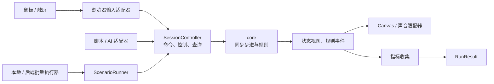
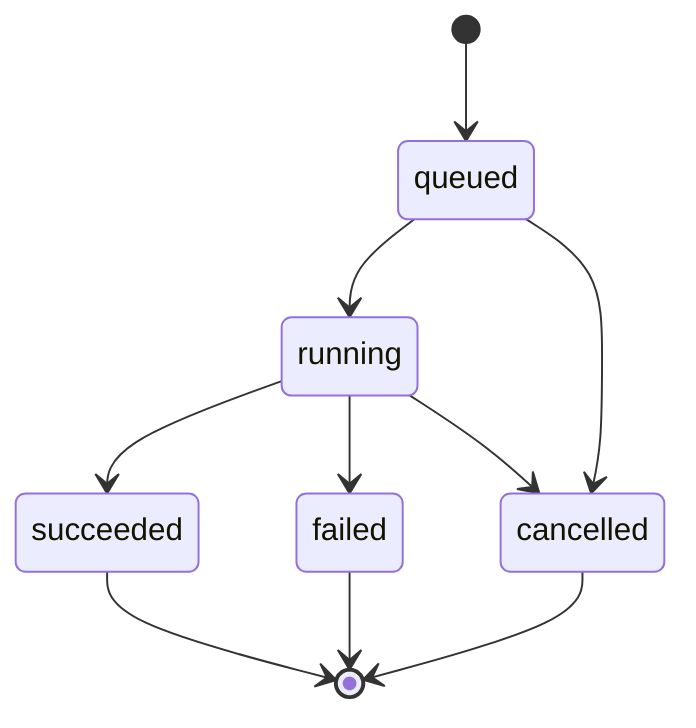

# 模拟、调试与自动化接口

## 1. 文档状态与目标

本文定义待实现的公共操作、场景、实验和批量执行契约；接口名称是设计约定，当前没有可运行的 SDK、CLI、MCP 或模拟服务。实施顺序见[实施计划](implementation-plan.md)，依赖方向见[架构设计](architecture.md)，持久化语义见[存储契约](storage-contracts.md)。

目标是让玩家、学习面板、脚本和 AI 使用同一套游戏能力，并让浏览器与无画面运行共享规则。实时战斗始终在浏览器；后端以后可以加载相同内核执行批量任务，不承担玩家实时战斗的权威状态。

## 2. 术语与数据归属

| 概念 | 含义 | 生命周期与归属 |
| --- | --- | --- |
| 战局 `Session` | 一个正在运行的游戏实例，包含实体、计时器和随机状态 | `core` 独占规则状态，`application/SessionController` 拥有命令队列和生命周期 |
| 场景 `Scenario` | 一次运行的输入描述：关卡、初始条件、控制策略、时钟方案和预算 | 可版本化的数据，不包含活动连接或函数序列化 |
| 数值方案 `BalanceConfig` | 完整解析后的单位、敌人、经济等可调整参数 | 原版基线只读；实验方案生成独立版本 |
| 实验 `Experiment` | 使用一组场景、数值方案和随机样本开展比较的定义 | 一经开始执行即冻结；修改产生新版本 |
| 运行 `Run` | 实验中一个确定的场景、方案、样本组合 | 每次创建独立战局；具有稳定 `runId` |
| 回放 `Replay` | 重建一次运行所需的初始条件和有序帧输入 | 用于诊断和回归，不等于正式游戏续玩存档 |
| 检查点 `Checkpoint` | 特定版本、帧边界上的完整内核状态与验证摘要 | 首版优先从初始状态重放，检查点加速按需实现 |

正式战役档案与实验数据分开。实验中的胜利、解锁或高分仅是运行结果，不调用正式档案保存用例。

## 3. 模块与调用路径

- `src/application` 暴露公共操作与查询；`SessionController` 负责实例生命周期、模式校验、命令队列和步进边界，规则由 `core` 处理。
- `src/simulation` 负责场景展开、策略调用、运行预算和指标收集。内层循环调用同一个同步步进入口，不通过逐帧 HTTP、浏览器点击或另一套物理模型运行。
- 跨模块的 `Scenario`、`RunRequest`、`RunResult` 在 `src/ports` 定义，应用公共 API 可重导出。应用经注入的 `RunExecutor` 发起粗粒度运行；实际执行适配器调用 `ScenarioRunner`，不让应用层反向导入模拟实现。
- 环境适配器负责将 DOM、进程或网络输入转换为公共 DTO。CLI/MCP 只做参数转换、调用和结果格式化，不包含玩法。
- 实时步骤同步完成，资源加载和结果持久化发生在运行前后或明确的缓冲边界。大型批次按批写结果，不能在每一帧等待数据库。

## 4. 公共能力与操作边界

### 4.1 最小能力集合

以下是语义能力清单，具体 TypeScript 签名在对应实现阶段落地；不据此预建通用 RPC 框架。

| 能力 | 输入要点 | 结果与约束 |
| --- | --- | --- |
| 创建战局 | 已校验内容、完整配置、初始状态、运行模式和随机状态 | 新 `sessionId`；不复用上局的队列或随机实例 |
| 提交命令 | `commandId`、序号、目标帧、类型及参数 | 接受或拒绝回执；接受不等于已执行 |
| 查询状态 | 会话、查询种类、可选实体范围 | 有帧编号的隔离 DTO，不返回可变内核对象 |
| 暂停 / 恢复 | 会话及请求标识 | 更新控制状态；暂停不推进战斗时间 |
| 单步 | 暂停的调试会话及合法帧输入 | 恰好执行一帧，执行后保持暂停 |
| 重开 / 关闭 | 会话与明确的重开配置 | 旧队列作废；重开使用记录的初始随机状态或明确的新状态 |
| 导出回放 | 会话或已结束运行 | 返回版本化记录或产物标识，不返回本机文件句柄 |
| 执行场景 | 场景、配置版本及运行预算 | `RunResult`、指标、必要回放或失败诊断 |

玩家与策略共用选择、方向输入、释放、招募、升级、确认开波、特殊对象操作等正式命令。输入命令表达游戏意图，不把鼠标像素、CSS 尺寸或 DOM 元素引用传入内核。

构造测试状态通过独立的场景工厂完成；正式命令不提供 `setAnyField`、任意 `eval` 或替换内部函数。调试查询可暴露更多状态，但必须与策略允许看到的观察范围分开。

### 4.2 命令排序与拒绝

一个会话只有一个命令排序所有者。浏览器输入、AI 和脚本不得分别维护互不协调的序号；同时接入时，由控制器顺序接收，或明确指定当前控制者。

1. 输入适配器将操作转换为命令，控制器分配递增 `sequence` 和下一次可执行的 `frameIndex`。
2. 控制器校验 DTO、权限模式及帧位置，记录接受或拒绝回执。
3. 在该帧约定的输入边界按 `sequence` 消费命令，规则更新按基线规定的相对次序执行。
4. 返回执行结果及规则事件，再发布带帧编号的状态视图。

输入边界是帧契约的一部分，实现时对齐基线游戏的输入与更新相对次序；不得将命令随机插入敌人或投射物更新中途。初始状态中的待处理输入也必须显式记录。

| 情况 | 约定处理 |
| --- | --- |
| 同一 `commandId` 重试且载荷相同 | 返回原回执，不再次执行；重复窗口覆盖该会话的有效命令历史 |
| 同一 `commandId` 对应不同载荷 | 拒绝为冲突，不选择最后一次覆盖 |
| 目标帧已执行 | 拒绝为过期命令，不回溯修改状态或静默挪到当前帧 |
| 实体不存在、资源不足、当前状态不允许 | 返回明确业务拒绝，不抛成未分类内部错误 |
| 会话已关闭或重开 | 拒绝旧 `sessionId`；重开后的对象 ID 不能使旧命令误命中新实体 |
| 队列超出预算 | 显式拒绝或由调用方背压；不能无记录丢弃改变玩法的命令 |

连续指针移动是否合并属于浏览器输入策略；规则接口接收已经确定的命令流。回放保存最终接受并消费的序列；调试记录另保留拒绝信息。两者不可混用为“实际执行过的输入”。

## 5. 时间、随机与可复现性

### 5.1 帧输入

每个规则步骤至少绑定 `frameIndex`、`dtMs`、受控 `nowMs`、该帧命令和会影响规则的环境状态。帧编号单调增加；任何读取时间的游戏逻辑都使用注入值。

基线保留 `0–100 ms` 的可变 `dtMs` 和既定数值语义。浏览器适配器计算真实间隔并按基线限制；测试可以指定 `16, 17, 33, 100...` 等明确序列。指定测试序列不代表把产品改成固定 60 Hz。

`nowMs` 用于依赖时间基准的逻辑或动画；其原点和推进规则属于时钟方案。截断后的 `dtMs` 不一定等于两次时间读数之差，回放不能只累加 `dtMs` 后猜测所有时间值。

| 控制 | 明确语义 |
| --- | --- |
| 暂停 | 不执行战斗步进；页面和控制界面仍可绘制，恢复时重设浏览器计时基线 |
| 等待开波 | 保留基线允许继续更新的子系统，不当作完整暂停 |
| 单步 | 执行一条指定帧输入，输入命令、计时器与随机调用按普通步骤处理 |
| 测试倍速 | 更快消费同一帧序列，允许减少绘制；不把 `dtMs` 直接乘倍率冒充等价运行 |
| 页面进入后台 | 浏览器控制器暂停并记录状态转换，恢复不补算未经定义的大段真实时间 |
| 长时间运行 | 同时设置模拟时长、帧数和实体数预算，避免连续零 `dtMs` 绕过停止条件 |

### 5.2 随机源与表现环境

所有影响结果的随机源都由战局实例持有，按基线共享关系和调用顺序使用。不得为了便于模块划分，将原本共享的装饰、气泡、音效选择与玩法抽样拆成新随机流。

真正播放声音与绘制图像是外部效果；随机选择、音效请求的接受条件和冷却等确定性决定必须在受控步骤中完成。若可见范围、声音设置或窗口状态影响某条随机调用是否发生，它们就是运行输入的一部分，必须固定或记录。

无画面运行采用明确的表现环境配置，例如虚拟视口、镜头轨迹和声音设置。关闭实际播放或跳过绘制不能额外跳过基线要求的随机消耗。统计采样也不能调用玩法随机源。

### 5.3 回放最小载荷

| 类别 | 必须记录 |
| --- | --- |
| 版本 | 回放格式、规则、内容、数值方案、策略版本与摘要 |
| 初始化 | 关卡、难度、初始合法状态、运行模式、稳定实体 ID 生成状态 |
| 随机 | 各相关随机源的算法标识和初始完整状态，不仅是一个总 seed |
| 时间 | 时间原点与方案；逐帧时间值，或可无歧义重建其值的压缩编码 |
| 输入 | 命令执行帧、序号、载荷，以及影响规则的环境变化 |
| 核验 | 终止原因、关键帧状态摘要、最终指标摘要 |

载荷和摘要采用明确的字段排序及数值编码，排除机器路径、任务到达时间等非语义信息。跨版本重放必须取得相同版本或经过明确迁移；依赖缺失时返回不支持，不静默套用最新版本。

检查点需包含完整计时器、队列、对象关系、随机状态及必要表现环境。未证明“从头重放”和“检查点恢复”一致前，不用局部状态快照跳过前半段运行。

## 6. 场景与控制策略

### 6.1 场景定义

场景以数据描述，内容引用必须可解析，禁止嵌入脚本源码或可执行表达式。最小字段包括：

- `scenarioId / scenarioVersion`、关卡和难度。
- 初始档案的游戏相关投影或显式初始条件；实验不读取运行机器上的个人正式进度。
- 配置版本、初始随机状态生成方案、时钟与环境方案。
- 控制方式：固定命令回放或具名策略及版本。
- `maxFrames / maxSimulatedMs / maxEntities` 等确定性预算，以及执行器的真实耗时预算。
- 结果采样频率、必要指标和回放保留规则。

场景初始化先校验地图、单位、初始资源和关系，失败返回 `invalid-input`。用于边界测试的特殊状态也必须有明确构造器和约束，不能通过任意对象补丁绕过不变量。

### 6.2 策略接口

策略在约定的决策帧获取观察并返回正式命令。观察应具有 `frameIndex`，动作声明对应观察帧；不允许异步旧响应在未知帧生效。

| 控制方式 | 适用场景 | 可复现要求 |
| --- | --- | --- |
| 固定命令回放 | 回归已知操作、定位规则差异 | 保留精确帧和命令序列 |
| 确定性规则机器人 | 多关卡、多种子平衡比较 | 固定策略版本、独立策略随机源和决策频率 |
| 外部 AI 决策 | 交互学习、策略探索 | 记录最终动作与接收帧；仅记录模型名称不足以重放 |

策略观察有显式权限档位，例如玩家可见信息与全状态调试。比较报告必须标注档位，不能把读取隐藏计时器的策略与仅观察画面的玩家能力混为一谈。

外部 AI 在实验调试模式可于决策边界暂停模拟等待响应；等待时间不进入模拟时钟。实时浏览器模式按已声明的超时、跳过或保持原方向规则处理迟到动作，记录实际生效帧。批量基准优先采用固定回放或确定性机器人。

## 7. 数值实验与指标

### 7.1 冻结实验输入

原版基线不可就地修改。用户编辑时可用基线加参数差异作为编辑形式；开始实验前解析为完整配置、校验并计算摘要，运行固定引用该快照，避免基线更新改变旧实验。

对比采用相同场景集、控制策略、决策频率、时钟方案和初始随机样本。方案变化可能改变随机调用次数，因此相同初始种子不保证逐次随机结果永远对应；结论应以多样本分布和配对差异为依据。

运行标识由实验版本、方案、场景和样本标识稳定派生，不受 worker 数量或调度顺序影响。随机初始化不能依赖任务启动时间、worker 编号或上一次运行的结束状态。

### 7.2 结果与终止分类

| 字段 | 含义 |
| --- | --- |
| `status` | `completed`、`cancelled`、`budget-exceeded`、`failed` 或 `invalid-input` |
| `outcome` | 仅正常规则结束时为 `victory` 或 `defeat`；其他状态为空 |
| `stopReason` | 细分生命耗尽、通关、模拟预算、真实超时、资源限制或执行异常 |
| `metrics` | 有定义和单位的数值结果；缺失数据使用明确空值，不伪装为零 |
| `artifacts` | 回放、失败快照、分段时间序列等逻辑产物标识 |
| `provenance` | 规则、内容、配置、策略、运行环境和输入摘要 |

未完成运行不进入正常胜负分母。报告同时给出计划运行数、各终止分类数量、有效样本数和缺失比例，避免只展示成功完成的样本。

### 7.3 首批指标

| 指标 | 定义及注意点 |
| --- | --- |
| 胜率 | 正常结束运行中的胜利比例，同时报告未完成率与样本量 |
| 剩余生命 | 正常结束时的生命值，按胜负分别汇总 |
| 通关时间 | 胜利运行的模拟时间；失败或截断运行不得当作零耗时 |
| 经济收支 | 初始现金、击杀收入、拾取、特殊收支、招募升级支出、结束现金分别记录 |
| 单位贡献 | 输出伤害、有效伤害、击杀归属及投入成本分别定义，避免把过量伤害计作收益 |
| 波次压力 | 每波峰值敌人数、漏敌数、持续时间和剩余生命 |
| 执行性能 | 步进耗时、帧数、峰值实体数和产物体积；真实耗时不参与游戏结果摘要 |

指标由规则事件或只读状态计算；相同事件具有稳定帧与事件序号，统计重复消费不得重复累加。只有确实需要时才增加逐实体全量轨迹，默认按采样及异常保留控制体积。

同一报告同时呈现基线值、实验值、差异分布和样本量。若输出置信区间，应明确计算方法；不能用单个 seed 或平均值就宣称总体更平衡。指标判断目标由实验定义给出，不让统计模块自行决定游戏设计取舍。

## 8. 本地与后端批量执行

### 8.1 单次运行与并行

`ScenarioRunner` 的职责是校验输入、创建实例、推进到停止条件、收集结果并释放资源。执行器仅分配任务和保存产物，不能修改规则或在过载时偷偷改变模拟步长。

首个 runner 在单进程串行执行；有真实批量需求后再使用 Node worker 并行。每个 worker 独立持有战局和随机状态，内容可作为只读数据复用；可变实体、策略状态和计时器不得跨运行共享。

调度必须设置并发数、队列长度、单运行内存/实体预算、真实超时和最大产物体积。取消在帧边界检查；不响应的 worker 可由执行器终止，结果记为执行超时或取消，不记为游戏败北。

任务重试使用同一逻辑 `runId`，附加不同 `attemptId`；最终结果只提交一次，失败尝试作为诊断保留。外层执行器先条件切换 `activeAttemptId` 再启动重试；产物 ID 包含尝试标识，迟到的旧尝试不能提交新终态。尝试失败与逻辑运行失败分开，重试耗尽才提交逻辑失败。具体提交条件和大型产物完整性按存储契约处理。

### 8.2 后端任务边界

后端以完整运行或批次为单位接收任务，不提供远程逐帧战斗控制。待实现的最小操作是提交实验、查询状态、请求取消、读取结果和获取产物。

任务状态描述调度与执行是否完成；其中每个 `RunResult` 仍保留自己的游戏结果和停止原因。批次 `succeeded` 只表示按约定完成任务处理，不表示所有游戏运行都胜利，也不掩盖明确记录的截断或无效样本。

提交使用稳定幂等键，响应丢失后可查询原任务；取消是请求，不保证瞬间结束。状态查询返回已完成数量、分类计数和产物可用状态，部分产物不得显示成完整报告。后端授权在任务边界解析用户和资源范围，内核不接触凭据。

## 9. CLI、MCP 与 agent 验证

先提供应用内公共接口和可导入的场景 runner，确有使用需求时再添加 CLI；MCP 复用同一用例，不为不同入口复制业务实现。本阶段不预选协议 SDK 或服务框架。

CLI/MCP 参数应映射到已验证的场景、配置及逻辑产物标识，使用有界查询和明确错误码。CLI 的本地路径处理属于适配器，不能让路径进入游戏内核；远程入口不得暴露任意文件读取或执行能力。

每个实际开发的 agent 入口都要用 `pi` 实际加载并完成至少一次真实操作。证据包括执行命令、加载的工具/技能或上下文标识、输入场景、返回的运行标识和关键结果。CLI 必须经 agent 实际执行；MCP 必须经桥接工具真实调用；只读源码、单测或手工直调不能替代该验证。

如果环境不支持，交付明确列出未验证入口和阻塞原因。接口设计、示例输出或模拟桩均不能作为已经调用成功的证明。

## 10. 验收矩阵

| 验证对象 | 必须满足 |
| --- | --- |
| 接口等价 | 同初始状态、时间、环境和命令下，UI 适配输入与脚本输入得到相同规则状态 |
| 命令边界 | 重复、过期、跨会话、非法状态和队列溢出都有明确回执，状态未被意外修改 |
| 暂停与单步 | 暂停不推进战斗；一次单步只增加一帧；恢复不补算后台停留时间 |
| 绘制与音频隔离 | 开启/关闭实际绘制和播放不改变已固定环境下的规则结果及随机状态 |
| 回放 | 从初始状态重放通过关键帧与最终摘要；缺失版本或坏输入被明确拒绝 |
| 策略公平性 | 观察档位、决策频率、超时策略和最终动作可审计，实验无正式档案副作用 |
| 配置冻结 | 修改编辑中的参数不会改变已提交实验；基线保持原版本 |
| 串并行一致 | 同一运行串行、不同 worker 数和不同调度顺序的语义摘要一致 |
| 失败分类 | 无效输入、模拟预算、真实超时、取消和异常均与正常胜负区分 |
| 任务与产物 | 重试不重复提交结果；取消可追踪；不完整产物不发布为完整报告 |
| agent 入口 | 按[应用约束](../AGENTS.md)提供 `pi` 实际加载与调用证据 |

本文约束可以逐阶段实现，阶段尚未覆盖的接口应明确标为不可用。每个新增能力的完成状态和回归范围记录在实施计划中，不通过提前暴露空接口宣称已支持。
