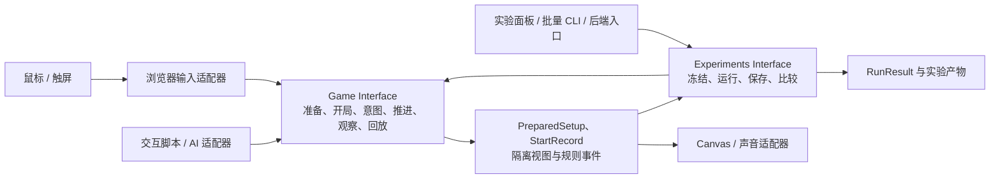
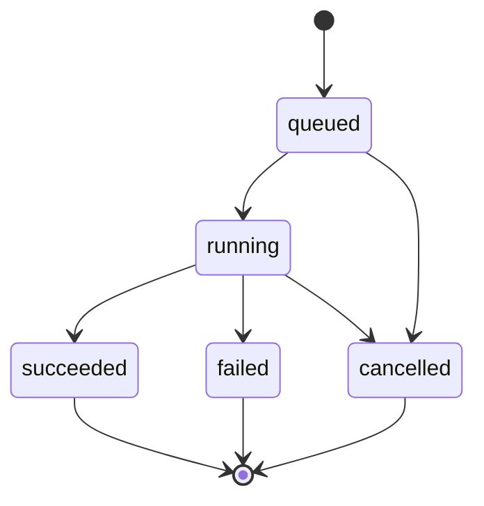

# 模拟、调试与自动化接口

## 1. 文档状态与目标

本文定义公共操作、场景、实验和批量执行契约，并区分设计目标与已落地切片。T01–T13 已发布；T14–T15 已在 `gunsnglory` 集成分支完成本地实现与验证，尚未发布。T14 提供数值方案准备、不可变版本冻结和 Cow Gulch 配对比较界面；T15 为方案与比较报告增加 IndexedDB 持久化。批量、CLI、MCP 和无画面产品界面尚未实现。T12 回放实际范围与扩展缺口见[5.3 节](#53-game-拥有的回放最小载荷)，T13 运行器行为见[6.3 节](#63-t13-当前实现范围)，T14 比较范围见[7.1 节](#71-冻结实验输入)与[验证记录](validation.md#20-t14-比较两套数值方案)，T15 保存/恢复范围见[7.4 节](#74-t15-保存与重新打开实验)及[验证记录](validation.md#21-t15-保存并重新打开实验)。实施顺序见[实施计划](implementation-plan.md)，依赖方向见[架构设计](architecture.md)，持久化语义见[存储契约](storage-contracts.md)。

公共能力按已确认的 `Game`、`Progress`、`Experiments` 三个深 Module 组织。本文以 `Game` 和 `Experiments` 的 Interface 为测试 Seam；`SessionController`、规则内核和 `ScenarioRunner` 均为内部实现，不能再形成一套要求消费者掌握的公共调用链。

目标是让玩家、学习面板、脚本和 AI 使用同一套游戏能力，并让浏览器与无画面运行共享规则。实时战斗始终在浏览器；后端以后可以加载相同内核执行批量任务，不承担玩家实时战斗的权威状态。

## 2. 领域用语与数据归属

战局、场景、数值方案、实验、运行、回放和检查点的定义统一见[领域词汇表](GLOSSARY.md)，正式游玩与实验的产品范围见[产品规格](spec.md)。本文只定义这些概念对应的运行行为和数据契约；类型与状态的所属 Module 由[架构设计](architecture.md)规定。

## 3. 公共调用路径与数据归属

- `Game` 拥有开局准备、输入校验、命令及视图类型、`PreparedSetup`、`StartRecord`、回放格式和战局生命周期；内部控制器负责排序、模式和推进权，规则内核负责同步计算。
- `Experiments` 拥有 `Scenario`、`RunRequest`、`RunResult`、数值方案冻结、策略、场景执行、预算、指标、比较及仓库存取。其私有 `ScenarioRunner` 直接组合 `Game` Interface，不复制初始化或战斗规则。
- `Experiments` 不依赖 `Progress`。正式进度需要的投影由正式游玩消费者提供；实验使用显式初始条件，不读取运行机器上的个人档案，也不提交正式结算。
- `ContentSource` 属于共享的内部内容 Module。`Game` 取得并验证定义，通过 `prepare` 向真实的数值方案消费者返回完整配置与精确版本。`Experiments` 只组合 Game Interface，不直接读取 Content，也不开临时假会话提取配置；冻结后仍由 Game 校验每次实际开局输入。
- 不建立全局 `ports` 或 `application` 层，不导出 runner 供 CLI 旁路调用。进程内执行直接组合；真实 worker 或远端执行需求出现时，才增加 `Experiments` 内部 execution Seam，其约定由所属 Module 管理。
- 环境 Adapter 只把 DOM、进程或网络输入转换为公共意图和结果。`Game.prepare`、`Game.open` 及实验持久化异步，战局步进同步；大型批次按缓冲边界保存，不能逐帧等待网络或数据库。

## 4. 公共能力与操作边界

### 4.1 最小能力集合

以下是语义能力清单，具体 TypeScript 签名在对应实现阶段落地；不据此预建通用 RPC 框架。

| 所属 Module 与能力 | 输入要点 | 结果与约束 |
| --- | --- | --- |
| `Game.prepare` | 关卡、模式、内容/规则版本及参数差异 | 返回不可变、可序列化 `PreparedSetup`；不创建会话，不取随机样本或读取时钟，不推进 |
| `Game.open` | 普通开局请求；或受控的 `PreparedSetup` 加本次样本初始条件、随机与时间/环境输入 | 异步准备或校验既有准备结果，再初始化；返回独立 session 与不可变 `startRecord` |
| `Game` session 的普通 `dispatch` | 选择、移动、升级等语义意图，可选重试键 | 返回回执；命令序号和执行帧由内部生成，接受不等于已执行 |
| `Game` session 的查询 | 查询种类、可选实体范围 | 有帧编号的隔离 DTO，不返回可变内核对象 |
| `Game` session 的暂停 / 恢复 | 明确的控制请求 | 更新控制状态；暂停不推进战斗时间 |
| `Game` session 的受控 `step` | 时间及必要环境输入；通过受控驱动权调用 | 同步完成一帧，帧编号由内部递增；普通 UI 不自行构造精确帧记录 |
| `Game` session 的单步 | 已暂停的会话及合法时间输入 | 复用普通推进规则恰好执行一帧，执行后保持暂停；不得由检查面板或覆盖层另行修改战局 |
| `Game` 的重开 / 关闭 | 会话与明确的重开配置 | 旧队列作废；重新开局仍走 `open` 校验并生成新的启动记录 |
| `Game` 的回放导入 / 导出 | 完整启动记录和精确帧序列，或当前会话 | 由 Game 校验、重放及生成格式；外部保存不改变回放语义 |
| `Experiments` 的场景 / 批次运行 | 冻结场景、配置版本、策略、样本及预算 | `RunResult`、指标及产物；返回实际启动记录或其绑定引用 |

`Game.prepare` 只在数值方案编辑/保存这一真实消费者出现的纵向切片公开，不要求首个可玩切片 T01 预建。普通 `Game.open` 内部使用同一准备逻辑，普通 UI 无需先调用 `prepare`；公开后也不能维护两套默认值解析或校验实现。

`PreparedSetup` 由 Game 定义，包含精确规则/内容版本、关卡与模式、完整解析参数及摘要、已校验的初始化约束。它不是会话或已抽样的初始战局，不包含活动连接、函数、随机样本或实时钟读数。多个关卡/模式的实验分别绑定适用的准备结果，不能用一份结果跳过其他场景的约束检查。

受控 `Game.open` 接收准备结果时重新校验其版本、摘要和本次样本是否满足初始化约束，之后才初始化随机状态、时间/环境基准并生成 `StartRecord`。准备结果被篡改、版本不可取得或样本不合法时明确拒绝，不替换为最新内容。已准备不等于可跳过每次实际开局校验。

`Game.open` 完成时战局已准备好，但没有启动帧循环，也未推进首帧。消费者随后选择一个浏览器驱动或受控驱动，取得唯一推进权；失败时不返回半初始化 session。无画面开局只准备规则需要的数据，不等待图片、音频解码或创建播放设备。

`startRecord` 记录实际使用的准备结果摘要、规则与内容版本、完整解析配置、本次初始条件、模式、随机状态以及时间/环境基准；运行标识在这里固定。它是与内部可变状态隔离的不可变值，由 `Game` 生成，调用者不能用未解析请求或尚未抽样的 `PreparedSetup` 代替实际启动事实。

运行模式显式区分正式游玩、调试、实验和回放。模式影响允许的控制及观察能力；`Game` 返回带本次执行模式的结算，`Progress` 只接受正式游玩的结算，对 replay/debug/experiment 均明确拒绝。Experiments 不依赖 Progress，也不把实验结果转换成正式结算。

玩家与策略共用选择、方向输入、释放、招募、升级、确认开波、特殊对象操作等正式命令。输入命令表达游戏意图，不把鼠标像素、CSS 尺寸或 DOM 元素引用传入内核。

测试场景工厂只生成公共 Interface 接受的初始请求，仍经 Game 校验；正式命令不提供 `setAnyField`、任意 `eval` 或替换内部函数。调试查询可暴露更多状态，但必须与策略允许看到的观察范围分开。

### 4.2 命令排序与拒绝

一个会话只有一个命令排序所有者，即 `Game` 内部的 `SessionController`。浏览器输入、AI 和普通脚本只提交意图，不分配 `sequence` 或 `frameIndex`；同时接入时由内部顺序接收，或明确指定当前控制者。

1. 输入 Adapter 将操作转换为普通意图；`Game` 校验 DTO、模式和可选重试键。
2. 内部控制器为新意图生成命令标识、递增 `sequence` 和下一次可执行的 `frameIndex`，记录接受或拒绝回执。
3. 在该帧约定的输入边界按 `sequence` 消费命令，规则更新按基线规定的相对次序执行。
4. 返回执行结果及规则事件，再发布带帧编号的状态视图。

输入边界是 Game 的帧契约，实现时对齐基线游戏的输入与更新相对次序；不得将命令随机插入敌人或投射物更新中途。导入的精确序列只经 Game 的受控 driver/replay 能力进入，校验会话、序号、帧连续性和目标位置后消费，不能混入普通 `dispatch` 绕过排序。初始状态中的待处理输入也必须显式记录。

| 情况 | 约定处理 |
| --- | --- |
| 同一可选重试键重试且载荷相同 | 返回原回执及内部命令标识，不再次执行；重复窗口覆盖该会话的有效命令历史 |
| 同一重试键对应不同载荷 | 拒绝为冲突，不选择最后一次覆盖；未提供键的两次意图按两次独立操作处理 |
| 受控导入的帧已执行、缺失或顺序不合法 | 明确拒绝，不回溯修改状态或静默挪到当前帧；普通意图不要求调用者选择目标帧 |
| 实体不存在、资源不足、当前状态不允许 | 返回明确业务拒绝，不抛成未分类内部错误 |
| 会话已关闭或重开 | 拒绝旧 `sessionId`；重开后的对象 ID 不能使旧命令误命中新实体 |
| 队列超出预算 | 显式拒绝或由调用方背压；不能无记录丢弃改变玩法的命令 |

连续指针移动是否合并属于浏览器输入策略；Game 对收到的意图生成确定的命令流。回放保存最终接受并消费的序列；调试记录另保留拒绝信息。两者不可混用为“实际执行过的输入”。

## 5. 时间、随机与可复现性

### 5.1 兼容语义与帧输入

一次逻辑更新的固定顺序为：对象 → 敌人 → 单位生成 → 单位移动 → 投射物 → 波次 → 生成池 → 音效状态；输入、控制状态及胜负检查的位置由基线规则固定。

Java 整数除法向零截断、特定 float 运算和逐帧截断点分别建模。逻辑集合保持稳定次序，绘制排序使用独立索引。敌人路线、玩家方向输入、地形可走性、占格和实体碰撞分别保留其规则；具体玩法分支在对应纵向切片通过公共 Interface 验证。

每个内部规则步骤至少绑定 `frameIndex`、`dtMs`、受控 `nowMs`、该帧命令和会影响规则的环境状态。受控驱动通过 session 的同步 `step` 提供时间与环境，内部生成单调增加的帧编号；回放导入的编号必须与当前预期匹配。任何读取时间的游戏逻辑都使用注入值。

一个 session 在任意时刻只有一个驱动所有者。浏览器实时循环与实验 runner 不能同时调用 `step`；重入、关闭后调用或非所有者推进都明确拒绝。驱动切换必须先停止旧驱动并完成边界交接，不用两个循环争抢同一个实例。

基线保留 `0–100 ms` 的可变 `dtMs` 和既定数值语义。浏览器适配器计算真实间隔并按基线限制；测试可以指定 `16, 17, 33, 100...` 等明确序列。指定测试序列不代表把产品改成固定 60 Hz。

`nowMs` 用于依赖时间基准的逻辑或动画；其原点和推进规则属于时钟方案。截断后的 `dtMs` 不一定等于两次时间读数之差，回放不能只累加 `dtMs` 后猜测所有时间值。

| 控制 | 明确语义 |
| --- | --- |
| 暂停 | Game 不执行战斗步进；页面和控制界面仍可绘制，恢复时重设浏览器计时基线 |
| 等待开波 | 保留基线允许继续更新的子系统，不当作完整暂停 |
| 单步 | 浏览器学习控件传入 16 ms 时间输入；Game 复用普通推进路径执行一帧并保持暂停，计时器和随机调用按普通步骤处理 |
| 测试倍速 | 更快消费同一帧序列，允许减少绘制；不把 `dtMs` 直接乘倍率冒充等价运行 |
| 页面进入后台 | 浏览器 Adapter 调用 Game 暂停并记录状态转换，恢复不补算未经定义的大段真实时间 |
| 长时间运行 | 同时设置模拟时长、帧数和实体数预算，避免连续零 `dtMs` 绕过停止条件 |

### 5.2 随机源与表现环境

所有影响结果的随机源都由战局实例持有，按基线共享关系和调用顺序使用。不得为了便于模块划分，将原本共享的装饰、气泡、音效选择与玩法抽样拆成新随机流。

真正播放声音与绘制图像是外部效果；随机选择、音效请求的接受条件和冷却等确定性决定必须在受控步骤中完成。若可见范围、声音设置或窗口状态影响某条随机调用是否发生，它们就是运行输入的一部分，必须固定或记录。

无画面运行采用明确的表现环境配置，例如虚拟视口、镜头轨迹和声音设置。关闭实际播放或跳过绘制不能额外跳过基线要求的随机消耗。统计采样也不能调用玩法随机源。

### 5.3 Game 拥有的回放最小载荷

| 类别 | 必须记录 |
| --- | --- |
| 版本 | 回放格式、规则、内容、数值方案、策略版本与摘要 |
| 初始化 | 不可变 `StartRecord` 中的关卡、难度、完整配置、初始合法状态、运行模式和稳定实体 ID 生成状态 |
| 随机 | 各相关随机源的算法标识和初始完整状态，不仅是一个总 seed |
| 时间 | 时间原点与方案；逐帧时间值，或可无歧义重建其值的压缩编码 |
| 输入 | 命令执行帧、序号、载荷，以及影响规则的环境变化 |
| 核验 | 终止原因、关键帧状态摘要、最终指标摘要 |

Game 拥有准备结果、启动记录、命令、观察视图和回放格式及其校验。Experiments 可保存回放或绑定产物引用，并附加策略与实验信息，但不重新实现回放排序、帧解码或初始化规则。回放需要本次实际随机和时间输入，不能仅保存 `PreparedSetup` 后重新抽样。

回放导入保留不可变的原始 `StartRecord` 作为来源；Game 为本次重放创建新的 `sessionId`，本次执行模式固定为 replay，并记录来源摘要。原始录制模式只用于校验当时允许的输入，不能将来源记录中的正式模式继承为本次结算资格。该转换由 Game 的回放入口负责，消费者不能通过修改准备结果的模式绕过验证。

载荷和摘要采用明确的字段排序及数值编码。玩法比较摘要排除新会话身份、任务到达时间、机器路径及本次复现用途标签，但保留所有影响玩法的配置、时间、环境、输入和随机状态；来源关联仍独立保存。新建回放会话不会因此得到不同的玩法比较结果，也不会复制正式结算。跨版本重放必须取得相同版本或经过明确迁移；依赖缺失时返回不支持，不静默套用最新版本。

检查点需包含完整计时器、队列、对象关系、随机状态及必要表现环境。未证明“从头重放”和“检查点恢复”一致前，不用局部状态快照跳过前半段运行。

#### T12 当前实现范围

T12 已实现的是 Cow Gulch 单场战局导出和从头确定性重放，不代表上表的完整长期载荷契约已全部完成。

| 项目 | 当前行为 |
| --- | --- |
| 版本与启动来源 | JSON 记录包含格式版本、规则版本、场景内容版本、来源 `StartRecord`、执行模式、Java `Random` 算法标识和 unsigned 32-bit 初始 seed。新 `StartRecord` 可包含 Game.prepare 生成的完整 PreparedSetup 与摘要；旧记录仍可不携带此字段。重放校验实际记录的数值配置，但当前不绑定一个可长期查询的命名方案版本。 |
| 时间与输入 | 记录 Game 实际消费的每帧整数 `deltaMs`（0–100 ms）和按接受顺序排列的全部 `GameIntent`；回放从帧 0 提交同一输入，不采用墙钟时间或原浏览器倍速。 |
| 检查点与终局 | 帧 0、每 120 帧及终局保存状态摘要；SHA-256 对规范 JSON 计算。摘要覆盖帧、游戏时间、单位、敌人、投射物、招募池、事件和波次，不包含新会话身份、镜头和暂停 UI 状态。终局结算与最终检查点必须匹配。 |
| 新会话与存档权限 | `Game.replay` 创建新的会话 ID，当前运行模式固定为 `replay`，保留不可变来源 `StartRecord`。Replay 结算可展示，但不会写入正式 Progress；页面只提供 JSON 文件导入/导出，不覆盖旧文件，也不把回放内容写进 IndexedDB。 |
| 拒绝与错误分类 | 缺少版本、格式/规则/随机算法不支持、内容版本不可用、输入损坏、文件摘要不符、重放检查点/终局不符、未完成录制、记录过大和不支持的来源模式均有独立错误码。内容或规则不匹配时不静默套用最新版。 |
| 尚未实现 | 多随机流完整状态、策略版本长期存档、命名数值方案 ID 与回放的持久关联、可变环境输入记录、检查点续跑、跨版本迁移、途中战局导出，以及除当前样本外的内容回放覆盖。只有出现相应功能需求时再扩展，不把这些目标写成 T12 已验证能力。 |

因此，T12 的回放可复现性只对同一规则版本、同一场景内容版本和当前记录格式成立；它不承诺恢复任务机器、镜头、声音或暂停界面，也不提供从检查点续跑。

## 6. 场景与控制策略

### 6.1 场景定义

场景以数据描述，内容引用必须可解析，禁止嵌入脚本源码或可执行表达式。最小字段包括：

- `scenarioId / scenarioVersion`、关卡和难度。
- 初始档案的游戏相关投影或显式初始条件；实验不读取运行机器上的个人正式进度。
- 固定的开局请求，或数值方案能力引入后的 `PreparedSetup` 及方案版本；本次样本的初始随机状态生成方案、时钟与环境方案。
- 控制方式：固定命令回放或具名策略及版本。
- `maxFrames / maxSimulatedMs / maxEntities` 等确定性预算，以及执行器的真实耗时预算。
- 结果采样频率、必要指标和回放保留规则。

`Scenario`、`RunRequest` 和 `RunResult` 由 Experiments 拥有。T13 的单场景切片以明确版本、初始条件及样本请求调用 `Game.open`，在首帧前固定实际 `StartRecord`；它不依赖 T14 的方案编辑入口。

T14 的方案准备与比较由 Experiments 校验场景安排、策略及预算，并通过 `Game.prepare` 取得完整数值、精确内容/规则版本和摘要后冻结；之后每次用固定的 `PreparedSetup` 与声明的样本输入调用 `Game.open`。Game 校验实际场景与数值摘要，返回真实 `startRecord`。任一输入校验失败返回 `invalid-input`；开局与准备共用同一内部数值绑定实现，不复制规则。

实验输入不得通过 `latest`、当前默认内容包或个人档案间接解析运行数据。编辑时的默认选择由 Game 的准备逻辑在冻结前解析为明确版本；冻结后的所有 `open` 只用固定准备结果和声明的本次样本输入。若该版本不可取得，运行明确失败，不能跨样本漂移到另一个版本。用于边界测试的特殊状态经 Game 的受控构造和校验进入，不通过任意对象补丁绕过不变量。

### 6.2 策略接口

Experiments 的策略在约定决策边界获取 Game 的隔离观察并返回正式意图。观察带 `frameIndex`；Experiments 的驱动记录动作对应的观察帧，并依策略迟到规则决定是否交给普通 `dispatch`，实际执行帧由 Game 生成。策略不获得内部排序权；异步旧响应不得在未知帧生效。

| 控制方式 | 适用场景 | 可复现要求 |
| --- | --- | --- |
| 固定命令回放 | 回归已知操作、定位规则差异 | 保留精确帧和命令序列 |
| 确定性规则机器人 | 多关卡、多种子平衡比较 | 固定策略版本、独立策略随机源和决策频率 |
| 外部 AI 决策 | 交互学习、策略探索 | 记录最终动作与接收帧；仅记录模型名称不足以重放 |

策略观察有显式权限档位，例如玩家可见信息与全状态调试。比较报告必须标注档位，不能把读取隐藏计时器的策略与仅观察画面的玩家能力混为一谈。

外部 AI 在实验调试模式可于决策边界暂停模拟等待响应；等待时间不进入模拟时钟。实时浏览器模式按已声明的超时、跳过或保持原方向规则处理迟到动作，记录实际生效帧。批量基准优先采用固定回放或确定性机器人。

### 6.3 T13 当前实现范围

`createExperiments()` 暴露 `Experiments.run(request, { signal })`。每次请求必须明确 run、scenario、sample、policy 的 ID/版本，场景内容与规则版本、随机 seed、策略观察档位、固定帧时间、决策间隔及预算；不接受 `latest`。当前初始状态由注册的 Game 场景定义，样本显式提供无符号 32 位随机 seed，不提供通用初始状态编辑器。

| 行为 | 当前实现 |
| --- | --- |
| 开局与版本固定 | 以 `mode: experiment` 调用 `Game.open`；检查实际 StartRecord 的场景、内容版本、规则版本、seed 和模式，并在首帧之前拒绝漂移；未推进帧即失败时也关闭会话。 |
| 策略与观察 | 策略按 ID/版本注册，注册版本固定；每次运行创建独立实例。策略只取得冻结的玩家可见白名单（单位、存活敌人、招募池及波次 HUD），不含地图、事件、投射物或敌方生命值；返回值必须是白名单 Game 意图。 |
| 推进与回执 | 在固定决策帧同步执行策略，提交合法意图，再调用 Game.advance 恰好推进一帧；验证实际帧号和时间增量。动作记录观察帧、接受状态以及实际消费帧。 |
| 停止与结果 | 胜利/失败来自 Game 终局记录；取消、预算耗尽、无效请求/策略输出、缺失场景/策略、版本不符和执行错误分别分类。外部 AbortSignal 在有界批次让出宿主后响应。 |
| 预算边界 | `deltaMs` 为 0–100 的整数；`maxFrames` ≤ 250,000、`maxSimulatedMs` ≤ 2,147,483,647、`maxEntities` ≤ 100,000、`maxWallClockMs` ≤ 120,000、`yieldEveryFrames` ≤ 10,000；每决策最多 16 个意图，总动作轨迹最多 10,000 条。 |
| 结果与保存 | `Experiments.run()` 返回实际 StartRecord、终局记录、动作轨迹、帧数、模拟/墙钟时间、实体峰值及可用的波次指标；该单次运行结果只在内存返回，不写 Progress 或 IndexedDB。比较报告的持久化由 T15 的 `saveComparison()` 单独负责。 |

当前验收场景为 Cow Gulch 固定内容版本与单波样本。Experiments 已实现 `saveScheme()` 与 `compare()`；浏览器面板只允许编辑拓荒者现金奖励，并用 1、3 或 5 组固定配对 seed 比较原版与新建的不可变草稿版本。报告包含完成/计划数、未完成率、胜负、胜率、剩余生命、胜利用时、结算现金与现金变化、敌人数峰值及逃脱数。T14 初版只在内存中保存方案与报告；T15 已提供内存和 IndexedDB 仓储，可保存方案与比较报告并在刷新后重开，不写 Progress。仍没有一般化场景目录、单次运行记录持久化、批量/CLI、MCP、worker 或远端执行。T13 行为门槛见[验证记录](validation.md#18-t13-无画面运行单个场景)，T14 面板验收见[验证记录](validation.md#20-t14-比较两套数值方案)。

## 7. 数值实验与指标

### 7.1 冻结实验输入

编辑和提交分为三个步骤，避免把可编辑草稿与已保存版本混为一谈：

1. 编辑数值方案草稿，可以使用基线加参数差异的表示；原版基线保持只读。
2. 保存时由 Experiments 调用 `Game.prepare`，将基线选择与参数差异解析为完整参数、精确版本和摘要，再创建不可变数值方案版本。继续编辑使用新草稿，不能覆盖该版本；Experiments 不直接读取内部 Content，也不创建假战局取得配置。
3. 开始实验时，针对所引用的固定方案和各场景，通过 Game 的准备能力取得适用的 `PreparedSetup`，冻结它们以及策略、样本、时间与环境。保存完整准备结果与摘要，后续修改产生新实验版本；已有运行使用原准备结果加各自声明的样本输入，不重新解析默认或 `latest`。

冻结、比较及实验仓库存取由 Experiments 统一负责，内部存储 Seam 与提交语义见[存储契约](storage-contracts.md)。每次 Game 实际返回的 `startRecord` 都绑定到对应运行；准备结果中的固定部分、声明的本次样本输入与实际启动记录不一致时，停止该运行并报告差异，不能继续输出貌似可比的结果。

T14 实现了上述流程的单场景方案冻结和配对比较：`Game.prepare` 返回完整数值参数、精确内容/规则版本和 SHA-256 摘要；`Experiments.saveScheme()` 为方案 ID/版本冻结完整参数，之后不允许相同 ID/版本覆盖为不同内容。`Experiments.compare()` 对同一 Cow Gulch 内容、玩家可见策略、固定时间方案及同一组 seed 顺序运行两套方案；UI 当前只暴露现金奖励这一参数和 1、3、5 个样本数。用户编辑奖励后再次比较会创建新候选版本，先前报告保留原快照。

对比采用相同场景集、控制策略、决策频率、时钟方案和初始随机样本。方案变化可能改变随机调用次数，因此相同初始种子不保证逐次随机结果永远对应；结论应以多样本分布和配对差异为依据。

运行标识由实验版本、方案、场景和样本标识稳定派生，不受 worker 数量或调度顺序影响。随机初始化不能依赖任务启动时间、worker 编号或上一次运行的结束状态。

### 7.2 结果与终止分类

| 字段 | 含义 |
| --- | --- |
| `status` | `completed`、`cancelled`、`budget-exceeded`、`failed` 或 `invalid-input` |
| `outcome` | 仅正常规则结束时为 `victory` 或 `defeat`；其他状态为空 |
| `stopReason` | 细分生命耗尽、通关、模拟预算、真实超时、资源限制或执行异常 |
| `metrics` | 有定义和单位的数值结果；缺失数据使用明确空值，不伪装为零 |
| `artifacts` | 回放、失败快照、分段时间序列等逻辑产物标识 |
| `provenance` | 规则、内容、配置、策略、运行环境和输入摘要，以及实际 `StartRecord` 或其不可变绑定引用 |

未完成运行不进入正常胜负分母。报告同时给出计划运行数、各终止分类数量、有效样本数和缺失比例，避免只展示成功完成的样本。

### 7.3 首批指标

| 指标 | 定义及注意点 |
| --- | --- |
| 胜率 | 正常结束运行中的胜利比例，同时报告未完成率与样本量 |
| 剩余生命 | 正常结束时的生命值，按胜负分别汇总 |
| 通关时间 | 胜利运行的模拟时间；失败或截断运行不得当作零耗时 |
| 经济收支 | 初始现金、击杀收入、拾取、特殊收支、招募升级支出、结束现金分别记录 |
| 单位贡献 | 输出伤害、有效伤害、击杀归属及投入成本分别定义，避免把过量伤害计作收益 |
| 波次压力 | 每波峰值敌人数、漏敌数、持续时间和剩余生命 |
| 执行性能 | 步进耗时、帧数、峰值实体数和产物体积；真实耗时不参与游戏结果摘要 |

指标由规则事件或只读状态计算；相同事件具有稳定帧与事件序号，统计重复消费不得重复累加。只有确实需要时才增加逐实体全量轨迹，默认按采样及异常保留控制体积。

同一报告同时呈现基线值、实验值、差异分布和样本量。若输出置信区间，应明确计算方法；不能用单个 seed 或平均值就宣称总体更平衡。指标判断目标由实验定义给出，不让统计模块自行决定游戏设计取舍。

### 7.4 T15 保存与重新打开实验

T15 通过 `Experiments.saveComparison()` 保存不可变的比较请求、方案快照、完整运行结果、配对数据和指标报告；取消比较也保存全部计划样本及已经完成的部分结果。`listComparisons()` 只读摘要，使用稳定倒序和不透明游标；`openComparison()` 校验记录、产物摘要及方案引用后直接恢复报告，不重新调用 `Game.open()`，也不改变 `Progress`。

浏览器将方案记录保存在 `gunsnglory-experiments` 的 `schemes` 仓，摘要索引与完整比较报告分别保存在 `comparisons` 与 `artifacts` 仓；索引和报告在同一 IndexedDB 读写事务中提交。方案与比较记录按 ID/版本不可变，相同内容可幂等重试，不同内容复用同一标识会返回冲突。页面加载时读取最近比较摘要，用户选择后显式打开。失败、容量不足、损坏、版本不兼容均显示存储错误，不伪装成仅内存成功。

T15 不提供运行中断点、后台继续执行、单次 `run()` 持久化、批次执行、CLI、worker 或远程任务；刷新页面后未完成的实时比较不会续算。若要继续相同实验，需重新从冻结的请求输入启动新的比较。

## 8. 本地与后端批量执行

### 8.1 单次运行与并行

`ScenarioRunner` 是 Experiments 的私有实现，负责校验运行安排、通过 `Game.open` 创建实例、取得驱动权、调用同步 `step` 推进到停止条件、收集结果并释放资源。消费者只调用 Experiments Interface，不能导入 runner 旁路冻结、预算或结果处理。Game 对每次实际开局和帧输入保留自己的校验职责。

首个 runner 在进程内串行直接组合 Game，不预建 `RunExecutor`。有真实 worker 或远端需求后，再在 Experiments 内增加 execution Seam，隐藏分发、序列化和取消；它不是新的公共 Module，也不改变消费者的场景和结果契约。

每个 worker 独立持有战局和随机状态，内容可作为只读数据复用；可变实体、策略状态和计时器不得跨运行共享。执行适配只分发任务和返回运行结果，Experiments 统一保存产物，不能在过载时偷偷改变模拟步长。

调度必须设置并发数、队列长度、单运行内存/实体预算、真实超时和最大产物体积。所有浏览器和 Node 串行 runner 在有界帧批之间让出事件循环，以处理取消请求、`AbortSignal` 和真实耗时预算；同时在帧边界检查已经可见的取消与预算状态。不能用一个持续同步循环阻止取消信号到达。

单次 `step` 仍同步；批间让出只改变真实执行速度，不改变帧输入序列、模拟时间或随机调用。worker 内也执行相同检查，外层执行器可强制终止不响应的 worker 作为兜底；结果记为执行超时或取消，不记为游戏败北。

任务重试使用同一逻辑 `runId`，附加不同 `attemptId`；最终结果只提交一次，失败尝试作为诊断保留。Experiments 内部先条件切换 `activeAttemptId` 再启动重试；产物 ID 包含尝试标识，迟到的旧尝试不能提交新终态。尝试失败与逻辑运行失败分开，重试耗尽才提交逻辑失败。具体提交条件和大型产物完整性按存储契约处理。

### 8.2 后端任务边界

后端入口通过 Experiments Interface 以完整运行或批次为单位接收任务，不提供远程逐帧战斗控制，也不直接导出私有 runner。待实现的最小操作是提交实验、查询状态、请求取消、读取结果和获取产物。

任务状态描述调度与执行是否完成；其中每个 `RunResult` 仍保留自己的游戏结果和停止原因。批次 `succeeded` 只表示按约定完成任务处理，不表示所有游戏运行都胜利，也不掩盖明确记录的截断或无效样本。

提交使用稳定幂等键，响应丢失后可查询原任务；取消是请求，不保证瞬间结束。状态查询返回已完成数量、分类计数和产物可用状态，部分产物不得显示成完整报告。后端授权在任务边界解析用户和资源范围，内核不接触凭据。

## 9. CLI、MCP 与 agent 验证

先提供 Game 与 Experiments 的公共 Interface，确有使用需求时再添加 CLI。交互调试调用 Game，场景与批次调用 Experiments；MCP 复用相同接口，不导入私有 `SessionController`、规则内核或 `ScenarioRunner` 绕过行为契约。本阶段不预选协议 SDK 或服务框架。

CLI/MCP 参数应映射到已验证的场景、配置及逻辑产物标识，使用有界查询和明确错误码。CLI 的本地路径处理属于适配器，不能让路径进入游戏内核；远程入口不得暴露任意文件读取或执行能力。

每个实际开发的 agent 入口都要用 `pi` 实际加载并完成至少一次真实操作。证据包括执行命令、加载的工具/技能或上下文标识、输入场景、返回的运行标识和关键结果。CLI 必须经 agent 实际执行；MCP 必须经桥接工具真实调用；只读源码、单测或手工直调不能替代该验证。

如果环境不支持，交付明确列出未验证入口和阻塞原因。接口设计、示例输出或模拟桩均不能作为已经调用成功的证明。

## 10. 验收矩阵

| 验证对象 | 必须满足 |
| --- | --- |
| 准备与冻结 | `Game.prepare` 返回不可变、可序列化完整准备结果，不创建会话、不取样、不读时钟或推进；普通 open 与 prepare 复用同一准备逻辑 |
| 开局与记录 | `Game.open` 返回可控 session 和不可变实际启动记录；不启动循环或推进首帧，无画面运行不等待表现资源解码 |
| 接口等价 | UI、脚本和 Experiments 使用真实消费者的 Game Interface；同实际启动输入、时间、环境和命令下得到相同规则状态 |
| 命令边界 | 重复、过期、跨会话、非法状态和队列溢出都有明确回执，状态未被意外修改 |
| 推进所有权 | 普通意图不要求外部分配帧和序号；受控导入校验精确序列；重入或多个驱动不能同时推进一个 session |
| 暂停与单步 | 暂停不推进战斗；一次单步只增加一帧；恢复不补算后台停留时间 |
| 绘制与音频隔离 | 开启/关闭实际绘制和播放不改变已固定环境下的规则结果及随机状态 |
| 回放 | 原始启动记录不可变，本次使用新会话和 replay 模式；玩法比较摘要一致，来源正式模式不能使 Progress 接受重复结算；缺失版本或坏输入明确拒绝 |
| 策略公平性 | 观察档位、决策频率、超时策略和最终动作可审计，实验无正式档案副作用 |
| 配置冻结 | Experiments 经 Game.prepare 保存完整数值版本和各场景准备结果；每次 open 校验固定版本/摘要与本次样本，实际启动记录匹配冻结输入，不解析 `latest` |
| 串并行一致 | 同一运行串行、不同 worker 数和不同调度顺序的语义摘要一致 |
| 可取消执行 | 浏览器和 Node 串行执行在有界帧批间让出并响应取消/真实预算，step 保持同步且不改变模拟序列；worker 强制终止有明确分类 |
| 失败分类 | 无效输入、模拟预算、真实超时、取消和异常均与正常胜负区分 |
| 任务与产物 | 重试不重复提交结果；取消可追踪；不完整产物不发布为完整报告 |
| agent 入口 | 按[应用约束](../AGENTS.md)提供 `pi` 实际加载与调用证据 |

本文约束可以逐阶段实现，阶段尚未覆盖的接口应明确标为不可用。每个新增能力的完成状态和回归范围记录在实施计划中，不通过提前暴露空接口宣称已支持。
