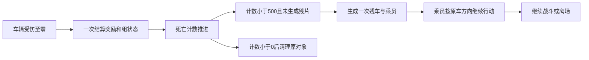

# Guns’n’Glory 产品规格

本文是产品目标、用户可见行为和范围的单一真源；本文不代表所有目标能力已经实现，阶段状态和交付顺序见[实施计划](implementation-plan.md)。领域用语统一采用[领域词汇表](GLOSSARY.md)。

## 1. 问题陈述（Problem Statement）

项目以 Guns’n’Glory FREE 1.8.6 为指定原版基线，提供在浏览器中游玩、观察规则、复现操作并比较数值方案的学习环境。已有研究和局部实现只是该目标的输入与阶段成果；单个受控战斗样本及其存储、回放、实验能力不能证明完整原版玩法已交付。

玩家需要完整的离线玩法和清楚的操作反馈；学习者需要暂停、单步与状态检查；测试者需要让同一套规则接受脚本控制，并区分游戏败北、无效输入和执行失败。后续更换档案或资源的保存方式时，这些能力应保持一致。

## 2. 解决方案（Solution）

提供一个纯前端游戏，逐步实现原版基线的战役、操作、界面、图像、音效和数值，并在同一个游戏能力入口上增加学习控制、可复现回放和数值比较。

完整战役目标为 **6 个区域、60 个关卡**。已有的 63 个地图文件不能直接视为 63 个可玩关卡。玩家可在桌面、手机和平板浏览器中操作，使用英文或中文；正式档案保留进度、游戏设置与本地高分，未完成关卡重新开始。

首个正式版同时提供本地无画面批量模拟，用于重复场景和比较数值方案。后续可分别接入远程档案、内容资源及批量模拟服务，玩家的实时战斗继续在浏览器内运行。这里的“离线玩法”描述游戏内容范围，不承诺首次断网打开或完整离线安装。

原版基线覆盖参数、规则消费、交互、素材表现和完整关卡结果。网页适配包括共享站点、鼠标/触屏、视口、中文和浏览器生命周期；学习控制及脚本入口复用同一套生产规则。主动改变数值或机制的内容归入独立实验方案，不能以“网页适配”为由改写基线。

规划阶段须固定完整内容集合及阶段归属，识别计量单位、时间随机、状态所有权、关卡身份和存档兼容等跨阶段决定。当前里程碑开始前补齐每项任务的输入、行为、失败处理、独立验收预期；后续阶段可以延后展开帧裁切等局部细节，但其内容范围、关键差异、依赖和完成门槛必须已确定。启动门槛、完整任务格式和状态由[实施计划](implementation-plan.md)维护。

## 3. 用户故事（User Stories）

1. 作为玩家，我希望在浏览器中启动游戏，以便无需安装原生游戏即可游玩。
2. 作为玩家，我希望通过区域与关卡入口推进完整战役，以便按照实际解锁关系体验内容。
3. 作为玩家，我希望选择已开放的难度与单位，以便在允许的条件下安排战术。
4. 作为玩家，我希望选择和移动单位、招募、升级以及确认开波，以便完成战斗中的主要决策。
5. 作为玩家，我希望与炸药箱、赌场、列车等特殊对象交互，以便体验对应关卡的完整规则。
6. 作为玩家，我希望清楚看到生命、现金、波次、伤害反馈和战斗结果，以便理解当前局势与结束原因。
7. 作为玩家，我希望图像、动画与音效符合原版基线，以便通过一致的表现理解游戏行为。
8. 作为桌面玩家，我希望使用鼠标操作，并在改变窗口大小后仍能准确选中目标，以便稳定控制战局。
9. 作为手机或平板玩家，我希望使用触屏操作，且手势取消、画面缩放和界面按钮不会造成残留指令，以便准确操作游戏。
10. 作为玩家，我希望画面保持游戏比例，并能阅读英文或中文界面，以便在不同设备和语言设置下正常使用。
11. 作为玩家，我希望查看帮助、调整声音并暂停游戏，以便理解玩法和控制游玩节奏。
12. 作为玩家，我希望切到后台后战局按明确规则暂停，恢复时不突然跳过一段战斗，以便避免不可控的损失。
13. 作为玩家，我希望结算后保存进度、解锁、设置和本地高分，并在重新打开后读取它们，以便持续推进战役。
14. 作为玩家，我希望保存失败、数据损坏或内容缺失时看到明确提示和可用的恢复操作，以便判断哪些结果已保存并保护原有进度。
15. 作为学习者，我希望暂停后逐帧推进并查看单位、敌人、路线和射程，以便解释一次移动、选择目标或伤害计算。
16. 作为学习者，我希望打开检查面板与覆盖层不会改变战斗结果，以便信任观察到的行为。
17. 作为测试者，我希望记录操作并从初始状态重放同一战局，以便复现问题并比较修改前后的结果。
18. 作为测试者，我希望回放明确报告版本缺失、输入损坏或结果不一致，以便区分无法重放与已验证通过。
19. 作为实验者，我希望从原版基线创建并编辑数值方案、保存独立版本，以便保留原始参照并追溯每次修改。
20. 作为实验者，我希望在相同场景、策略和随机样本上比较数值方案，以便判断差异，而不是把输入变化误当成数值效果。
21. 作为实验者，我希望查看胜负、剩余生命、通关时间、经济和波次压力，并看到样本量和未完成比例，以便理解报告的适用范围。
22. 作为实验者，我希望实验期间的胜利、解锁和高分与正式档案隔离，以便自由测试而不污染个人进度。
23. 作为脚本或 AI 使用者，我希望通过受约束的观察与游戏命令控制战局，以便复用玩家使用的规则，并明确策略可见的信息。
24. 作为测试者，我希望不打开游戏画面也能运行场景、执行本地批次并导出失败样本，以便开展重复验证。
25. 作为批量实验者，我希望串行和并行执行同一运行得到一致结果，并能取消或限制任务预算，以便控制测试成本。
26. 作为批量实验者，我希望取消、超时、无效输入和程序错误分别报告，以便避免把未完成样本算作游戏败北。
27. 作为后续远程服务使用者，我希望按需保存远程档案、读取指定内容版本或提交批量任务，同时保留浏览器实时游玩，以便在扩展服务时保持既有玩法。

## 4. 原版内容与行为规格

本节集中维护原版来源、具体参数和已确认行为。它规定实现必须满足什么；目录组织、资源装配与生命周期见[架构设计](architecture.md)，时间、共享随机与回放协议见[模拟与自动化契约](simulation-and-automation.md)。以下已核对的事实直接作为基线；标明尚待核对的消费细节，须在对应任务实现前确认，不得补入看似合理的默认值。

### 4.1 研发资料与验证边界

研究根目录为 `/Users/shiwei/.codex/worktrees/f862/wishflow-tools/apps/gunsnglory/docs/research/`，本节以 `R/` 简写。该位置仅是研发参考入口；迁入后的配置和素材由游戏拥有，构建与运行不读取研究树、不调用 REA。研究迁址时更新入口或保留文件引用即可，不改变游戏架构。

| 输入 | 已有范围 | 规格落点 |
| --- | --- | --- |
| `R/data/level-config.json` | 60 行关卡、9 行敌人、14 组升级数据共44行、21个类型映射及解锁表 | 具名关卡、单位、敌人、升级、限制与难度定义 |
| `R/data/waves.json` 及符号解析表 | 60关、527条 `newWaves`、1377条 `addToWave` 配置、86条生成池动作 | 波次身份、调用顺序、时间、请求池类别与生成动作；配置条数不是敌人数 |
| `R/data/map-inventory.json` | 63个地图文件，战役实际使用60个 | 原始地形、道路字段、生成点、转向点、出口及初始对象 |
| `R/data/resource-inventory.json`、地形绘制索引 | 943条 PNG 路径、423个 basename，含不同 density 和平台资源 | 按实际消费者选择素材、区域别名及裁切；文件总数不是功能分母 |
| `R/assets/audio/`、音频索引、`R/resources-and-audio.md` | 67个 OGG 已导出并校验，64个有直接 DEX/XML 引用 | 游戏事件、音乐循环、冷却及真实播放行为 |
| `R/recovered-source/`、`R/content-inventory.md`、`R/route-and-wave-model.md`、`R/game-loop-and-enemy-update.md` | 对象构造、规则消费、碰撞、更新与绘制分支 | 行为公式、状态迁移、独立测试预期及原版表现对照 |

表中范围及本节具体勘误来自 2026-10-28 的静态资料交叉核对。数组、资源清单、静态规则、Android 实际运行和浏览器实现验证是不同证据，不能相互替代；当时的核对没有重新运行 Android。已有静态资料足以支持大部分实现，遇到资料冲突、语义缺失或实现差异时回查相应消费者，无需以重新研究全部游戏为前置。每项任务的实际运行证据另记[验证记录](validation.md)。

### 4.2 完整内容集合

以下集合构成固定覆盖范围。实施计划须将各对象、参数组、关卡和表现需求落实到具名条目与阶段；不能用“后续增加内容”替代归属，也不能以已实例化的子集作为完成率分母。

| 内容集合 | 必须覆盖的内容 |
| --- | --- |
| 普通可雇用角色 | Desperado、Mexican、Cannon、Indian、Grandpa、Sniper、Pyromaniac、Salesman 共8组，每组四档；按真实解锁与地图使用落地 |
| 车辆和武器组件 | Train、Gatling、Steamer、DoubleCannon；21个类型映射并非21种独立兵种，按实际共享定义与组件关系处理 |
| 特殊对象 | DynamiteTrigger/Box、Gambler/Casino 的配对、输入、经济、冷却、生成及表现 |
| 敌人 | 源表全部9行及实际构造分支，涵盖男女乘员、骑乘、车组和特殊敌人；表行与工厂请求类型分别映射 |
| 战斗规则 | 目标选择，普通/特殊装填，轻/火/重/毒穿透，AOE，持续伤害、减速、治疗、奖励、动态难度与离场扣命 |
| 地图对象 | 装饰、待雇用槽、活动单位、生成建筑、铁路、Steamer、道路字段和背景碰撞 |
| 战役 | New Mexico、Mississippi、Oregon、Dakota、Nevada、Alaska 六区各十关；逐关绑定地图、现金/生命、波次、生成池、升级上限、难度、可用单位、文案和资源包 |
| 表现与交互 | 每种已交付行为的状态、方向与帧、特效、绘制顺序、声音、选择/命中反馈及中英文界面 |

每个覆盖条目至少包含语义 ID、所属关卡、参数/规则入口、素材/动画需求、具体任务，以及“资料确认、数据迁入、规则通过、表现检查”四种独立状态。例如特殊装填参数已迁入，不等于装填周期已消费；地图显示成功，不等于初始对象和全部波次已完成。覆盖表是研发交付管理，不进入运行时证据系统。

### 4.3 参数确定、单位与规则消费

迁入的每个原版参数须明确：值、单位、适用对象/等级、消费公式、整数截断位置、难度/波次/状态修正和验收场景。来源定位保留在研发文档；运行时只保留游戏所需 ID、版本与数据。实验调整使用独立版本，不能覆盖这些基线值。

波次配置须按归档 `GameDesignWaves` 的真实调用顺序与逐波索引解释。`newWaves`、`addToWave` 和 `rawCalls` 是按类别整理的数据；前两个数组不能按下标配对，同一波可包含多个生成调用。

枪手来源为 `R/data/level-config.json → tables.unitsByField.unitDataDesperado`：

| 升级索引 | 本次购买/升级价 | 基础伤害 | 射程 | 移动速度原始值 | 普通装填 | 特殊装填 | 周期 |
| ---: | ---: | ---: | --- | ---: | ---: | ---: | ---: |
| 0 | 75 | 140 | 38400，即5格 | 1500 | 500 ms | 1500 ms | 6发 |
| 1 | 25 | 140 | 38400，即5格 | 1750 | 400 ms | 1250 ms | 6发 |
| 2 | 25 | 180 | 38400，即5格 | 1750 | 400 ms | 1250 ms | 6发 |
| 3 | 25 | 180 | 38400，即5格 | 1750 | 300 ms | 1000 ms | 6发 |

每格为7680 fine units；移动速度按每100 ms 的 fine units 消费，保留方向处理、逐帧截断和碰撞。基础伤害不等于所有目标的实际扣血，实际结果还依赖伤害类型、穿透等规则。射程边界、目标排序、普通/特殊装填切换均通过行为验证，不能只断言表值。

特殊装填任务开始前须从消费分支补齐射击计数初值、哪次射击切换冷却、普通/特殊冷却替换还是叠加、无目标与移动期间的计时行为、升级是否重置。四档参数已确认，不代表这些消费细节已由本表定义；固定输入至少跨越一次完整装填周期，预期来自分支推导而非待测实现自身输出。

同一要求适用于敌人生命、速度、抗性、奖励和扣命，以及单位各档范围伤害、持续伤害、减速、毒、治疗、特殊武器和效果持续时间。未确认项须注明阻塞的任务和关卡；仅阻塞依赖该项的工作。

### 4.4 地图构造、首关初态与雇用

研究摘要存在以下已核对勘误。以 `R/recovered-source/smali/smali_classes2/com/hg/gunsandglory/gamelogic/GameObjectManager.smali` 的 `pswitch_4/5/6`、`pswitch_data_2/3` 及构造分支为准：

| 摘要冲突 | 基线语义 | 必须验证的结果 |
| --- | --- | --- |
| `content-inventory.md` 将 tile96–101、130–131 写为“仅从存档还原时创建” | `if-nez fromLoadGame` 跳过创建分支；正常新局创建 activity4 待雇用对象，仍受解锁判断约束 | 原始开局包含符合地图与解锁条件的待雇用对象，完整实例集合有独立预期 |
| 摘要将 tile102/110 对应为箱/触发器 | 102→type7 `DynamiteTrigger`；110→type8 `DynamiteBox` | 输入、配对和爆炸对象不颠倒，按 switch 目标与类型构造核对 |

这两处勘误已在本规格记录；外部研究文件尚未因此被改写。导入器不能继续沿用冲突摘要，也不能用自己的输出同时生成正确答案。

炸药配对触发后的命中按精确坐标和炸药自身半径边界判定，不能直接套用普通武器 AOE。对应任务须从原消费者固定坐标、距离公式及边界包含关系，并用范围内、边界上和范围外的独立样例验收。

Cow Gulch 的原图包含8个 tile96 枪手槽、7个 tile97 炸弹手槽、1个 tile104 活动枪手；101/130 依原解锁规则判断。tile98–100、131 不在该图中。原始现金65、生命50、`maxUpgrades=0`，共8波。原图没有 tile112–114 生成建筑，也没有 spawn-pool actions；其他关卡的建筑出兵路径不能替代首关的地图待雇用单位。

首关前两波使用拓荒者组；第三波有3个 covered-wagon 配对请求，每个请求构造 type8 牵引与 type4 车厢并同组行动；第四至八波使用混合池。请求次数不等于最终敌人总数，车毁派生乘员另走第4.6节规则。各波的完整调用顺序、数量、间隔及倍率仍须按第4.3节的方法展开，不能把这段概述当作完整可执行波次定义。

`GameObjectUnit.hire()` 将已有 activity4 对象激活为 activity5 并扣款；同一对象随后可以被选择、移动和参与战斗，表现切换至唤醒/活动状态。枪手雇用的价格边界测试以“执行雇用动作前有75现金及合法待雇用对象”为前置，确认后仅扣一次75并保留对象身份；74现金时拒绝且状态不变，重复确认不能重复扣款。这些是动作边界 fixture，不能改写首关65现金的原始开局；真实首关须从原始开局击杀赚钱后完成雇用流程。

首关升级上限保持0；升级行为在允许升级的真实后续关卡验收，边界场景可另用 fixture，实验模式可以显式改变限制。首关炸弹手取 `unitDataMexican` 的初始配置：购买价100、基础重型伤害500、AOE7680即一格，实际命中范围、穿透和伤害仍按对应消费公式计算。首关战斗必须覆盖群体伤害，而非只保留枪手的单目标射击。

### 4.5 路线、占格与障碍

| 行为类别 | 基线规则入口 | 必须覆盖的边界 |
| --- | --- | --- |
| 普通敌人路线 | 地图 action1 生成点、action2 转向点、action3 出口；格心触发，按方向表和随机规则处理 | 转向前后、分叉、地图外生成和离场延迟 |
| 敌人组与占格 | 牵引/车厢组关系、当前格/下一格占用、异组碰撞、生成失败重试 | 同组跟随、异组堵塞、占用释放；重试不丢池请求 |
| 玩家步行 | 地形通行规则、碰撞框、装饰/建筑与逐轴运动 | 水域/峡谷、建筑边缘、转角与移动取消 |
| 横纵列车 | 分组、轴向输入、部件形状和处理顺序 | 双向移动、途中出现阻挡、组选中及解除 |
| Steamer | 水域和部件运动规则 | Cold Lake 左右输入分别核对；不能假设整组原子移动 |

这些检查按参与对象和生命周期分别处理，不能合成一个“可行走”开关。PriorityMap 是静态优先数据，不是每帧寻路器；地图像素不是碰撞真源。异常原图字段保留并单独回归，禁止凭猜测更正或用通用寻路替代基线。完整方向表、碰撞形状和判定顺序在对应任务开始前由源消费点展开成可验证样例。

### 4.6 运输组与马车死亡派生

`R/game-loop-and-enemy-update.md` 对应消费分支中，仅 type4/5/6 走该残片路径。乘员数量计算为 `n = trunc(random(trunc(difficulty / 50) + average × 10) / 10)`，三种类型的 average 分别为2/4/0，最多填入四个槽。每个乘员随机选择 type1 或2，使用规定的四个相对位置，方向取原车向量符号，采用当前波次 HP 倍率及 `90 + random(20)` 速度比例，并获得独立组号。

死亡判定、奖励、组状态、残片/乘员生成和最终清理是同一规则链。Renderer 根据规则状态显示死亡过程，不负责决定是否生成敌人。验收覆盖0–4个槽、计数阈值两侧、一次性生成/奖励、方向、相对位置、独立组号、倍率和车组清理；待派生乘员尚未处理时不得提前宣告整关胜利。相对位置常量、计数更新与随机调用边界在该任务启动前从原消费者固定为独立预期；本式不能被简化为“车毁固定出现两个人”。

### 4.7 动画与声音必须对应真实行为

每种玩法交付包括其可雇用/睡眠、唤醒、待机、移动、攻击/装填、受击/状态效果、死亡等实际存在的状态，以及相应方向、选择反馈、弹丸/残片/爆炸、声音和清理条件。原版不存在的状态不另造。素材字段与文件组织由[架构设计](architecture.md)维护；本节维护具体基线。

枪手依据 `R/recovered-source/` 下的 `GameDesignOptics.java`、`GameObjectUnit.java`：

- `player_gunslinger`、`player_gunslinger_sleep`、`player_gunslinger_shot` 分别用于移动、睡眠和攻击相关状态。
- 步行动画由实际移动距离累计驱动，默认 `(帧, 距离阈值)` 为 `(0,1536)、(1,3072)、(0,4608)、(2,6144)`，距离单位与世界坐标一致；不能改成统一每100 ms 换帧。
- 攻击动画时间记录为 `(0,100)、(1,200)、(0,1000)`，八方向映射为五行与水平镜像；这些是源记录，具体重置、累计阈值和状态切换在实现前按消费者核对，不能直接猜为各帧持续时间。
- 验收以固定距离、朝向和攻击进度核对预期帧，并检查连续移动、停下、开火的衔接。图片存在、裁切未越界均不足以证明行为正确。

运输车辆还须显示牵引/车体关系、残车和乘员出现时机；投射物/效果须随实际方向、寿命和绘制顺序呈现；音频须在真实事件及循环、暂停、静音、恢复流程中检查。原版部分表现消费共享随机数，相关顺序仍由同一模拟过程维护；无画面运行省去绘制，不能跳过会改变结果的随机调用。完整时间和环境契约只在[模拟与自动化契约](simulation-and-automation.md)维护。

浏览器尚未取得播放手势许可时，可显示启用声音入口并无声开始；音频下载或解码失败须提示失败及恢复入口，可无声继续，但不能据此通过音频表现验收。静音、播放受限和解码失败都不改变已经固定的规则与随机消费。地图、玩法定义或必需图像缺失则阻止连接新战局的输入与绘制，保留可恢复入口，不以不可辨识的占位画面冒充资源就绪。

### 4.8 关卡身份、切换与结算

关卡 ID、区域内序号和地图编号是不同概念：战役1–10关使用地图01–10，11–60关使用地图14–63。每关以原始地图、对象、完整波次和限制共同定义，复制地图的合成样本不得计为另一真实关卡。

难度分为简单、中等、困难；所选难度决定该关的敌人生命修正与评分，实际值取对应关卡/难度配置。困难模式在完成全局关卡号为10的倍数的关卡后开放，未开放时界面与 Progress 操作都拒绝选择；原版用持久化门闩保存开放状态，网页可从有效完成记录派生同一结果。切回其他难度不撤销已经完成的进度。原版依据是 `R/progress-and-save-data.md` 的“六区进度与解锁”及其归档消费者；现有样本验证见[历史 T21 记录](validation.md#27-t21-难度选择与困难模式解锁)，它不证明真实第10关及其解锁流程已通过。

开发阶段的区域顺序不等于游戏内的解锁链。原版空档开放每个区域的首关，其余关卡依据本区单调增加的进度前沿判定；通关推进本区下一关。当前尚未交付的内容须标明未实现，不能用它构造虚假的原版锁定规则。具体可用性公式、编码索引与单位解锁重载须在战役目录任务中按上述来源核对。

切换行为须用不同真实地图及资源组合验证：目标开局对象和规则正确，旧对象、投射物、计时器和选中状态清理，资源缺失保留明确可恢复入口，不留下可操作的半初始化战局。Game、Progress、内部 Content 与 Render 的协作及资源生命周期见[架构设计](architecture.md)。

一波结束与整关胜利分别判断，剩余波次、请求池、敌人和死亡待派生对象按原规则处理；胜败、重开及完整通关结果进入正式进度。旧样本胜利不自动转成真实战役完成，失败或未完成的关卡也不能标为已通关。完整首关/区域以及样本迁移的任务归属和验收门槛见[实施计划](implementation-plan.md)。

## 5. 已确认的实现决策（Implementation Decisions）

| 决策 | 约束与理由 |
| --- | --- |
| 纯前端先行 | 首版采用 Vite、TypeScript、Canvas 2D、DOM/CSS 和浏览器原生能力；不预先增加 UI 框架或完整游戏引擎。 |
| 共享站点接入 | 公共外壳和语言状态由仓库已有能力提供；游戏只维护自身内容与文案。 |
| 同一套游戏规则 | 实时游玩、学习控制、脚本和无画面模拟复用生产规则；界面或执行方式变化不产生另一套玩法实现。 |
| 环境隔离 | 游戏规则不直接访问浏览器、系统时钟、网络或存储；运行所需的时间、输入、随机状态和必要环境信息显式提供。 |
| 保留原版语义 | 以研究确认的时间、数值、随机调用和更新次序为兼容目标；有意改变规则的方案单独标记，不能覆盖原版基线。 |
| 档案与实验隔离 | 正式游戏只保存规定的档案内容，不提供中途战局续玩；回放与检查点服务于学习测试。数值方案和实验的版本语义见领域词汇表。 |
| 存储可替换 | 首版优先使用 IndexedDB 与静态内容；更换介质时保持相同业务操作、失败和冲突语义，由契约验证兼容性。 |
| 内容由游戏拥有 | 地图、数值、图像、声音和文案形成可验证的游戏内容；研究工具、证据和中间产物不成为构建或运行依赖。 |
| 本地执行先行 | 实时游戏先采用单线程；场景先串行运行，批量需求出现后再加入本地并行。优化依据实际测量提出。 |
| 后端分项演进 | 远程档案、内容资源和批量任务分别交付；身份、服务供应商、成本与运维责任在对应阶段确认。 |
| 自动化入口按需提供 | 先形成可调用的游戏与场景能力，再增加所需 CLI；MCP 或远程控制入口由实际消费者需求决定。 |

用户已确认三个公共深 Module：Game 提供战局能力，Progress 提供正式进度能力，Experiments 提供模拟与比较能力；内部细节及所有权由[架构设计](architecture.md)统一维护。用户同时确认以首关展示与选中、单波移动扣命、击杀得金、胜败重开、保存恢复作为首批纵向切片粒度，具体依赖和验收由实施计划维护。

存储细节由[存储契约](storage-contracts.md)维护，命令、时间、回放和运行协议由[模拟与自动化契约](simulation-and-automation.md)维护。本文描述产品目标，不代表所有游戏能力已经实现；当前交付状态见[实施计划](implementation-plan.md)。

## 6. 测试决策（Testing Decisions）

测试以用户可观察的行为与明确契约为目标，不依赖私有函数、内部容器布局或调用次数来证明功能正确。固定输入应有独立可判断的预期，不能只证明实现与自身生成的快照一致。

原始数据的关键构造保留独立人工核对的预期，规则预期由来源公式与状态案例推导，避免同一错误导入器同时生成生产配置和测试答案。发现规格错误时先修唯一真源，再列出受影响的规则、内容、存档/回放与历史样本，修实现并重跑对应验收；原版纠错与主动平衡调整分别记录。

**已确认：Game、Progress、Experiments 的公共 Interface 是主要行为测试 Seam。** 游戏测试提交意图并观察结果，进度测试执行结算及恢复，实验测试运行场景并比较报告。内部存储 Seam 的共享契约测试、真实介质检查及浏览器流程验证各自承担环境相关责任，不给每个内部函数或转发层重复建立一套行为测试。

以下是这些测试必须证明的用户可观察结果；详细职责和变更范围见[架构设计](architecture.md)：

| 行为范围 | 必须能够证明的结果 |
| --- | --- |
| 游戏与规则 | 开局、操作、波次、胜负和结算符合原版基线；关键边界与特殊对象有明确场景。 |
| 控制与回放 | 暂停不推进战斗，单步恰好推进一帧；同一完整输入能够重放，界面与脚本的等价操作得到相同结果。 |
| 内容与表现 | 全部承诺关卡可初始化，资源引用完整；代表性地图、动画、声音和目标视口完成实际检查。 |
| 档案 | 正常保存、冲突、失败、重复提交及迁移结果符合契约；实验结果不写正式档案。 |
| 数值实验 | 已提交运行不受后续编辑影响；串行与并行的语义结果一致；失败分类、样本量与报告分母准确。 |
| 浏览器交互 | 鼠标、触屏、取消输入、后台恢复、语言和保存反馈形成可完成的用户流程。 |
| 自动化入口 | 每个实际提供的 agent 入口通过 pi 加载并完成真实调用；交付保留命令和关键返回。 |

全战役验收以60个真实关卡为固定分母，每关须完整运行并保留有效通关记录；仅可初始化、预算终止或合成样本通过均不算完整关卡。三档难度的配置逐项检查，倍率及解锁边界通过代表性运行验证；不把单次胜利描述为穷举全部策略和随机轨迹。新增交互/表现有代表性浏览器检查，不同地图的资源切换与释放必须实际覆盖。

每个内容条目同时满足数据、规则、表现、交互与公共行为验收，才记为完整交付。测试数量、任务编号、提交数量和工具通过率不替代覆盖证据；实验结论只适用于已实现并验收的内容与规则。参数字段、计数器和静态图只完成相应子项。

仓库已有球群实验的无画面场景测试、种子复现、运行记录和浏览器流程测试，可借鉴其验证方法与工具。其固定步长、物理模型和领域指标不能作为本游戏行为预期。性能预算应绑定实际设备、视口和场景；Node 耗时与模拟手机视口不能代替真实设备测量。

## 7. 范围外（Out of Scope）

- 广告、支付、统计 SDK、外部排行榜，以及超出原版基线的新玩法。
- 多人同步、服务端权威战斗、网络预测与回滚。
- 正式战局中途续玩，以及原生 Android 二进制存档兼容。
- 首次断网打开、安装式 PWA 和整站预缓存保证。
- 通用内容编辑平台、任意代码插件系统、通用 ECS 或分布式任务平台。
- 在需求和测量依据不足时引入物理引擎、通用寻路、额外渲染引擎或后台服务。
- 在没有具体消费者前提供 MCP、公共远程 API 或长期托管全部历史运行版本的服务。

## 8. 待定事项与完成标准（Further Notes）

| 待定事项 | 确定时点 |
| --- | --- |
| 最低浏览器版本、目标触屏设备和手势优先级 | 浏览器交互实现前。 |
| 参考视口、图像与动画对照容差、中文检查标准 | 对应表现内容验收前。 |
| 单帧耗时、内存、实体数、批量并发与产物预算 | 代表性场景可测量后、扩大运行规模前。 |
| 资源分发范围与必要的音频备用编码 | 内容迁入和公开发布前。 |
| 后端身份、供应商、成本、数据保留与维护责任 | 各后端阶段开始前。 |

完整正式版的完成标准是：承诺的内容与行为均有实现及验证记录，正式档案、学习控制和本地批量模拟可用，完成共享站点发布及线上实测。后端能力独立验收，不阻塞纯前端正式版。阶段顺序、依赖、当前进度和回滚方式仅由实施计划维护，具体交付记录保留实际执行的验证证据。
