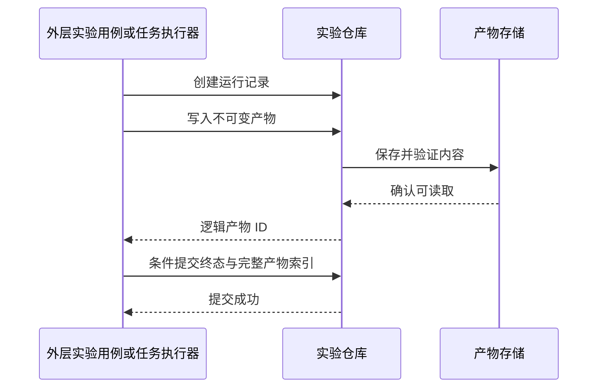

# 存储与内容访问契约

## 1. 目的与范围

本文件定义应用层能够依赖的持久化语义。当前为设计契约，接口、适配器和测试尚未实现。模块关系见[架构设计](architecture.md)，交付顺序见[实施计划](implementation-plan.md)。

目标是让 IndexedDB、localStorage、远程数据库或对象存储的替换只影响适配器及启动装配。接口替换成立的条件是新实现通过同一套契约测试；类型签名相同但原子性、冲突或失败语义不同，不算兼容实现。

实时战局只在内存中运行。存储用于档案、内容和实验产物，不参与逐帧移动、伤害、寻路或随机计算。后端负责持久化、资源和批量任务，不承载浏览器实时战斗。

## 2. 三个端口及其所有权

| 端口 | 数据与操作 | 所有者与边界 |
| --- | --- | --- |
| `ProfileRepository` | 读取和保存正式档案 | 应用层决定何时保存；核心规则决定进度、解锁和高分内容 |
| `ContentSource` | 按版本读取内容清单、关卡数据及资源字节 | 应用层准备内容；适配器处理静态路径、缓存或远程传输 |
| `ExperimentRepository` | 保存不可变实验配置、运行记录与结果产物；查询运行列表 | 实验用例管理生命周期；适配器组织索引和大文件 |

端口位于 `src/ports/`，适配器位于 `src/adapters/`，具体组合由启动入口选择。上层只看到业务标识、格式版本和不透明修订号，不看到 SQL、IndexedDB 事务、HTTP 响应、数据库主键规则或 S3 地址。

首版只实现被阶段功能使用的操作。内存适配器用于契约测试，正式档案和实验数据优先使用 IndexedDB，内容优先使用静态文件。localStorage 与 HTTP 是后续适配器，不为展示抽象而提前实现。

## 3. 通用返回与错误语义

所有端口操作返回 Promise。它是 I/O 边界，不要求内核或每帧命令异步化。

| 情况 | 统一结果 | 应用层处理 |
| --- | --- | --- |
| 可选档案或实验记录不存在 | 成功返回 `null` | 创建默认档案或显示不存在 |
| 指定内容版本、资源或必需产物不存在 | `not-found` | 阻止依赖它的开局或重放，明确缺失项 |
| 格式无法解析或校验失败 | `corrupt-data` | 保留原数据，提供恢复或导出入口 |
| 格式版本高于当前实现 | `unsupported-version` | 保留数据并拒绝覆盖，不降级解释 |
| 请求参数不合法，或同一操作标识对应不同请求内容 | `invalid-input` | 修正请求；不按暂时故障重试 |
| 预期修订号与当前值不符 | `conflict` | 重读并执行业务合并或交由用户选择 |
| 容量不足 | `quota-exceeded` | 保留旧记录，提示清理或导出 |
| 未认证、身份失效、无访问权 | `unauthorized` / `forbidden` | 由应用入口进入登录或权限提示流程 |
| 环境、网络、介质暂时不可用 | `unavailable` | 保留待保存状态，提供有限重试 |
| 调用者取消 | `cancelled` | 停止等待，区分尚未提交和提交结果未知 |

错误同时携带业务对象标识、可读说明、是否建议重试，以及 `commitState`：`not-committed` 或 `unknown`。读操作无提交状态；成功写操作返回已提交结果。原始异常可以进入开发诊断，但不成为上层分支条件，也不含凭据。

写入超时、连接中断或取消不能自动解释为“未写入”。只有适配器确定尚未跨过提交点时，才返回 `not-committed`。提交状态未知时，应用层重读或查询运行状态，不先撤销内存结果再重复计算奖励。

端口不承诺跨仓库事务，也不承诺离线队列、后台同步或无限重试。这些能力需要应用层的明确用例与单独验收。

## 4. 正式档案契约

### 4.1 档案数据

正式档案作为一个小型聚合保存，至少包含：

- `schemaVersion`：档案序列化格式版本。
- 六个地区的进度、难度和单位解锁所需状态。
- 声音等游戏设置；语言状态继续由站点外壳管理，不重复保存。
- 每关高分、姓名及必要的待显示解锁提示。
- 用于避免重复处理结算的业务标识及其明确保留策略。

未完成战局、实体位置、随机运行状态、实验参数与批量运行结果不属于正式档案。实验的快照和回放不会变成正式“继续游戏”入口。

### 4.2 最小操作

| 操作 | 输入与输出 | 保证 |
| --- | --- | --- |
| `loadProfile(profileId)` | 返回 `{ profile, revision }` 或 `null` | 返回完整且已验证的档案；修订号只用于相等比较 |
| `saveProfile(request)` | 输入完整档案、`expectedRevision`、`operationId`；返回新修订号 | 在单档案范围内原子地校验修订号并替换内容 |

`expectedRevision = null` 表示仅当记录不存在时创建。更新必须携带读取到的修订号，禁止无条件覆盖。修订号不是时间戳；上层不得解析、排序或自行递增。

单次保存的原子范围是该档案的完整记录及提交识别信息。成功后，后续读取必须能观察到本次提交或更晚的完整提交，不能读取半份档案。

结算生成的新进度、设置或高分由应用层准备，仓库只做校验与保存。进度前沿取最大值、高分比较、姓名选择和设置冲突处理属于业务规则，不能由不同存储引擎各自实现。

### 4.3 并发和重试

同一档案的写入在一个应用实例内串行处理；多标签页或多个客户端仍依靠修订号防止覆盖。

`operationId` 标识一次确定的保存请求，重试必须保持档案内容和预期修订号不变。同一标识对应不同内容属于请求错误。适配器至少在当前记录中保留最近一次提交标识及请求摘要：

1. 最近提交标识与本次请求一致、摘要相同：返回该次已提交结果。
2. 当前修订号仍等于预期值：原子提交并记录标识。
3. 已有其他提交：返回 `conflict`，不覆盖、不重新应用旧请求。

这防止重复保存产生额外业务效果，但不承诺永久保存所有请求收据。若原请求提交后又有新提交，重试可能返回冲突；冲突不证明原请求从未成功。应用层必须重读，并依据结算标识和业务合并规则判断下一步，不能盲目加钱、推进关卡或覆盖设置。

结算幂等属于应用层契约：同一战局的终局结果只应用一次。结算标识保留周期必须覆盖该版本允许的重试与待保存生命周期；超过范围的旧请求明确拒绝，不假装仍能去重。普通设置保存不重新执行结算。

### 4.4 各介质如何满足契约

| 实现 | 条件替换方式 | 必须注意 |
| --- | --- | --- |
| 内存 | 在共享实例内串行执行比较与替换 | 测试需使用同一个共享后端，不能拿两个互不相干的 Map 测并发 |
| IndexedDB | 在同一读写事务内读取、比较、写入完整记录 | Promise 在事务完成后才成功；单个请求成功不等于事务已提交 |
| localStorage | 所有合作写入者在同源跨标签页锁内比较并替换单个序列化记录 | `getItem` 加 `setItem` 本身不是原子 CAS；需经过验证的 Web Locks 等协调能力 |
| HTTP + 数据库 | 后端按身份隔离，在事务或条件更新中比较版本 | 浏览器重试不绕过后端版本检查 |
| HTTP + 对象存储 | 后端使用介质实际支持并验证过的条件写入 | 对象版本/ETag 转换为不透明修订号；不假设任何 S3 兼容服务都支持相同条件语义 |

localStorage 适配器的锁协议必须覆盖本应用所有写入者。环境不支持必需协调能力时，该适配器初始化失败；不能悄悄退化为“最后写入获胜”。既有非合作写入者或开发工具直接改数据不在并发保证内，后续读取仍须校验数据。

这是一项适配器可用性限制，上层继续使用相同端口和错误处理。用户可以在启动配置选择其他合格适配器，无需更改档案用例。

### 4.5 保存失败与内存运行

保存失败时，应用层保留“尚未保存”的档案状态，并明确展示。游戏可继续运行，但不显示保存成功，不自动覆盖原持久化档案，也不把临时内存适配器伪装成已持久化存储。

重试、导出或放弃变更由统一应用流程处理。关闭页面可能丢失未保存变更；关键保存不能只依赖页面退出回调。

## 5. 内容读取契约

### 5.1 版本与定位

`ContentSource` 以内容包版本和逻辑资源 ID 读取数据，提供两个最小能力：

- `loadManifest(contentVersion)`：返回该版本的关卡、数值、资源清单及完整性信息。
- `loadAsset(contentVersion, assetId)`：返回字节、媒体类型和摘要等资源数据。

JSON、图片和音频使用同一版本清单定位，解码与业务格式校验由内容加载模块完成。图片解码对象、音频缓冲和 Canvas 句柄不进入端口返回值；浏览器表现适配器负责创建及释放这些对象。

逻辑资源 ID 不等于 URL。静态目录、发布子路径、签名 URL 和后端对象键由适配器解析。凭据和长期签名链接不写入游戏配置、回放或实验记录。

同一已发布版本的内容不可原地改写。修复地图或数值时生成新版本；正式开局和实验开始时固定具体版本，不在运行中跟随“最新版本”。

### 5.2 加载和缓存

1. 读取并校验清单，检查规则版本兼容范围。
2. 根据本次关卡或实验的资源集合加载必需内容。
3. 检查摘要、大小和格式后，构造可供内核使用的定义。
4. 所有玩法必需内容可用后才创建战局；失败返回清楚的资源标识。

缓存以版本和资源 ID 为键，验证失败的缓存不进入游戏。缓存属于适配器优化，不改变缺失或损坏语义。内核不懒加载远程数据。

音频不可播放可以按应用策略静音降级；缺失地图、波次或数值不能用空配置继续。离线安装与完整预缓存是独立功能，不由“纯前端”自动获得。

## 6. 实验配置、运行记录与大文件

### 6.1 三种数据分别管理

| 数据 | 内容 | 更新方式 |
| --- | --- | --- |
| 实验配置 | 基线版本、参数覆盖、场景集、策略与采样/时间方案 | 保存后不可变；修改产生新配置 ID 与版本 |
| 运行记录 | 运行 ID、配置 ID、状态、进度、结果索引、错误和时间信息 | 受修订号保护的状态转换 |
| 运行产物 | 回放、时间序列、失败样本、汇总文件 | 按逻辑产物 ID 写入不可变内容 |

实验记录格式和可重放输入以[模拟与自动化接口](simulation-and-automation.md)为准。存储层不计算胜率、不决定如何归类失败，也不把实验结果合并进正式档案。

`ExperimentRepository` 在实验阶段按需要提供保存/读取配置、创建/读取运行、条件更新运行、列出运行、写入/读取产物等能力。列表使用稳定排序及不透明分页游标，设置页大小上限；不设计通用查询语言。

大文件可以由适配器写到对象存储，运行索引写数据库；上层仍使用逻辑产物 ID。后端对象存储不是必须公开给客户端的第四个业务接口。

### 6.2 产物提交点

跨数据库和对象存储不承诺全局事务。采用明确的可见性规则：

`ScenarioRunner` 只返回结果或产物数据，不调用仓库；图中的写入属于外层应用用例或任务执行器。只有运行终态及其完整产物索引提交成功后，界面才把运行显示为完整结果。上传中或运行中可以展示明确标记的进度，但不能伪装为最终统计。

产物写入采用调用者固定的逻辑 ID 与摘要：相同 ID、相同摘要可重复确认；相同 ID、不同内容返回冲突。逻辑 ID 包含 `runId`、`attemptId` 和产物名称，避免不同尝试相互覆盖。写入成功但索引提交失败时，同一次尝试的重试使用原 ID，避免每次生成重复大文件。

清理任务可以删除未被有效记录引用的临时产物，但必须有保留窗口，并避开仍可能提交的活动运行。清理错误不得删除已提交结果；取消运行也不等于立即删除所有附件。

### 6.3 取消、恢复与竞争

运行状态转换使用预期修订号。运行记录维护 `activeAttemptId`；开始新尝试时先条件更新该字段及修订号。提交终态必须同时匹配当前修订号和活动尝试；旧 worker 的迟到结果、失败或取消不能覆盖新尝试。最终索引只引用获选尝试的产物，不混合两次轨迹。

逻辑运行终态只提交一次；完成与取消请求竞争时，以成功提交的合法状态转换为准，后续请求读取实际结果。单次尝试失败先记录尝试结果，由外层执行器判断是否切换下一尝试；重试策略耗尽后才把逻辑运行提交为失败终态，不能先结束运行再撤销终态重试。

取消请求代表执行器应停止工作，不代表网络传输或写入立刻停止。执行器停止后提交取消状态及允许保留的部分产物；超过截止时间的结果由任务层判定是否接收，仓库不擅自改成成功。

重启后可恢复任务管理和查询，不默认具备模拟中途续算能力。若尚未实现经过验证的检查点恢复，应从该场景初始输入重跑，使用新的尝试 ID，并保留与原运行的关联；不得把两次尝试的统计拼成一条完整轨迹。

## 7. 格式迁移、导入导出与更换后端

格式迁移代码独立于介质，位于应用内 `src/adapters/serialization/` 的纯数据编解码/迁移模块。各适配器调用同一组纯迁移函数，避免浏览器与后端各写一套格式解释；该模块依赖端口值类型，不导入应用用例或浏览器 API。

旧格式读取先校验原始输入，再逐版本迁移并校验结果。迁移成功不等于已保存；持久化升级使用条件替换，保留可恢复副本或导出。未知较新版本不覆盖。

更换存储需要显式的数据迁移流程：

1. 明确源与目标、身份映射、数据范围和冲突策略；记录导出格式版本。
2. 从源读取并校验数据，导出可恢复副本；本次迁移不删除源。
3. 导入目标；同一迁移批次和对象 ID 的重试不制造重复实验。
4. 回读核对档案内容、实验数量、产物摘要和引用完整性。
5. 验证通过后切换启动配置；保留回退入口，旧格式不兼容时使用对应版本恢复。

本地档案上传到已有云端账号时，不能默认覆盖任一侧。进度及高分可按明确的业务合并规则处理，设置冲突需要确定优先级；完整覆盖是另一项显式操作。账号、租户和授权由连接边界解析，客户端不能借业务 `profileId` 访问其他身份的数据。

切换适配器不等于自动实时同步。多设备同步、匿名档案与账号合并、离线写队列需分别设计，不混入首版存储替换验收。

## 8. 契约测试与验收

同一测试套件对每个适配器运行；允许用适配器工厂创建隔离数据空间和注入故障，不在业务断言中识别存储种类。

| 测试组 | 必测情况 |
| --- | --- |
| 基本读写 | 缺失值、默认档案、往返序列化、特殊字符、完整替换 |
| 原子性 | 提交中失败、容量不足、事务回滚；读取只出现旧版或新版完整数据 |
| 并发 | 两个客户端使用同一修订号写入，仅一个成功；冲突后旧请求不能覆盖 |
| 重试 | 响应丢失、相同操作重复、同标识不同内容、后续提交介入 |
| 格式 | 旧版迁移、损坏输入、未知新版、迁移后回读校验 |
| 内容 | 缺少版本/资源、摘要错误、缓存污染、不同版本同名资源隔离 |
| 实验 | 产物先成功而索引失败、重复上传、终态竞争、部分结果标识、分页稳定性 |
| 隔离 | 正式与实验数据隔离、用户/租户隔离、清理不删除有效引用 |

契约测试之外，必须对真实介质执行集成检查：IndexedDB 的真实事务与重开恢复、localStorage 的多标签页锁和容量失败、后端的真实身份和条件写入、对象存储的上传与读取。测试替身不能证明这些能力。

“上层无需修改”的验收方式：用相同应用用例和测试输入，只替换适配器装配，观察相同业务结果及错误分类。额外记录各实现的容量、环境要求和性能；这些限制不能隐藏成静默丢数据或不一致结果。

当前文档阶段只校验文字与链接。实际端口、测试命令、后端产品及存储容量指标以对应阶段的实现和验证记录为准。
