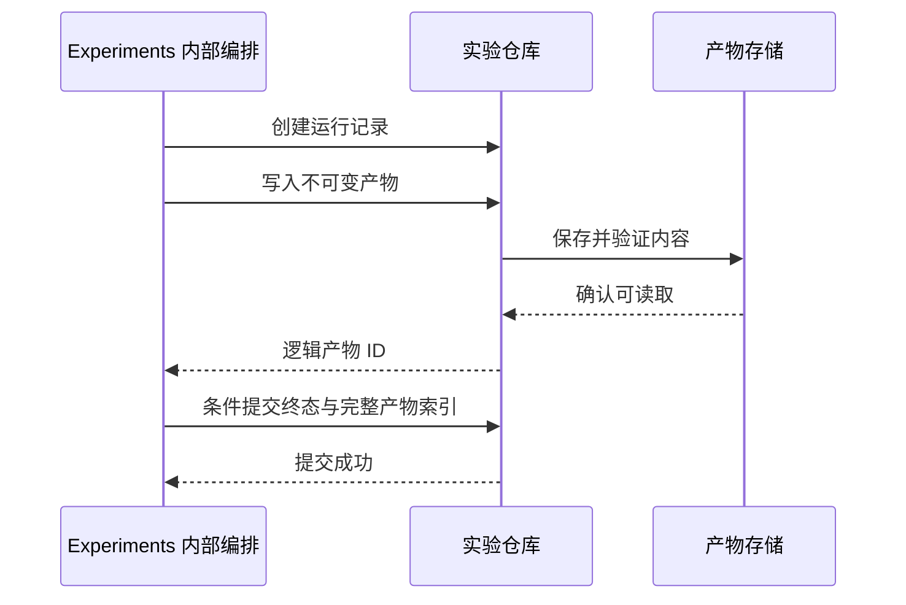

# 存储与内容访问契约

## 1. 目的与范围

本文件定义 `Progress`、`Experiments` 及共享内部 `content` Module 隐藏的存储与内容读取语义。三个面向消费者的深 Module 为 `Game`、`Progress`、`Experiments`；本文的 Repository 和 Source 是所属 Module 的内部 Seam，不是 UI、AI 或脚本需要调用的另一套公共 Interface。模块关系见[架构设计](architecture.md)，交付顺序见[实施计划](implementation-plan.md)。

本文同时记录长期契约和已实现范围。T05 已实现 Progress 的小型档案聚合、Cow Gulch 受支持样本的正式结算、内存与 IndexedDB 存储、条件写入、去重及页面内重试；T15 已实现实验数值方案与比较报告的内存/IndexedDB 存储及跨刷新恢复。完整六区域战役进度、关卡解锁、损坏档案恢复、可续算的运行状态和内容来源仍是后续目标。当前存档与实验仓库均是窄实现，不能视作完整战役或通用实验平台。

目标是让 IndexedDB、localStorage、远程数据库或对象存储的替换只影响适配器及启动装配。接口替换成立的条件是新实现通过同一套契约测试；类型签名相同但原子性、冲突或失败语义不同，不算兼容实现。

实时战局只在内存中运行。存储用于档案、内容和实验产物，不参与逐帧移动、伤害、寻路或随机计算。后端负责持久化、资源和批量任务，不承载浏览器实时战斗。

## 2. 内部 Seam 及其所有权

| 内部 Seam | 数据与操作 | 所有者与边界 |
| --- | --- | --- |
| `ProfileRepository` | 读取和保存正式档案 | `Progress` 隐藏默认档案、格式迁移、结算去重、并发修订、业务合并与重试 |
| `ContentSource` | 按版本读取内容清单、关卡数据及资源字节 | 共享内部 `content` Module 隐藏读取、解析、校验与缓存，为 `Game` 和 `Progress` 提供已校验的不可变定义 |
| `ExperimentRepository` | 保存不可变实验配置、运行记录与结果产物；查询运行列表 | `Experiments` 隐藏尝试管理、状态转换、结果完整提交及恢复；Adapter 组织实际索引和大文件 |

契约及编解码随其所有者组织，例如 `src/progress/persistence/`、`src/experiments/persistence/` 和 `src/content/source/`。具体 Adapter 可放在所属 Module 的内部接入目录，环境接入位置按架构约束安排；具体实现仍在启动装配时选择。

UI、AI 和脚本只使用 `Game`、`Progress`、`Experiments` 的公共 Interface。`schemaVersion`、`revision`、保存用 `operationId`、`attemptId` 及产物提交顺序都属于内部机制；公共调用者取得业务视图、保存或运行状态、可用的恢复操作，不负责驱动版本比较或分支处理某个存储引擎。

首版只实现阶段功能需要的操作。内存 Adapter 服务临时档案、无持久化实验及测试，IndexedDB Adapter 服务浏览器跨会话保存，二者是内部存储 Seam 的具体实现。内容优先从随应用分发的静态资源取得。Node 运行可使用内存并返回或导出结果；需要持久化时按阶段选择文件或远程接入，不要求 Node 加载 IndexedDB。localStorage 与 HTTP 在真实需求阶段实现，不为展示抽象提前建设。

Module 的公共状态必须说明数据保留范围：仅当前会话可用与跨会话已保存是不同结果。内存 Adapter 的成功写入不能被表述为跨会话保存，正式存储失败也不能被静默替换成临时成功。

## 3. 通用返回与错误语义

所有内部存储 Seam 操作返回 Promise。它是 I/O 边界，不要求 `Game` 内的规则或每帧命令异步化。下表供所属 Module 和 Adapter 使用，不是 UI 必须处理的驱动错误列表。

| 情况 | 内部统一结果 | 所属 Module 的处理 |
| --- | --- | --- |
| 可选档案或实验记录不存在 | 成功返回 `null` | 创建默认档案或显示不存在 |
| 指定内容版本、资源或必需产物不存在 | `not-found` | 阻止依赖它的开局或重放，明确缺失项 |
| 格式无法解析或校验失败 | `corrupt-data` | 保留原数据，提供恢复或导出入口 |
| 格式版本高于当前实现 | `unsupported-version` | 保留数据并拒绝覆盖，不降级解释 |
| 请求参数不合法，或同一操作标识对应不同请求内容 | `invalid-input` | 修正请求；不按暂时故障重试 |
| 预期修订号与当前值不符 | `conflict` | 重读并执行业务合并或交由用户选择 |
| 容量不足 | `quota-exceeded` | 保留旧记录，提示清理或导出 |
| 未认证、身份失效、无访问权 | `unauthorized` / `forbidden` | 返回需要身份恢复或无权访问的业务状态与可用操作 |
| 环境、网络、介质暂时不可用 | `unavailable` | 保留待保存状态，提供有限重试 |
| 调用者取消 | `cancelled` | 停止等待，区分尚未提交和提交结果未知 |

错误同时携带业务对象标识、可读说明、是否建议重试，以及 `commitState`：`not-committed` 或 `unknown`。读操作无提交状态；成功写操作返回已提交结果。原始异常可以进入开发诊断，但不成为上层分支条件，也不含凭据。

写入超时、连接中断或取消不能自动解释为“未写入”。只有 Adapter 确定尚未跨过提交点时，才返回 `not-committed`。提交状态未知时，`Progress` 或 `Experiments` 内部重读并核对结果，不先撤销内存结果再重复计算奖励。

公共 Interface 将内部结果收敛为消费者可理解的业务状态，例如已保存、保存中、尚未保存或需要恢复，并给出可执行的重试、导出或解决冲突操作。调用者不接收原始事务、修订号或 `commitState` 后再自行编排重试；开发诊断可以保留内部原因。

内部 Seam 不承诺跨仓库事务，也不承诺离线队列、后台同步或无限重试。这些能力需要所属 Module 的明确用例与单独验收。

## 4. 正式档案契约

### 4.1 档案数据

正式档案由 `Progress` 作为一个小型聚合保存，其内部序列化记录至少包含：

- `schemaVersion`：档案序列化格式版本。
- 六个区域的进度、难度和单位解锁所需状态。
- 声音等游戏设置；语言状态继续由站点外壳管理，不重复保存。
- 每关高分、姓名及必要的待显示解锁提示。
- 用于避免重复处理结算的业务标识及其明确保留策略。

未完成战局、实体位置、随机运行状态、实验参数与批量运行结果不属于正式档案。实验的快照和回放不会变成正式“继续游戏”入口。

### 4.2 最小操作

以下是 `Progress` 的内部持久化操作。消费者通过它的正式档案、战役可用内容、应用结算、设置及保存状态等公共能力工作，不直接组装保存请求。

| 操作 | 输入与输出 | 保证 |
| --- | --- | --- |
| `readProfile()` | 返回 `{ data, revision }` 或 `null` | 返回完整且已验证的档案；修订号只用于相等比较 |
| `writeProfile(request)` | 输入完整档案、`expectedRevision`、`operationId`；返回新修订号 | 在单档案范围内原子地校验修订号并替换内容 |

`expectedRevision = null` 表示仅当记录不存在时创建。更新必须携带读取到的修订号，禁止无条件覆盖。修订号不是时间戳；`Progress` 内部只比较其相等性，不解析、排序或自行递增，公共 Interface 不暴露它。

单次保存的原子范围是该档案的完整记录及提交识别信息。成功后，后续读取必须能观察到本次提交或更晚的完整提交，不能读取半份档案。

`Progress` 只接受本次执行模式为正式的 `Game` 结算，计算新进度和高分，并管理设置；实验、调试和回放终局均拒绝，即使回放的来源记录来自正式游戏。进度前沿取最大值、高分比较、姓名选择和设置冲突处理归 `Progress`，Repository 只按契约读写已准备的档案；不同存储引擎不重复实现这些规则。

### 4.3 并发和重试

同一档案的写入由一个 `Progress` 实例内部串行处理；多标签页或多个客户端仍依靠修订号防止覆盖。

`operationId` 标识一次确定的保存请求，重试必须保持档案内容和预期修订号不变。同一标识对应不同内容属于请求错误。适配器至少在当前记录中保留最近一次提交标识及请求摘要：

1. 最近提交标识与本次请求一致、摘要相同：返回该次已提交结果。
2. 当前修订号仍等于预期值：原子提交并记录标识。
3. 已有其他提交：返回 `conflict`，不覆盖、不重新应用旧请求。

这防止重复保存产生额外业务效果，但不承诺永久保存所有请求收据。若原请求提交后又有新提交，重试可能返回冲突；冲突不证明原请求从未成功。`Progress` 必须重读，并依据结算标识和业务合并规则判断下一步，不能盲目加钱、推进关卡或覆盖设置。

结算幂等属于 `Progress` 的公共行为：同一战局的终局结果只应用一次。当前 T05 将所有已应用的样本结算 ID 保存在档案中，只要该档案保留，旧结算就仍可去重；删除档案会同时删除这些收据。普通设置保存不重新执行结算。内部 `operationId` 的生成与重试由 `Progress` 隐藏，UI 或脚本不管理它。

### 4.4 各介质如何满足契约

| 实现 | 条件替换方式 | 必须注意 |
| --- | --- | --- |
| 内存 | 在共享实例内串行执行比较与替换 | 测试需使用同一个共享后端，不能拿两个互不相干的 Map 测并发 |
| IndexedDB | 在同一读写事务内读取、比较、写入完整记录 | Promise 在事务完成后才成功；单个请求成功不等于事务已提交 |
| localStorage | 所有合作写入者在同源跨标签页锁内比较并替换单个序列化记录 | `getItem` 加 `setItem` 本身不是原子 CAS；需经过验证的 Web Locks 等协调能力 |
| HTTP + 数据库 | 后端按身份隔离，在事务或条件更新中比较版本 | 浏览器重试不绕过后端版本检查 |
| HTTP + 对象存储 | 后端使用介质实际支持并验证过的条件写入 | 对象版本/ETag 转换为不透明修订号；不假设任何 S3 兼容服务都支持相同条件语义 |

localStorage 适配器的锁协议必须覆盖本应用所有写入者。环境不支持必需协调能力时，该适配器初始化失败；不能悄悄退化为“最后写入获胜”。既有非合作写入者或开发工具直接改数据不在并发保证内，后续读取仍须校验数据。

这是一项 Adapter 可用性限制。`Progress` 继续使用相同内部 Seam 并返回统一保存状态，消费者不切换为另一套保存协议。启动配置可以选择其他合格 Adapter，无需更改公开档案行为。

### 4.5 保存失败与内存运行

保存失败时，`Progress` 保留“尚未保存”的档案状态，UI 根据公共状态明确展示。游戏可继续运行，但不显示保存成功，不自动覆盖原持久化档案，也不把临时内存 Adapter 伪装成已持久化存储。

重试、导出或放弃变更由 `Progress` 提供可用恢复操作，调用者只选择操作，不实现内部修订检查与合并。关闭页面可能丢失未保存变更；关键保存不能只依赖页面退出回调。

### 4.6 当前已实现：倍速设置与样本结算档案

`Progress` 公共 Interface 提供 `loadProfile()`、`loadSettings()`、`saveSettings()`、`applySettlement()` 和 `retrySettlement()`。公开档案视图仅返回设置、已完成样本 ID 和各样本高分；不暴露修订号、结算收据或存储介质。浏览器使用 `gunsnglory-profile` 数据库、`profiles` 对象仓库和 `default` 记录，实时战局本身不写入档案。

当前记录格式 `schemaVersion: 2` 包含 `settings`、`completedScenarios`、`highScores`、`appliedSettlementIds`、`revision`，以及最近一次存储操作的 ID 和请求摘要。对象仓库结构仍为数据库版本 1，以保持与既有记录兼容。旧 `schemaVersion: 1` 记录在读取时映射为默认的空样本进度和修订 0；首次成功写入时升级为格式 2，原有声音设置及其他设置字段原样保留。缺少倍速时使用 `1×`，有效范围为 `0.25×–4×`、步进 `0.25×`。

内存和 IndexedDB Repository 共用相同条件写入契约。IndexedDB 在同一个读写事务内读取、比较修订并替换完整档案；只有事务提交后才报告成功。同一操作 ID 与相同请求可幂等重试；同 ID 的不同请求返回 `invalid-input`，过期修订返回 `conflict`。Progress 保留已应用的结算 ID，避免重复应用；刷新后重新读取样本完成状态和高分。刷新时没有活动战局续玩数据，未完成波次回到初态。

Cow Gulch 样本明确标记为当前唯一支持正式结算的内容。调试败北样本、实验和回放不能写正式档案。写入失败或修订冲突会在结算界面显示未保存状态；用户可在当前页面重试，失败期间待处理结算只保存在内存，关闭或刷新页面会丢失待重试请求。此切片没有完整战役解锁、跨标签页自动合并、档案重置/导出或损坏数据恢复 UI；它们仍由 T18、T20 和后续切片覆盖。

## 5. 内容读取契约

### 5.1 版本与定位

共享内部 `content` Module 为 `Game` 和 `Progress` 提供已校验的不可变定义，并拥有所需资源的读取准备。`Game` 在开局内部调用它，`Progress` 用它取得战役和解锁定义；普通消费者不先加载清单再手工构造战局。`ContentSource` 是该 Module 内部的字节读取 Seam，以内容包版本和逻辑资源 ID 提供两个最小能力：

- `loadManifest(contentVersion)`：返回该版本的关卡、数值、资源清单及完整性信息。
- `loadAsset(contentVersion, assetId)`：返回字节、媒体类型和摘要等资源数据。

JSON、图片和音频使用同一版本清单定位；`content` 拥有数据解析、引用及业务格式校验。图片解码对象、音频缓冲和 Canvas 句柄不进入 `ContentSource` 的返回值；环境表现接入负责创建及释放这些对象，不能把浏览器对象写入不可变游戏定义。

逻辑资源 ID 不等于 URL。静态目录、发布子路径、签名 URL 和后端对象键由适配器解析。凭据和长期签名链接不写入游戏配置、回放或实验记录。

同一已发布版本的内容不可原地改写。修复地图或数值时生成新版本；正式开局和实验开始时固定具体版本，不在运行中跟随“最新版本”。

### 5.2 加载和缓存

1. 读取并校验清单，检查规则版本兼容范围。
2. 根据本次关卡或实验的资源集合加载必需内容。
3. 检查摘要、大小和格式后，构造可供内核使用的定义。
4. 所有玩法必需内容可用后才创建战局；失败返回清楚的资源标识。

缓存以版本和资源 ID 为键，验证失败的缓存不进入游戏。缓存属于 `content` 内部实现优化，不改变缺失或损坏语义；I/O 由 Source Adapter 完成。`Game` 在准备阶段取得定义，规则步进不懒加载远程数据。

音频不可播放可以按应用策略静音降级；缺失地图、波次或数值不能用空配置继续。离线安装与完整预缓存是独立功能，不由“纯前端”自动获得。

## 6. 实验配置、运行记录与大文件

### 6.1 三种数据分别管理

| 数据 | 内容 | 更新方式 |
| --- | --- | --- |
| 数值方案与实验定义 | 基线版本、完整数值及摘要、可选编辑差异；场景集、策略与采样/时间方案 | 编辑草稿可变；保存后的配置不可变，修改产生新配置 ID 与版本 |
| 运行记录 | 运行 ID、配置 ID、状态、进度、结果索引、错误和时间信息 | 受修订号保护的状态转换 |
| 运行产物 | 回放、时间序列、失败样本、汇总文件 | 按逻辑产物 ID 写入不可变内容 |

`Experiments` 拥有草稿、配置、运行和产物生命周期。保存数值方案及开始实验时，它通过 `Game.prepare` 取得完整参数与精确版本，冻结实验安排，随后收集每次 `Game.open` 的实际启动记录；编辑中的草稿不影响既有运行。实验记录格式和可重放输入以[模拟与自动化接口](simulation-and-automation.md)为准。Repository 不解析游戏规则、不计算胜率、不决定如何归类失败，也不把实验结果合并进正式档案。T15 的窄实现不保存可变的运行状态；它把完成或取消的比较请求、方案快照、各次运行结果和汇总报告作为不可变比较记录保存。单场景独立运行、运行中断续算、批次尝试状态及远程任务仍未持久化。

`ExperimentRepository` 在 `Experiments` 内部按阶段需要提供保存/读取配置、创建/读取运行、条件更新运行、列出运行、写入/读取产物等能力。列表使用稳定排序及不透明分页游标，设置页大小上限；不设计通用查询语言。公共 Interface 返回配置、运行状态、结果和恢复操作，不要求调用者先写产物再提交索引。T15 当前 Interface 提供不可变方案保存/读取、比较保存/打开及摘要分页；内存与 IndexedDB Adapter 执行同一仓储契约。浏览器数据库 `gunsnglory-experiments` 使用 `schemes`、`comparisons` 和 `artifacts` 三个对象仓库，数据库版本为 1，与正式档案的 `gunsnglory-profile` 分离。比较摘要索引与完整报告产物在同一 IndexedDB 读写事务中提交；回读时校验规范 JSON SHA-256 摘要和方案引用。列表按保存时间及 ID 稳定倒序，不透明游标分页，每页最多 50 条。IndexedDB 不可用、容量不足、格式损坏或版本过新时返回明确错误，不降级为内存保存。

大文件可以由 Adapter 写到对象存储，运行索引写数据库；`Experiments` 内部仍使用逻辑产物 ID，公共消费者通过其结果访问能力取得内容。对象存储不成为必须公开给客户端的业务接口。

### 6.2 产物提交点

跨数据库和对象存储不承诺全局事务。采用明确的可见性规则：

`ScenarioRunner` 是 `Experiments` 内部的计算实现，只返回结果或产物数据，不调用仓库；图中的 I/O 编排由 `Experiments` 拥有，不交给 UI、CLI 或网络传输 Adapter。进程内直接组合这些实现。实际需要 worker 或远程执行时，在 `Experiments` 内增加相应执行 Seam，保持提交规则归属不变。

只有运行终态及其完整产物索引提交成功后，`Experiments` 才将其公开为已保存的完整结果。尚未保存的内存计算结果可以按公共状态查看或导出，不能伪装为已持久化；上传中或运行中的进度也不能伪装为最终统计。

产物写入采用 `Experiments` 内部固定的逻辑 ID 与摘要：相同 ID、相同摘要可重复确认；相同 ID、不同内容返回冲突。逻辑 ID 包含 `runId`、`attemptId` 和产物名称，避免不同尝试相互覆盖。写入成功但索引提交失败时，同一次尝试的重试使用原 ID，避免每次生成重复大文件。这些 ID 组合与提交顺序不构成公共消费者的操作前置条件。

清理任务可以删除未被有效记录引用的临时产物，但必须有保留窗口，并避开仍可能提交的活动运行。清理错误不得删除已提交结果；取消运行也不等于立即删除所有附件。

### 6.3 取消、恢复与竞争

运行状态转换使用预期修订号。运行记录维护 `activeAttemptId`；开始新尝试时先条件更新该字段及修订号。提交终态必须同时匹配当前修订号和活动尝试；旧 worker 的迟到结果、失败或取消不能覆盖新尝试。最终索引只引用获选尝试的产物，不混合两次轨迹。

逻辑运行终态只提交一次；完成与取消请求竞争时，以成功提交的合法状态转换为准，后续请求读取实际结果。单次尝试失败先记录尝试结果，由 `Experiments` 的运行管理判断是否切换下一尝试；重试策略耗尽后才把逻辑运行提交为失败终态，不能先结束运行再撤销终态重试。公共运行状态可显示正在重试，但不要求调用者产生或比较 `attemptId`。

取消请求代表内部执行器应停止工作，不代表网络传输或写入立刻停止。执行器停止后由 `Experiments` 提交取消状态及允许保留的部分产物；超过截止时间的结果由其运行管理判定是否接收，仓库不擅自改成成功。

重启后可恢复任务管理和查询，不默认具备模拟中途续算能力。若尚未实现经过验证的检查点恢复，应从该场景初始输入重跑，使用新的尝试 ID，并保留与原运行的关联；不得把两次尝试的统计拼成一条完整轨迹。

## 7. 格式迁移、导入导出与更换后端

格式迁移与 Codec 由数据所有者维护：档案归 `Progress`，实验配置及记录归 `Experiments`，内容清单归共享内部 `content` Module。各自内部使用共享纯函数执行编解码和迁移，同一 Module 的浏览器、Node 与后端接入复用它们，不各写一套格式解释。它们只依赖所属数据定义，不访问存储或环境 API；不建立全局序列化层来混合不同业务格式。

旧格式读取先校验原始输入，再逐版本迁移并校验结果。迁移成功不等于已保存；持久化升级使用条件替换，保留可恢复副本或导出。未知较新版本不覆盖。

更换存储需要显式的数据迁移流程：

1. 明确源与目标、身份映射、数据范围和冲突策略；记录导出格式版本。
2. 从源读取并校验数据，导出可恢复副本；本次迁移不删除源。
3. 导入目标；同一迁移批次和对象 ID 的重试不制造重复实验。
4. 回读核对档案内容、实验数量、产物摘要和引用完整性。
5. 验证通过后切换启动配置；保留回退入口，旧格式不兼容时使用对应版本恢复。

本地档案上传到已有云端账号时，不能默认覆盖任一侧。`Progress` 使用明确的进度及高分合并规则，设置冲突需要确定优先级；完整覆盖是另一项显式操作。UI 选择公开的迁移或恢复操作，不直接合并存储记录。账号、租户和授权由连接边界解析，客户端不能借业务 `profileId` 访问其他身份的数据。

切换适配器不等于自动实时同步。多设备同步、匿名档案与账号合并、离线写队列需分别设计，不混入首版存储替换验收。

## 8. 契约测试与验收

业务行为测试优先通过真实消费者使用的 `Progress`、`Game`、`Experiments` 公共 Interface 验证。默认档案、战役解锁、结算去重、业务合并与恢复操作属于 `Progress` 测试；实验冻结、结果可见性和重试策略属于 `Experiments` 测试，不把它们下放为 Repository 的职责。

内部 Seam 的共享契约测试验证 Adapter 可替换性：同一套存储断言对内存、IndexedDB 等实际实现运行，允许用工厂创建隔离数据空间和注入故障。此类测试不替代公共行为测试，也不要求 UI 为测试获得 Repository 访问权。

| 测试组 | 必测情况 |
| --- | --- |
| 基本读写 | 缺失值、往返序列化、特殊字符、完整替换；默认档案由 `Progress` 的公共测试验证 |
| 原子性 | 提交中失败、容量不足、事务回滚；读取只出现旧版或新版完整数据 |
| 并发 | 两个客户端使用同一修订号写入，仅一个成功；冲突后旧请求不能覆盖 |
| 重试 | 响应丢失、相同操作重复、同标识不同内容、后续提交介入 |
| 格式 | 所属 Module 的 Codec 验证旧版迁移、损坏输入和未知新版；Adapter 集成验证迁移后完整回读 |
| 内容 | 缺少版本/资源、摘要错误、缓存污染、不同版本同名资源隔离 |
| 实验 | 产物先成功而索引失败、重复上传、终态竞争、部分结果标识、分页稳定性；T15 已验证不可变方案冲突/幂等、完整比较保存/打开、稳定分页与残缺产物拒绝 |
| 隔离 | 正式与实验数据隔离、用户/租户隔离、清理不删除有效引用 |

每种 Adapter 实现到对应阶段后，必须对真实介质执行集成检查：T15 已对 IndexedDB 实际执行共享仓储契约、同事务提交、刷新后重开、稳定分页和缺失产物检测；localStorage 的多标签页锁和容量失败、后端的真实身份和条件写入、对象存储的上传与读取仍待各自阶段验证。测试替身不能证明这些能力；尚未开发的远程接入不阻塞当前内存和浏览器实现验收。

“上层无需修改”的验收方式：通过相同 Module 公共 Interface 使用相同业务输入，仅替换内部 Adapter 装配，观察相同业务结果、保存状态及可用恢复操作。测试不向 UI 或脚本暴露修订号、操作 ID 和介质分支。额外记录各实现的容量、环境要求和性能；这些限制不能隐藏成静默丢数据或不一致结果。

当前文档阶段只校验文字与链接。实际内部 Seam、测试命令、后端产品及存储容量指标以对应阶段的实现和验证记录为准。
