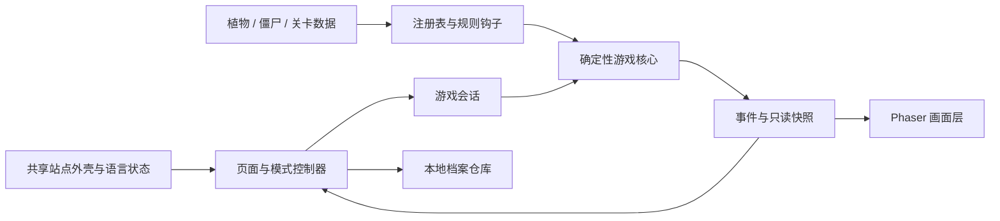

# Garden Defense（植物大战僵尸网页重制）

## 背景

本项目是在现有 WishFlow Tools 静态站点中开发的纯网页塔防游戏，目标是逐步重建《Plants vs. Zombies》PC GOTY 的关卡、植物、僵尸和玩法。项目使用独立的 TypeScript 游戏规则核心和 Phaser 画面层，存档留在浏览器本地；不需要游戏服务器或账号服务。

本仓库不是原作官方发行版，也不包含原版游戏文件。原作名称、角色和原始素材的权利归其权利人所有。

## 目标与边界

### 本期目标

- 以 PC GOTY 的真实关卡表和规则为数据依据，覆盖 50 个冒险关卡及其日夜、泳池、浓雾、屋顶和首领场景。
- 完成核心防守循环：固定步进、阳光、植物放置、攻击、僵尸行为、波次、草坪割草机、胜负和本地进度。
- 逐步实现原作小游戏、解谜、生存、禅境花园、图鉴和首领战；各模式应使用可核对的原作规则，而不是用随机拼装的关卡宣称复刻。
- 支持桌面鼠标与手机横屏触控；通过本仓库的共享站点构建并发布到 `/plants-vs-zombies/`。
- 为后续数值模拟保留稳定的植物/僵尸/关卡注册表、规则钩子、游戏事件、固定随机种子和只读快照接口。

### 本期不做

- 不加载未经审查的外部插件代码；扩展能力仅限进程内注册表、替换规则与事件钩子。
- 不做在线账号、云端存档、排行榜或多人对战。当前档案只保存设置、解锁植物、关卡进度和已解锁/完成的模式。
- 暂不构建未来的平衡性批量模拟器；本阶段只确保游戏核心能以固定种子运行并可被无界面测试调用。

### 真实数据与重建行为

`src/content/adventureData.ts` 保存 Adventure 的 50 个基础波数、逐关僵尸准入范围、特殊关卡标识、地形行数和原作奖励。初次 1-1 的 1 行草坪、重玩时 5 行草坪也按原规则切换。数据表来自公开反向工程代码和关卡资料，来源见下方链接。

Adventure 的 3-x 泳池和 4-x Fog 关卡均使用 6 行草坪，中间两行是水道；其它常规关卡为 5 行，前几关按原教程使用 1 行或 3 行。普通生存有 50 个小波次，困难生存有 100 个，无尽生存每次先载入 20 个并在阶段间继续扩展。每 10 个小波次构成一个旗帜波；困难/无尽的重选间隔和逐阶段点数也按公开重建代码处理。

生存模式还按源码重建每阶段的僵尸候选池：第一阶段固定基础僵尸与路障僵尸（困难/无尽再加入铁桶）；后续阶段以 1/5 概率在读报与路障中选一个，再从场景和难度允许的类型中抽取候选。实现还覆盖泳池专属单位、屋顶/墓碑排除、红眼巨人出现门槛、无尽模式提前解锁与蹦极旗帜波限制，以及普通/路障权重衰减和巨人数量上限。新增的红眼巨人属性取自公开重建项目的僵尸定义表。

原作每次开局会按玩家存档和游戏随机状态挑选每波僵尸。本项目把相关权重和预算规则接入核心，并使用可指定的种子保证同一输入能够重放。当前生成队列与原作数据规则相符，但随机数流、出怪时序以及特殊关卡的专用交互仍在重建，不能视为原作逐帧一致的固定波次录制。

## 架构



| 模块 | 责任 | 后续模拟接口 |
| --- | --- | --- |
| `content/` | 静态原作数据、植物和僵尸定义、冒险关卡事实 | 版本化数据集、关卡 fixture |
| `core/` | 固定步进、规则结算、随机源、注册表与事件 | `GameRuntime`、种子、事件记录、快照 |
| `modes/` | Adventure 以外各玩法的关卡/会话工厂 | 可插拔的模式定义，不要求改动核心循环 |
| `game/` | 页面级会话、命令派发、模式与存档协调 | 可由无界面驱动器直接创建会话 |
| `rendering/` | Phaser 场景、画布绘制与响应式布局 | 只消费快照，不负责改写游戏状态 |
| `save/` | 设置、解锁和关卡进度的读写/迁移 | 可替换的存储适配器 |
| `ui/` | 种子选择器、图鉴等 DOM 组件 | 尽量以稳定数据 ID 与游戏核心通信 |

扩展规则通过 `registerPlant`、`registerZombie`、`registerLevel`、`registerPlantingRule`、`registerPlantCostRule` 与事件 hook 接入。注册时检查稳定 ID、数值范围和引用关系；快照与事件数据为副本，避免调用方从 UI 或模拟脚本改写核心状态。

## 依赖与运行环境

应用目录为 `apps/plants-vs-zombies/`，由 pnpm 独立管理依赖，不加入跨应用 workspace。

| 依赖 | 用途 |
| --- | --- |
| TypeScript | 游戏核心、内容定义与浏览器代码 |
| Phaser 4 | Canvas/WebGL 场景和渲染生命周期 |
| Vite | 开发服务器与静态站点构建 |
| `@wishflow/site-shell` | 共用导航、页脚和语言持久化 |
| Node `node:test` + `tsx` | 规则核心与数据测试 |
| Playwright | 桌面流程、触控视口和构建后页面测试 |

档案很小，因此当前用 `localStorage` 保存设置、植物/模式解锁及关卡进度；数据结构带版本号并提供迁移。若后续增加大型存档、游戏回放或模拟结果，再单独评估 IndexedDB，不预先引入额外数据库依赖。

## 开发与验证

```bash
cd apps/plants-vs-zombies
./scripts/install.sh
pnpm run dev
```

常用检查：

```bash
pnpm run typecheck
pnpm run test:unit
pnpm run build
pnpm run test:e2e
pnpm run test:ci
```

单元测试覆盖数据完整性、注册约束、规则和事件、固定种子的可重放性、关卡进度迁移及模式行为。端到端测试覆盖桌面开局/种植、手机横屏操作和模式入口。新增关卡数据时，测试需断言其来源表映射、地形/行数/水域、奖励与僵尸引用；不能只验证“运行时能随机造出一关”。

## 发布

应用已登记在 `apps/catalog.json`。根目录的站点工作流根据变更路径决定是否构建应用、运行测试并发布共享静态站点；应用产物位于 `apps/plants-vs-zombies/dist/`，最终挂载到 `/plants-vs-zombies/`。正常发布流程依仓库规则，将验证后的功能分支合入 `master`，再通过 `git push origin master` 触发既有工作流；部署完成后访问公开站点实测桌面和横屏布局。

## 调研来源与素材说明

以下项目用于反向工程数据核对或实现方式比较；引用它们不代表其素材可再发布，也不表示本项目得到原作权利人授权。

| 来源 | 用途 | 本项目采用方式 |
| --- | --- | --- |
| [Patoke/re-plants-vs-zombies：Challenge.cpp](https://github.com/Patoke/re-plants-vs-zombies/blob/main/Lawn/Challenge.cpp) | `gZombieWaves`、`gZombieAllowedLevels` 及准入表 | 逐项转录事实表，独立实现规则 |
| [Patoke/re-plants-vs-zombies：Board.cpp](https://github.com/Patoke/re-plants-vs-zombies/blob/main/Lawn/Board.cpp) | 波次点数、旗帜波、首次出现僵尸、关卡背景与特殊波次 | 按行为重建，不复制源码文件 |
| [Patoke/re-plants-vs-zombies：Zombie.cpp](https://github.com/Patoke/re-plants-vs-zombies/blob/main/Lawn/Zombie.cpp) | 僵尸出怪点数、首次出现波次、抽取权重与红眼巨人定义 | 转录规则数据到本项目的类型注册表 |
| [Patoke/re-plants-vs-zombies：LawnApp.cpp](https://github.com/Patoke/re-plants-vs-zombies/blob/main/LawnApp.cpp) | 50 关特殊玩法、夜晚与首领场景的关卡判定 | 作为关卡事实和规则参考 |
| [YJL-debug/pvz-portable](https://github.com/YJL-debug/pvz-portable) | C++20 跨平台重实现，提供 WebAssembly 版本；说明中列出 GOTY 兼容范围、IndexedDB 存档和本地导入原版资源流程 | 用作兼容性与行为交叉核对；代码使用 LGPL-3.0/GPL-3.0 许可，资源必须由玩家从自己的游戏副本导入。本项目不直接嵌入其 C++ 引擎 |
| [marblexu/PythonPlantsVsZombies](https://github.com/marblexu/PythonPlantsVsZombies) | Python/Pygame 学习实现，使用 JSON 关卡、覆盖部分植物/僵尸和保龄球等玩法 | 只比较 JSON 关卡组织；仓库作者声明仅供个人学习且非商业使用，包含的原作图像不进入本项目 |
| [baojie/PVZ](https://github.com/baojie/PVZ) | Vanilla JavaScript 与 Canvas 浏览器实现，MIT 许可，使用程序化图形和自定义波次 | 只比较前端运行与渲染拆分；其游戏规则和关卡并非 GOTY 数据 |
| [PvZ Wiki：Adventure Mode](https://plantsvszombies.wiki.gg/wiki/Adventure) | 冒险关卡结构和奖励交叉核对 | 与反向工程代码互相校验 |
| [GameFAQs：Plants vs. Zombies Walkthrough](https://gamefaqs.gamespot.com/pc/959255-plants-vs-zombies/faqs/65095?page=1) | 逐关解锁奖励交叉核对 | 转录奖励 ID，不复用页面内容 |
| [FregD156/PvZ_Assets](https://github.com/FregD156/PvZ_Assets) | 查看提取资源的目录和格式 | 仓库收录原作提取图像/音频，但未找到覆盖再分发素材的明确许可；不把这些二进制资源放入公开构建 |
| [JiangNanGame/New-Plants-vs-Zombies-JavaScript](https://github.com/jiangnangame/New-Plants-vs-Zombies-JavaScript) 与 [Changjiang River License](https://github.com/jiangnangame/The-Changjiang-River-License/blob/master/LICENSE-ENGLISH.md) | 浏览器实现、关卡资源组织与许可条款 | 许可允许非营利二次发布，但禁止把作品的一部分单独拆出用于另一个项目，且不授予品牌权利；本项目不单独抽取其素材 |
| [Tino1234567/plants-vs-zombies-game](https://github.com/Tino1234567/plants-vs-zombies-game) | Phaser/TypeScript 结构和小型浏览器实现比较 | 仅比较实现思路，不复制代码或素材 |

当前画面使用本项目的程序化绘制。调研到的反向工程项目不包含原版美术；提取素材库没有明确的再分发许可；另一个可用的浏览器素材项目采用的许可禁止单独拆出素材供其它项目使用。README 引用只记录来源，不会改变这些许可边界。若后续改用完整既有项目，应按其整体许可、依赖和运行方式另做架构评审。

调研中找到的 `pvz-portable` 已有纯静态 WebAssembly 玩法路径：由玩家在浏览器本地导入自己的 `main.pak` 与 `properties/`，原始资源不会上传，存档放入浏览器 IndexedDB。若本项目后续决定改用完整既有引擎，应先单独评审 LGPL/GPL 合规、源码分发义务、与 TypeScript 模拟接口的桥接成本，以及是否接受玩家自行导入资源；这会改变当前模块化 TS 核心的架构边界，不作为本计划默认依赖。

## 后续实现拆分与验收

| 阶段 | 工作内容 | 验收重点 |
| --- | --- | --- |
| 1. 关卡事实与数据对齐 | 完成 Adventure 50 关地形、行数、奖励、特殊关卡、波数、僵尸准入和规则来源 | 每个数据点能映射到引用来源；无模糊的生成关卡冒充原作关卡 |
| 2. 核心数值与交互 | 对照公开反向工程逐项校正植物/僵尸属性、攻击/移动/冷却/地形规则、阳光与出怪节奏 | 规则单测覆盖边界，固定种子可复现，事件能够导出模拟指标 |
| 3. GOTY 模式 | 补齐迷你游戏、砸罐子、僵尸吃脑、禅境花园、生存模式及首领专用状态 | 各模式使用真实关卡配置与状态机，胜负、解锁和重玩流程通过用例 |
| 4. 素材与交互完善 | 仅接入有许可的美术/音频素材；完善图鉴、反馈、鼠标和触控手势 | 桌面及手机横屏可完成关键操作，布局在常见视口内无裁切 |
| 5. 发布与模拟准备 | 扩大自动化覆盖、产出版本化内容集和回放 fixture、完成线上验收 | CI 全绿；公网页面可加载；核心数据能被未来的 headless runner 调用 |

每个阶段都应保持可单独测试、部署和回滚。未完成的关卡专用机制应作为明确的实现缺口记录，不应以外观相似的随机波次替代后标注为完整复刻。
