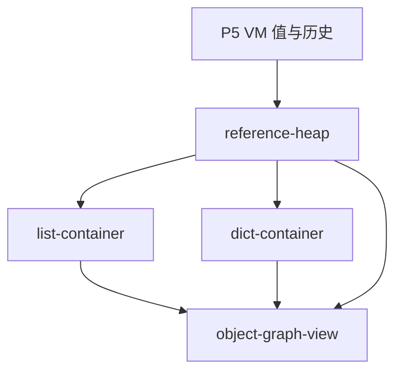

# P8 能力地图

**状态：实施中，T01–T02 已完成。** 能力边界与依赖顺序用于组织阶段规格和代码任务，若验证揭示必须调整，先更新规格和任务记录。

## 目标

在现有教学 VM 中加入可变列表、字典和对象引用观察。变量绑定到对象后，别名应指向同一对象；修改必须反映到所有别名；查看历史时保留当时的对象内容。对象快照使用有界、不可变、可通过 Worker 结构化克隆的数据表示。

## 设计前提

- 以已发布的 `mini-vm-v3` 为基础，兼容 P5–P7 的语法、调用帧、共享语言状态和 Worker 边界；真实 CPython 视图不变。
- 不引入依赖、后端、路由或新的 Worker 消息协议。运行期对象身份只属于教学 VM，不声称复现 CPython 对象地址或内部布局。
- 本阶段聚焦内建 `list` / `dict` 的字面量、下标读写和引用展示；更广的对象模型继续留在后续阶段。
- 以下模块 ID 和依赖图作为阶段规格与任务的拆分依据；具体索引、字典键、比较、循环引用及预算语义由 P8 规格明确。

## 能力模块

| 稳定模块 ID | 职责 | 依赖 | 独立验收结果 |
| --- | --- | --- | --- |
| `reference-heap` | 在 VM 内维护有界堆对象与稳定对象 ID；将变量、帧和求值栈中的容器值表示为引用；生成可序列化且不可变的逐步历史快照 | 已有 P5 VM 值/快照机制；P7 模块和函数帧作为兼容验收面 | 同一步中的多个变量可被确认指向同一对象；后续修改不改变旧快照；越过对象或快照预算时给出诊断 |
| `list-container` | 构造列表、保存元素引用、读取和写入下标；定义索引类型与越界行为 | `reference-heap` | 对列表执行构造、下标读取和赋值，所有别名观察到同一修改 |
| `dict-container` | 构造有序字典、保存键值、读取和更新下标；定义键类型、键冲突、缺失键行为 | `reference-heap` | 对字典执行构造、读取和更新；重复键和无效/缺失键行为有明确结果 |
| `object-graph-view` | 在教学界面展示对象 ID、变量绑定与容器边；按当前执行步和历史步显示对象状态，不递归展开成无界树 | `reference-heap`、`list-container`、`dict-container` | 用户能区分别名与独立对象，并能看到对象修改前后的历史差异；循环引用不会导致 UI 卡死或无限展开 |



列表与字典共享对象堆，但各自的索引、键和错误语义分开验收；对象图视图最后接入，避免 UI 依赖尚未稳定的对象表示。按整体计划，P8 以 P5 VM 为前置。P7 是兼容验收面：容器引用需要能存入现有模块全局、函数局部和求值栈，不要求本阶段改变函数或帧的语义。

## 建议的阶段边界

**纳入 P8：** 列表与字典构造、下标读取/写入、跨变量别名、对象身份标记、对象状态历史、受限对象图、明确的资源预算与错误诊断。

**暂不纳入 P8：** 容器方法（如 `append`）、切片、推导式、一般容器迭代、集合/元组/自定义类、属性访问、任意对象协议，以及真实 CPython 对象 ID/内存布局。`is` 比较运算符和列表/字典结构相等规则留待阶段规格明确；此提案建议首版用对象 ID/引用关系展示身份，不依赖新增比较语法。

关键语义（负索引、字典键类型与 `True`/`1` 冲突、嵌套下标赋值、循环引用展示、容器/历史预算和结构相等）已由 [P8 规格](docs/specs/p08-mutable-containers.md)固定；实现与验证进度以 [P8 tasks](docs/tasks/p08-mutable-containers.md) 为准。

## 跨模块验收目标

保留整体计划中的例子：

```python
a = [1, 2]
b = a
b[0] = 9
```

在当前执行步中，`a` 和 `b` 指向同一对象，内容均显示为 `[9, 2]`；修改前的历史步仍显示 `[1, 2]`。规格还应增加单独构造的同值列表以证明对象身份不同，并加入字典、函数帧和循环引用的边界案例。

## 实施进度

阶段规格和任务分别见 [`docs/specs/p08-mutable-containers.md`](docs/specs/p08-mutable-containers.md) 与 [`docs/tasks/p08-mutable-containers.md`](docs/tasks/p08-mutable-containers.md)。本地图保持模块边界；任务与验收证据以 tasks 执行记录为准。
