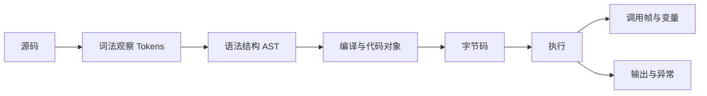
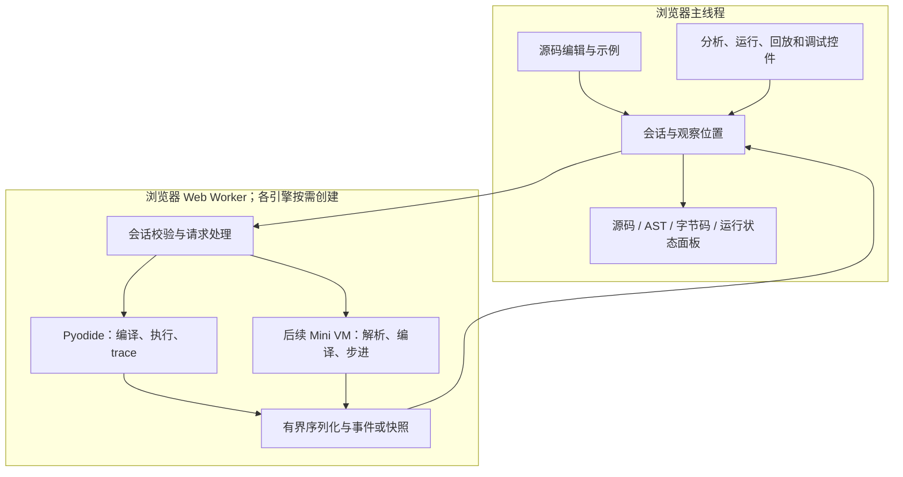
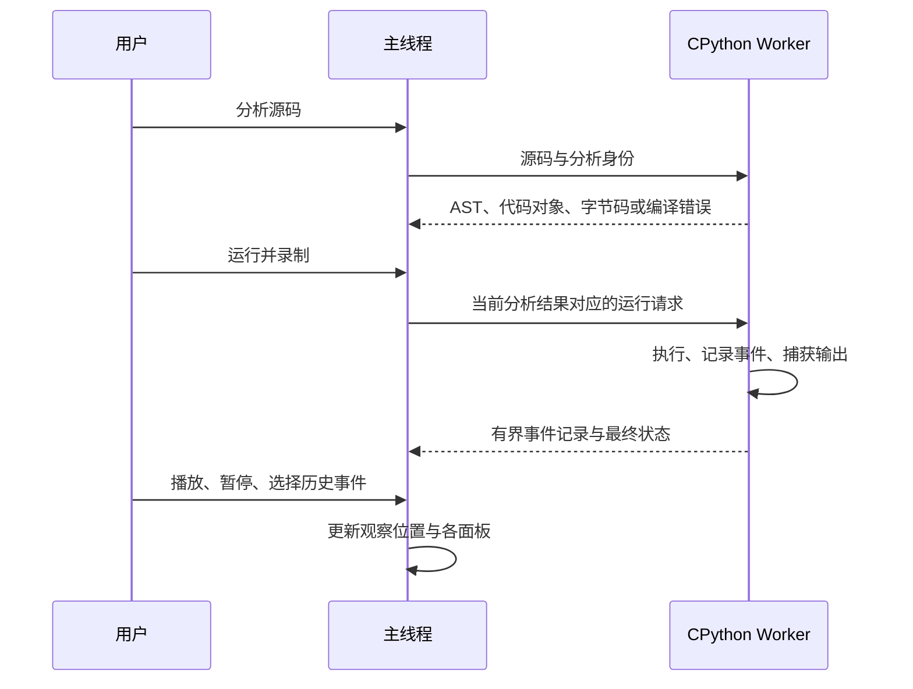

# ADR-0001：浏览器内 Python 编译与执行可视化

## 1. 状态与决策范围

- 日期：2026-10-29。
- 已确认方向：用户选择先用 Pyodide 展示真实 CPython AST、字节码和执行轨迹，再逐步加入教学 Mini VM。
- 应用：Python 解释器实验室，目录 `apps/python-interpreter-lab/`，未来发布路径 `/python-interpreter-lab/`。
- P0 已交付：协作契约、整体架构决策和实施计划。P1 已开始，并在[阶段 spec](../specs/p01-real-cpython-compile-view.md) 中确认首版依赖、运行时版本、资源路径和消息边界；该阶段的实现进度以[整体实施计划](../implementation-plan.md)为准。
- 本文中的模块划分和边界用于指导阶段规格；各阶段的具体公共接口和消息字段只在对应 spec 中约定，不预建通用框架。

阶段、依赖与交付状态由[整体实施计划](../implementation-plan.md)维护。本文负责解释为什么采用这条路线、各引擎能展示什么，以及哪些边界必须保留。

## 2. 背景与目标

用户输入 Python 代码，希望直观看到源码如何被分析、编译为字节码并执行，以及变量、调用帧、输出如何随执行变化。静态反汇编只能回答“生成了什么指令”；原理教学还需要解释这些指令何时执行、执行状态如何改变。

目标链路是以下教学概览，并非对 CPython 全部内部编译阶段的逐项模拟；符号表分析、优化、缓存等细节按实际展示范围说明：

产品围绕三个问题组织交互：

| 用户问题 | 观察内容 | 操作 |
| --- | --- | --- |
| 这段代码编译成了什么？ | 源码范围、Tokens、AST、代码对象和指令 | 编辑、分析、展开节点、选择函数、交叉高亮 |
| 真实 Python 按什么顺序运行？ | 行事件、调用/返回、变量摘要、输出和异常 | 运行录制、终止、播放/暂停轨迹、选择历史事件 |
| 一条指令如何改变解释器状态？ | 教学指令、值栈、帧栈、名字绑定和对象引用 | 真正单步、继续、断点、观察历史快照 |

“纯前端”指分析和运行均在用户浏览器完成，没有 Python 执行后端、数据库或账号服务。加载页面、WASM 和标准库仍可能需要下载静态资源；离线运行不属于首版承诺。

## 3. 备选方案与选择

| 路线 | 能力与成本 | 决策 |
| --- | --- | --- |
| 仅 Pyodide/CPython | 可直接获得真实编译产物和执行语义；细粒度状态控制受公开接口与浏览器执行模型约束 | 作为首版主线，不能覆盖完整值栈教学目标 |
| 仅 TypeScript Mini VM | 每步状态可控，适合教学；需自行维护解析、编译和 Python 子集语义 | 作为后续教学引擎，明确兼容边界 |
| 两个引擎首版同时实现 | 可以同时覆盖两类目标，但会同时引入运行时、语言语义和 UI 的验证成本 | 不采用；用户已选择先真实视图后教学 VM |
| 其他 Python 实现或修改 CPython/WASM 内核 | 可探索其他执行接口，但不能默认等价于真实 CPython；内核维护另有成本 | 不作为当前路线，出现无法满足的明确目标时另立 ADR |

双引擎是分阶段演进目标，不要求首版预建通用引擎插件框架。首版只有真实视图；教学 VM 可运行后再引入模式选择及必要的公共展示结构。

## 4. 观察能力与真实性边界

| 能力 | CPython 真实视图 | 教学 VM 视图 |
| --- | --- | --- |
| AST、代码对象、指令 | 使用所选 Pyodide 内 CPython 的实际结果 | 使用教学解析器和编译器自己的结果 |
| 字节码版本 | 显示 Pyodide 和 Python 版本，按该版本解释 offset、跳转和缓存 | 使用独立的教学指令集版本，指令序号不伪装成 CPython 字节偏移 |
| 执行轨迹 | 首版记录 `call`、`line`、`return`、`exception` 及输出 | 每条指令产生可核验的状态变化 |
| 值栈 | 首版不展示；公开 trace/frame 接口不能直接提供完整内部求值栈 | 由 VM 拥有，按当前帧展示真实教学执行状态 |
| 暂停与单步 | 暂停/单步的是已经录制的事件播放 | 暂停/单步的是 VM 执行；浏览历史另行标识 |
| 断点与函数步进 | 首版无实时断点；未来回放定位不能标作实时调试 | 分阶段提供行/指令断点、Step Into/Over/Out |
| 历史浏览 | 不重新执行代码，不重复输出或其他副作用 | 读取不可变历史快照；初版也不从历史位置分叉运行 |
| 修改运行中变量 | 不属于当前范围 | 不属于当前范围 |

官方 `sys.settrace` 支持显式开启 `opcode` 事件，因此“真实 Python 完全不能逐指令观测”不准确。但记录 opcode 与控制 WASM 内实时暂停、读取内部值栈、保存可恢复进程状态是不同能力。opcode 轨迹只作为后续可选增强，须单独验证性能和版本映射。[Python trace 文档](https://docs.python.org/3/library/sys.html#sys.settrace)、[frame 文档](https://docs.python.org/3/reference/datamodel.html#frame-objects)。

CPython 字节码是实现细节，会随版本变化。真实视图应读取 `dis` 的结构化结果，保留 code object 身份及来源位置，不硬编码某一版本的指令长度、跳转计算方式或名称。基线反汇编与运行后的专门化指令如需同时展示，必须区分来源；首版只承诺固定版本的编译基线。[Python dis 文档](https://docs.python.org/3/library/dis.html)。

## 5. 总体结构与所有权

图中的模块是职责边界，不要求对应独立包、类层级或全部在首版建立。

| 责任 | 所有者 | 约束 |
| --- | --- | --- |
| 源码修订、当前引擎、运行身份、请求状态 | UI 会话 | UI 接受响应前验证其仍属于当前源码和会话 |
| AST、代码对象、指令和源码关联 | 对应引擎 | 分析与运行消费同一编译结果或明确校验同一源码及配置 |
| CPython 运行环境、trace 钩子、输出捕获、Python 对象生命周期 | CPython Worker | UI 接收可传输的数据，不持有跨线程活 Python 对象 |
| 教学值、对象身份、帧栈、指令位置及调试停止条件 | Mini VM Worker | UI 不另算一份解释器状态 |
| 历史数据 | Worker 产生，UI 保存已收到的有界记录 | 观察过去不会改变当前执行头；记录说明完整、截断或中止 |
| 可视化布局、选中项、播放速度 | UI | 播放速度控制观察节奏，不改变 Python 语义 |

真实引擎和教学引擎分别生成各自的编译产物。不能把 CPython 指令直接交给 Mini VM 执行，也不能宣称两个引擎能逐条指令对齐；对照以同一源码、支持范围和可观察结果为基础。

## 6. 真实视图：分析、录制与回放

### 6.1 编译产物

- AST 展示采用 `ast.parse` 等公开接口；执行前仍需实际编译，AST 生成成功不代表完整编译一定成功。代码对象中的嵌套函数需能单独选择。[Python ast 文档](https://docs.python.org/3/library/ast.html)。
- Token 面板采用标准库 `tokenize` 的词法观察结果，不声称展示 CPython 内部解析器的逐步运行；源码不合法时展示明确诊断，不把局部 Token 结果作为编译成功。[Python tokenize 文档](https://docs.python.org/3/library/tokenize.html)。
- 源码、AST、指令之间允许一对多、多对一或无对应项。常量折叠可能使 `1 + 2` 直接成为常量加载，真实视图必须保留实际结果，不能为了动画补出加法指令。
- 字符位置需适配 Python API 与编辑器的计量差异，尤其是 AST 的 UTF-8 字节列偏移与 JavaScript 字符位置；使用中文标识符和非 ASCII 字符验收。具体转换写入联动阶段 spec。

### 6.2 运行与事件

录制使用独立的运行环境，按提交源码标识筛选用户代码帧；内部采集逻辑不混入用户调用树。脚本顶层使用一致的全局/局部命名空间，避免示例中的 `exec(code, {}, {})` 使函数无法按正常脚本语义读取顶层变量。[Python exec 文档](https://docs.python.org/3/library/functions.html#exec)。

`line` 事件通常发生在该行执行前，不能把此时的局部变量标作“这一行执行后的值”。异常传播可能触发多个帧事件，`exception` 事件也不代表程序最终失败；最终完成状态由执行结果判定。具体事件顺序、返回及输出时机在录制阶段用案例确认。[Python trace 文档](https://docs.python.org/3/library/sys.html#sys.settrace)。

行级回放可以高亮源码行及其关联指令集合，但不能从行事件推断集合中某条指令就是当前实际执行指令。精确指令高亮需使用经过版本核验的实际 opcode 事件。

首版以录制结束后回放为基线；是否分批发送记录由该阶段 spec 根据停止恢复和数据量确定。用户终止运行时，只保证保留主线程已收到的数据，不能承诺拿回被终止 Worker 中尚未发送的记录。

### 6.3 变量快照与资源恢复

变量以有界、独立的数据表示保存，不能只保存可变对象引用后等执行结束再读取。首版采用基础值及受限容器摘要；大整数避免转为 JavaScript `Number` 丢失精度。自定义对象默认显示类型与受控占位，不为展示任意调用其 `repr`、属性或迭代方法。循环引用、超深结构、字符串和输出量都需有上限与可见截断提示。

UI 获得结构化数据后，Worker 按生命周期释放不再需要的 Python 代理和采集资源；成功、异常、重新运行和终止都要验收。`PyProxy` 的显式释放方式以固定版本 API 为准。[Pyodide JavaScript API](https://pyodide.org/en/stable/usage/api/js-api.html#PyProxy.destroy)。

## 7. 教学 VM：逐步状态与兼容边界

Mini VM 在 TypeScript 中逐步实现 Lexer、Parser、AST、Compiler、VM 和必要运行时。各层作为同一引擎内部模块，从最小可运行语言切片开始；不提前采用复杂中间表示或通用编译器框架。

| 范围 | 教学目标 | 推进原则 |
| --- | --- | --- |
| 表达式、变量、`print` | 指令如何读写值栈与名字绑定 | 首个 VM 切片同时交付输入、编译、执行和逐步观察 |
| 分支、循环、短路求值 | 指令位置与控制流如何变化 | 按已声明子集实现 Python 语义，不能直接沿用 JavaScript 语义 |
| 函数、调用与返回 | 局部/全局名字及帧栈 | 独立定义作用域和调用规则；闭包、默认参数等按规格选择 |
| 列表、字典、引用与修改 | 多个名字指向同一对象 | 对象身份与历史版本分开；旧快照不随当前修改改变 |
| 异常捕获与传播 | 异常如何影响控制流和帧 | 基础运行错误先有明确结果，`try/except/raise` 在后续独立阶段补齐 |

每个切片明确支持的语法和运算，不支持的语法在执行前给出带源码位置的诊断。整数、除法/取模、真值、短路、求值顺序和作用域都属于语义契约；尚未支持的部分不得静默转换为近似 JavaScript 行为。

逐指令快照必须区分“即将执行的指令”和“刚执行完成的变化”，每个帧拥有自己的指令位置、值栈及局部绑定。历史使用独立不可变表示，允许先采用有界完整快照；只有测量显示必要时再设计增量或压缩。

时间轴初版只用于浏览历史。用户回到执行头才可继续；从任意旧快照恢复或修改变量后分叉运行，需要完整保存执行状态及副作用边界，属于另行确认的能力。源码行步进与 Step Over 也必须处理同一行多条指令、循环再次到达同一行和递归，不能只比较行号或调用深度。

## 8. 执行隔离、停止与资源限制

Pyodide 放入浏览器 Web Worker，保持编辑和控制界面可响应；具体 Worker 形式遵循最终固定的 Pyodide 版本。浏览器 Web Worker 与 Cloudflare Worker 是两类资源，本应用不因此新增 Cloudflare 执行服务。[Pyodide Worker 文档](https://pyodide.org/en/stable/usage/webworker.html)。

| 风险 | 架构处理 | 后续验收 |
| --- | --- | --- |
| 编译超大源码或运行死循环 | 主线程计时并允许终止 Worker；销毁后重建运行环境 | 分析和运行均可取消，之后可处理新代码 |
| 同步执行占满 Worker | 不依赖普通消息即时暂停；Mini VM 分批步进并让出事件循环 | 停止控件生效；不会把“请求已发送”显示为“已停止” |
| 事件、输出或快照失控增长 | 分别设条数/字节、深度和运行预算 | 达到预算时有明确截断或中止状态，不伪装完整轨迹 |
| 旧会话迟到响应 | 每次 Worker 生命周期及源码修订都有可区分身份 | 重置、切换模式、快速连续分析后不串数据 |
| 强制终止造成资源丢失 | 接受丢弃未发送数据，清理旧 UI 请求状态并重建 | 可从头重新运行，不声称从中断点恢复 |

`Worker.terminate()` 会直接结束 Worker，因此作为停止兜底不要求执行线程先处理新消息。[MDN Worker.terminate](https://developer.mozilla.org/en-US/docs/Web/API/Worker/terminate)。Pyodide 的协作中断可使用 `SharedArrayBuffer` 与相应安全响应头，但这会涉及共享站点兼容性；首版不以修改全站 COOP/COEP 或具备 SharedArrayBuffer 为前提。未来引入时另行确认。[Pyodide 中断文档](https://pyodide.org/en/stable/usage/keyboard-interrupts.html)。

Worker 提供线程隔离，不提供任意不可信 Python 的完整权限沙箱。Pyodide 与浏览器互操作及网络能力需要明确边界：应用本身不主动上传源码，不向运行环境注入账号凭据或业务能力；这不意味着用户代码无法发起网络请求。首版定位为用户主动运行自己输入的学习代码，不自动运行外部分享脚本，不承诺抵御恶意代码的所有资源攻击。独立来源隔离、网络能力限制或公开脚本分享如成为需求，须先完成专门设计。

## 9. 前端与部署取舍

- **应用基线**：使用仓库现有独立 React + TypeScript + Vite 应用模式和普通模块边界；确需不同 UI 框架或更换构建模式时，先在阶段 spec 说明消费者需要和维护影响。Vite 的 `build` 需单独执行类型检查，再生成静态产物；本项目现有应用已采用 `tsc --noEmit` 加 Vite build 的模式。[Vite TypeScript 文档](https://vite.dev/guide/features.html#typescript)。
- **子路径发布**：slug 固定为 `python-interpreter-lab`，公开路径为 `/python-interpreter-lab/`。首次可运行版本提供独立 `package.json`、`pnpm-lock.yaml`、`scripts/install.sh`、`build` 和 `test:ci`；Vite 使用 `base: './'`，产物落入应用 `dist/`。先验证构建资产及 Worker 在共享站点子路径下的引用，再登记 `apps/catalog.json`；catalog 是导航和共享构建的路径真源。
- **共享外壳**：应用依赖仓库本地 `@wishflow/site-shell` 包，并按[页面接入与语言接口](../../../../packages/site-shell/README.md)使用 `<wishflow-site-shell data-app="python-interpreter-lab" data-base="../" data-home-href="../" ...>`。双语标题随站点菜单展示，React 根挂到 `slot="content"`；入口导入共享组件。应用语言由壳负责存储和切换，静态内容使用成对的 `data-locale`，React 动态消息使用 `registerMessages`/`subscribeLanguage`。现阶段是单页多面板工具，不显示空的本地导航；若将来形成多路由，才开启共享侧栏并维护双语 `data-local-nav`。
- **Worker 打包**：Pyodide 的 JavaScript 模块要求 module-type Worker。默认沿用现有 Vite Worker 写法 `new Worker(new URL('./worker.ts', import.meta.url), { type: 'module' })`；将来实际版本的加载要求和打包约束按 P1 spec 验证。[Vite Worker 导入](https://vite.dev/guide/features.html#web-workers)、[Pyodide Web Worker](https://pyodide.org/en/stable/usage/webworker.html)。此处的 Web Worker 是浏览器静态应用代码，不新增 Cloudflare Worker。
- **交互与可访问性**：源码输入及面板操作可用键盘完成，状态有可访问名称和可见焦点；窄屏使用响应式面板布局，源代码可在面板内滚动；状态变化动画尊重 `prefers-reduced-motion`。具体断点、编辑器和布局指标由阶段 spec 定义。
- **尚待阶段决定的依赖**：CodeMirror/Monaco、树组件和图形库均不在 ADR 中预选。先用原生 HTML/React 实现源码表单与可展开结构；P1 按编辑能力、包体、许可、可访问性和子路径构建评估是否引入编辑器，P8 再根据已实现对象数据决定是否需要图形库。
- Pyodide 资源采用同站点托管还是固定版本 CDN，在首阶段明确下载体积、缓存、CORS/CSP、路径、失败重试和发布限制后选择。运行时与标准库资产版本必须一致；不用漂移的 `latest` 作为生产依赖。
- 固定 Pyodide 及其内置 CPython 版本，并在界面和验证结果显示。版本升级是独立变更，重新核对编译结果、源码位置和轨迹行为。

## 10. 影响、留后项与重新决策条件

采用这条路线可以先交付真实、可核验的 Python 分析和运行，再集中解决教学执行的可控性。代价是后续维护两类语义及不同粒度的数据；因此只复用确有共同需求的界面与元信息，不提前强行统一所有引擎结果。

以下内容不属于当前已承诺范围：完整 Python 兼容的 Mini VM、通用第三方包安装、文件/网络编程教学、交互式 `input()`、类/装饰器/生成器/async 的教学执行、真实 CPython 值栈、运行状态编辑、任意历史分叉、账号、云保存及协作编辑。真实 CPython 能解析或执行某种语法，不代表可视化层已完整支持它；各阶段分别声明运行能力和可观察能力。

出现以下情况时重新评估，而不是在实现中隐式扩大范围：

1. 必须取得真实 CPython 内部值栈或可恢复的逐指令暂停，现有公开接口不能满足。
2. Mini VM 的目标从教学子集变为普遍兼容 Python，或需要改用已有解析器/解释器。
3. 需要 SharedArrayBuffer、共享站点响应头调整、新后端或不同来源的执行隔离。
4. 真实样本显示完整快照或现有 UI 结构不能满足已确认性能预算，需要新存储或渲染方案。

以上方案为后续 spec 的依据；实现中的支持表、接口和限制应写在对应阶段文档，避免本文成为所有细节的重复副本。
