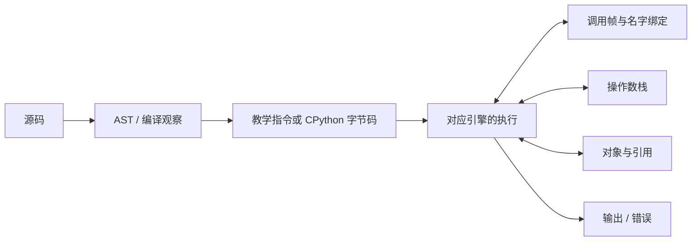
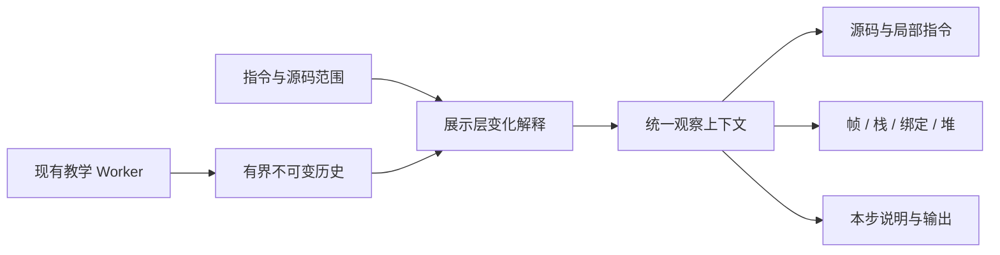

# ADR-0002：以执行现场为中心的连贯可视化

## 1. 状态与决策范围

- 日期：2026-10-30。
- 状态：**已接受；应用改造尚未实施。** 用户确认原讨论稿的四项决定，并要求增加可点击查看的中英文使用说明。
- 适用范围：Python 解释器实验室的默认入口、观察布局、语句/指令讲解、栈与堆动画、观察位置和使用说明。
- 基线：已发布的双引擎和教学 `mini-vm-v5`。本次不改变支持语法、运算规则或资源预算。
- 与 [ADR-0001](0001-browser-python-visualizer.md) 的关系：补充体验与展示架构；双引擎、真实性、浏览器 Worker 和历史只读边界继续有效。原来的“先真实 CPython、再教学 VM”是已经完成的建设顺序，不限制新版以教学模式作为默认入口。
- 实施与发布状态由[体验实施计划](../visual-execution-plan.md)维护。详细 spec/tasks 在对应阶段开始时补充，本 ADR 不预先批准未列明的新依赖或协议重构。

## 2. 背景与目标

当前应用已经能够展示源码、AST、指令、帧、变量、堆与历史，但这些数据主要分散在面板中。用户需要自行推断执行原因、数据来源以及多个视图之间的关系。单纯增加高亮或过渡效果，不能解决这个问题。

目标是让用户在一次操作后理解：正在执行哪段源码、读取了哪些数据、改变了哪些状态，以及接下来去哪里。成功标准是能够预测与解释下一步，而不是同时显示更多内部字段。

现有编译结果、不可变快照、帧 ID、对象 ID、执行计数和前后指令位置足以支持第一批改进，因此先扩展展示层，保留已有解释器与 Worker 所有权。

## 3. 已确认决定

| 决定 | 采用方案 | 理由与边界 |
| --- | --- | --- |
| 执行现场为主 | 源码、当前动作、活动帧、操作数栈、变量绑定、堆与输出围绕同一步组织；完整编译材料按需展开 | 降低跨面板对照成本；不把编译过程重新播放成每条运行指令的前置步骤 |
| 默认入口 | 新版默认教学演示，默认按源码语句讲解，可展开保留范围内的指令；保留明确的真实 CPython 入口 | 从容易解释的可控状态进入，再核对真实结果；切换时维持两个独立会话的边界 |
| 底层范围 | 机器码仅作解释器、WebAssembly、浏览器与 CPU 关系的概念说明 | 不实现真实机器指令、寄存器、物理地址或逐条 CPU 执行；以后另行确认 |
| 验证顺序 | 先以别名/重新绑定和函数调用/返回验证视觉语法，算术作为基础对照，再推广到控制流、递归与错误 | 先验证共享对象和跨帧数据流确实能看懂，避免一次覆盖所有指令 |
| 使用说明 | 提供简短中英文正文，以及应用内“使用说明 / User guide”点击入口 | 说明真实可用的操作、四种运行状态概念及历史边界；使用共享站点语言机制 |

默认教学入口随 V1 发布切换，同时以现有 Step Over 作为主步进操作；V2 再交付历史语句分组与展开指令。用户始终可使用已有单指令控制。本 ADR 接受不等于当前线上默认已改变。V0 的使用说明先描述当前版本，后续阶段发布时同步更新，不提前将候选控件写为已提供功能。

## 4. 概念与真实性边界

### 4.1 编译关系与执行关系分开

图中的运行结构是概念关系；具体可视范围受下表约束。不能把它画成“源码 → 机器码 → 栈 → 堆”的单线编译流水线。

| 能力 | 教学演示 | CPython 实证 |
| --- | --- | --- |
| 指令 | 教学编译器的实际结果，显示教学版本 | 固定 Pyodide/CPython 的真实结果 |
| 运行位置 | 已执行教学指令及下一条指令 | 已记录 trace 事件；行事件不伪装为某条 opcode 的执行证据 |
| 操作数栈与对象图 | 教学 VM 实际快照，容器对象使用教学 ID | 不添加推测的内部值栈；不把事件内回指当作跨事件对象身份 |
| 历史 | 已记录教学快照；不可从过去分叉 | 真实事件回放；不重新执行代码 |
| 对照 | 依同一源码范围、支持子集和最终结果对照 | 不承诺与教学指令逐条对应，保留优化与版本差异 |

教学标量内联显示属于模型简化，不能据此宣称 Python 标量不在堆中。对象卡片的位置不代表真实地址；对象离开可达快照不代表观察到了 GC 或内存释放。

机器码概念说明沿用设计说明中的关系图；不能将 Python 字节码、Wasm 与 CPU 指令混为同一层。技术参考见 [Python dis](https://docs.python.org/3.14/library/dis.html)、[Python 内存管理](https://docs.python.org/3.14/c-api/memory.html) 与 [Pyodide 概述](https://pyodide.org/en/stable/project/about.html)。

## 5. 展示架构与状态所有权

| 责任 | 所有者 | 决定 |
| --- | --- | --- |
| 指令执行、语义、暂停和预算 | 现有 Worker / VM | UI 不重新计算一份解释器状态 |
| 执行头 | Worker 确认的最新状态 | 动画不能推进或回退执行头 |
| 观察位置 | 主线程展示层 | 源码、指令和所有状态面板使用同一坐标 |
| 手动检查 | 主线程展示层 | 可选择非活动帧或对象，但不改变活动执行帧；提供回到执行焦点的路径 |
| 变化解释 | 指令与相邻实际快照 | 结果读取后态；不确定的来源只显示差异，不制造因果 |
| 动画进度与空间布局 | 展示层 | 可取消、有界、尊重减少动态效果；不构成可恢复 VM 中间状态 |

观察坐标应包含引擎、会话/源码版本、Reset 代次、记录位置、帧与指令身份。具体字段和接口在 V2 spec 约定，不在本 ADR 固定通用框架。

教学 Token 尚未包含在当前编译结果中。首轮重排现有 AST/指令数据，CPython 的 Token 能力继续可用；新增教学 Token 传输另行确认。

## 6. 语句、指令与动画的执行合同

### 6.1 语句是观察分组

默认“下一语句”沿用已支持子集的源码 Step Over 边界，允许展开仍保留的实际指令。它不是新的 VM 原子性规则：断点、错误或预算终止仍可在语句中间停止。

历史位置先消费后续已记录分组；只有到执行头才请求新的 VM 步进。Continue 保持既有语义：先回到真实执行头，再继续运行。查看历史、展开 AST 或选择对象都不重新执行代码。

一次 Step Over 可能执行超过历史容量的指令。分组要区分完整、前缀截断及缺少前态，只展开现存范围；若需额外保存语句起点，必须在阶段 spec 中定义独立有界预算。

### 6.2 动画是已确定变化的解释

动作节拍为“定位源码与指令 → 强调参与值/引用 → 呈现真实后态 → 保留一句说明”。过渡过程中不能宣称存在可暂停恢复的半次赋值、半次调用等 VM 状态。

- 操作数栈明确 `TOP`，按操作数角色展示读入、消耗和结果。
- `b = a` 增加绑定线；下标赋值修改同一对象；重新绑定改变引用目标。
- 调用创建新帧和参数绑定；返回值进入调用者栈，随后按真实指令完成绑定。
- 对象与帧按运行身份保持稳定位置；相同显示值不当作同一操作数身份。
- 控制停顿与失败单独处理。`stepIndex` 增长或快照更新不必然代表成功执行了一条指令。
- 历史跳转、Reset、换引擎、源码变化取消旧过渡；缺少前态时静态呈现。
- 减少动态效果模式保留相同的箭头、前后差异和说明，不依赖飞行动画传达必要信息。

### 6.3 执行与展示的调度权

当前 Worker Run 会自主推进，停止动画或停止发送新请求不会使它停止。采用两种互斥推进方式：

1. **讲解推进**：前端串行发出源码 Step Over，等待响应和展示完成后才请求下一组；已有历史优先回放。
2. **快速执行**：沿用 Worker Run，展示可合并并明确跳过展示的步数；不会承诺保留全部历史。

Pause 停止新的讲解请求；Worker 运行中必须发出真实暂停命令并等待确认。动画节奏与现有执行速度档是不同维度，具体控件在 spec 中定义，避免重复控制。

## 7. 双语使用说明与跳转

- 文档正文：[中文](../guide/usage.zh-CN.md)、[English](../guide/usage.en.md)，两份内容保持同等范围。正文与发布界面同步，不把本 ADR 当作用户说明。
- 应用内使用文字链接“使用说明 / User guide”，默认在新标签打开应用自己的静态帮助页，目标路径为 `/python-interpreter-lab/help.html`；应用使用相对链接兼容子路径。
- 链接应明确提示新标签，并采用合适的 `noopener` 隔离。打开帮助不卸载原工作区，不触发 Run、Pause、Reset 或重新编译；原页面按原状态继续。
- 帮助页自身不创建解释器 Worker，不自动运行示例，不传递源码或运行状态。示例以可复制文本展示。
- 用户返回原标签可继续查看原实验。独立打开帮助页时可通过“打开实验室”进入新工作区；不能声称该入口恢复了某个旧会话。
- 帮助页沿用 `@wishflow/site-shell`、既有共享语言状态和应用本地导航契约。没有第二个语言存储键、语言按钮或导航框架。
- 公开帮助页是可阅读的页面，不直接跳到 GitHub、原始 Markdown、ADR 或本地文件。部署页内容应由上述正文同源生成，渲染方式在 V0 spec 明确，优先现有构建能力，不默认增加运行时 Markdown 库。
- Markdown 顶部的双语互链和 README 导航用于仓库阅读；公开页面以共享语言控件和站内“打开实验室”入口替代这些导航，不把 `.md` 路径原样发布成帮助链接。
- V0 必须将帮助页纳入 Vite 产物与共享站点的导航注入。目前应用构建默认只有 `index.html`，共享构建也只对应用首页注入项目导航，不能假设新增 HTML 自动继承完整导航，更不能手写另一份 catalog。
- 初版内容只覆盖快速开始、四个概念、主要控制、历史与执行头、双引擎差异及常见提示，避免演变成长篇课程。

## 8. 备选方案与取舍

| 方案 | 取舍 |
| --- | --- |
| 原面板仅增加闪烁与淡入淡出 | 可局部过渡，但无法建立完整因果，未选作最终结构 |
| 执行现场为主、编译细节按需 | 采用；与已有数据兼容，需要统一观察状态和重新组织布局 |
| 自由画布、3D 内存、全量力导向布局 | 首轮不采用；增加遮挡、位置漂移和语义误导 |
| 两引擎逐指令同步播放 | 不采用；数据与粒度不同，按源码片段和结果对照 |
| 帮助在原标签卸载工作区后跳转 | 不采用；当前 hooks 清理会终止 Worker，不满足返回继续查看的目标 |
| 帮助弹窗或新增路由/持久化框架 | 首轮不采用；独立静态页面足以满足点击阅读 |

## 9. 后果与实施约束

收益是空间关系稳定、每步变化有明确原因、新手有可点击说明，并能从语句深入指令。代价是需要维护统一观察状态、确定性变化说明、动画取消以及双语内容与界面的同步。

优先验证静态图也能讲清别名与函数返回，再增加动画。现有 VM、资源预算、共享外壳和真实引擎持续回归；新增依赖、精确 effect 协议、历史分叉、真实 opcode 轨迹或机器码观察不包含在这次决策中。

阶段、独立验收、上线顺序与回滚见[体验实施计划](../visual-execution-plan.md)；布局图、例子及视觉语法见[设计说明](../design/visual-execution-experience.md)。
