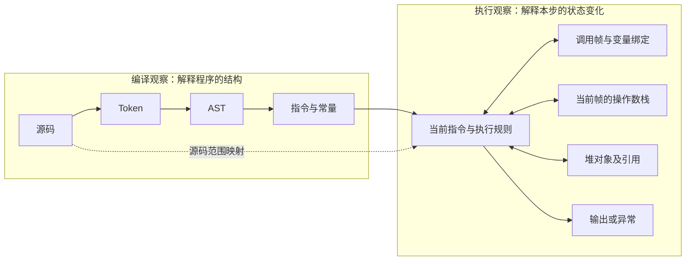
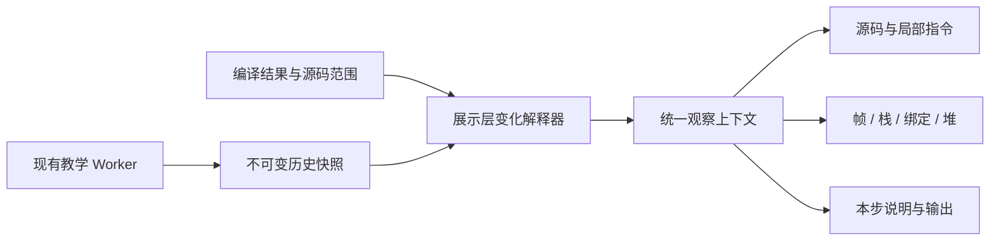

# 连贯的执行可视化：设计说明与图示

状态：产品方向已确认，作为 ADR-0002 的设计附件；应用改造尚未实施。日期：2026-10-30。

本文保留布局、栈与堆表达、动画及跨视图联动的图示与例子。正式决定以 [ADR-0002](../adr/0002-coherent-execution-experience.md) 为准，阶段与状态以[体验实施计划](../visual-execution-plan.md)为准。详细 spec/tasks 在实施前补充。当前实现基线为包含 review 修复的 `mini-vm-v5`。

## 1. 目标与已确认偏好

用户反馈：栈、堆及动画不够直观，源码、中间表示、执行指令和运行状态之间缺少连贯关系。

**已确认：默认按源码语句讲解，允许展开到每条指令。**

希望用户每按一次“下一步”，都能回答：

1. 当前在执行哪段源码？为什么轮到它？
2. 这段源码对应哪些指令，本次实际经过了哪些指令？
3. 指令从哪里读取数据，向哪里写入？
4. 当前帧、操作数栈、变量绑定和堆对象分别发生了什么变化？
5. 为什么会跳转、进入函数、返回或报错？

成功标准是用户可以预测并解释下一步，而不是页面同时展示更多内部字段。

**已确认：采用执行现场为主的布局，以教学模式作为新版默认入口，先验证别名与函数调用；“机器码”停留在概念说明，真实底层指令观察留待以后。** 同时提供可点击的中英文使用说明。接受设计方向不等于功能已经发布。

## 2. 当前体验为什么不连贯

以下是基于当前组件与样式的结构分析；本轮内置浏览器连接失败，未完成新版页面的视觉实测。

| 当前结构 | 理解上的负担 | 建议改变 |
| --- | --- | --- |
| `App.tsx` 的源码区与右侧结果区分栏；`TeachingVmPanel.tsx` 先放 AST/完整指令，再放运行状态 | 执行原因和执行结果相距较远，常需滚动才能对照 | 将当前动作和运行现场放在同一工作区 |
| AST 和完整指令表占据较大固定区域 | 编译细节持续占据视线，当前一步缺少主次 | 执行时显示局部指令；完整编译材料按需展开 |
| 值栈按数组条目排列，活动帧中又有栈与变量展示 | 缺少明确的栈顶方向；容易把变量表、调用栈、操作数栈当成同一件事 | 用明确分区和稳定空间位置表达四种概念 |
| `TeachingHeapPanel.tsx` 以对象清单、引用按钮和滚动定位为主 | “能跳到同一对象”还不能直接表达“两个名字共享一个对象” | 同屏画出绑定与引用关系，保持对象位置稳定 |
| 指令有刚执行、下一条等状态，源码联动另由 `sourceLink` 管理 | 手动选择与运行跟随容易出现两个视觉焦点 | 将执行焦点与手动检查焦点分开定义，共用观察坐标 |
| 动态效果主要是状态提示与滚动 | 数字改变了，但看不到变化的来源与去向 | 用有语义的入栈、运算、绑定、调用和返回过渡 |

现有数据基础较完整：教学 VM 已提供源码范围、指令索引、帧 ID、各帧栈和变量、对象 ID、堆快照、输出及历史。优化的第一步可以聚焦展示层，不必先重写解释器。

## 3. 先建立准确的概念地图

### 3.1 编译链与运行现场是两种关系

不要画成“源码 → AST → 机器码 → 栈 → 堆”的单线流水线。栈与堆是执行时共同参与的数据结构，不是后续编译产物。



每次运行只更新执行焦点和运行状态，不重播一遍词法分析与 AST 构建。编译观察可以有一次性的生成演示，但须清楚标为编译过程。

### 3.2 两种引擎保留不同的证据边界

| 视图 | 主任务 | 可以展示 | 不能冒充 |
| --- | --- | --- | --- |
| 教学演示 | 把一步的因果讲清楚 | 教学指令、教学操作数栈、帧、变量绑定、列表/字典堆和动画 | CPython 内部值栈、真实内存地址 |
| CPython 实证 | 核对真实编译与执行结果 | 真实 Tokens/AST/代码对象/字节码、已记录事件和变量快照 | 逐 opcode 的真实内部状态，跨事件稳定的真实对象图 |

已决定以教学演示作为新手主路径，保留明显的“查看真实 CPython”入口；默认入口随 V1 发布切换。切换时沿用清理旧会话的规则，不把两套状态混在同一运行现场中。

可以按同一源码片段对照两种编译结果，但映射是多对多的；不能按指令序号一一对齐。常量折叠、版本差异或不支持的语法均应如实呈现。

### 3.3 “机器码”放在哪一层

CPython 字节码与教学指令都不是 CPU 机器码。[Python 的 `dis` 文档](https://docs.python.org/3.14/library/dis.html)将其定义为解释器使用的字节码，且指令随版本变化。

[Pyodide](https://pyodide.org/en/stable/project/about.html) 是基于 WebAssembly/Emscripten 的 Python 发行版。概念说明可以展示：

```text
用户源码 ──编译──> CPython 字节码
                       │ 由解释器处理
                       ▼
              浏览器中的 CPython / Pyodide
                       │ 运行于 WebAssembly 环境
                       ▼
               浏览器运行时与底层 CPU
```

这张图是环境关系图，不表示用户的每条 Python 指令都有一条可直接观察的 Wasm/CPU 指令。本轮不承诺原生机器指令、寄存器、物理地址或逐条机器指令执行；如需要，应另立范围和可行性验证。

## 4. 工作区：一个动作，一个观察位置

### 4.1 桌面布局草图

```text
┌────────────────── 沿用公共站点外壳 ───────────────────┐
│ 教学演示 · mini-vm-v5     示例 / 自由代码     编译 / 执行 │
├───────────────┬───────────────────────────────────────┤
│ 源码          │ 本步：通过 b 修改 list #1 的第 0 项       │
│               │ 第 3 行 · 当前帧 <module> · 教学执行       │
│ 1 a = [1]     ├──────────────────┬────────────────────┤
│ 2 b = a       │ 调用帧 / 变量     │ 堆对象              │
│▶3 b[0] = 9    │ <module>         │                    │
│ 4 b = [2]     │  a ──────────────┼──> list #1         │
│               │  b ──────────────┼──> [0] 1 → 9       │
│ 当前语句指令  │                  │                    │
│ LOAD_CONST 9  │ 操作数栈         │                    │
│ LOAD_NAME b   │ TOP: 0           │                    │
│ LOAD_CONST 0  │      list #1     │                    │
│ STORE_SUBSCR  │      9           │                    │
├───────────────┴──────────────────┴────────────────────┤
│ 本步前/后差异             输出                         │
├───────────────────────────────────────────────────────┤
│ 上一记录  下一语句  展开指令  播放/暂停  节奏  观察时间轴 │
│ 正在看第 8 步 · 执行头第 8 步；历史截断时明确显示边界     │
└───────────────────────────────────────────────────────┘
按需展开：AST / 完整指令；CPython 另有 Token / 代码对象元数据
```

上图的栈是 `STORE_SUBSCR` 前态，`1 → 9` 是即将提交的变化预告；正式界面需标明“执行前 / 本次变化 / 执行后”，不能把不同时间的状态伪装成一个快照。

- 源码固定为位置参照；当前动作与运行现场占主要面积。
- 指令区默认只显示当前语句实际经过的指令以及少量前后文；保留打开完整指令表的入口。
- 活动调用帧展开；其他帧显示函数名、帧 ID、调用点和返回位置。点击其他帧只改变检查对象，执行焦点仍在活动帧。
- 变量绑定与操作数栈放在所属帧中，但保持不同标题、排列与形态。避免重复出现两套“当前栈”。
- 普通运行以平面结构为主；不做 3D 内存、自由拖拽无限画布或物理碰撞。

### 4.2 三种观察深度

| 深度 | 默认内容 | 操作含义 |
| --- | --- | --- |
| 语句讲解，默认 | 本语句说明、相关源码、重要数据变化 | 沿用源码 Step Over 的边界；循环行可能再次出现，函数调用可以概括 |
| 指令展开 | 仍保留的实际指令序列与每个栈变化 | 在已有记录中逐指令观察；到执行头时才请求新的 VM 单步 |
| 编译观察 | AST、常量池、完整指令及映射；CPython 另有 Tokens/代码对象 | 静态检查，不改变程序执行位置 |

语句层的动画是已有执行记录的分组展示，不是新的 VM 原子性承诺。源码步进中遇到断点、错误或预算终止时立即停在真实位置，不为“讲完这一句”继续执行。

初版可按现有源码步进的行与帧边界分组，明确这是该教学子集的操作定义；多行表达式等能力扩展后，再单独设计语句 ID 和分组规则。

当前教学编译结果不传输 Tokens；教学模式的 Token 观察不计入首轮纯布局调整。若需要，再单独讨论数据合同扩展。一次 Step Over 也可能超过历史预算，指令展开必须标明“前缀已截断”，不能将剩余后缀称为完整语句过程。

### 4.3 窄屏

- 768px 左右改为源码/当前动作在上、运行现场在下，控制区紧邻当前动作。
- 320px 使用纵向帧、栈、堆分区和文字引用标签，如“a、b → list #1”；长距离连线收敛为可点击的同一对象标记。
- 不能依靠缩小字号或整页横向滚动保留桌面四区。
- 手动检查时不自动跳滚；提供“跟随执行”返回主焦点。

## 5. 栈、帧、绑定与堆的视觉语法

| 概念 | 空间与形态 | 关键动作 | 必须防止的误解 |
| --- | --- | --- | --- |
| 操作数栈 | 活动帧内竖向槽位，顶部标 `TOP`；空栈也保留容器位置 | 读值进入栈顶；运算取走操作数并放入结果 | 栈不是局部变量表；清空栈不代表变量消失 |
| 调用栈 | 按调用层级排列的帧，活动帧突出 | 调用新增帧，返回恢复调用者 | 递归时同名函数的帧不同；不能共用局部变量 |
| 变量绑定 | 名字槽及值/引用出口，属于对应作用域 | 新建、重新绑定、显示未绑定状态 | `b = a` 不必复制堆对象 |
| 堆对象 | 按对象 ID 保持位置，列表有索引槽，字典有键值槽 | 创建对象、修改条目、建立引用 | 卡片是教学对象身份，不是地址或按字节排列的物理内存 |

显示标量时沿用教学 VM 的简化值模型，在说明中明确这一点。不能由此推出“Python 的整数在栈上，只有容器在堆上”；[Python 内存文档](https://docs.python.org/3.14/c-api/memory.html)说明 Python 对象与数据结构由私有堆管理。

引用线策略：

1. 所有对象保持稳定位置；选择变量或对象时才强调相关入边、出边，其他连线淡化或隐藏。
2. `a`、`b` 指向同一对象时，两条线汇入同一张卡片；不绘制两份内容相同的独立对象。
3. 循环引用画回边，不能递归展开成无穷嵌套列表。
4. 栈顶临时引用也可连向对象；出栈只移除该临时引用。
5. 对象从当前可达快照消失，只标为“本快照不再显示”；不播放“释放真实内存”或“完成 GC”的效果。
6. 暂不显示推算的引用计数；可显示“当前可见引用”，且不能把它当作 CPython 引用计数。

## 6. 动画围绕可解释的变化

### 6.1 一次动作的节拍


这是对一次已经确定的执行变化的讲解节拍，中间画面不是额外的 VM 状态。示例的动作节奏可先用 150–250ms 定位、250–450ms 数据移动、150–250ms 提交进行原型比较；数值是待验证的设计起点，不是性能承诺或最终规格。停留时间可随用户节奏调整。

| 动作 | 画面如何解释 | 一句说明示例 |
| --- | --- | --- |
| `LOAD_CONST` / `LOAD_NAME` | 从常量或已确认的绑定位置强调来源，值/引用进入栈顶 | “读取 b，压入对 list #1 的引用” |
| 算术 | 操作数保持左右角色，取出参与计算，然后压入真实结果 | “取 2 和 3，相乘得到 6” |
| `STORE_NAME` | 消耗栈顶，建立或改变名字绑定 | “b 现在也指向 list #1” |
| 建容器 | 堆中新建一张对象卡片，栈中出现引用 | “创建 list #2，并将其引用压栈” |
| 下标写入 | 强调值、对象、索引三个角色；只更新目标槽位 | “将 list #1 的第 0 项从 1 改为 9” |
| 调用 | 保留调用者位置，创建被调用帧并建立参数绑定 | “进入 bump，参数 xs 指向 list #1” |
| 返回 | 结果回到调用者操作数栈，然后关闭被调用帧 | “返回 2，回到调用位置之后” |
| 条件/循环 | 条件结果与选中的目标路径同时出现，未走路径弱化 | “条件为 False，跳到循环结束之后” |
| 输出 | 将新增文本追加到输出区，只强调本次新增部分 | “输出 [9]” |
| 异常 | 停在失败指令，展示实际保留状态与诊断 | “索引越界；该次写入没有成功” |

动画必须有明确语义。禁止每个面板同时闪烁、所有对象每步重新布局、自动滚动与数据飞行同时争夺视线。减少动态效果时，使用静态前后值、箭头和同样的文字说明，信息保持完整。

### 6.2 数据身份与动画身份

对象使用 `(runId, objectId)`；帧使用 `(runId, frameId)`；变量槽使用帧/作用域与名字。不要用显示文本辨认对象。

相同数值不代表同一个操作数。对一次运算中的两个 `1`，应按“这条指令消耗的第几个栈槽”分配短期视觉身份，而不是按字符串 `1` 配对。具体栈效果不能确定时，展示前后差异，不编造数据飞行路径。

## 7. 连贯性的核心：一个事实状态，分清执行与展示

### 7.1 统一观察坐标

建议增加一个轻量的展示层观察上下文；以下是讨论模型，尚未批准接口重构：

```text
Observation = 引擎 + 会话/源码版本 + reset 代次
            + 当前记录位置 + 活动帧 + 当前指令 + 源码范围

Transition = 前态 + 后态 + 类型 + 对应指令 + 已验证变化
类型       = instruction | control | fault
```

源码、指令、帧、栈、堆和变化说明从同一观察上下文取得当前位置，不分别维护自己的播放游标。

两个位置必须清楚区分：

- **执行头**：Worker 已真正执行到的位置。
- **观察位置**：用户正在看的已记录位置。

动画进度是表现细节，不是第三个可继续执行的位置。历史播放不重跑代码；历史位置点击 Continue 时先明确回到执行头，再继续原运行，沿用现有约束。

### 7.2 运行与播放

| 情况 | 建议行为 |
| --- | --- |
| 手动下一语句 | 历史位置先观察下一组已有记录；仅在执行头请求源码 Step Over，响应后按语句展示；只能展开仍保留的记录 |
| 展开指令后下一步 | 先消费已记录的下一条；到执行头才触发真实单步 |
| 自动慢速讲解 | 前端独占推进权，串行发送 `step-source(over)`，等待响应并完成展示后再发下一次；与 Worker 的 Run 互斥 |
| 快速执行 | 可直接合并展示结果，并明确“略过展示 N 条已执行指令”；可保留范围内仍能逐步回看 |
| 暂停 | 停止发出新请求；Worker 正在运行时显式发送 `pause`，等确认后清理过渡并显示确认后的状态 |
| 拖动历史 | 取消正在进行的动画，直接显示目标快照；只允许对相邻完整记录播放变化 |
| Reset、改源码、换引擎 | 废弃旧过渡与布局身份，阻止旧结果重新进入画面 |
| 历史被截断 | 显示最早可观察边界；缺少前态时只显示静态快照 |

现有 Run 在 Worker 内自主推进，单靠 UI 停止发请求或停止动画不能暂停它。这里提出的是新的展示调度方式，不能暗示当前速度档已经控制动画。原有 Run 的执行速度与演示停留时间需要分别定义。

一次源码步进进入函数后，可能执行上千条指令，起点与早期快照会在该组结束前被裁剪。分组需记录“完整 / 前缀缺失”状态，只允许展开现存范围。首轮不承诺保留所有过程；若要额外保存语句前态来生成摘要，需为这份数据单独定义有界预算，而不是绕过现有历史限制。

现有 `stepIndex` 包含控制停顿，`setStatus` 也可能替换最后一条记录，不能把每次快照更新都动画成“执行成功了一条指令”。应结合 `executedInstructionCount`、`lastExecutedInstructionIndex`、诊断和暂停原因识别变化类别。

### 7.3 首轮采用最小增量



- 先用相邻真实快照、指令语义和已有 ID 生成确定的变化；运算结果直接读取后态，不在 UI 再执行一套 Python 语义。
- 第一版覆盖入栈/出栈、运算、绑定、容器创建与更新、调用/返回。无法确认的原因退化为前后差异。
- 不为动画新建全局状态库、通用事件溯源框架或替换 Worker 协议。
- 若后续需要准确表达同名局部/全局读取来源等信息，再单独讨论由 VM 发送有界 effect 元数据。新增协议或依赖遵守仓库确认规则。
- 保持已有历史预算；展示队列也有界，不复制完整运行历史来换动画便利。

## 8. 用三个例子检验是否讲清楚

### 8.1 表达式：栈为何存在

```python
x = 1 + 2 * 3
print(x)
```

教学 VM 指令展开示意，栈书写顺序为“栈底 → 栈顶”：

```text
读取 1       [1]
读取 2       [1, 2]
读取 3       [1, 2, 3]
乘法         [1, 6]
加法         [7]
绑定 x       []              x = 7
```

观察重点：`x` 在计算完成之前并未完成本次绑定。真实 CPython 可能折叠常量表达式，因此本例不能用于声称两套指令逐条对应。

### 8.2 别名：修改对象与重新绑定不同

```python
a = [1]
b = a
b[0] = 9
b = [2]
print(a)
print(b)
```

```text
执行 b = a 后          执行 b[0] = 9 后       执行 b = [2] 后

a ─┐                   a ─┐                  a ───> #1 [9]
   ├──> #1 [1]            ├──> #1 [9]
b ─┘                   b ─┘                  b ───> #2 [2]
```

观察重点：对象数量依次是 1、1、2；第一次变化发生在对象内部，第二次变化发生在名字 `b` 的绑定上。箭头和对象位置比反复刷新两份变量字符串更能解释原因。

### 8.3 函数：引用跨帧共享，返回值进入调用者

```python
def bump(xs):
    xs[0] = xs[0] + 1
    return xs[0]

a = [1]
n = bump(a)
print(a)
print(n)
```

```text
<module> 帧                        bump 帧（活动）
  a ──────────┐                     xs ─────┐
  等待返回    ├──────────> list #1 <─────────┘
              │              [0] 1 → 2

返回后：bump 帧退出 → 2 进入 <module> 操作数栈 → n 绑定 2
        a 仍然指向 list #1 [2]
```

先用单次调用讲清帧，再用 `fact(3)` 等递归示例验证：同名函数有不同帧 ID、不同局部变量和各自的返回位置。

## 9. 方案取舍

| 方向 | 优点 | 代价 | 建议 |
| --- | --- | --- | --- |
| 原有面板加高亮/淡入淡出 | 改动小，容易回滚 | 仍需跨区域自行拼接原因与结果 | 可作为过渡，不作为完整目标 |
| 执行现场＋按需编译细节 | 源码、动作、状态集中；支持语句与指令两层 | 需调整布局与观察状态 | 已采用 |
| 全屏自由对象图/3D 内存 | 演示感强 | 布局漂移、遮挡与交互成本高；易误导内存语义 | 首轮不采用 |
| 同屏同步两套引擎 | 方便比较 | 容易暗示逐条对应，且增加状态与视线负担 | 先做按源码片段切换对照 |

不先追求完整的动画指令库。先让“计算、别名、调用”三类因果被看懂，再扩展控制流、递归、错误和复杂容器。

## 10. 实施入口

实施顺序、依赖、验收与回滚统一维护在[体验实施计划](../visual-execution-plan.md)。V0 先提供双语帮助入口，V1–V6 分别推进静态执行现场、变化说明、栈与引用动画、调用返回、控制流及真实 CPython 对照。本文不另行维护阶段状态。

使用说明正文见[中文](../guide/usage.zh-CN.md)与[English](../guide/usage.en.md)。应用内入口、独立静态帮助页和共享语言接入属于 V0，目前尚未实现。

## 11. 验证方式

### 11.1 理解效果

先用小规模观察测试验证方向，不把人数或通过率当成已有研究结论。可邀请 3–5 位目标用户，给同一示例，让他们在操作后回答：

- 乘法执行前，栈顶的两个数是什么？`x` 此时是否已完成赋值？
- `b = a` 后有几个列表？修改 `b[0]` 为什么会影响 `a`？
- `b = [2]` 为什么不再修改 `a`？
- 进入 `bump` 后哪个帧活动？返回值先去哪里？
- 现在看到的是运行头、历史记录，还是某一步的过渡解释？

记录误答原因、来回滚动次数及必须打开的面板，而不只收集“更好看”的主观评价。若静态图已能解释问题，动画应该减少推理负担，不能成为理解的必需条件。

### 11.2 技术验收

- 变化解释器对相同值、别名、重新绑定、嵌套容器、循环引用、函数/递归、错误和控制停顿给出正确结果。
- 快照前后态与解释结果一致；动画完成后与直接渲染后态一致。
- Pause、Reset、源码修改、切换引擎、快速连续操作不留下旧动画和旧连线。
- 历史截断、缺失前态、快速播放跳过展示均有准确状态说明。
- 键盘能够访问所有控件；`prefers-reduced-motion` 下保留完整含义；动态播报只在完整步完成时发生。
- 在 320/768/1024/1440px 验证布局，窄屏无整页横向溢出；连线不遮住文字或控件。
- 使用有界可见对象和连线；达到现有运行预算时仍能操作。具体渲染性能预算在目标设备测量后写入 spec。
- 复用既有 `typecheck`、单元测试、构建和真实页面测试，增加覆盖实际过渡语义的用例，不以截图相似代替运行正确性。

## 12. 决策归档

原讨论中的四项决定已全部确认，机器码范围明确为概念说明；新增双语使用说明与可点击入口。决策及取舍记录在 [ADR-0002](../adr/0002-coherent-execution-experience.md)。布局尺寸、具体动画时长、控件文案和数据接口在各阶段 spec 中细化，未做过的视觉实测与用户理解测试不记为已完成。
