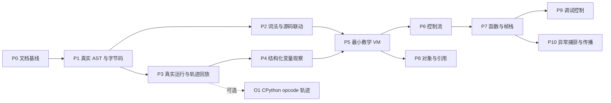

# Python 解释器实验室整体实施计划

## 1. 目标与当前状态

目标是在纯前端应用中交互观察 Python 从源码、编译产物到执行状态的全过程。已确认顺序为：**Pyodide 真实编译视图 → 真实执行轨迹与回放 → 教学 Mini VM 的逐指令交互**。架构理由和能力边界见 [ADR-0001](adr/0001-browser-python-visualizer.md)。

P0 文档基线及 P1–P7 双引擎路线均已完成并发布到 `master`。P1–P5 的 GitHub Pages、Cloudflare Pages 和线上验收通过；P1、P2 证据分别见 [P1 spec](specs/p01-real-cpython-compile-view.md)、[P1 tasks](tasks/p01-real-cpython-compile-view.md) 与 [P2 spec](specs/p02-token-source-linkage.md)、[P2 tasks](tasks/p02-token-source-linkage.md)，P3 证据见 [P3 spec](specs/p03-real-execution-trace.md) 与 [P3 tasks](tasks/p03-real-execution-trace.md)，P4 证据见 [P4 spec](specs/p04-structured-variable-history.md) 与 [P4 tasks](tasks/p04-structured-variable-history.md)，P5 证据见 [P5 spec](specs/p05-minimal-teaching-vm.md) 与 [P5 tasks](tasks/p05-minimal-teaching-vm.md)，P6 验收、发布及线上证据见 [P6 spec](specs/p06-control-flow.md) 与 [P6 tasks](tasks/p06-control-flow.md)。P7 函数、作用域与帧栈已于 2026-10-29 合并并发布，线上验证与尚未完成的 `pi` 检查见 [P7 tasks](tasks/p07-functions-and-frames.md)。

P0 建立了以下文档：

| 文件 | 单一职责 |
| --- | --- |
| [AGENTS.md](../AGENTS.md) | 应用稳定约束与条件式阅读入口 |
| [CLAUDE.md](../CLAUDE.md) | 仅导入同目录 AGENTS |
| [ADR-0001](adr/0001-browser-python-visualizer.md) | 总体路线、备选方案、执行边界及取舍 |
| 本文 | 阶段、依赖、启动条件、验收与回滚 |

详细 spec 和 tasks 在对应阶段开始实施前创建，不预建空文件，也不把整体路线视为已批准所有依赖和接口细节。P1–P6 的规格记录各自已发布范围；P7 的参数、返回、作用域和递归边界已在 [P7 规格](specs/p07-functions-and-frames.md)中确认，按 [P7 tasks](tasks/p07-functions-and-frames.md)实施。

## 2. 阶段启动方式

每次开始一个阶段，先读取相关 ADR 和本计划，核对仓库现状，再补充两份文件：

- `docs/specs/pNN-<topic>.md`：该阶段用户行为与实现必须遵守的具体规格。
- `docs/tasks/pNN-<topic>.md`：落实该规格的可执行任务、真实前置及验证记录。

这些目录和文件在实际阶段开始时再创建。每个文件使用相同阶段编号；具体名称由该阶段确定。若一个阶段无法形成可独立验收的小改动，先在该阶段 tasks 中拆成纵向切片，不拆成只有 Parser、只有 VM 或只有 UI 的长期孤立任务。

### 2.1 阶段 spec 必须回答

| 项目 | 必须具体化的内容 |
| --- | --- |
| 用户目标与范围 | 何种代码、哪些操作、可观察的学习结果；明确尚不支持什么 |
| 前端集成 | 遵循应用 [AGENTS.md](../AGENTS.md) 与[站点外壳契约](../../../packages/site-shell/README.md)；spec 记录本阶段新增或改变的界面行为、语言、键盘、窄屏及构建验证，不另起共享导航或语言方案 |
| 引擎与版本 | Pyodide/CPython 或教学指令集版本，支持语法与可视化能力 |
| 状态与事件 | 初态、操作顺序、分析/执行/回放状态、异常和取消、源码变更后的行为 |
| 数据与接口 | 当前实际消费者需要的输入输出、身份和来源、顺序、生命周期及错误约定 |
| 资源与兼容 | 源码、事件、输出、对象、执行时间等预算；目标浏览器、静态资源来源和依赖 |
| 交互与可访问性 | 面板关系、键盘操作、长内容和窄屏处理、中英文及降低动画偏好 |
| 验收 | 具有独立预期的正常、错误和边界样例；如何测试、如何回滚 |

新增依赖、复杂接口或新实现范式，先列出最小选择、理由和影响，按用户及根规则确认。已确认的 Pyodide 优先路线不需要反复征询。

### 2.2 阶段 tasks 必须回答

每项任务注明对应 spec 条目、前置任务、改动边界、用户可见结果、验证方式和完成证据。尚未验证、只完成文档、仅通过内部单测与已上线必须分别记录；任务依赖只引用真实需要的前置，不为便于排期制造无关依赖。

## 3. 里程碑与依赖

| 里程碑 | 包含阶段 | 用户可获得的结果 |
| --- | --- | --- |
| M1 真实编译观察 | P1–P2 | 输入代码，观察真实 AST、代码对象、Tokens 与字节码，并与源码联动 |
| M2 真实执行观察 | P3–P4 | 运行代码，查看行与函数轨迹、变量变化、输出和异常，浏览历史 |
| M3 教学执行 | P5–P7 | 从表达式到控制流和函数，真正逐条执行教学字节码并观察值栈和帧栈 |
| M4 深入交互 | P8–P10 | 对象引用、调试控制和异常传播教学；继续使用已有真实视图对照 |



P5 等待 M1/M2 完成是已确认的产品优先顺序，不表示教学解析器需要消费 CPython 的编译结果。P2 与 P3 在 P1 后可独立实现；P8/P9/P10 按图中实际前置开展。每个阶段都沿用当时已发布能力，可在前置完成后单独发布，并在尚无依赖它的后续改动时独立回退；已有后续依赖时，应一并回退实际依赖的改动，或提供兼容修复，不能只删除前置能力。

## 4. 阶段范围、验收与回滚

### P0：文档基线（已完成）

- **范围**：功能分支、应用目录、AGENTS/CLAUDE、整体 ADR 和 plan，确认两类引擎的推进顺序。
- **完成标准**：文档间无矛盾或失效文件链接；`pi` 能启动加载本应用契约，并按指针真实读取 ADR/plan；Markdown 差异检查通过，成品复制完成。
- **边界与回滚**：P0 本身不登记导航、不创建依赖清单和应用代码。回退 P0 文档提交即可，不影响站点运行。

### P1：真实 AST、代码对象与字节码（已完成并发布）

- **前置**：P0；已在 [P1 spec](specs/p01-real-cpython-compile-view.md) 中确定 UI 最小方案、Pyodide 314.0.7 与对应 CPython 版本展示方式、固定版本 CDN 资源及浏览器验收范围。
- **交付**：用户可输入或选择示例、点击分析，在 Worker 内得到 AST、代码对象和真实反汇编；可选择嵌套函数代码对象；展示版本、加载状态、语法/编译错误及取消恢复。分析不执行用户代码。
- **集成**：已建立独立 React + TypeScript + Vite 应用、pnpm lockfile、可执行安装脚本、独立 `build`/`test:ci` 和 `dist/`；`build` 先做类型检查再构建。Vite 使用 `base: './'`，在 `/python-interpreter-lab/` 子路径下验证了入口、样式和 module Worker，并经 Pyodide CDN 初始化后登记 catalog。catalog 含中英文标题和简介。HTML 通过 `@wishflow/site-shell` content 插槽接入共享壳，设置 slug、双语标题和 `../` 站点链接；React 入口导入共享壳。单页未启用空侧栏。
- **验收**：`x = 1 + 2` 展示实际常量折叠结果；含 `def` 的源码能区分模块与函数代码对象；缩进错误、AST 成功但编译失败、资源加载失败和分析取消都有正确反馈；后续再次分析可成功。
- **路径验收**：检查以 `/python-interpreter-lab/` 为 base 的生产产物资源路径，而非只通过 Vite 根路径 dev server。
- **当前结果**：应用类型检查、6 条单测与 5 条浏览器用例通过；根 `pnpm run test:catalog` 的 14 条检查通过；`pnpm run build:site` 生成 `_site/python-interpreter-lab/`。首次推送后的 workflow `40748933722` 因 pnpm 12 未批准 `esbuild` 安装脚本而失败并跳过部署；新增应用本地 `allowBuilds.esbuild` 后，pnpm 12.15.0 冻结安装与完整应用 `test:ci` 通过。修复后的 workflow `40750421138` 中共享检查、Python 应用测试、GitHub Pages 和 Cloudflare Pages 均成功。Codex 内置浏览器在 `https://wishflow-tools.pages.dev/python-interpreter-lab/` 实测得到 Pyodide 314.0.7 / CPython 3.14.2、模块 `LOAD_SMALL_INT 3`、嵌套 `add` 函数 `BINARY_OP`，并确认共享语言切换到英文后恢复中文正常。发布门通过。
- **回滚**：回退应用登记及首版提交，恢复此前静态站点。只回退应用自身文件及本阶段必需的共享登记，不改变其他应用。

### P2：词法观察与源码联动（已完成并发布）

- **前置**：P1 已发布；P2 spec 已确认 Python tokenizer/AST/bytecode/textarea 的位置单位和转换边界。
- **交付**：真实 Token 面板、AST 节点与字节码到源码的定位；源码选择可观察相关 Token/节点/指令，选择 Token、节点或指令可定位其源码范围。允许无对应项及多个相关项。
- **验收**：赋值、多行表达式、中文标识符、emoji 字符串和 Tab 位置准确；常量折叠不会产生虚构指令；结构 Token、空白和注释不伪造映射；源码更改后旧映射失效；具体场景见 [P2 spec](specs/p02-token-source-linkage.md)。
- **当前结果**：应用 `pnpm run test:ci` 通过（11 条单测、8 条 Playwright）；根 `pnpm run test:catalog` 14 条检查通过，`pnpm run build:site` 成功。推送 `a062421` 后 workflow [40765644524](https://github.com/wishflow/wishflow-tools/actions/runs/40765644524) 的共享检查、Python 应用测试、GitHub Pages 和 Cloudflare Pages 均成功。线上 `https://wishflow-tools.pages.dev/python-interpreter-lab/` 实测 CPython 3.14.2 返回 19 个 Token，运算符显示 `OP · PLUS`；定位 emoji 字符串精确选择 `"🐍"`，点击 `BINARY_OP` 选择 `left + right`，并联动高亮 3 个 Token 与 AST 节点。P2 已独立发布，后续按 P3 的启动规则继续。
- **回滚**：移除新增观察与联动能力，P1 独立分析仍可用。

### P3：真实运行、轨迹与回放（已完成并发布）

- **前置**：P1；确认执行会话、输出捕获、事件时机、停止恢复及录制预算。
- **交付**：运行当前源码，记录用户帧的行、调用、返回和异常事件，捕获输出；显示调用关系和基础值摘要；录制完成后可播放、暂停、调速及按事件前后移动。停止运行与暂停播放使用不同控件或明确状态。
- **验收**：循环显示多次行事件；函数能读取顶层全局变量；异常显示已产生输出及最终结果；事件前/后状态标识准确；回放不重复执行 `print`；死循环可终止并重新运行；旧会话响应不混入新会话。
- **具体规格与任务**：[P3 spec](specs/p03-real-execution-trace.md)；[P3 tasks](tasks/p03-real-execution-trace.md)。固定 Pyodide 314.0.7 / CPython 3.14.2，通过 `sys.settrace()` 记录 `<input>` 用户帧；单次运行上限 5 秒、轨迹 5,000 项、输出 32,768 码点，并限制快照字段长度。停止或超时时终止 Worker，回放只浏览已录制事件，不重新执行代码。
- **当前结果**：应用 `pnpm run test:ci` 通过（13 条单测、15 条 Playwright）；根 `pnpm run test:catalog` 14 项通过，`pnpm run build:site` 成功。Playwright 实测 CPython 调用/行/返回与异常、全局读取、循环重复行、事件回放不重复输出、停止/超时/Retry、源码编辑清理旧轨迹、事件与输出上限及 320/768/1024/1440px 布局。提交 `bdba3e8` 推送后，workflow [40810018154](https://github.com/wishflow/wishflow-tools/actions/runs/40810018154) 的共享检查、Python 应用测试、GitHub Pages 和 Cloudflare Pages 均成功。线上固定版本 CPython 3.14.2 实测全局变量函数输出 `42`、8 个事件、源码行定位及回放输出；死循环可停止，重载运行时后再次运行成功。P3 已独立发布，下一阶段按 P4 启动规则补充 spec/tasks。
- **回滚**：回退运行与轨迹入口，保留静态编译观察。终止或超限留下的历史明确标为不完整。

### P4：结构化变量与历史观察（已发布）

- **前置**：P3 已发布；[P4 spec](specs/p04-structured-variable-history.md) 与 [P4 tasks](tasks/p04-structured-variable-history.md) 已确认。
- **交付**：按事件查看各帧局部/全局变量、基础容器、有限深度展开和相邻事件变化；历史快照保持事件发生时的值。P3 的基础值摘要继续可用。
- **验收**：局部/全局作用域与帧切换正确；列表先后修改不会污染旧事件；大整数不失真；循环引用、长字符串和深容器可控展示；自定义 `repr`、属性或迭代器不会因查看变量被执行；截断范围不误报变量增删；异常与连续运行后代理和采集资源正确释放。详见 P4 spec §6。
- **验证与发布**：应用 `pnpm run test:ci` 通过（19 条单测、20 条 Playwright）；根 `pnpm run test:catalog` 14/14 通过，`pnpm run build:site` 成功。提交 `85719da` 合入 `master` 后推送提交 `ec062c7`；workflow [40819932964](https://github.com/wishflow/wishflow-tools/actions/runs/40819932964) 中共享检查、Python 应用测试、Cloudflare Pages 和 GitHub Pages 均成功，Worker 部署按变更分类跳过。线上 [Cloudflare Pages](https://wishflow-tools.pages.dev/python-interpreter-lab/) 实测 Pyodide 314.0.7 / CPython 3.14.2：嵌套 `outer`/`inner` 帧分别显示 `parent`、`child` 局部变量；相邻事件差异显示列表从 `[1]` 变为 `[1, 2]`；移动观察位置和切换视图未重新运行代码或增加事件。
- **回滚**：恢复 P3 的基础摘要；本阶段不引入跨版本历史持久化，不需要存档迁移。

### P5：最小教学 VM，打通真正逐指令执行（已完成并发布）

- **前置**：M1/M2 已发布；本阶段按 P5 v1 spec 的语言子集、教学指令版本与数字/字符串语义实施。
- **交付**：引入教学模式；表达式、名字赋值和最小 `print` 调用经 Lexer → Parser → AST → Compiler → VM 执行；提供单条指令、运行、暂停、重置，以及指令、值栈、变量、输出和有界历史快照。首个可见 VM 切片包含完整输入到结果链路。
- **验收**：先赋值 `x = 1 + 2 * 3`、下一行 `print(x)` 的逐步栈变化及结果可核对；非法或未支持语法在执行前诊断，运行期才能确定的不支持操作明确报错、不降级语义；教学指令不标作 CPython offset；与真实模式切换从新会话开始，已有 CPython 能力不回归。
- **详细文档**：[P5 规格](specs/p05-minimal-teaching-vm.md) 与 [P5 任务拆分](tasks/p05-minimal-teaching-vm.md)。范围变更按 spec §10 更新文档并确认影响；阶段进度以 tasks 执行记录为准。
- **当前结果**：P5 v1 已实现并发布。应用 `PLAYWRIGHT_PORT=4187 pnpm run test:ci` 通过（39 项单测、24 项 Playwright），根 `pnpm run test:catalog` 通过（14 项检查），`pnpm run build:site` 成功。合并提交 `88a0fad` 推送后，workflow [40838287683](https://github.com/wishflow/wishflow-tools/actions/runs/40838287683) 的共享检查、Python 应用测试、GitHub Pages 与 Cloudflare Pages 均成功，Worker 部署按变更分类跳过。2026-10-29 在 [Cloudflare Pages](https://wishflow-tools.pages.dev/python-interpreter-lab/) 实测教学 VM：`x = 1 + 2 * 3` / `print(x)` 生成 9 条 `mini-vm-v1` 指令并运行输出 `7`；切回真实 CPython 后，Pyodide 314.0.7 / CPython 3.14.2 正常生成 AST 与真实字节码。逐项证据见 [P5 tasks](tasks/p05-minimal-teaching-vm.md)。
- **回滚**：回退教学模式入口和该引擎，真实模式仍可独立构建运行。不得用替换真实引擎来简化首个教学实现。

### P6：控制流、短路与循环

- **前置**：P5；比较、真值、短路、缩进和循环支持表已由用户确认。
- **交付**：按已确认规格支持 `if/elif/else`、`while`、受限 `for/range`、布尔表达式与比较；展示条件、短路和循环如何改变下一条教学指令。任务按表达式、分支、循环等可独立验收的完整输入到输出切片展开。
- **详细文档**：[P6 规格](specs/p06-control-flow.md) 与 [P6 任务](tasks/p06-control-flow.md)。T01–T06 已完成并发布；本地、CI 和线上验收证据见 P6 tasks。
- **验收**：未选中分支和短路右侧不执行；循环回跳、range 边界和嵌套正确；空循环、零次循环和动态步数超限可解释；对已确认的共同子集，与固定 CPython 的最终输出和错误类别对照。
- **回滚**：撤回新增语法支持及示例，保留 P5；旧版语言边界继续显式显示。

### P7：函数、作用域与帧栈

- **前置**：P6；用户已确认参数、返回、局部/全局名字解析、`None` 和递归边界。
- **交付**：`def`、必需位置参数调用、返回及递归范围内的执行；逐步展示新帧进入、每帧独立值栈与变量、返回值如何回到调用方。闭包、默认参数、关键字/可变参数、`global/nonlocal` 和函数值均不在本阶段支持范围。
- **详细文档**：[P7 规格](specs/p07-functions-and-frames.md)与[P7 tasks](tasks/p07-functions-and-frames.md)。本阶段将教学指令集从 `mini-vm-v2` 升至 `mini-vm-v3`；当前任务状态与验证记录见 tasks。
- **验收**：函数调用与嵌套调用结果正确；同名局部变量不污染其他帧；递归帧身份不同；局部未绑定错误与名字绑定规则一致；活动帧和动态指令上限可恢复；Pyodide/CPython 3.14.2 对照支持子集结果。
- **进度**：T01–T05 实现与本地验证已完成；功能已合入并发布。T06 的 CI、部署和正式页面实测已完成，应用契约的 `pi` 实际加载仍待验证，详见 [P7 tasks](tasks/p07-functions-and-frames.md)。
- **回滚**：撤回函数能力及相关示例，P6 的模块级执行仍可用。

### P8：列表、字典与对象引用

- **前置**：P5；本阶段无需等待调试控制或异常捕获。
- **交付**：在明确支持的索引、读写和构造规则内支持列表/字典；展示变量绑定和对象身份，观察别名与修改；对象图仅在数据模型和最小布局确定后加入。
- **验收**：依次执行三行 `a = [1, 2]`、`b = a`、`b[0] = 9`，两个名字指向同一对象；历史中修改前的对象保持原值；复制、新建对象与别名可区分；不支持的键类型、越界和循环引用均有清晰行为。
- **回滚**：撤回容器语法及对象图，既有标量执行继续可用；不改变其他引擎输出格式。

### P9：教学调试控制

- **前置**：P7；确认停止位置、断点命中/恢复、行步进及调用深度语义。
- **交付**：源码行和教学指令断点、Step Line、Step Into/Over/Out、继续及执行速度控制。时间轴浏览旧快照时，继续执行要求返回执行头；不实现历史分叉。
- **验收**：同一行多条指令、同一行循环、递归、调用后返回、断点后继续都停在规定位置；Continue 不在同一暂停点立即重复命中；根帧 Step Out 和结束后的操作有明确反馈。
- **回滚**：撤回高级调试入口，P5 的逐指令单步及各阶段语言能力仍工作。

### P10：教学异常捕获与传播

- **前置**：P7；确认首批异常类型、`try/except/raise` 子集与帧展开规则。
- **交付**：可视化异常产生、匹配处理器、跨函数传播和未捕获终止；基础 VM 错误仍沿用此前阶段已定义的结果。`finally`、上下文管理器等是否纳入另行明确。
- **验收**：已捕获异常可继续执行；未捕获异常按预期展开帧；错误不会留下可继续执行的损坏状态；分别与固定 CPython 核对支持子集的输出和异常类别。与 P9 组合时，断点和步进语义需补充集成验收。
- **回滚**：撤回异常语法，保留此前的基础运行错误展示及其他功能。

### O1：可选的真实 opcode 轨迹

- **前置**：P3；仅在需要更精确真实指令轨迹时立项，不阻塞 M3/M4。
- **交付候选**：通过 `f_trace_opcodes` 记录指令事件并映射到同一 code object 的反汇编，仍采用观察/回放语义。
- **进入条件**：先确认选定版本的 `f_lasti`、offset、缓存/专门化处理和事件量预算，实测后决定是否实现。
- **验收与回滚**：实际事件可追溯、额外开销满足预算；不展示虚构的 CPython 值栈。可独立撤回并保留 P3 行级轨迹。

## 5. 功能归属与范围边界

| 功能 | 首次交付阶段 | 说明 |
| --- | --- | --- |
| 编辑源码、真实 AST、代码对象和字节码 | P1 | 使用固定版本；分析与执行分开 |
| Tokens 与源码/AST/指令联动 | P2 | 展示观察结果，不模拟 CPython parser 内部运行 |
| 真实运行、输出、异常、调用轨迹、时间轴 | P3 | 控制的是录制后的观察位置 |
| 结构化变量和事件间变化 | P4 | 有界快照，不等于任意对象内部状态 |
| 教学字节码、实时单步、值栈和基础历史 | P5 | 自定义指令集，明确教学语义 |
| 分支与循环 | P6 | 包括所需短路和条件语义 |
| 函数调用与帧栈 | P7 | 各帧拥有独立状态 |
| 对象引用图 | P8 | 包括别名与可变对象历史 |
| 行/指令断点和函数步进 | P9 | 区分执行头与历史游标 |
| `try/except/raise` 教学 | P10 | 基础报错无需等到本阶段才出现 |
| CPython 精确 opcode 事件 | O1 | 可选，非实时值栈调试 |

不在本计划中隐含承诺：Mini VM 完整 Python 兼容、真实解释器状态恢复、第三方包管理、账号/云端持久化、共享代码自动执行和后端服务。需要时先补充目标及 ADR，不塞进现有阶段。

## 6. 关键风险与实施前待决事项

| 风险或待决项 | 必须处理的时点 | 具体动作 |
| --- | --- | --- |
| UI 技术栈、编辑器依赖 | P1 spec（已确定） | 采用 React/TypeScript/Vite 与原生 textarea，不额外引入编辑器依赖；后续图形库在 P8 再定 |
| Pyodide/CPython 版本与资源托管 | P1 spec（已验证主要链路） | 固定 Pyodide 314.0.7 CDN，显示运行时 CPython 3.14.2；已验证加载、失败重试及子路径访问，尚未形成加载耗时或离线表现承诺 |
| 浏览器、窄屏、键盘与动画预算 | P1 spec（本地通过） | 浏览器用例覆盖 320/768/1024/1440px、键盘焦点和共享语言切换；样式尊重减少动态效果偏好，其他浏览器兼容性随阶段扩展 |
| 运行占满 Worker、无法取消 | P1/P3/P5 | 分别验证分析终止、执行终止、教学步进让出；测量停止延迟 |
| 源码与引擎/版本不匹配 | P1 起 | 每个结果带明确来源，重置和编辑后拒绝旧结果 |
| trace 事件时机或异常状态误导 | P3 spec | 先用小案例确定事件含义，再设计高亮与变量标签 |
| 快照内存、对象副作用和数值精度 | P3/P4/P8 | 设置总量与展开限制，保留截断原因；使用专门边界样例 |
| Mini VM 语义漂移 | P5 起每个语言切片 | 发布支持表；独立逐步预期与 CPython 子集差分结合 |
| 两类引擎输出被强行统一 | P5 spec | 共享最小 UI 元信息，保留独立编译产物和观察粒度 |
| 共享站点响应头或安全边界变化 | 需求实际出现时 | 独立确认兼容性；不以此作为首版前置 |

数量预算和具体浏览器版本需要在对应 spec 中成为可测阈值；当前尚无实现和测量，不编造加载时延、内存上限或移动端性能结论。

## 7. 验证与发布标准

1. **文档**：核对状态、范围、相对链接、阶段依赖及 spec/tasks 指针；运行 `git diff --check`。AGENTS 入口通过 `pi` 启动加载和真实读取验收。
2. **编译**：在固定的 Pyodide/CPython 中生成并核对结果。单独验证嵌套 code object、位置缺失、非 ASCII 位置、语法与编译错误；外部系统 Python 只能作参考，不能冒充目标运行时。
3. **执行与历史**：验证事件时机、变量冻结、输出顺序、取消重建、预算截断、旧消息丢弃及回放无副作用。基础样例需覆盖表达式、循环、调用和异常。
4. **教学 VM**：每个语法切片验证独立预期的指令与状态，再与固定 CPython 比较支持范围的最终结果；差分相同不替代逐步状态正确。
5. **浏览器**：使用应用实际交互完成输入、分析、选择、运行、停止和回放；新增调试能力再补相关流程。检查共享壳和语言切换、catalog 登记、从 `base: './'` 构建的生产产物、`/python-interpreter-lab/` 路径下的静态资源/WASM/module Worker 地址、窄屏面板布局、键盘可达和减少动态效果。预览使用 Codex 内置浏览器，CI 可运行已有模式的无头浏览器检查。
6. **发布**：后续可运行阶段按根规则完成相关检查、提交、合并 `master`、`git push origin master`，等待已有 CI/CD 成功，并在线上路径实测后才记录发布完成。静态应用改动不触发无关 Cloudflare Worker 发布。
7. **回滚**：以每个阶段的独立提交或明确提交集合回退，按第 3 节处理已经落地的后续依赖，验证剩余能力仍可用；有持久化格式、新共享协议或跨应用变更时必须重新补充兼容与回滚说明。

阶段中的构建和测试入口由 P1 建立并已在本地运行。本应用沿用现有 CI 变更分类与静态站发布链路，不为其新增 CI 配置。

## 8. 验证记录

### 8.1 P0 文档检查（历史记录）

检查范围为本批 4 份 Markdown：相对文件链接、代码围栏、尾空白、CLAUDE 单行导入及跨文档范围一致性。相对链接检查共 9 处，均可解析；交叉审阅后明确了依赖阶段的回退条件，以及语法预检与运行期不支持操作的区别。

收尾执行 `git diff --check` 与 `git diff --cached --check`，并核对暂存文件仅包含本应用文档。Markdown 成品使用 `cp` 按仓库相对路径复制到 `/tmp/var/wishflow-tools/`，逐文件核对内容一致。

### 8.2 pi 实际加载与读取

本轮前端约束修订后，在 `apps/python-interpreter-lab/` 下重新验证。使用已有模型配置，关闭额外扩展、MCP 和 skill，仅开放 `read`，保留 AGENTS 启动发现。`--offline` 只关闭启动更新等网络行为，不表示使用离线推理模型。

```sh
pi --no-extensions --no-mcp --no-skills --no-prompt-templates --no-themes \
  --no-session --no-approve --offline --tools read --mode json \
  -p '这是只读的应用文档加载验证，不是实现任务。先列出启动上下文中已加载的 AGENTS.md 路径，确认包含仓库和当前 python-interpreter-lab 应用契约；不要调用 read 补读 AGENTS.md 来代替启动加载。然后根据应用文档指针实际调用 read 读取 docs/adr/0001-browser-python-visualizer.md 和 docs/implementation-plan.md。报告两个标题，并回答：默认前端模式是什么；Vite 如何配置子路径构建；HTML 如何接入站点壳；单页要不要启用本地侧栏；动态语言状态由谁管理；Pyodide 使用哪种 Worker；catalog 在什么时候登记；现在是否已存在应用实现与登记。不要修改文件、执行命令、安装内容或调用任何其他服务。' \
  > /tmp/python-interpreter-lab-pi-frontend-context.jsonl \
  2> /tmp/python-interpreter-lab-pi-frontend-context.stderr
```

运行退出码为 0，stderr 为空。启动上下文加载了根与本应用的 `AGENTS.md`，没有用 `read` 补读 AGENTS 冒充启动加载；两次真实 `read` 分别读取 ADR 和计划，均返回 `isError: false`。以下是 P0 当时的输出结论；当前应用状态请以本节 P1 记录为准。

```text
启动加载：AGENTS.md
启动加载：apps/python-interpreter-lab/AGENTS.md
read: docs/adr/0001-browser-python-visualizer.md -> isError: false
read: docs/implementation-plan.md -> isError: false
默认前端：React + TypeScript + Vite
子路径构建：base: './'，输出 dist/
站点壳：@wishflow/site-shell；React 根节点使用 content 插槽
单页侧栏：不启用
语言状态：由共享站点壳管理
Pyodide 执行：module-type Web Worker
catalog 登记：首版可构建、可验证，且通过子路径资源检查后
应用实现与登记：均未进行；当前为 P0 文档阶段
```

P0 交付只有文档，因此当时没有应用构建、解释器测试、浏览器功能或线上发布结果。

### 8.3 P1 本地实现与验证

本阶段详细基线见 [P1 spec](specs/p01-real-cpython-compile-view.md) 与 [P1 tasks](tasks/p01-real-cpython-compile-view.md)。应用通过真实 module Worker 动态加载固定 Pyodide 314.0.7；在本机 Chrome 中收到版本握手 `Pyodide 314.0.7；CPython 3.14.2`。`x = 1 + 2` 的真实指令表显示 `LOAD_SMALL_INT 3`；嵌套 `add` 函数由实际 `dis.get_instructions` 返回 `BINARY_OP`。分析 `raise RuntimeError(...)` 只显示编译结果，没有执行或抛出用户代码异常。

| 验证 | 命令或操作 | 结果 |
| --- | --- | --- |
| 应用 CI | `CHROME_EXEC='/Applications/Google Chrome.app/Contents/MacOS/Google Chrome' pnpm run test:ci`（应用目录） | 通过：类型检查、6 条单测、5 条生产构建浏览器用例；包含解析/编译错误、常量折叠、嵌套代码对象、无执行、取消/重试、CDN 失败恢复、AST/code object 截断及 320/768/1024/1440px 无横向溢出 |
| catalog 与变更分类 | `pnpm run test:catalog` | 通过：14 条检查；确认应用变更进入测试矩阵及静态站构建 |
| 整站构建 | `pnpm run build:site` | 通过，生成 `_site/python-interpreter-lab/`；既有 3D 应用报告 chunk 大小提示，其 bundle 检查通过 |
| 站点语言同步 | Codex 内置浏览器切换共享语言控件 | 通过：中文与英文的标题、源码操作、AST/字节码标签和运行时状态同步更新 |
| 生产子路径浏览器实测 | Playwright 本地静态服务挂载 `/python-interpreter-lab/` 并加载 Pyodide CDN | 通过：页面、module Worker、Pyodide/WASM 实际运行；错误恢复后可继续分析 |
| 正式 CI、部署与线上实测 | GitHub CLI 跟进 workflow `40750421138`；Codex 内置浏览器访问正式 URL | 通过：应用测试、共享检查、GitHub Pages 和 Cloudflare Pages 全部成功；真实运行时版本、AST、模块/嵌套函数字节码及中英切换均在线验证 |

首次远端安装失败已由应用本地 `allowBuilds.esbuild` 配置修复；修复后的远端 workflow、两种 Pages 部署及正式 URL 实测均通过。P1 已完成并发布，后续阶段仍按本计划的启动门另行准备 spec 与 tasks。

### 8.4 P7 发布与线上实测

P7 在 `451f4b6` 合并到 `master` 并推送；GitHub Actions workflow [40867914499](https://github.com/wishflow/wishflow-tools/actions/runs/40867914499) 中共享检查、Python 应用测试、GitHub Pages 与 Cloudflare Pages 部署均成功，Worker 发布按静态站变更分类跳过。正式页面为 [Cloudflare Pages](https://wishflow-tools.pages.dev/python-interpreter-lab/?p7-verification=451f4b6)。

| 验证 | 操作或命令 | 结果 |
| --- | --- | --- |
| 应用完整 CI | `env CI=1 PLAYWRIGHT_PORT=49340 pnpm run test:ci`（应用目录） | 通过：84 项单测、31 项 Playwright 浏览器用例及生产构建 |
| catalog 检查 | `pnpm run test:catalog`（仓库根目录） | 通过：14/14 |
| 共享站点构建 | `pnpm run build:site`（仓库根目录） | 成功，包含 Python 解释器实验室静态资源 |
| 真实 CPython | Codex 内置浏览器，Pyodide `314.0.7` / CPython `3.14.2` | 通过：分析递归 `factorial` 得到真实 `FunctionDef` AST、两个代码对象及 CPython `CALL` 字节码；运行结果为 `120`，执行轨迹显示 24 个事件 |
| Teaching VM | Codex 内置浏览器，`mini-vm-v3` | 通过：递归 `factorial` 编译为 19 条教学指令；执行 55 步后输出 `120`，帧栈回到模块帧 |
| `pi` 应用契约加载 | `pi` 只读加载验证 | 尚未验证：隔离调用因当前 provider 没有可用 API key 失败；访问本机 provider 配置的提权重试被自动审核拒绝，理由是可能将仓库 `AGENTS.md` 内容发送给未获明确授权的外部模型提供商。未通过其他途径重试；T06 仍待用户明确授权该数据流，或提供不涉及此传输的可运行配置。 |
