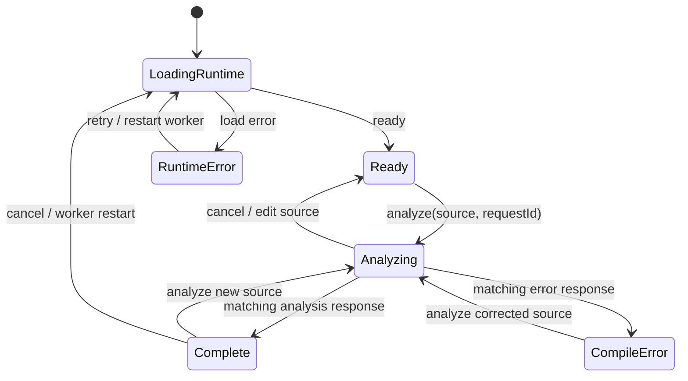

# P1 规格：真实 CPython 编译视图

## 1. 状态与范围

- 阶段：P1，真实 AST、代码对象与字节码。
- 状态：本地实现与验收已完成；本规格仍作为集成和发布的验收基线。
- 引擎：固定使用 Pyodide `314.0.7`；页面同时显示 Pyodide 版本及运行时返回的 CPython 版本。
- 部署：应用静态发布在 `/python-interpreter-lab/`；Pyodide 模块和 WASM 从固定版本 `https://cdn.jsdelivr.net/pyodide/v314.0.7/full/` 加载。
- 本阶段只提供真实编译观察。P2 的 Token 面板与源码联动、P3 的用户代码执行与 trace、教学 Mini VM 均不属于本规格。

## 2. 用户目标

用户打开网页后能输入或修改一段 Python 源码，分析后检查真实 CPython 生成的 AST、模块/嵌套函数代码对象和 `dis` 反汇编。用户能切换所选代码对象，确认 `x = 1 + 2` 会按固定 CPython 版本真实编译（可能折叠为常量），而不是由 UI 拼出预设指令。

运行 `ast.parse`、`compile` 和 `dis`；不调用 `exec`/`eval` 执行用户代码，也不上传源码。Worker 只加载固定版本运行时和执行上述分析逻辑。

## 3. 页面结构与操作

页面是共享站点壳内的单页多面板工具：

1. 标题与运行时状态：显示本应用标题、Pyodide/CPython 版本，以及“加载中/可分析/错误”等状态。
2. 源码区：可编辑的多行源码输入；默认样例为 `x = 1 + 2` 与 `print(x)` 两行；保留缩进，提供清空/恢复示例。
3. 分析控件：显式“分析”按钮；分析或运行时加载中提供“取消”按钮。分析不触发代码执行。
4. AST 区：树形展示节点类型、字段值和存在的源码行列。节点可展开，使用原生语义化结构。
5. 代码对象选择器：至少列出模块对象和所有嵌套函数代码对象；名称、限定名称、首行号应可区分。
6. 字节码区：按实际 `dis.get_instructions` 顺序展示 offset、opcode、操作名称、参数文本和该版本返回的源码行号；当前选择的 code object 为空时显示引导状态。
7. 错误区：显示解析或编译错误类型、消息、行/列信息（若 Python 提供），错误发生后移除旧 AST/字节码，不能让旧结果看似属于当前源码。

界面与状态文案同时支持中英文，采用站点当前语言。主要交互可用键盘操作，控件具有可访问名称和可见焦点，窄视口下转为单列而不造成页面横向滚动；源码及指令内容可在自身容器中滚动，并尊重 `prefers-reduced-motion`。

## 4. 编译数据契约

每次分析只接受 `{ requestId, source }`，响应携带相同 `requestId` 以及固定 Pyodide 版本：

- `ready`：包含 Pyodide 版本与 Python 运行时版本。
- `analysis`：包含本次源码对应的 AST 树、代码对象清单、各对象反汇编数据。
- `error`：包含结构化诊断（类别、消息、可用的位置字段）。

### AST

- `ast.parse(source)` 成功后序列化 `ast.Module` 根节点及其字段/子节点。
- 保留 `lineno`、`col_offset`、`end_lineno`、`end_col_offset` 等运行时提供的位置值；不在本阶段将 Python UTF-8 字节列映射为 JavaScript 字符索引。
- 仅序列化 AST 内建字段和有限字面量，输出可经 structured clone/JSON 安全传输；限制节点深度与总节点数。达到上限时清楚标注“显示已截断”，不得静默删除。

### 代码对象与字节码

- `compile(source, '<input>', 'exec')` 后递归遍历 `types.CodeType.co_consts`。
- 每个代码对象具有本次分析内唯一、稳定的选择 ID；至少保留 `co_name`、可用的 `co_qualname`、`co_firstlineno`、`co_varnames`、`co_names` 和 `co_consts` 的安全摘要。
- 用 `dis.get_instructions(code)` 生成指令列表。保留 `offset`、`opcode`、`opname`、`arg`、`argrepr`、`starts_line` 以及该版本提供的 positions；不把值对象或 CodeType 直接传给 UI。
- 不假定指令偏移、缓存或参数编码跨 Python 版本稳定。版本来源固定并展示。
- 编译结果对应的指令必须来自当前 Pyodide 执行的 `dis`，不能用手工构造或系统 Python 输出替代。

### 资源边界

- 单次源码限制为 20,000 个 JavaScript UTF-16 code units；超限时在发送 Worker 前拒绝并给出双语提示。
- AST 最多序列化 5,000 个节点、最大递归深度 100；超过时返回有效的截断结果和提示。
- 最多展示 200 个 code object、总计 50,000 条指令；每个 code object 最多传回 20,000 条指令。任一上限触发时标注对应的截断状态，不把部分指令宣称为完整反汇编。
- 加载/分析在独立 Worker 中。主线程取消请求后 terminate Worker、清除当前 request 状态并建立新 Worker；不承诺保留尚未送达的部分结果。重建后能够再次分析。
- Pyodide 页面资产从固定版本公共 CDN 获取；CDN、CORS 或 WASM 初始化失败时提供可重试错误，不静默切换版本或返回伪造数据。

## 5. 状态转换与陈旧结果

- 每次请求生成新的单调 requestId；只接受仍匹配当前源码和当前 Worker 会话的响应。
- 编辑源码立即清除结果，旧请求响应被忽略；选择代码对象只改变当前展示，不触发 Python 执行。
- 取消分析/运行时加载后，UI 回到可重试状态；旧 Worker 的迟到响应不能覆盖新 Worker 的状态。

## 6. 前端与静态站点契约

页面接入、目录路径、共享语言、公共导航、可访问性和独立构建规则遵循[应用协作约束](../../AGENTS.md)与[站点外壳契约](../../../../packages/site-shell/README.md)。本节记录 P1 的具体落地与验收，不另设一套站点或语言机制。

- 独立 React + TypeScript + Vite；类型检查作为 build 前置。
- `base: './'`、产物写入应用 `dist/`；所有站内静态资源与 Worker 由相对路径打包，生产测试部署到 `/python-interpreter-lab/` 子路径。
- `index.html` 使用 `wishflow-site-shell`，设置 app slug、`../` 站点链接及中英文标题；React 根节点放入 `slot="content"`。单页不启用本地侧栏。
- 入口导入 `@wishflow/site-shell`。语言状态由共享壳维护；应用消息通过 `registerMessages` 接入并通过 `getLanguage`/`subscribeLanguage` 更新 React 文案；不创建独立存储键或切换器。
- P1 首版建立可执行 `scripts/install.sh`、独立 pnpm lockfile、`build` 和 `test:ci`，并在通过测试与子路径产物检查后登记 catalog；目录卡片需有中英文标题、简介及图标。
- 浏览器 Worker 为 Vite 可打包的 `type: 'module'` Worker，内部动态 import 固定 URL 的 Pyodide ES module；它不使用 Cloudflare Worker。

## 7. 验收案例

| 案例 | 操作 | 预期 |
| --- | --- | --- |
| 运行时启动 | 打开生产应用 | Worker 加载 Pyodide，显示实际 Pyodide 与 CPython 版本；应用控件仍可响应 |
| 常量折叠 | 分析 `x = 1 + 2` | AST 有赋值与加法语法结构；真实反汇编展示 CPython 实际优化结果，不强制出现加法指令 |
| 嵌套代码对象 | 分析含 `def add(a, b): return a + b` 的源码 | 可选模块和 `add` 函数对象；选择函数后展示该代码对象的反汇编 |
| 编译错误 | 输入 `if :` 后分析 | 显示 Python 错误类型与位置，清掉此前成功结果；修正源码后可以成功分析 |
| AST 通过但编译失败 | 输入 `return 1` | `ast.parse` 成功但 `compile` 拒绝，界面标记为编译错误并清除上次结果 |
| 运行时资源失败 | 阻断固定 Pyodide CDN 请求 | 显示加载错误；解除阻断后重试能初始化同一固定版本 |
| 输入/节点/指令超限 | 分别构造超过各资源边界的样例 | 分析前拒绝或明确标注截断；页面保持可用 |
| 取消和恢复 | 加载或分析期间按取消，再重试一段有效代码 | Worker 被替换，旧响应被忽略，后续结果正确 |
| 子路径资源 | 在生产 `dist` 中用 `/python-interpreter-lab/` 前缀提供文件 | JS、CSS、Worker、Pyodide CDN 模块和 WASM 可加载；不请求站点根目录下的错误 `/assets` 路径 |
| 语言及窄屏 | 切换共享语言，再缩小到窄视口并键盘操作 | app 文案更新、站点记忆状态归壳管理；页面无横向溢出、主要控件可键盘访问 |

### 不变量

1. 任何 Python 源码都只传给 AST parser/compiler；P1 页面从不执行用户代码。
2. 可见版本、AST、code object 和指令来自同一个 Worker 会话及同一次源码修订。
3. 解析/编译失败或取消后，旧结果不会伪装成新源码的结果。
4. 固定版本的 CPython 字节码仅按该版本解读，不承诺跨版本稳定。
5. UI 不展示 CPython 不提供的真实值栈、运行轨迹或逐指令执行状态。

## 官方参考

- [Pyodide：在 Web Worker 中运行](https://pyodide.org/en/stable/usage/webworker.html)
- [Pyodide：下载与部署](https://pyodide.org/en/stable/usage/downloading-and-deploying.html)
- [Python 3.14 `dis` 文档](https://docs.python.org/3.14/library/dis.html)
