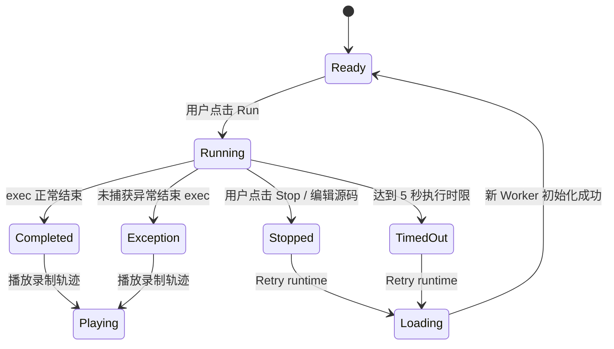

# P3 规格：真实执行、轨迹与回放

对应整体计划：[P3 真实运行、轨迹与回放](../implementation-plan.md)。本阶段在现有 Pyodide 314.0.7 / CPython 3.14.2 Worker 内增加用户主动触发的同步执行、真实 Python trace 事件、标准输出观察与离线回放；不实现教学 VM，也不改变 P1/P2 的编译视图。

## 1. 目标、前提与边界

用户可以运行当前编辑器中的源码，在程序运行时观察 CPython 对用户代码产生的调用、行、异常和返回事件；程序结束或停止后，可以仅浏览已录制的事件和输出，不重新执行源码。

本阶段沿用已确认的应用架构：React + TypeScript + Vite，固定 Pyodide/CPython 运行时，分析和执行放在同一个浏览器 module Worker。一次 Run 使用新的 Python globals 字典，运行期间由 `sys.settrace()` 记录 `co_filename == '<input>'` 的帧；Pyodide/CPython 版本不变，不新增 npm/Pyodide 包，不修改共享站点响应头。

| 决策 | P3 约定 | 原因/影响 |
| --- | --- | --- |
| 执行方式 | 显式点击 Run 后在 Worker 中 `compile` + `exec` 当前源码 | 与 Analyze 分开；打开页面和分析源码都不执行用户代码 |
| 事件来源 | 使用固定 CPython 的 `sys.settrace()`；只记录 `<input>` 用户帧的 `call`、`line`、`exception`、`return` | 真实解释器事件；不把库内部事件或推导出的 opcode 当作真实轨迹 |
| 停止方式 | 手动 Stop 或主线程计时到限后立即 `Worker.terminate()`；该 Worker 不复用 | 普通消息无法打断同步 WASM 执行；结束后用户通过 Retry runtime 创建干净 Worker |
| 轨迹传输 | Python trace 回调按批次通过 Pyodide 的 JS/Python 互操作向 Worker 主 JS 发送 DTO | 在强制终止时保留已送达的部分事件和输出；所有批次均带 session/run 身份 |
| 历史浏览 | 执行结束后只移动 `cursor` 浏览内存中的事件；不再次调用 Python | 回放是观察记录，不是状态恢复或可继续执行的调试器 |

不支持教学指令单步、CPython 内部值栈、暂停后恢复运行、历史分叉、跨刷新保存、交互式 `input()`、Python async/线程调试或为库代码生成逐行轨迹。Pyodide 内置 CPython 实际支持的语法仍由固定运行时决定；“可运行”不代表每类事件都可视化。

## 2. 运行状态与时序

Worker 运行状态、Python 程序结果和回放状态分别维护，停止执行不等于暂停回放：

- `call` 表示进入用户代码帧、尚未执行该帧第一条源码行；`line` 表示解释器即将执行/重新执行该行；`exception` 表示异常在该帧产生，后续仍可能被 `except` 捕获；`return` 表示帧正在退出，并携带可安全概述的返回值。
- 时间线显示的是上述真实事件点，不把一条语句的完成状态伪装成 `line` 事件的“执行后状态”。选中某事件只改变回放游标和显示内容。
- `exception` 事件本身不代表整次运行失败。仅未捕获异常使运行结果为 `exception`；捕获后正常结束为 `completed`，同时保留异常事件。
- 源码编辑时立即清除旧分析、轨迹和输出；若正在执行则先终止旧 Worker，再以新会话重建运行时。迟到的 worker/session/run 响应必须丢弃。
- 手动停止和超时保留主线程已收到的批次，并标注执行未完成；Retry runtime 加载新 Worker 后保留这份只读记录，下一次 Run 才替换它。
- Worker 初始化失败或运行期 Worker 崩溃显示局部诊断。运行结果异常不影响独立编译视图；必要时可重试运行时并重新执行。

## 3. 事件与 Worker 消息合同

每个 `TraceEvent` 至少包含下列字段：

| 字段 | 语义 |
| --- | --- |
| `index` | 本次 run 从 0 开始、严格递增的事件序号 |
| `event` | `call`、`line`、`exception` 或 `return`，来自 CPython trace API |
| `phase` | 与事件类型一致的可读时点标识：进入帧、行执行前、异常产生、帧退出 |
| `line` / `functionName` | 触发事件的用户源码行与 `co_name`；模块帧以本地化文案显示 |
| `callStack` | 事件发生时从模块帧到当前帧的用户函数名路径 |
| `locals` | 当前帧至多 20 个局部名字的基础值概述；不递归展开对象 |
| `returnValue` | 仅 `return` 事件存在的安全值概述 |
| `exception` | 仅 `exception` 事件存在的异常类型及安全消息概述 |
| `stdoutOffset` / `stderrOffset` | 事件时刻两个输出流各自累计的 Unicode 码点数；供时间线显示该时点已产生的输出 |

Worker 请求/响应均携带 `sessionId` 和 `requestId`。运行中增量消息使用 `execution-batch`，含有序事件、stdout/stderr 增量；正常终结消息使用 `execution-complete`，含 `completed`/`exception`、完整输出、时长、截断状态和可选最终异常。Stop、超时及 Worker 崩溃由主线程形成 `stopped`、`timed-out` 或 `worker-error` 的不完整记录，并保留已经收到的批次。

每次执行使用隔离于 Pyodide runtime globals 的新 `{'__name__': '__main__'}` 用户命名空间；每次运行结束时还原 `sys.settrace`、`sys.stdout` 和 `sys.stderr`。Python trace 快照避免调用任意用户对象的 `repr()`/`str()`：仅精确内建标量可显示截短文本；容器和自定义对象只显示类型及有限摘要。异常消息只从安全的内建参数摘要构造；不得为了展示而调用自定义 `__repr__`、`__str__` 或属性。

## 4. 资源上限与停止

| 资源 | P3 上限 | 达到上限后的行为 |
| --- | --- | --- |
| 单次同步运行时间 | 5,000 ms，由主线程 Worker timer 计时 | 终止 Worker，保留已收批次，标为 `timed-out`/未完成；用户可重新加载运行时 |
| trace 事件 | 5,000 条 | 停止收集额外事件但让程序继续；最终结果标记轨迹被截断。总运行时限仍生效 |
| 单次运行 stdout + stderr | 合计 32,768 个 Unicode 码点 | 截断保留内容并显示提示；不把未收集内容当作完整输出 |
| 单事件调用栈 | 最多 40 个用户帧 | 标记调用栈已截断；不递归遍历 C/库栈 |
| 单事件名称与类型标签 | 函数名、调用栈函数名、局部变量名、值类型名和异常类型名各至多 100 码点 | 超长标签截断并以省略号结尾，避免合法长标识符重复放大轨迹消息 |
| 单事件当前帧局部变量 | 最多 20 项；每项值摘要至多 120 码点 | 按变量名稳定排序后截断并标注；不展开列表/字典/对象图 |
| 编辑器源码 | 延续 P1 的 20,000 UTF-16 code unit 上限 | 禁止启动执行并复用现有输入诊断 |

主线程的 5 秒 timer 是尽力而为的浏览器时限，后台页调度或单次长时间 WASM/JavaScript 调用可能造成延迟。手动停止和超时通过销毁 Worker 实现，不依赖 `SharedArrayBuffer`，不承诺回滚运行中已发生的浏览器副作用。

## 5. 用户界面与可访问性

- Source 面板提供独立 Run 与 Stop execution 控件；Analyze 仍只编译而不执行。状态名称清楚区分运行时载入、分析、执行、已停止、超时和运行时错误。
- 新增执行面板展示运行结局、当前回放事件、调用路径、局部基础值、stdout/stderr、异常和截断/不完整说明。输出按所选事件的 offset 展示，不随播放重复追加。
- 执行结束后提供首条、上一条、播放/暂停、下一条、末条、可键盘操作的事件范围滑块和 0.5×/1×/2×/4×速度。游标抵达末尾自动暂停；移动游标不执行 Python。
- 当前事件提供显式“定位源码行”操作；定位到有效范围后沿用 P2 `SourceLink` 联动。不因自动播放而抢夺编辑器焦点。
- 执行期间禁用回放操作；Stop execution 只结束程序。事件不足 2 条时禁用没有意义的前进/后退；空程序仍显示真实执行结局。
- 所有新增文案使用共享 `registerMessages`/站点语言状态提供中英文；所有按钮和滑块有名称、可见焦点和键盘操作。窄屏下各面板内部滚动、页面不横向溢出；减少动态效果偏好下播放状态仍清楚。
- 安全提示明确说明：应用本身不上传源码，但用户主动运行的 Python 可通过 Pyodide 的 JavaScript 互操作访问 Web API/网络；Worker 不是恶意代码安全沙箱。应用不自动运行输入、示例或外部代码，不注入账号凭据。

## 6. 验收样例

| 场景 | 输入或操作 | 独立预期 |
| --- | --- | --- |
| 全局查找与调用 | `base = 10; def add(x): return x + base; print(add(2))` | stdout 为 `12`；事件出现 module → add 调用路径；`add` 帧可看到参数 `x` 的基础值 |
| 重复行事件与回放 | `for i in range(3): print(i)` | 同一循环行出现多条真实 `line` 事件；输出为 `0\n1\n2\n`；拖动/播放事件不重复调用 `print` |
| 捕获异常 | `try: 1 / 0; except ZeroDivisionError: print("caught")`（按有效缩进输入） | 出现 `ZeroDivisionError` 事件；结束为 completed，显示 `caught` |
| 未捕获异常 | `print("before"); raise ValueError("boom")` | stdout 保留 `before`；结束为 exception，展示类型/安全消息和用户源码行；已有异常事件保留 |
| 停止死循环 | `i = 0; while True: i += 1`，运行后点击 Stop execution | UI 可操作；记录状态为 stopped/不完整，保留已送达轨迹；Retry runtime 后运行有限代码成功，不收到旧 run 事件 |
| 自动超时 | `while True: pass` 等待 5 秒 | Worker 被销毁，记录状态为 timed-out/不完整；主线程仍可交互并可重试 |
| 轨迹上限 | 执行能产生超过 5,000 trace 事件但在时限内结束的循环 | 程序结局仍正确，最多保留 5,000 条并明确提示轨迹截断 |
| 输出上限 | 输出超过 32,768 码点 | 标记输出截断；保留已知前缀且页面不失控 |
| 源码修订 | 执行中编辑源码、分析后编辑源码或快速重新执行 | 旧结果清除；旧 session/request/run 事件不能覆盖新状态 |
| 兼容回归 | 继续分析 P1/P2 样例、切换共享语言并检查窄屏 | AST、Tokens、代码对象、字节码和 P2 范围联动仍正确；新增文案双语可读；320/768/1024/1440px 无页面横向溢出 |

## 7. 验证命令、回滚与参考

- 应用：`pnpm run test:ci`（类型检查、单测、生产构建、Playwright）；重点新增 trace 摘要/Unicode offset 单测和真实 Pyodide Playwright 用例。
- 根目录：`pnpm run test:catalog`、`pnpm run build:site`；发布后在 `/python-interpreter-lab/` 线上路径运行全局调用、输出/异常、停止/重试和回放流程。
- 文档：`git diff --check`、修改文件相对链接检查；所有 Markdown 按根 AGENTS 复制到 `/tmp/var/wishflow-tools/` 并逐文件核对。
- 回滚：移除 P3 执行入口、事件/回放面板和 Worker run 消息，保留 P1/P2 分析 API；不需要数据迁移或全站响应头回退。

参考依据：CPython 3.14 [`sys.settrace`](https://docs.python.org/3.14/library/sys.html#sys.settrace) 定义 trace 事件及调用时点；固定版本 [Pyodide Web Worker](https://pyodide.org/en/stable/usage/webworker.html) 说明 Worker 隔离主线程；[Pyodide 中断执行](https://pyodide.org/en/stable/usage/keyboard-interrupts.html) 要求使用 `SharedArrayBuffer` 与相应安全响应头；因此本阶段为停止执行采用 [Worker.terminate](https://developer.mozilla.org/en-US/docs/Web/API/Worker/terminate)，并明确丢弃尚未发出的数据。
