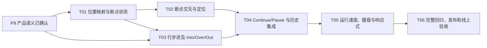

# P9 tasks：教学调试控制

对应规格：[P9 教学调试控制规格](../specs/p09-teaching-debugger.md)，阶段基线见[整体实施计划](../implementation-plan.md)。**状态：产品语义已确认；T01 已完成本地实现和验证，其余任务按序推进。** 本阶段不增加语法或教学指令，沿用 `mini-vm-v4` 和现有 Worker。

## 依赖和约束

- 前置：P7 的显式帧栈、P8 的历史快照和对象堆均已发布。
- 保持真实 CPython 视图、P5–P8 的语义和现有教学 ISA 不变；版本仍为 `mini-vm-v4`。
- 复用现有 Teaching VM Worker、session/sourceRevision 隔离、history update 与 run/pause/reset 消息；按已确认语义扩展消息参数/命令，不新增 Worker、编辑器依赖、服务或共享状态管理库。
- 所有调试操作只作用于当前编译程序和执行头；历史浏览保持只读；每次运行仍受 5,000 条动态指令预算约束。

## 依赖顺序

每项实现后保留已完成 P5–P8 的可构建/可测试状态；测试优先补充失败用例。修改教学 Worker 消息前，应确认新增数据均为有界、可序列化 DTO，旧 session/sourceRevision 的迟到响应仍被丢弃。

## T01：指令位置映射与断点状态

**状态：已完成（代码已实现并通过本地测试；尚未随 P9 发布）。**

- **用户结果**：VM 能明确说明下一条可执行指令属于哪个源代码行/函数帧，并能以稳定、可序列化的状态表示断点和暂停原因。
- **改动范围**：新增源码行到首条非 `HALT` 教学指令映射；断点 DTO 以 `source-line:<行号>` 为程序内稳定 ID；VM 暴露有界断点集合和暂停原因/命中 ID。断点集合上限为编译指令上限 2,000 条；VM 实例将断点限定在其编译结果内。
- **验收**：跨模块/函数代码区、多条指令同一行和空程序映射确定；空行/注释行不能设断点；断点暂停不改变 PC、计数、栈、帧、变量、堆或输出；同一循环再次到达断点可再次暂停。
- **验证**：`node --import tsx --test tests/teaching-debugger.test.ts` 通过 5 项；`pnpm run test:unit` 通过 116 项；`pnpm run typecheck` 通过。
- **后续集成**：Worker 和 UI 的断点命令、Continue、执行历史与源码控件在 T02/T04 中接入。
- **依赖**：已确认 P9 规格。

## T02：断点控件和源码定位

- **用户结果**：能够用键盘和鼠标设置、启停、移除源码行断点及教学指令断点，并从暂停位置查看相关源码和指令。
- **改动范围**：在现有源码定位/AST/教学指令表中加入可访问的断点入口、断点列表和命中样式；保持原生 `textarea`，不引入编辑器依赖。
- **验收**：源码行断点映射到该行的首个可执行指令；指令断点指向当前编译版本的索引；空行处理符合规格；选中断点可从列表定位源码和指令；编辑/重编译后无过期绑定。
- **验证**：组件/Playwright 覆盖启停、移除、无可执行行、焦点、键盘操作、源码定位和中英文。
- **依赖**：T01。

## T03：源码步进和调用帧控制

- **用户结果**：从现有单指令 Step 扩展到确认后的源码级步进，并能进入、越过和离开函数调用。
- **改动范围**：Teaching VM 运行目标与 worker command；按已确认的行/帧条件推进；把完成/暂停原因写入快照；根模块帧上的 Step Out 反馈。
- **验收**：同一源码行多条指令不会被误作多行步进；Into/Over/Out 对嵌套和递归函数保持帧 ID、调用者续行与状态栈正确；单指令 Step 保持原行为。
- **验证**：VM 单测逐步核对指令、行号、帧 ID、pc、变量和栈；Worker 测试确认命令取消/完成的响应顺序。
- **依赖**：T01 和已确认的 Step Line 关系。

## T04：断点 Continue/Pause 和历史时间轴集成

- **用户结果**：运行到断点自动暂停，可继续、暂停、复位，并可从历史快照返回执行头后继续。
- **改动范围**：runLoop 断点检查与当前位置一次性抑制；原子指令边界 Pause；当前执行头与历史游标的控制可用状态及提示。
- **验收**：Continue 从命中断点启动时不会立即再次命中；后续循环/递归再次到达同一位置时正常暂停；多个断点按运行次序生效；历史 Continue 先回执行头、不分叉、不覆盖旧对象快照；错误、预算耗尽和完成状态不可继续。
- **验证**：Worker 测试覆盖断点和 Pause 竞争、无限循环预算、历史更新/截断和 Reset；Playwright 覆盖真实 Worker 的完整交互。
- **依赖**：T02、T03。

## T05：运行速度和操作体验

- **用户结果**：运行时可以在慢、标准、快档间切换，并可观察当前运行状态和断点原因。
- **改动范围**：Worker 批次/调度配置和控制区档位选择；键盘焦点、状态播报、按钮可用性、中英文和响应式排版。
- **验收**：速度档只影响自动运行，单步/步进命令确定性不变；暂停、断点、预算和终态在每档一致；速率参数有界，不会造成无限队列或主线程阻塞；320/768/1024/1440px 无页面横向溢出。
- **验证**：使用可控定时器/批次计数验证节奏映射，避免用真实时间精确值制造脆弱测试；Playwright 检查档位、键盘操作、状态提示和减少动态效果。
- **依赖**：T04 和已确认的速度档数值。

## T06：完整回归、文档与发布

- **用户结果**：P9 调试控制在正式页面可用，同时完整保留现有真实 CPython 视图和 P5–P8 教学能力。
- **范围**：更新 README、应用 `AGENTS.md`（如支持能力发生变化）、P9 spec/tasks 和整体计划；不增加新引擎、部署服务或依赖。
- **验收**：应用完整 CI、catalog、共享站点构建通过；回归历史游标、对象图、函数帧、循环、语言、Worker 过期响应和真实 CPython 视图；workflow 部署成功；正式页面按两种视图实测。
- **验证**：记录本地测试、CI workflow、正式页面断点/步进/速度验收和 Markdown 副本。适用的 `pi` 入口加载按根协作规则验证；无法验证时记录原因，不声称通过。
- **依赖**：T01–T05。

## 已确认语义

- Step Line 与 Step Over 合并；保留单指令 Step 和 Into/Over/Out。
- 源码行断点绑定首条可执行指令；空行和注释行不创建断点。
- Continue 只跳过当前断点命中一次；以后循环/递归再次到达时暂停。
- 历史位置 Continue 先回执行头；Reset 保留断点；编辑或重新编译清除断点。
- 慢/标准/快档分别为 1 条/250ms、8 条/16ms、32 条/16ms；动态指令上限仍为 5,000。
