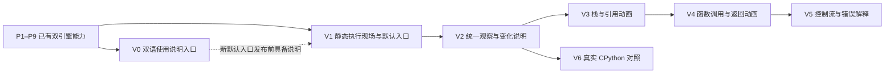

# 执行可视化体验实施计划

## 1. 目标、依据与当前状态

依据：[ADR-0002](adr/0002-coherent-execution-experience.md)，已于 2026-10-30 获用户确认。目标是让源码、当前动作、操作数栈、调用帧、变量绑定和堆共同解释同一个执行步；默认按语句讲解，可展开指令，教学模式成为默认入口，机器码只作概念说明。

| 内容 | 当前状态 |
| --- | --- |
| 四项体验决定和双语使用说明需求 | 已确认 |
| ADR、实施计划、图示及中英文说明正文 | 本轮文档交付 |
| V0 帮助入口与静态帮助页 | 实现、本地验证、CI/CD 与线上验收完成 |
| V1 静态执行现场与默认教学入口 | 已实现、验证、发布并完成线上验收 |
| V2 统一观察位置、源码步进分组与变化说明 | 已实现、验证、合并发布并完成线上验收 |
| V3 操作数栈与对象引用动画 | 已实现、本地验证、双站部署并完成线上验收 |
| V1–V6 spec/tasks | V1–V4 已发布；V5 在独立分支完成实现和本地验证、等待 V4 理解核对；V6 已发布并完成线上验收 |

依托 P1–P9 已有能力开展，保留[整体计划](implementation-plan.md)的 P10 异常语法和 O1 可选真实 opcode 编号。本体验路线使用 V0–V6，优先处理已确认的可视化问题；不以尚未实施的 P10/O1 为前置，也不顺带扩大 Python 子集。

## 2. 交付原则

1. 先让静态执行现场能够解释别名与函数调用，再增加变化说明和动画。
2. 每片都形成独立用户价值，独立验证与发布；回滚时保留其前置能力。
3. 新默认入口在 V1 发布时切换，V0 说明正文先匹配当前界面；后续每次发布同步更新中英文内容。
4. 源码、指令和状态采用同一观察坐标；Worker 是执行状态的唯一来源。
5. 本轮批准方向与切片，不批准尚未定义的数据协议、依赖或新实现范式。实际出现这些变化时，再按仓库规则确认。
6. 每个切片启动前创建 `docs/specs/vNN-<topic>.md` 和 `docs/tasks/vNN-<topic>.md`，前者定义具体行为与边界，后者记录实现、验证和发布证据。例如 V0 对应 `v00-...`，不重用已有 P 编号。

## 3. 路线与依赖

推荐发布顺序为 V0 → V1 → V2 → V3 → V4 → V5 → V6。V0 不是运行数据依赖，要求先发布是为了新默认入口同时有使用说明；V6 可在 V2 后独立开展，不必等全部动画完成。所有阶段都可使用既有少量示例，不新增课程体系或示例管理框架。

## 4. 各阶段范围、验收与回滚

### V0：双语说明与可点击入口

- **前置**：已发布应用、当前共享站点壳；核对两份[使用说明](guide/usage.zh-CN.md)与现有控件一致。
- **交付**：工作区显示“使用说明 / User guide”，默认新标签打开应用静态帮助页 `help.html`；正文支持中英文，沿用现有语言机制、本地导航与站点外壳。
- **用户行为**：点击即可阅读；原实验页面仍保留运行会话，状态不因帮助动作而改变。说明页不启动 Worker、不自动执行示例；返回原标签继续实验，独立打开时可进入新实验室。
- **内容**：快速开始、算术与别名例子、帧/栈/绑定/堆、步进/Continue/Reset、历史与执行头、两种引擎、截断和不支持语法提示。两份 Markdown 是正文来源，构建时生成可阅读页面；V0 spec 明确渲染、代码转义和内容同步方式。仓库文档互链替换为共享语言与站内导航，不发布失效的 `.md` 链接。
- **构建接入**：应用 `vite.config.ts` 当前没有帮助页入口；根 `scripts/build-site.mjs` 当前只为应用 `index.html` 注入项目导航。V0 spec 明确 `help.html` 产物及二级页注入方式，保持 catalog 为唯一来源，增加针对共享构建的回归检查，不把项目列表复制到帮助页。
- **验收**：中英文入口和正文一一对应；页面刷新、深链接、语言切换及子路径静态资源正确；帮助动作不重置、切换或主动推进原会话，不改变源码/引擎/断点，原有运行或播放可自然继续。暂停状态下打开帮助，执行头与观察位置保持不变；独立帮助页无解释器初始化。
- **验证**：文档链接与代码示例检查；应用构建与浏览器入口/语言/新标签测试；共享壳和站点构建回归。公开页不能指向本地路径或直接依赖仓库站点。
- **回滚**：撤回入口和帮助页面发布配置，原实验功能继续工作，仓库说明正文保留。
- **状态**：说明正文、V0 spec/tasks、应用实现、本地验证、CI/CD 与线上验收已完成。

### V1：静态执行现场与默认教学入口

- **前置**：P8/P9；V0 在新版默认入口发布前可用。
- **交付**：默认教学模式，以现有 Step Over 作为主“下一语句”操作，保留单指令控制；源码、当前动作和运行现场同屏；局部指令优先，AST/完整指令按需展开。明确活动调用帧、操作数栈顶、名字绑定和稳定对象位置，保留真实 CPython 入口。历史语句分组与展开指令在 V2 交付，V1 不提前宣称具备该能力。
- **边界**：重排已有数据和焦点，不改变支持语法、VM 指令集或运行协议。教学 Token 不在当前 DTO 中，不能作为纯布局调整默认加入。Pyodide 加载策略不与本次布局改造捆绑。
- **验收**：无动画也能从图中识别 `a/b` 是否指向同一列表，以及 `bump(xs)` 的参数与模块变量是否共享对象；调用帧和操作数栈不会混淆；手动检查不改变活动帧；已有 Into/Over/Out、断点、历史和输出继续可用。
- **验证**：三个基准示例、现有调试回归、两种引擎切换、中英与 320/768/1024/1440px 布局；同步修改说明正文的默认入口与空间概念。
- **回滚**：恢复原布局与初始引擎，V0 帮助仍可保留并匹配回滚后的界面。
- **状态**：已实现、验证、合并至 `master` 并发布；GitHub Actions [41049187550](https://github.com/wishflow/wishflow-tools/actions/runs/41049187550) 通过，生产站点完成 Teaching VM 与真实 CPython 冒烟验收。详细证据见 [V1 tasks](tasks/v01-static-execution-workbench.md)。

### V2：统一观察位置、语句分组与变化说明

- **前置**：V1。
- **交付**：所有面板共用观察上下文；默认下一语句、展开已有指令、本步一句话、前后差异；区分执行头与观察位置。
- **历史规则**：历史位置只消费已记录内容，到执行头才请求新步进；Continue 仍先返回执行头。完整/前缀截断/缺少前态分别表示，不能声称一次长 Step Over 的全部指令都可展开。
- **数据规则**：识别成功指令、控制停顿和失败；结合执行计数、指令身份和诊断，不能仅按 `stepIndex` 动画或生成成功说明。变化结果取自真实快照，不在 UI 重算表达式。
- **验收**：点击同一步后源码、指令、帧、栈、堆和输出属于同一记录；赋值、别名更新和函数返回说明准确；断点中断语句；相同值不被当作相同对象；缺少前态退化为静态状态。
- **验证**：有独立预期的变化解释用例；历史位置步进与执行头操作分支；长函数调用超过 500 条历史快照时的截断用例，具体上限以实施时资源配置为准；Pause/Reset/换源码后旧结果不回流。同步说明正文。
- **回滚**：回到 V1 的静态状态展示与原控制，保留既有 VM 历史语义。
- **状态**：spec/tasks、T01–T05 已完成；应用本地 CI（153 条单测、53 条 Playwright、类型检查和生产构建）、catalog 与整站构建均通过。已合并发布；GitHub Actions [41065148292](https://github.com/wishflow/wishflow-tools/actions/runs/41065148292) 成功，线上 Teaching VM 分组/差异与真实 CPython AST/字节码/执行输出均已实测通过。详细验收见 [V2 tasks](tasks/v02-observation-and-change-explanations.md)。

### V3：操作数栈与对象引用动画

- **前置**：V2；别名示例的静态变化解释已通过核对。
- **交付**：读取、入栈、运算、绑定、对象创建和条目修改的解释动画；保留稳定对象位置和选择相关引用的交互。
- **调度**：讲解播放由前端串行驱动源码步进，完成 Worker 响应与固定时长展示后再推进；与 Worker Run/Continue 互斥。Run 的慢、标准、快速度档只影响 Worker 自动执行，不改变讲解播放，也不合并讲解过渡。单个源码步最多展示 12 条过渡；超出部分合并到最终状态并标出省略数量。Pause 必须落实到 Worker 确认，不能只冻结动画。
- **边界**：视觉中间帧不是 VM 中间状态；不新增物理布局引擎或绘图库；不通过扩大历史预算消除动画积压。时长、可见对象数与动画队列上限在 spec 中定义并实测。
- **验收**：`b = a` 不复制对象；`b[0] = 9` 修改同一对象；`b = [2]` 才增加对象并改绑定。过渡结束与直接后态完全一致；减少动态效果具有相同信息。
- **验证**：已知前后态与动作语义、暂停/取消/复位、快速连续点击、快慢切换、空栈/重复值/循环引用和历史跳转；同步帮助说明的演示与执行区别。
- **回滚**：关闭动画和新增讲解调度，保留 V2 的静态差异与原 VM 控制。
- **状态**：spec/tasks 与 T01–T05 已完成；独立“讲解播放”控件按串行 Step Over 等待 Worker 响应和本步展示。应用本地 CI（159 条单测、63 条 Playwright、类型检查和生产构建）、catalog（15 项）与整站构建均通过；已合并推送，GitHub Actions [41092079704](https://github.com/wishflow/wishflow-tools/actions/runs/41092079704) 及 GitHub Pages、Cloudflare Pages 部署成功。线上已验证讲解播放中的别名/原位修改/重绑定，以及真实 CPython AST、字节码与执行输出。详细结果见 [V3 tasks](tasks/v03-operand-stack-and-reference-animation.md)。

### V4：函数调用、参数与返回的连续解释

- **前置**：V3；静态 `bump(xs)` 示例已能解释引用跨帧共享。
- **交付**：进入函数、创建新帧、参数绑定、保留调用者位置、返回值进入调用者操作数栈和帧退出；用递归验证不同实例的身份。
- **边界**：沿用 P7 作用域/参数与 P9 步进规则，不增加默认参数、闭包或异常捕获。过渡展示只能使用实际调用与返回记录。
- **验收**：`bump(a)` 中 `xs` 与 `a` 共享同一对象；返回的标量先回到调用者栈，再按后续指令绑定 `n`；`fact(3)` 的同名帧仍有独立局部状态和返回位置。
- **验证**：Into/Over/Out、递归、暂停在函数内、从历史检查非活动帧、参数与运行错误的失败显示；达到调用帧预算时不播放成功创建动画。
- **回滚**：调用/返回退化为 V2 静态解释，V3 其他动作不受影响。
- **状态**：spec/tasks、实现、本地验证、代码审查、提交合并、推送、CI/CD 与线上验收均已完成。应用全量 CI（166 条单测、68 条 Playwright、类型检查、生产构建）、catalog（15 项）、整站构建和 `git diff --check` 均通过。提交 `42c5789` 已快进合并至 `master`；GitHub Actions [41104135193](https://github.com/wishflow/wishflow-tools/actions/runs/41104135193) 成功，GitHub Pages 与 Cloudflare Pages 部署成功。线上教学 VM 已播放 `bump(items)` 调用和返回，历史可见帧 #1 进入/退出且最终输出为 `9`；真实 CPython 已显示 AST、字节码并运行得到 `9`。细化范围与执行记录见 [V4 spec](specs/v04-function-call-return-animation.md) 和 [V4 tasks](tasks/v04-function-call-return-animation.md)。

### V5：控制流与既有运行错误

- **前置**：V4 的两个核心教学场景通过理解检查。
- **交付**：条件结果、分支目标、循环回边、短路以及已支持运行错误的连续解释；保留未走路径与未成功写入的区别。
- **边界**：只使用 P6/P9 已有行为与基础错误，不实现 P10 的 `try/except/raise`、异常处理器匹配或新的跨帧展开语义。
- **验收**：可解释为什么跳到该行、循环为什么重复暂停、短路为何不执行右侧；失败停在真实位置，错误后状态与 VM 一致。
- **验证**：条件两分支、零次与多次循环、循环断点重复命中、短路副作用、失败操作数保留和资源终止；同步双语帮助。
- **回滚**：新增动作退化为静态说明，不改变控制流与错误行为。
- **状态**：实现及本地验证已在独立分支完成；等待 V4 的 `bump(xs)` 与 `fact(3)` 理解核对后再合并发布。当前核对未通过前，不将 V5 标记为完成。

### V6：真实 CPython 的源码片段对照

- **前置**：V2；已有 P1–P4 真实编译与轨迹能力。可独立于 V3–V5 开展。
- **交付**：从当前源码片段明确进入真实 CPython 观察，核对 AST、真实指令和记录到的事件/结果；解释编译差异和机器码概念层级。
- **边界**：沿用切换引擎的会话清理；不把教学快照套在真实字节码上，不提供跨引擎共享执行头。CPython 行事件只能标记实际记录的粒度；O1 不在本阶段实施。
- **验收**：优化导致缺失的指令不补造；多对多源码映射正确；用户能识别当前引擎和数据来源；教学子集不支持的语法有明确边界。
- **验证**：常量折叠、嵌套函数、中文/emoji 位置、真实执行结果与录制回放；实际 Pyodide 版本测试，不能用本机 Python 冒充；双语概念说明同步。
- **回滚**：撤回新对照入口，保留两个独立引擎及原模式切换。
- **详细文档**：[V6 spec](specs/v06-cpython-source-contrast.md)；[V6 tasks](tasks/v06-cpython-source-contrast.md)。
- **状态**：实现、代码审查、合并发布与线上验收已完成。提交 `a4103ea`；GitHub Actions [41160361840](https://github.com/wishflow/wishflow-tools/actions/runs/41160361840) 全部通过，GitHub Pages 与 Cloudflare Pages 部署成功。生产页已验证教学选区映射真实 AST/字节码、整份源码只分析不运行，以及显式运行后输出 `3` 和 4 条真实事件。详见 [V6 tasks](tasks/v06-cpython-source-contrast.md)。

## 5. 基准样例与理解验收

具体代码和图示见[设计说明第 8 节](design/visual-execution-experience.md#8-用三个例子检验是否讲清楚)。

| 场景 | 使用阶段 | 必须能回答的问题 |
| --- | --- | --- |
| `x = 1 + 2 * 3` | V1–V3 | 当前栈顶是什么；变量何时完成绑定；为什么先乘后加 |
| `a = [1]`、`b = a`、`b[0] = 9`、`b = [2]` | V1–V3 主场景 | 哪一步增加对象；哪一步改内容；哪一步改引用 |
| `bump(xs)` 修改列表并返回 | V1/V2 静态，V4 动态 | 当前活动帧是谁；参数与全局变量共享什么；返回值先去哪里 |
| `fact(3)` | V4 | 同名调用为何有不同局部变量与返回位置 |
| 分支、循环、短路、失败下标访问 | V5 | 为什么选择这条路径；哪次操作未成功提交 |
| 同片段真实反汇编与执行 | V6 | 哪些是实际 CPython 数据；哪些只属于教学模型 |

先进行内部预期核对，再用小规模目标用户观察验证理解效果。可以邀请 3–5 位用户作为初次试验，记录误答原因、反复滚动及混淆的焦点；不把该人数当作统计有效性承诺。理解验证未完成时如实记录，不以自动化测试通过替代。

## 6. 通用验收、发布与回滚

### 6.1 每阶段必须核对

- 真实运行、历史回放和动画的边界；非活动帧检查不改变执行状态。
- 当前会话、源码版本和 Reset 代次；旧响应、旧连线与过渡不会恢复到新场景。
- 控制停顿、错误、预算截断、缺少前态和取消路径。
- 中英文词义与控件一致；帮助正文随实际交付更新，未实现功能不写成操作步骤。
- 站点壳、共享语言、本地导航、键盘、可见焦点、减少动态效果和窄屏。
- 有界快照、可见对象/连线、展示队列；不创建无法收敛的播放积压。

### 6.2 验证与发布

- 文档阶段：相对链接、英文对应、代码围栏、示例、状态与引用一致性，`git diff --check`，按仓库相对路径复制 Markdown 到 `/tmp/var/wishflow-tools/`。
- 实现阶段：运行与改动匹配的测试，沿用应用 `typecheck`、单元测试、构建与 Playwright；涉及站点入口/帮助页时核对 catalog、共享站点构建及子路径产物。
- 每个阶段 tasks 分别记录“实现完成”“本地验证”“CI/CD”“线上验收”；未上线或线上失败不能记为发布完成。
- 按根规则在功能分支完成后提交、合并和推送，等待现有工作流成功，再在正式应用与帮助路径实测。公开域名只在根 README 维护。
- 回滚针对该阶段的提交集合；若已有依赖其接口的后续阶段，应一并回退实际依赖或提供兼容修复，不能只删前置模块。

## 7. 不包含的范围

不增加 Python 语法、全量语言兼容、真实 CPU/Wasm 指令追踪、CPython 内部值栈、真实内存地址/引用计数、历史恢复分叉、持久化会话、在线课程系统、第三方包管理或后端服务。

需要精确 VM effect 元数据、新绘图库或更大历史容量时，先说明现有数据无法满足的具体场景及成本，再确定是否另立规格。已确认的四项产品决定不重复征询。
