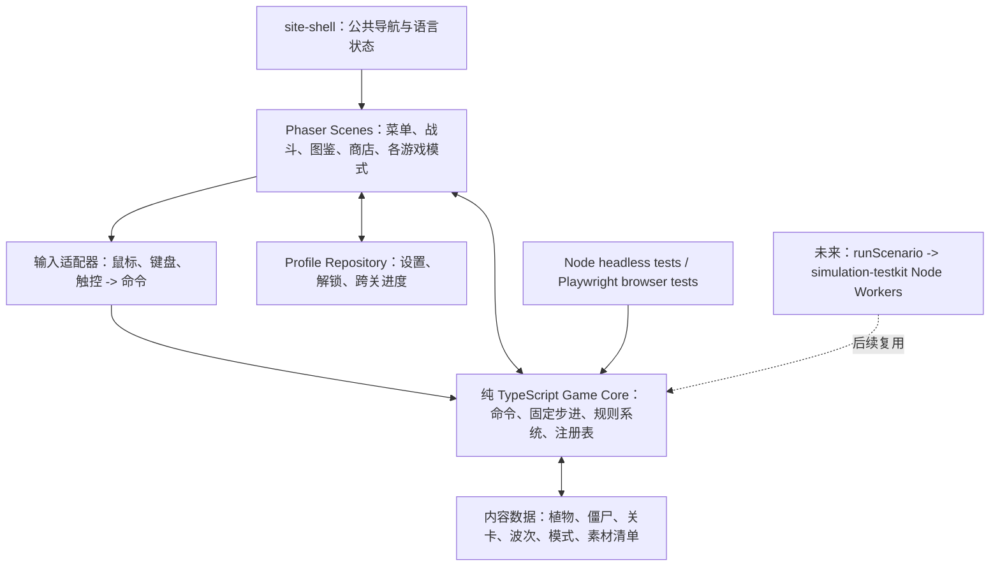

# 网页版《植物大战僵尸》GOTY 学习项目实施计划（审核稿）

**状态：** 用户已授权实施；当前在 `codex/plants-vs-zombies` 分支推进首个可玩纵切片，完整 GOTY 目标尚未达到，暂不发布。
**目标版本基线：** PC《Plants vs. Zombies: Game of the Year Edition》（GOTY）；页面支持桌面浏览器与手机横屏触控。
**产品定位：** 非商业学习用途的纯前端单机游戏；进度只存储在当前浏览器。

## 1. 背景

仓库是由多个独立前端应用组成的静态站点。新应用应放在 `apps/<slug>/`，独立使用 pnpm，登记在 `apps/catalog.json`，复用 `@wishflow/site-shell`，并通过现有静态站点工作流发布。仓库另有 `@wishflow/simulation-testkit`，其场景适配器在 Node Worker 中批量运行；后续植物、僵尸和规则平衡分析可以复用它。

用户希望尽可能覆盖 PC GOTY 的主要模式、场景、植物、僵尸与配套系统，并为后续数学模型和数值模拟保留接口。本计划因此先把玩法规则与表现层分离，先交付完整的可玩纵切片，再逐步扩展内容和模式。Steam 商店页将 GOTY 描述为 50 个冒险关卡、五种模式（冒险、迷你游戏、解谜、生存、禅境花园），关卡场景包含白天、黑夜、浓雾、泳池和屋顶。[Steam 产品页](https://store.steampowered.com/app/3590/Plants_vs_Zombies_GOTY_Edition/)

## 2. 目标与范围

### 2.1 本阶段目标

- 完成以 PC GOTY 为基线的浏览器单机游戏，包含可核对的内容目录和玩法实现。
- 支持桌面鼠标/键盘，以及手机横屏触控；窄屏或竖屏时提供清晰的旋转提示。
- 通过本地浏览器存储保留设置、解锁和关卡进度；不实现账号、云同步或中途战斗存档。
- 建立内部扩展接口，使植物、僵尸、投射物、关卡、模式和规则可注册、组合和测试。
- 使核心模拟可由固定种子和命令序列确定性驱动，未来可从 Node 调用同一套规则。
- 使用仓库现有静态站点流程上线，不新增后端、Worker、数据库或账号服务。

### 2.2 游戏内容范围

内容清单以**PC GOTY**为唯一对照版本，首个盘点任务形成逐项清单和验收状态。范围包括：

1. **冒险模式：** 50 关、关卡地图和解锁、选卡、关卡奖励、不同场景规则、波次、胜负和重玩。
2. **战斗系统：** 网格种植、阳光生成与收集、卡片冷却、植物行为、僵尸移动/啃食/装甲/状态、投射物、波次、草坪割草机和结束条件。
3. **场景规则：** 白天、黑夜、泳池、浓雾、屋顶及其专有地形、植物限制、阳光/视野规则。
4. **其他模式：** 迷你游戏、解谜（含花瓶破碎和 I, Zombie 等 PC GOTY 内容）、生存（含不同场景和无尽形式）、禅境花园。
5. **配套系统：** 主菜单、图鉴、商店、选卡/奖励/结果界面、帮助、设置、成就，以及 PC GOTY 基线中存在的其他附属功能。精确列表由内容盘点任务锁定。
6. **单位目录：** PC GOTY 植物、僵尸、投射物、道具、地形与关卡配置；数值统一由配置表管理，能力由可组合行为模块实现。

### 2.3 明确不做

- 后端、账号、跨设备存档、在线排行榜、多人对战。
- 本阶段的平衡性模拟产品、自动调参器、统计仪表盘或第三方 Mod 下载/执行机制。
- PWA 安装、离线资源缓存、原生应用封装。
- 保存战斗中的完整动态状态；刷新或关闭页面后，当前战斗从关卡开始。

### 2.4 存档范围假设

按用户已确认的范围，存档只包含设置、植物/模式解锁和关卡进度；不保存战斗快照、商店货币、花园物品或成就状态。若后续模式需要更多长期数据，再单独讨论 schema 扩展。

## 3. 调研结论与技术选择

| 参考 | 调研结论 | 本项目采用方式 |
|---|---|---|
| [PlantsVsZombies-CPP](https://github.com/stefanpeiculeasa/PlantsVsZombies-CPP) | 将无图形依赖的 `World::step` 模拟核心与 SFML 界面分离，提供固定 RNG 种子、平衡配置和无窗口测试；README 也明确代码许可证不涵盖部分原作素材。 | 采用无 Phaser/DOM 依赖的模拟核心、固定种子、集中数值配置和 headless 测试。 |
| [PvZ-Portable](https://github.com/Allen98637/PvZ-Mod) 及其 [Mod 项目](https://github.com/CypressVillage/PvZ-Portable-Mods) | 目标是较完整重实现 PC GOTY，并有内部 mod/API 扩展方式；README 明确不包含 PopCap 资源，运行需要用户提供购买版本中的 `main.pak` 和 `properties/`。 | 参考模式边界和扩展接口，不引入原生引擎、Lua 或外部运行时代码；不抽取其资源。 |
| [PvZ-Portable WebAssembly 版](https://github.com/CypressVillage/PvZ-Portable-Mods) | 浏览器版使用静态托管，用户在浏览器本地导入自己持有的游戏资源；仓库说明资源不会上传服务器，存档写入 IndexedDB。此路线能让公开站点不托管游戏资源，但其引擎与素材管线是 C++/WASM。 | 将“用户本地导入资源、站点不分发资源”列为可评估方案；若采用，需先验证 GOTY PAK/资源解析和手机端性能，不直接移植其引擎。 |
| [GOTY C++ 逆向重建](https://github.com/Patoke/re-plants-vs-zombies) | 以原版 GOTY 为行为参考重建引擎，要求玩家自备原版游戏文件；适合定位系统和行为复杂度，不是可直接嵌入网页的应用。 | 只作行为研究索引，不移植其代码和原版数据。 |
| [TypeScript/Phaser 网页克隆](https://github.com/Tino1234567/plants-vs-zombies-game) | 8 关、8 种植物和 3 种僵尸的 Phaser/TypeScript/Vite 原型；用 Phaser Graphics 与 Web Audio 生成素材，不含原作素材。 | 采用 Phaser + TypeScript + Vite；模拟核心继续独立于 Phaser。 |
| [Cocos TypeScript 重制](https://github.com/cheng1559/pvz-remake) | 展示完整网页/移动端玩法和资源导入流程，同时说明其源码许可证不自动覆盖原作资源。 | 只作为内容和资源加载范围的参考，不迁移 Cocos 工程。 |
| [Python/Pygame 单关克隆](https://github.com/infinitybl/plants-vs-zombies-clone) | 展示最小战斗循环的构成；项目范围和架构不足以支撑 GOTY 全模式。 | 只作基础功能清单参考。 |
| [Python GOTY 重建](https://github.com/520HXC/pvz1) | 公开说明其已重建 `1-1` 至 `5-10`，采用旗帜波、世界僵尸解锁顺序、波次预算和原创/程序化美术；README 也列出未完成的迷你游戏规则和单位行为。根目录当前未显示代码许可证。 | 作为内容/关卡/波次拆分的调研样本；对照其未完成项管理复刻预期，不复制代码或素材。 |
| [xiaoclux/PvZ](https://github.com/xiaoclux/PvZ) | 使用 Phaser 的较大规模社区项目，含战斗、模式、测试工具和素材转换脚本；README 将素材来源指向江南项目，并声明采用仅限非营利的 Changjiang River License。 | 参考行为拆分与 Playwright 验证方式；不将其素材子集拆出后放进本项目。 |
| [JiangNan JavaScript 粉丝游戏](https://github.com/jiangnangame/New-Plants-vs-Zombies-JavaScript) 与[许可文本](https://github.com/jiangnangame/New-Plants-vs-Zombies-JavaScript/blob/master/LICENSE-ENGLISH.md) | 许可允许非营利使用、修改和二次发布，但要求保留许可、团队名单和免责声明、宣传材料署名，并明确不授予品牌知识产权；条款还限制把作品片段单独拆到其他项目。 | 不抽取单独图片/音效并放入本站公开包。可继续作为玩法研究对象；公开包暂用自制程序化图形。 |
| [PvZ 原始素材提取仓库](https://github.com/FregD156/PvZ_Assets) | 仓库描述的是从原版包提取的素材；未发现覆盖素材再分发的许可。 | 不将其中图片、音频或动画文件提交到本仓库或公开站点。 |
| [Plants-vs-Zombies-MODDED](https://github.com/Plants-vs-Zombies-MODDED/game) | 网页项目确实包含大量游戏内容，但 README 指明代码采用 Changjiang River License、项目内容采用 PolyForm Noncommercial License，并声明作者不拥有官方素材；要求托管者保留署名/许可通知。 | 可参考其网页模式拆分；其声明不能替 PopCap/EA 授予官方素材权利，不把它当作本项目的素材授权来源。 |
| [Nopiskl C++ remake](https://github.com/Nopiskl/PVZ_CPP_Remake) 与 [JavaScript 简化克隆](https://github.com/xLizDEV/simple-plants-vs-zombies) | 搜索到的仓库包含从原版提取的图像、音频或字体，但分别只描述“教育用途”或声明学习用途，没有提供明确覆盖这些素材公开再分发的许可。 | 不以仓库公开可下载作为可公开再分发的依据；只参考其模块/渲染实现。 |

**素材调研结论：** GitHub 确实能找到原版拆包资源，以及包含原版资源的社区项目；但“代码有开源许可证”不代表 PopCap/EA 的图片、音频、动画和字体也可再分发。`FregD156/PvZ_Assets` 描述其资源从原版 `main.pak` 提取，页面没有给出资源再分发许可；`PlantsVsZombies-CPP` 明确其 MIT 代码许可不覆盖部分原作素材。江南项目许可允许非营利二次发布并要求保留许可、团队名单、免责声明和署名，但同时禁止把作品片段单独拆给其他项目，且不授予品牌知识产权。用户已明确非商业学习用途，但应用仍计划公开部署，因此不能把“社区仓库可下载”当成素材公开授权。

本轮还找到一条能保留原版画面的备选实现路径：PvZ-Portable 的静态网页/WASM 版让用户从本地导入自己持有的 GOTY 资源，页面把资源留在浏览器，不由站点分发。可将其作为后续素材接入验证项：先评估 PAK、properties、动画格式的解析成本，再决定是否为当前 Phaser 实现做本地资源导入器。当前构建继续使用程序化图形，尚未接入该导入器或社区资源。

### 2.5 当前实现状态与差距

| 范围 | 当前已有 | 达到 GOTY 目标前仍需完成 |
|---|---|---|
| 应用骨架 | 独立 Vite/TypeScript/Phaser 应用、公共站点外壳、双语文案、桌面及手机横屏布局。 | 真机 iOS Safari/Android Chrome 检查；优化 Phaser 主包体积。 |
| 模拟核心 | 固定 tick、种子随机数、注册表、事件钩子、规则替换接口、指标、无浏览器依赖的单测。 | 补足全部特殊植物/僵尸/场景规则；稳定核心 API 并适配仓库模拟 testkit。 |
| 内容目录 | 49 个植物 ID、26 个僵尸 ID、50 个冒险关卡 ID；图鉴从注册表生成。 | 多个单位能力仍简化或缺失；除 1-1 外，关卡波次为程序生成，不是 GOTY 逐关数据。 |
| 场景和战斗 | 白天、黑夜、泳池、浓雾、屋顶基础地形；阳光、种植、冷却、投射物、僵尸、割草机、墓碑和部分特殊能力。 | 地形视觉/规则细节、屋顶弹道、雾、泳池单位、Boss、载具、投石、梯子等规则需要逐项验收。 |
| 模式 | 20 个迷你游戏和 20 个解谜条目已进入目录；生存有 5 旗普通、10 旗困难和泳池无尽配置；Vasebreaker、I, Zombie、Wall-nut Bowling、Whack a Zombie、Zen Garden 有独立运行时。 | 多数迷你游戏仍复用通用战斗波次，未实现其独有规则；Vasebreaker/I, Zombie 关卡布局和解谜条件仍近似生成；生存跨旗选卡/状态保留、花园长期经营、商店/金币等仍不完整。 |
| 进度和外围系统 | 设置、模式/植物解锁和关卡进度的版本化 localStorage；最多 6 植物的选卡器；植物/僵尸基础数值图鉴。 | 关卡奖励流程、商店、游戏内帮助、音效/音乐、成就和 GOTY 对照清单中的其他支持系统。 |
| 美术/音频 | 程序化图形和 CSS 场景；无原作二进制资源。 | 公开可分发素材未解决；资源清单、图集动画和音频懒加载尚未完成。 |

当前检查结果：应用 `test:ci` 通过（严格 TypeScript 检查、35 项单测、生产构建、Playwright 7 条）；仓库 `test:catalog` 14 项通过；共享站点 `build:site` 也通过。Phaser 动态 chunk 约 1.38 MB（gzip 约 358 KB），Vite 发出 chunk 体积提示。以上只证明当前部分功能可运行，不等同于 GOTY 完成验收；完整范围和线上验收通过前不合并到 `master`，不触发公开发布。

### 框架决策

建议使用 **Phaser 4 + TypeScript + Vite**。Phaser 面向 2D 浏览器游戏，支持 JavaScript/TypeScript 和桌面/移动浏览器；官方版本页在本轮调研时列出 v4.2.1。多场景、触控输入、动画和资源加载由 Phaser 承担，可降低全 GOTY 内容需要自建的基础设施。[Phaser 官方文档](https://docs.phaser.io/)、[Phaser 4 发布页](https://phaser.io/download/phaser4)

不建议使用 React + PixiJS 组合来实现整套游戏：该组合适合 React 管理的模拟界面，但本项目会产生多个游戏场景、动画、输入与资源生命周期，两个 UI/渲染体系会增加集成面。也不引入物理引擎；本作核心是离散网格、行列目标、定时和命中规则，物理库不会带来相称收益。

实施前用一个短验证切片检查 Phaser 4 与 Vite、仓库嵌套路由、iOS Safari/Android Chrome 横屏触控及低端设备渲染。如果出现阻断，再基于验证结果决定留在 Phaser 4、回退 Phaser 3 或选用 PixiJS；不在验证前增加第二个引擎。

## 4. 架构



### 4.1 Game Core 与固定步进

`src/core/` 不导入 Phaser、DOM、音频 API、`window` 或浏览器存储。核心公开接口建议为：

```ts
createGame(config, seed)
dispatchCommand(command)
step(ticks)
getSnapshot()
getMetrics()
```

- 核心采用固定步进；建议以 60 次/秒作为初始 tick 基准，所有冷却、持续时间和波次延迟以 tick 或整数毫秒配置。Phase 1 通过测试确认该频率满足移动端性能与玩法精度。
- 渲染帧由 Phaser 驱动，但不得用渲染帧数决定植物攻击、僵尸移动、波次或状态持续时间。
- 使用可注入、有序状态的 seeded PRNG；核心逻辑禁止直接使用 `Math.random()` 和墙上时钟。
- 定义每 tick 的固定系统执行顺序及稳定实体 ID，使同一初始配置、种子和命令序列得到相同结果。
- 页面进入后台时暂停交互战斗，恢复后不追补隐藏期间时间；数值模拟调用 `step(n)` 时则可不渲染地快速推进。

### 4.2 内容扩展接口

首期实现静态 TypeScript 插件模块和注册表：

- `registerPlant`、`registerZombie`、`registerProjectile`、`registerEffect`、`registerTerrain`、`registerLevel`、`registerMode`。
- `GamePlugin` 携带 `id` 与 `apiVersion`，通过 `register(registry)` 注册定义与处理器；重复 ID、缺少依赖和非法数值在启动前校验。
- 通用属性放在声明式定义中，例如费用、生命值、伤害、冷却、速度、目标规则、状态标签；独特能力由可组合的内置 behavior/effect 模块实现。
- 内部事件钩子覆盖种植、生成阳光、植物攻击、投射物命中、僵尸死亡、波次开始/结束和胜负结算。钩子只修改核心状态或发出领域事件，不直接播放声音或访问画面。
- 外部 JavaScript 插件、Lua、运行时代码求值、在线插件市场均不在首期范围；以后可在稳定 API 后另行设计隔离和兼容策略。

### 4.3 场景、数据和表现层

- `src/scenes/` 管理 Boot/Preload、菜单、地图、选卡、战斗、奖励、图鉴、商店、花园和模式场景。
- `src/core/systems/` 管理网格、经济、冷却、目标选择、移动、攻击、碰撞、状态效果、波次、胜负。
- `src/content/` 存放按类型/场景拆分的 JSON/TypeScript 定义；构建前检查唯一 ID、数值范围、引用关系和资源引用。关卡/波次尽量作为数据，不写入场景代码。
- `src/rendering/` 只负责读取核心快照和事件，将它们映射成 Phaser 精灵、动画、粒子、音效和 HUD；不可在动画回调中暗改战斗规则。
- 按场景懒加载纹理图集和音频，离开场景时释放不再使用的资源；首关先加载，迷你游戏等独立资源后续加载。
- 桌面/手机共用指针命令抽象；触控区域、拖卡落点和太阳收集区域根据当前逻辑画布缩放映射。

### 4.4 本地数据

设置、解锁和关卡进度体量小，建议先用带 schema 版本的 `localStorage` 适配器，不引入 IndexedDB 依赖。网站语言仍完全由 `@wishflow/site-shell` 保存和切换；游戏只保存游戏数据，不建自己的语言开关或语言存储键。MDN 说明 Web Storage 是同步且额度小，IndexedDB 更适合大量结构化/离线数据；本项目当前存档类型不需要这些能力。[MDN：Web Storage](https://developer.mozilla.org/en-US/docs/Web/API/Web_Storage_API)、[MDN：IndexedDB](https://developer.mozilla.org/en-US/docs/Web/API/IndexedDB_API/Basic_Terminology)

`ProfileRepository` 负责安全解析、默认值、迁移和重置。损坏数据不得阻止游戏启动；显示可恢复提示，并保留重置入口。无服务端，因此数据仅属于当前浏览器来源，不提供跨设备同步或云端备份。

### 4.5 素材输入和发布

实施方向按用户选择优先采用原版视觉素材。每项资源需通过 `assets/manifest.json` 记录素材 ID、来源、原文件名、许可/署名说明、校验值、图集帧和动画名；关卡和单位通过稳定 ID 引用资源，避免代码直接散布文件路径。

素材文件可在本地导入/转换流程中处理；公开静态部署需要将实际使用的资源交付浏览器。调研到的开源复刻素材并非都可以公开二次分发：例如江南游戏仓库采用的许可证仅授权非营利使用并明确不授予品牌知识产权；部分 C++ 克隆的代码 MIT 许可也明确不覆盖原作素材。[江南游戏许可证](https://github.com/jiangnangame/New-Plants-vs-Zombies-JavaScript/blob/master/LICENSE-ENGLISH.md)、[C++ 克隆素材说明](https://github.com/stefanpeiculeasa/PlantsVsZombies-CPP)

这不改变学习版的技术目标，但构成**线上发布门禁**：发布流水线必须能取得目标素材文件，并保留该资源来源所要求的许可信息；若某个来源只允许本地/非公开使用，发布构建需替换对应资源，或由用户提供明确允许该用途的资源包。静态站点若包含原版素材，其 URL 可被访问者下载，不能把“没有收费”当成“资源没有被公开分发”。

## 5. 依赖与仓库接入

| 类别 | 依赖/约束 | 用途 |
|---|---|---|
| 游戏运行时 | Phaser 4（实施时锁定官方最新稳定 4.x；调研时为 4.2.1） | 2D 场景、资源、动画、输入和缩放。 |
| 构建与类型 | TypeScript、Vite；版本沿用仓库现有应用惯例 | ESM 开发、类型检查和静态 `dist/` 构建。 |
| 公共站点 | `@wishflow/site-shell` (`file:../../packages/site-shell`) | 公共页眉/侧栏/页脚、中英文状态和切换。 |
| 单元测试 | Node 内置 `node:test` + `tsx` | 无浏览器的纯核心确定性测试，不新增 Vitest。 |
| 浏览器测试 | `@playwright/test` | Chromium 中的场景流程和桌面/触控视口回归。 |
| 未来模拟 | `@wishflow/simulation-testkit`，仅后续 Node 侧接入 | 批量场景、随机种子、结果汇总；不是游戏运行时依赖。 |
| 运行环境 | 使用根仓库 pnpm 配置和现有 Node 24 CI | 子应用不重复声明工具版本。 |

仓库接入点：

- 新建 `apps/plants-vs-zombies/`（暂定 slug）及独立 `package.json`、`pnpm-lock.yaml`、`scripts/install.sh`。
- 提供 `dev`、`typecheck`、`build`、`test:unit`、`test:e2e`、`test:ci`；构建产物写入本应用 `dist/`。
- 在 `apps/catalog.json` 注册应用，并在 `index.html` 接入 `@wishflow/site-shell`、`data-app`、相对 `base` 和双语信息。
- `locales.ts` 使用 `registerMessages` 接入中文/英文 UI；游戏文案按领域 key 管理，不在 Phaser scene 中散落硬编码文本。
- 站点构建脚本将它发布到 `/<slug>/`；继续由现有 `.github/workflows/pages.yml` 测试并部署 GitHub Pages 和 Cloudflare Pages。无需新建 Worker。

## 6. 实施工作包

工作包按依赖顺序实施；通过阶段检查后再拆为 GitHub Issues。每个应用代码改动从 `master` 的独立 `codex/` 分支开发，验证通过后按仓库规则合并并推送 `master`。

### 阶段 0：内容、行为和资源盘点（M）

**内容：** 固定 PC GOTY 作为对照版本；建立模式/关卡/场景/植物/僵尸/效果/支持系统清单；对候选原版素材记录来源、格式、体积和许可；列出数值字段、缺失内容及引用关系。

**验收：** 50 关和全部模式有可追踪清单；每个内容项有实现/素材状态；确定首批战斗数据字段和素材转换需求；明确哪些原版素材可进入本地构建、哪些可以进入公开构建。

**检查点：** 审核范围表与资源表；此阶段不复制未登记素材、不开始大批量关卡实现。

### 阶段 1：应用骨架与 Phaser 4 兼容验证（M）

**内容：** 创建独立 Vite/TypeScript 应用、站点外壳、双语消息入口、相对路径构建、Phaser Boot/Preload/Menu scene；完成一个横屏画布和键盘/触控输入探针。

**验收：** 从仓库根运行应用安装脚本和 build 成功；构建可挂载到 `/<slug>/`；桌面鼠标和手机横屏指针映射正常；portrait 下给旋转提示；加载/资源失败能显示明确状态。

**验证：** typecheck、静态 build、Playwright 启动页和触控视口冒烟；在真实 iOS Safari、Android Chrome 至少各一次手测。

### 阶段 2：纯模拟核心合同与基础单测（L，分 2 个 Issue）

1. 定义 `GameConfig`、命令、状态快照、领域事件、固定 tick、seeded RNG、稳定 ID 和核心系统执行顺序。
2. 定义注册表、内容校验器、插件元数据和内部钩子；为未来 `runScenario` 留出 Node 可导入入口。

**验收：** 同一 seed/config/command 序列输出相同最终快照；无 Phaser 或 DOM 环境可创建并步进游戏；重复 ID/无效引用/无效配置能在构建或测试阶段失败；系统可在独立测试中组合。

**验证：** `node --import tsx --test` 覆盖 RNG、步进、命令次序、钩子顺序、注册冲突和确定性重放。

### 阶段 3：战斗纵切片（L，分 3 个 Issue）

先完整实现一个白天冒险关卡：种子选择、卡片费用与冷却、种植和铲除、阳光生成/拾取、豌豆射手、普通僵尸、投射物命中、波次进度、割草机、胜利/失败和重玩。Phaser 渲染仅订阅核心快照和事件。

**验收：** 玩家能从菜单进入关卡并完成完整胜负循环；非法种植不扣阳光、不占格；暂停/切换场景不重复生成实体；同 seed 和相同操作可复现核心结果。

**验证：** 核心规则单测、固定场景回归、Playwright 鼠标与触控各走通一次“选卡—种植—收集—结束—解锁”。

### 阶段 4：通用战斗系统与场景类型（L，按能力拆分）

逐步实现高频能力模块：多目标/多行攻击、范围伤害、即时消耗植物、减速/冻结/中毒等状态、治疗/增益、装甲层、跳跃/飞行/潜水/潜行、特殊地形和 boss 行为。完成白天、黑夜、泳池、浓雾、屋顶的规则差异。

**验收：** 植物/僵尸新类型优先通过数据配置和已有 behavior 组合；新增能力有单独测试；场景差异由 terrain/rule 插件控制，不在通用战斗系统里堆场景 ID 分支。

**验证：** 行为模块表驱动测试、目标/碰撞/状态时长边界测试、各场景最小战斗回归。

### 阶段 5：冒险主线与内容目录（按场景批次拆成多个 M/L Issue）

依次录入并实现完整 50 关的波次、可用植物、解锁奖励和场景数据；把 PC GOTY 植物/僵尸/投射物及描述接入注册表。每一批关卡均可独立玩通、测试和发布。

**验收：** 50 关均可进入；关卡引用的内容已注册；奖励顺序和解锁关系一致；全部冒险关卡配置通过静态 schema 检查；内容统计页/开发命令可查看关卡和单位数量。

**验证：** 内容完整性测试、每个场景至少一个完整 Playwright 冒烟关卡、关键关卡的固定 seed 回归。

### 阶段 6：玩家进度、设置和支持系统（L，拆分）

实现本地设置、冒险/模式解锁、已完成关卡和玩家元进度；接入选卡、图鉴、商店、奖励与成就。持久化仅写 profile，不写战斗快照。禅境花园的长期数据采用独立 profile 域，时间推进规则与战斗 tick 分开。

**验收：** 刷新后设置、解锁和关卡进度保留；schema 升级可迁移旧档；损坏/缺失存档可恢复到默认值；清档有明确确认；战斗中的状态不会被误当作已保存进度。

**验证：** 存储迁移/损坏/清档测试，Playwright 验证通关刷新后解锁保留。

### 阶段 7：其他模式（每种模式独立 Issue 和验收）

按依赖次序实现：生存模式、迷你游戏、解谜模式（Vasebreaker、I Zombie）、禅境花园；完成 PC GOTY 清单中的其他模式/附属功能。复用战斗核心的模式实现 `GameMode` 契约；机制差异大时使用独立的纯规则模块，不将特殊模式塞进一个巨大通用战斗 scene。

**验收：** 每种模式可从入口进入、运行、结算和返回；对应的单位/地图/奖励与 profile 规则有测试；模式之间的状态互不污染。

**验证：** 每种模式一条完整 Playwright 路径；模式规则使用固定种子单测。

### 阶段 8：移动体验、性能和资源整理（M）

以桌面/手机横屏双目标持续验证，不把手机适配留到收尾才首次测试。整理精灵图集和音频，按模式加载/卸载素材，优化 HUD 命中区、拖拽反馈、页面缩放与音频解锁。

**验收：** 常用桌面浏览器和 iOS Safari/Android Chrome 手机横屏可操作；调整尺寸和旋转后布局及命中映射正确；在进入花园/迷你游戏时不一次性加载所有资源；确定首次加载和单模式资源预算。

**验证：** Playwright 桌面/触控 viewport 回归；真实设备检查启动加载、帧率、内存、旋转、音频和页面后台/恢复。

### 阶段 9：发布准备与线上验收（M）

检查应用目录契约、应用目录登记、公共语言接入、资源清单和发布文件；执行 app `test:ci`、仓库 `test:catalog`、共享站点 build。通过审查后提交、合并并推送 `master`，等待现有 CI/CD 成功，再访问 GitHub Pages 和 Cloudflare Pages 的实际 URL 验收。

**验收：** CI 绿灯；线上首页、关卡、进度存储、桌面输入、手机横屏触控和素材加载通过实测；文档仅在确认域名或操作步骤需要时更新根 README；记录线上版本与素材清单。

## 7. 测试框架和质量策略

| 层级 | 工具 | 主要覆盖 |
|---|---|---|
| 配置/素材检查 | Node 脚本 + JSON Schema/TypeScript 校验 | 唯一 ID、关卡引用、合法数值、素材存在性、许可元数据、缺失动画。 |
| 模拟核心单测 | `node:test` + `tsx` | 网格、费用、冷却、命中、装甲、状态、波次、胜负、seeded RNG、注册接口。 |
| 场景/模式回归 | Node headless 场景测试 | 关键输入序列产生预期事件和结束原因；相同 seed 可重放。 |
| 浏览器端到端 | Playwright | 菜单至关卡、关卡胜负、解锁、设置保存、模式切换、横屏触控。 |
| 发布验证 | 现有 `pages.yml` CI + 线上实测 | app `test:ci`、共享站点构建、静态部署和公开路径。 |
| 未来数值实验 | `@wishflow/simulation-testkit`（后续） | 通过 `runScenario(config, seed)` 批量驱动相同 Game Core；导出指标与结果。 |

首期的确定性验收至少包含：同种子和同操作得到相同结果；阳光不出现负值；非法操作无副作用；实体死亡只结算一次；一个投射物按规则命中目标；冷却、波次与胜负依赖模拟 tick 而不是画面 FPS。未来接入批量模拟前，再单独定义胜率、耗时、资源效率和难度评分等数学指标。

## 8. 验收节点与发布拆分

| 节点 | 可交付结果 | 是否可部署 |
|---|---|---|
| A. 技术验证 | Phaser 4 路由/触控探针、资源载入基线、内容清单和素材表。 | 可部署探针但不对外开放入口。 |
| B. 首个纵切片 | 一关日间草坪完整战斗循环，含键鼠/触控、固定种子核心和本地通关解锁。 | 可作为早期预览发布。 |
| C. 冒险核心 | 五类场景系统和 50 关主线，植物/僵尸目录覆盖 PC GOTY 基线。 | 可作为主线完整版本发布。 |
| D. GOTY 模式 | 迷你游戏、解谜、生存、禅境花园及商店/图鉴/成就等支持系统。 | 每个模式独立达到可玩后分批开放。 |
| E. 正式站点验收 | 双平台浏览器检查、资源性能、CI 和线上存档路径验证。 | 完成线上发布。 |

每个节点都有可独立构建和回滚的产物；未完成的模式在菜单中隐藏或标为未解锁，不通过半成品内容破坏已发布流程。

## 9. 主要风险与处理

| 风险 | 影响 | 处理 |
|---|---|---|
| GOTY 全部模式和单位范围大 | 单个大任务不可审阅、无法快速验证，且边界容易扩散。 | 先盘点内容；按纵切片和模式拆 Issue；阶段检查通过后才进入下一批。 |
| 复刻素材来源与公开分发许可不一致 | 本地可运行但 CI/公开站点无法安全构建，或需要发布时替换素材。 | 资源 manifest 记录逐项来源/许可；把资源交付检查放入发布门禁。学习目标不受影响。 |
| Phaser 4 是主要版本更新 | iOS/Android WebGL、输入、打包路径可能暴露兼容问题。 | 阶段 1 实测 Vite、嵌套路由和真机横屏；失败时先做框架回退评估。 |
| 画面帧率影响战斗结果 | 不同刷新率/后台切换造成冷却和移动误差，未来模拟无法复现。 | 固定 tick、seeded RNG、状态快照测试；渲染只消费状态。 |
| 全部规则堆入通用类 | 新单位相互耦合，后续加植物或模拟规则成本上升。 | 声明式定义 + 小型可组合 behavior + 有版本的内部注册 API；拒绝无边界的通用 ECS/脚本沙箱。 |
| 本地存档丢失或破损 | 用户失去解锁和进度；浏览器存储不是云备份。 | schema 版本和迁移、容错恢复、清档入口；暂不承诺跨设备备份。 |
| 移动端一次加载所有动画素材 | 首次加载慢、内存压力大。 | 按模式/场景懒加载，使用图集和压缩资源，退出场景释放不再使用的素材。 |

## 10. 已确认约束与当前发布门槛

- **版本范围：** PC GOTY，尽可能覆盖全部模式、场景、植物、僵尸和配套系统，不混入其他平台独占内容。
- **终端范围：** 桌面浏览器，以及手机横屏触控。
- **存档范围：** 只保存设置、解锁和关卡进度；不保存战斗中途状态、商店货币、花园物品或成就。
- **扩展边界：** 内部数据注册表、事件钩子和可替换规则；首期不加载外部插件代码。
- **部署方式：** 公开静态站点，复用现有共享站点和 CI/CD，不新增后端。
- **素材现状：** 已按要求检索 GitHub 与 npmjs 相关项目。找到原版拆包资源与多种克隆，但未找到能明确授权本站公开分发 PopCap/EA 原版素材的包。当前公开构建使用程序化图形；另将“用户在浏览器本地导入自己持有的 GOTY 文件、静态站点不托管素材”列为待评估方案，参考 PvZ-Portable WebAssembly 版。代码保留资源 manifest 接口。

本计划记录目标、架构、阶段、验收和已发现的发布约束。仓库实现已有部分纵切片和模式原型，但在内容清单与所有阶段验收完成前，不合并到 `master`，不触发线上发布。

## 参考来源

- [Steam：Plants vs. Zombies GOTY Edition](https://store.steampowered.com/app/3590/Plants_vs_Zombies_GOTY_Edition/)
- [Phaser 官方文档](https://docs.phaser.io/)；[Phaser 4 下载/版本](https://phaser.io/download/phaser4)
- [PlantsVsZombies-CPP：headless 核心、测试和数值配置](https://github.com/stefanpeiculeasa/PlantsVsZombies-CPP)
- [PvZ-Portable](https://github.com/Allen98637/PvZ-Mod)；[Portable Mods 文档](https://github.com/CypressVillage/PvZ-Portable-Mods/tree/main/docs)
- [PvZ TypeScript/Phaser 示例](https://github.com/Tino1234567/plants-vs-zombies-game)
- [520HXC Python GOTY 风格重建](https://github.com/520HXC/pvz1)
- [PvZ-Portable：资源由用户本地导入的 WebAssembly 版](https://github.com/CypressVillage/PvZ-Portable-Mods)
- [Plants-vs-Zombies-MODDED：网页模式与许可说明](https://github.com/Plants-vs-Zombies-MODDED/game)
- [Nopiskl C++ remake：包含提取素材的简化实现](https://github.com/Nopiskl/PVZ_CPP_Remake)
- [xLizDEV JavaScript 简化克隆](https://github.com/xLizDEV/simple-plants-vs-zombies)
- [xiaoclux/PvZ Phaser 项目](https://github.com/xiaoclux/PvZ)
- [GOTY C++ 逆向重建](https://github.com/Patoke/re-plants-vs-zombies)
- [FregD156 原版资源提取仓库](https://github.com/FregD156/PvZ_Assets)
- [江南游戏网页项目许可证](https://github.com/jiangnangame/New-Plants-vs-Zombies-JavaScript/blob/master/LICENSE-ENGLISH.md)
- [MDN：Web Storage](https://developer.mozilla.org/en-US/docs/Web/API/Web_Storage_API)；[MDN：IndexedDB 基本特征](https://developer.mozilla.org/en-US/docs/Web/API/IndexedDB_API/Basic_Terminology)
- 仓库约定：[AGENTS.md](../AGENTS.md)、[site-shell README](../packages/site-shell/README.md)、[simulation-testkit README](../packages/simulation-testkit/README.md)、[pages.yml](../.github/workflows/pages.yml)
